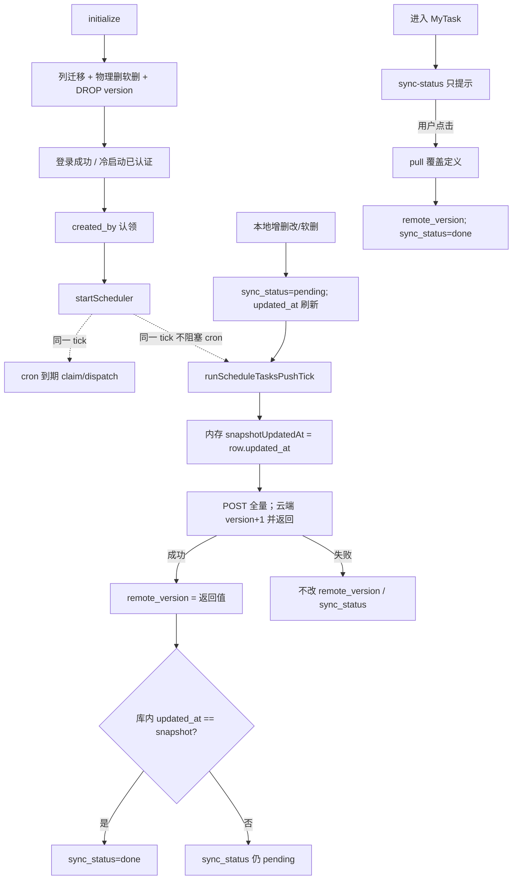

# 定时任务云端同步与历史归属

> 状态：**已编码**  
> 日期：2026-08-18  
> 关联：本地表 `docs/sqlite/schedule-tasks.md`、`electron/scheduled-tasks/`、`electron/db/`、云端 `memory-center/`（新建 `schedule_tasks_cloud`，不复用知多星 `scheduled_tasks`）、运营页 `memory-center-web/`

本文是同步策略真源。客户端经 Host API 代理，renderer 不直打 memory-center。

---

## 实施清单

完成一步勾选一步。

### A. 本地库 / 启动与登录

- [x] A1. `schedule_tasks`：**删除** `version` 列；增加 `sync_status`（`pending` / `done`）、`remote_version`（INTEGER NULL）。云端表仍用 `version`。不新建中间表
- [x] A2. 本地 CRUD / 软删：改业务字段 + `sync_status=pending`；**禁止**改 `remote_version`；`updated_at` 随定义变更正常刷新
- [x] A3. 调度 tick（`updateScheduleState`）不改 `sync_status` / `remote_version` / `updated_at` / 定义字段
- [x] A4. push 成功回写：`snapshotUpdatedAt` CAS（§4.2）；in-flight 期间再编辑则保持 `pending`；回写不改 `updated_at`
- [x] A5. 启动迁移：列→segments；**物理删除**全部软删行；**DROP** 本地 `version`（§3.5）
- [x] A6. **已认证后同一入口**（SSO 登录成功 **或** 进程启动时本来就是登录态）：只补 `created_by IS NULL` 为该用户（marker 仅审计，**每次仍跑认领**；切号不抢已有工号）；认领行置 `sync_status=pending`；**不**在此入口里 push
- [x] A7. **复用** `startScheduler`：A6 同一入口里 start（登录成功 / 冷启动已登录）；`initialize()` **不** startScheduler；登出 `stopScheduler`。云端 push 挂在同一 tick 上，start **不**立刻出队。本地 list / 调度 / CRUD **按当前登录人隔离**（切号后不展示、不执行他人任务）。

### B. 云端 memory-center

- [x] B1. alembic 建 `schedule_tasks_cloud`（DDL 见 §八）
- [x] B2. `GET list`（含墓碑）、`POST` 单条全量覆盖、`POST batch` 全量覆盖
- [x] B3. `version` 只在服务端累加；无乐观锁、无 409；`owner_user_id` 只认 token
- [x] B4. 调度四列写入恒 NULL
- [x] B5. 运营分页查询（按 `owner_user_id` / 工号，含墓碑；鉴权走管理端 stoToken，**不**复用客户端 token 隔离 list）

### C. 出队 push（轮询）

- [x] C1. **仅** `startScheduler` 的 tick 触发 push（不挡 UI，**绝不 pull**）；生命周期见 A7
- [x] C2. 云端**无当前用户任何数据**（list 含墓碑条数为 0）→ 本地该用户**全部行**上云（忽略 `sync_status`，含此后新软删）
- [x] C3. 云端**已有当前用户数据**（至少 1 条，含仅墓碑）→ 只推 `sync_status=pending`
- [x] C4. 成功：写 `remote_version`；CAS 通过则 `sync_status=done`；失败则 status 不动
- [x] C5. 云端缺失补齐（单条）：成功只更新 `remote_version`，**不改** `sync_status`

### D. MyTask 检测与手动 pull

- [x] D1. Host `GET /api/scheduled-tasks/cloud/sync-status`：`remote_version` vs 云端 `version`
- [x] D2. **仅进入 MyTask** 请求一次；有更新才显示「从云端同步」
- [x] D3. 用户点击后才 pull（含墓碑）覆盖本地定义，写 `remote_version`、`sync_status=done`，`refreshSchedule`

### E. 测试

- [x] E1. 本地保存不依赖网络；远程失败 `sync_status` 仍为 pending
- [x] E2. 云端无当前用户数据 → done 行也推；云端已有该用户数据 → 只推 pending
- [x] E3. 软删 pending 上云为墓碑；手动 pull 能落到另一台
- [x] E4. `remote_version` 只来自接口；本地编辑不改它
- [x] E5. 进 MyTask 才提示；不点按钮本地不被云端覆盖
- [x] E6. push in-flight 期间再编辑：回写后仍为 pending，下一轮推最新内容

### F. memory-center-web 运营查看

- [x] F1. 目录 `src/pages/synchronized-scheduled-tasks/`，侧栏「同步定时任务」，路由 `/synchronized-scheduled-tasks`
- [x] F2. 仅分页列表 + 按工号搜索；行点击打开**只读抽屉**；不做增删改 / 手动同步

---

## 一、目标与原则

1. **本地优先**：增删改立刻写本机 SQLite，任务可继续调度；上云异步。
2. **换机恢复**：新机进「我的任务」看到更新提示，**手动点按钮**才从云端拉。
3. **内容修订号只在云端**：列名 `version`。本地只有 `remote_version`（接口返回的云端 version），客户端绝不自增、本地表**不再有** `version` 列。
4. **云端无脑覆盖**：后提交覆盖先提交；多设备静默丢改，产品已接受。
5. **test/prod 可串**：该用户云端 **list 为空**（一条都没有，含墓碑）则全量灌库（见 §四）。
6. **同一 id 一行**：多次编辑不建队列；`sync_status=pending` 表示「有待同步」；push 时读业务表**当前最新整行**。
7. **in-flight 防丢改**：push 发出前把当前 `updated_at` 缓存在**内存变量** `snapshotUpdatedAt`，成功回写时与库内最新值比较（§4.2）；**不**为 CAS 单独改 `updated_at` 语义。

---

## 二、角色与时机

| 动作 | 时机 | 改本地业务数据 | 挡 UI |
|------|------|----------------|-------|
| 列迁移 + 清历史墓碑 + DROP version | 启动 `initialize()`（登录前） | 物理删软删行；去掉本地 `version` | 否 |
| 归属认领 | **已认证后**（§3.6 同一入口） | 只补 `created_by IS NULL` | 否 |
| CRUD / 软删 | 用户操作 | 是；`sync_status=pending`，`updated_at` 刷新 | 否 |
| 本机 cron + 云端出队 | **已认证后** 调 `startScheduler`（A7） | 否 | 否 |
| 出队 push | **仅**调度器 tick 内 fire-and-forget | 成功时写 `remote_version` / 可能写 `sync_status`（CAS）；**不改** `updated_at` | 否 |
| 版本检测 | **仅**进入 MyTask | 否，只提示 | 否 |
| pull | 用户点击按钮 | 是，以云端为准 | 是 |

不做：登录自动 pull、**登录后立刻 push**、tick 版本比对、focus 重检、轮询 pull、CRUD 先写云端、通用同步中间表。

**计时器：只保留一套。** 不另建云端 poller。复用 `ScheduledTaskScheduler`（`startScheduler` / `stopScheduler`，默认 30s tick）：

| 现况 | 要求 |
|------|------|
| `initialize()` 里登录前就 `startScheduler()` | **改掉**：未认证不 start |
| 无云端出队 | tick 里在 cron claim/dispatch **之后** fire-and-forget `runScheduleTasksPushTick`；**不 await**、不挡到期任务 |
| 登出不停调度器 | **改掉**：登出 `stopScheduler` |

未登录期间本机定时任务也不跑（与「认证后才 start」一致）。



---

## 三、本地表 `schedule_tasks`

在现有表上：**删除 `version`**；新增两列。业务列、调度四列、其余审计列不变。

| 列 | 类型 | 说明 |
|----|------|------|
| `sync_status` | TEXT NOT NULL DEFAULT `'pending'` | 仅 `pending` / `done` |
| `remote_version` | INTEGER NULL | **仅**在 push / pull **成功回写**时，用云端返回的 `version` 更新；本地编辑**永不**写入 |

`id` 仍为本地 UUID，与云端同值。

**命名**：云端 `schedule_tasks_cloud.version` = 服务端累加的内容修订号；本地只有 `remote_version` 镜像该值。禁止再在本地任务表上建名为 `version` 的列。

`schedule_task_runs.version` 仍是本地 run 行乐观字段，与云端任务 `version` 无关，本期不动。

### 3.0 两列分工（与 `updated_at` 的关系）

| 字段 | 本地 CRUD / 软删 | push 成功回写 | 用途 |
|------|------------------|---------------|------|
| `updated_at` | **正常**刷新（与现有一致） | **不改** | 审计 + push 期间变更检测（CAS） |
| `remote_version` | **不改** | **改为云端返回值** | 与云端 `version` 比对、sync-status |
| `sync_status` | 置 `pending` | CAS 通过才 `done` | 出队筛选 |

`updated_at` **不是**同步专用列：业务照常更新。push 时只是在内存里记一份 `snapshotUpdatedAt`，用来判断「请求发出后、响应回来前，是否又发生了一次定义变更」。

### 3.1 多次编辑 = 一行，不建队列

同一 `id` 永远一行。用户连续改多次：

- 每次：`sync_status=pending`，`updated_at=now()`，业务字段为最新
- **不会**产生多条待同步记录
- push 时读该行**当前**内容全量上传 → 天然 Last-Write-Wins

### 3.2 `remote_version` 强制规则

1. **只来自后端响应**（push 返回 / pull 读到的云端 `version`）。客户端不得自增。
2. **本地任意编辑**（含新建、改定义、setEnabled、软删）：**禁止** UPDATE `remote_version`。
3. **push 成功**：云端对该行 `version + 1` 并返回 → 本地 `remote_version = 返回值`。
4. **pull 成功**：`remote_version = 云端该行 version`。
5. **云端缺失补齐**（单条 POST 成功）：只更新 `remote_version`，**不改** `sync_status`。
6. **版本检测**（§5.1）：`remote_version`（NULL 视为 0）vs 云端 `version`。

### 3.3 `sync_status`

| 事件 | `sync_status` |
|------|----------------|
| 新建 / 编辑 / setEnabled / 软删 | `pending` |
| push 失败 | **不变** |
| push 成功且 **CAS 通过**（§4.2） | `done` |
| push 成功但 **CAS 未通过**（in-flight 期间又改） | **保持 `pending`** |
| 云端缺失补齐成功 | **不变** |
| 手动 pull | `done` |
| 空云端（当前用户 0 条）全量 push 成功且 CAS 通过 | `done` |

进程内对 `id` 加内存锁，防同一条并发 push 两次（与 CAS 互补）。

### 3.4 调度四列

`next_run_at` 等四列：本机 cron 缓存；上传恒 null；pull 不覆盖。  
`updateScheduleState` **只**改调度四列，**不**改 `sync_status` / `remote_version` / 定义字段 / **`updated_at`**（避免 tick 误判为 push 期间的「用户又改了」）。

### 3.5 启动迁移：列收敛 + 清墓碑 + DROP `version`

挂在 `initialize()`、现有 `runComposerColumnsToSegmentsMigration` 同一阶段（登录前）。**不**在此时认领 `created_by`、**不** `startScheduler`。

1. **保留**现有：`dingtalk_recipients_json` / `skill_code` / `workflow_code` → `extra.composerSegments`，三列清 null（marker 幂等）。
2. **物理删除**全部历史墓碑，避免空归属软删行进入后续认领 / 上云。
3. **去掉本地 `version` 列**（与云端 `version` 同名易混）；同步基准只走 `remote_version`。

```sql
DELETE FROM schedule_task_runs
WHERE task_id IN (SELECT id FROM schedule_tasks WHERE deleted_at IS NOT NULL);

DELETE FROM schedule_tasks WHERE deleted_at IS NOT NULL;

-- 与 ADD sync_status / remote_version 同一本地 migration
ALTER TABLE schedule_tasks DROP COLUMN version;
```

幂等：SQLite migrator 按 version 号只跑一次。  
此后用户删除仍走**软删**；本步只清**启动当时**库里已有的墓碑。CRUD / `updateScheduleState` **不再** `version + 1`。

### 3.6 已认证后：归属认领 + `startScheduler`（不立刻 push）

**同一入口、两种进法**（实现成一个函数，例如 `onScheduleTasksUserAuthenticated(userCode)`）：

| 进法 | 含义 |
|------|------|
| SSO **登录成功** | 用户刚完成登录 |
| **冷启动已登录** | 进程起来时 store 里已是认证态（上次没登出，直接进应用） |

两路都走下面顺序，后台执行、不挡 UI：

1. **认领**：只 `UPDATE` `created_by IS NULL` 的行 → 当前 `user.code`（同步 `updated_by` / `updated_at`，并置 `sync_status=pending`）。若认领前用户又软删了，这些行也补。
2. Marker：`~/.stoclaw/schedule-tasks-ownership-claim.done`（含 `claimedBy`、`count`、`completedAt`）。**仅审计**；有无 marker 都跑认领。切号不重认领靠 SQL（已有工号不动）；Marker 丢失再跑：仍只补 NULL。
3. **`startScheduler(userCode)`**：本机 cron + 同一 tick 上的云端出队；调度 / list / CRUD 只动当前用户任务。**禁止**在本入口直接调用 `runScheduleTasksPushTick`；首轮 push 等下一次 tick。
4. 登出：**`stopScheduler()`**（cron 与出队一起停，清空调度 owner）。

未认证不得认领、不得 `startScheduler`。

编码时：把 `electron/main/index.ts` 里 `initialize()` 的 `scheduledTaskService.startScheduler()` **挪到本入口**。

---

## 四、出队 push

入口：`runScheduleTasksPushTick(userCode)`，**只由 `ScheduledTaskScheduler` tick 调用**（与 cron 同一计时器）。**绝不 pull。认证入口不额外跑一轮。**

范围：`created_by === userCode`（含此后新软删）。

### 4.0 `startScheduler` 生命周期

| 事件 | 行为 |
|------|------|
| 进程启动 / `initialize()` | 迁移 + 清墓碑 + DROP 本地 `version`；**不** `startScheduler` |
| **已认证**（登录成功 **或** 冷启动本来就是登录态） | §3.6：认领 → **`startScheduler`**；**不**立即出队 |
| 调度 tick（默认 30s） | 先 cron（到期 claim/dispatch）；再 fire-and-forget 出队 |
| 登出 | **`stopScheduler`** |

未登录时不得 push、本机 cron 也不跑。

先 `GET` 云端 list（`includeDeleted=1`，只含 **token 当前用户**）：

| 云端（当前用户） | 行为 |
|------------------|------|
| **无数据**：返回 0 条（活跃、墓碑都没有） | **全量 push** 本地该用户全部行，**忽略** `sync_status` |
| **有数据**：≥1 条（哪怕全是墓碑） | 只 push `sync_status=pending` |
| 有数据且本地有、云端无此 id | **单条**补齐；成功只写 `remote_version`（§3.2 第 3 条） |

无条件全量覆盖，无 409。

### 4.1 push 流程（单条 / 批量内每一行）

```
1. 读出 row（含 updated_at、sync_status、remote_version、全业务字段）
2. snapshotUpdatedAt = row.updated_at   // 仅进程内局部变量，不写库
3. POST 全量 body（调度四列 null）
4. 云端：覆盖写入，已有则 version+1，返回 { id, version }
5. 若 HTTP/业务 success：
     UPDATE remote_version = 返回的 version
     再读当前行 updated_at（或 WHERE 子句内比较）：
       IF updated_at == snapshotUpdatedAt → sync_status = 'done'
       ELSE → sync_status 保持 'pending'（push 期间又有定义变更）
6. 若失败：remote_version、sync_status、updated_at 均不动
```

批量：每条独立 2–6。

**回写 push 结果时不得改 `updated_at`**——它只反映业务编辑时间，不由同步层刷新。

### 4.2 push 期间变更检测（`snapshotUpdatedAt` CAS，必做）

**问题**（成功回写若无条件 `done`）：

```
保存 A → pending，updated_at=T1，开始 push(A)，snapshotUpdatedAt=T1
又保存 B → pending，updated_at=T2（正常刷新）
push(A) 成功 → 若无条件 done → 本地已是 B 但不再出队
```

**解决**：`snapshotUpdatedAt` 只是 push 开始时缓存的**局部变量**，成功回写时：

```sql
-- push 成功后（remote_version 必写；sync_status 视 CAS）
UPDATE schedule_tasks
SET
  remote_version = :cloudVersion,   -- 云端已 version+1 后的返回值
  sync_status = CASE
    WHEN updated_at = :snapshotUpdatedAt THEN 'done'
    ELSE sync_status                 -- 仍为 pending，下轮推最新 B
  END
WHERE id = :id;
-- 不 SET updated_at
```

| 结果 | 含义 |
|------|------|
| CAS 通过 | 发出后无人再改定义 → `done`，云端与本地快照一致 |
| CAS 未通过 | 发出后又改了 → 保持 `pending`；云端暂为旧内容，下轮再推 |
| 两种情形 | **`remote_version` 都写返回值**（反映云端当前 revision） |

**与本地 `updated_at` 的关系**：定义 CRUD 仍**正常** bump `updated_at`；CAS 只比较「push 前快照 vs 回写瞬间库内值」。调度 tick 不改 `updated_at`（§3.4），以免非用户编辑触发误 pending。

---

## 五、MyTask：检测与手动 pull

### 5.1 检测

- **仅**进入 MyTask 挂载时请求一次。
- 未登录 / 失败：隐藏按钮。

```
GET /api/scheduled-tasks/cloud/sync-status
→ { hasCloudUpdates, cloudNewerCount, missingLocalCount, remoteDeletedCount, sampleIds? }
```

比对：云端 list（含墓碑）+ 本地当前用户行（含软删）。用 **`remote_version`**。

| 条件 | 计入 |
|------|------|
| 云端活跃，本地无 id | `missingLocalCount` |
| 双方都在，云端 version > remote_version | `cloudNewerCount` |
| 云端软删，本地活跃，云端 version ≥ remote_version | `remoteDeletedCount` |
| 云端活跃，本地软删，云端 version > remote_version | 复活 → `cloudNewerCount` |
| 本地 pending、云端更旧或没有 | **不算**（靠 push） |

### 5.2 手动 pull

1. `GET list?includeDeleted=1`
2. §七 合并（不覆盖调度四列）
3. `remote_version=云端 version`，`sync_status=done`
4. `refreshSchedule`；再调 sync-status

用户主动以云端为准；本地 pending 未推改动会被覆盖（接受）。

---

## 六、后端约定

鉴权：`owner_user_id` = token。主键 `(owner_user_id, id)`。

- `GET` 全量（`includeDeleted`）
- `POST` 单条：新建 version=1，已有 version+1，返回 `{ id, version }`
- `POST batch`：`[{ id, success, version? }]`
- 软删 = 带 `deleted_at` 的全量覆盖

---

## 七、pull 合并（同 id）

| 情况 | 动作 |
|------|------|
| 本地无 id，云端活跃 | 插入 → `refreshSchedule` |
| 本地无 id，云端墓碑 | **跳过** |
| 双方活跃 | 云端覆盖本地 |
| 云端软删、本地活跃 | 本地软删 |
| 本地软删、云端活跃 | **复活** |
| 两边都软删 | 云端墓碑元数据 |

覆盖后：`remote_version=云端 version`，`sync_status=done`。

---

## 八、账号隔离与 DDL

- 本地 push/pull / sync-status / **list / 调度 / CRUD** 只动 `created_by === 当前 userCode`（写入与比较均 **trim**；list 用 `trim(created_by)` 防御历史空白工号）。
- 历史空归属：§3.6 每次登录仍只补 NULL/空白；启动期已物理删历史软删行（§3.5）。
- 切号后他人任务：本机不可见、不执行、不可改；等原账号登录再调度 / 出队。
- `discardMissedOnStartup` 在有 owner 时只 cancel **本用户** queued；reaper 可跨 owner 收口已超时的 `running`。
- 未登录不得操作孤儿行；已登录操作孤儿时会认领 `created_by`。

**本地增量：**

```sql
ALTER TABLE schedule_tasks ADD COLUMN sync_status TEXT NOT NULL DEFAULT 'pending';
ALTER TABLE schedule_tasks ADD COLUMN remote_version INTEGER NULL;
ALTER TABLE schedule_tasks DROP COLUMN version;

CREATE INDEX IF NOT EXISTS idx_schedule_tasks_sync_pending
  ON schedule_tasks(created_by, sync_status)
  WHERE sync_status = 'pending';
```

**云端 `schedule_tasks_cloud`（MySQL 8+ / utf8mb4_general_ci）：**

```sql
CREATE TABLE IF NOT EXISTS schedule_tasks_cloud (
  owner_user_id               VARCHAR(64)   NOT NULL,
  id                          VARCHAR(64)   NOT NULL,
  name                        VARCHAR(256)  NOT NULL,
  enabled                     TINYINT       NOT NULL DEFAULT 1,
  cron_expr                   VARCHAR(512)  NOT NULL,
  engine_type                 VARCHAR(32)   NOT NULL,
  prompt                      MEDIUMTEXT    NOT NULL,
  agent_id                    VARCHAR(128)  NOT NULL,
  workflow_code               VARCHAR(128)  NULL,
  skill_code                  VARCHAR(128)  NULL,
  dingtalk_recipients_json    MEDIUMTEXT    NULL,
  model                       VARCHAR(128)  NULL,
  provider                    VARCHAR(128)  NULL,
  account_id                  VARCHAR(128)  NULL,
  workspace_path              VARCHAR(1024) NULL,
  my_artifact_folder_path     VARCHAR(1024) NULL,
  shared_artifact_folder_path VARCHAR(1024) NULL,
  permission_profile          VARCHAR(64)   NULL,
  timeout_sec                 INT           NULL,
  retry_policy_json           MEDIUMTEXT    NULL,
  failure_policy_json         MEDIUMTEXT    NULL,
  extra_json                  MEDIUMTEXT    NULL,
  next_run_at                 VARCHAR(40)   NULL,
  last_scheduled_for          VARCHAR(40)   NULL,
  last_recovered_at           VARCHAR(40)   NULL,
  cron_expr_snapshot          VARCHAR(512)  NULL,
  created_at                  VARCHAR(40)   NOT NULL,
  updated_at                  VARCHAR(40)   NOT NULL,
  deleted_at                  VARCHAR(40)   NULL,
  version                     INT           NOT NULL DEFAULT 1,
  created_by                  VARCHAR(64)   NULL,
  updated_by                  VARCHAR(64)   NULL,
  PRIMARY KEY (owner_user_id, id),
  KEY idx_schedule_tasks_cloud_owner (owner_user_id),
  KEY idx_schedule_tasks_cloud_owner_deleted (owner_user_id, deleted_at),
  CONSTRAINT chk_schedule_tasks_cloud_enabled CHECK (enabled IN (0, 1)),
  CONSTRAINT chk_schedule_tasks_cloud_version CHECK (version > 0)
) ENGINE=InnoDB DEFAULT CHARSET=utf8mb4 COLLATE=utf8mb4_general_ci;
```

---

## 九、API（Host / 云端）

| 接口 | 用途 |
|------|------|
| 云端 `GET .../list?includeDeleted=` | 出队、sync-status、pull |
| 云端 `POST` 单条 / batch | push |
| Host `GET .../cloud/sync-status` | 仅 MyTask 挂载 |
| Host `POST .../cloud/pull` | 仅按钮 |
| 管理端 `GET` 分页列表 | 运营页：按工号 / `owner_user_id` 筛选，含墓碑；**不**走客户端 token 用户隔离 |

---

## 十、运营查看（memory-center-web）

供运营只读查看云端 `schedule_tasks_cloud`，**不**做客户端同步。

| 项 | 约定 |
|----|------|
| 目录 | `memory-center-web/src/pages/synchronized-scheduled-tasks/` |
| 路由 | `/synchronized-scheduled-tasks` |
| 侧栏文案 | 「同步定时任务」（英文目录名 `synchronized scheduled tasks`） |
| 能力 | **仅**分页列表 + **按工号搜索** |
| 详情 | 点击行打开**只读抽屉**（任务定义 JSON / 关键字段即可） |
| 不做 | 新建、编辑、删除、手动同步、按任务 id 搜索 |

实现要点：

- 现有 claw `GET .../list` 按登录用户隔离，运营跨用户查看必须走 **B5 管理端分页接口**，鉴权用 stoToken，与客户端 token 隔离。
- 侧栏挂载方式对齐现有「提示词管理」等：`src/components/Layout.tsx`。
- 抽屉交互可参考 `src/pages/prompt-management/`。

---

## 十一、不做

- 通用同步中间表 `cloud_sync_state`
- 同一 id 多条待同步队列
- 后台 / 登录自动 pull
- **登录后立刻 push**（首轮也等 scheduler tick）
- 未认证就 `startScheduler` / 另起一套云端 poller
- 登录后做本地 `version` 基线重置（列已删除）
- 在本地 `schedule_tasks` 上保留或重建名为 `version` 的列
- 用 cron tick 做版本检测（sync-status）；出队不得阻塞 claim/dispatch
- 客户端自增 `remote_version`
- 乐观锁 / 409
- 同步 `schedule_task_runs`
- 三路合并 UI
- 按 test/prod 拆基准
- 运营页上的增删改 / 手动同步（只读列表 + 抽屉）

---

## 十二、push 回写与中途再编辑（`snapshotUpdatedAt`）

见 §4.2。

1. push **发出前**：`const snapshotUpdatedAt = row.updated_at`（**内存**，不入库）
2. 云端成功：该行 **version + 1**，响应带新 `version`
3. 回写：**只**更新 `remote_version`（= 返回值）和可能 `sync_status`；**不**改 `updated_at`
4. `sync_status='done'` 当且仅当回写时 `updated_at === snapshotUpdatedAt`
5. 否则保持 `pending`，下轮 push 读业务表最新行
6. 本地 CRUD 照常刷新 `updated_at`、置 `pending`、**不**碰 `remote_version`
