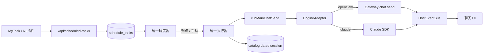

# 定时任务架构设计

> 一句话：**任务执行 = 普通聊天。**

## 理念

| 原则 | 做法 |
|---|---|
| 一处存 | SQLite `schedule_tasks` / `schedule_task_runs`（`engine_type` 区分引擎） |
| 一处调 | `ScheduledTaskScheduler`（30s tick · 单飞 · 开机不补跑） |
| 一处跑 | 执行器 → `runMainChatSend` → `EngineAdapter` |
| 一天一行 | 执行时 upsert 当天 dated session；侧栏读 catalog，不读任务表 |
| 历史同路 | 只走 `chat.history`，无 jsonl 回放 |
| Gateway | 只当 openclaw 的 `chat.send` 执行器，不再跑 cron |

创建入口仅两类：MyTask UI、自然语言插件（均 → `/api/scheduled-tasks`）。

## 架构图

## 不做

- 不收敛 `session_type`（保留 `cron` / `claude_task`）
- 不清 `definitions.json`、不统一 sessionKey 前缀
- 不删 live `create_scheduled_task`
