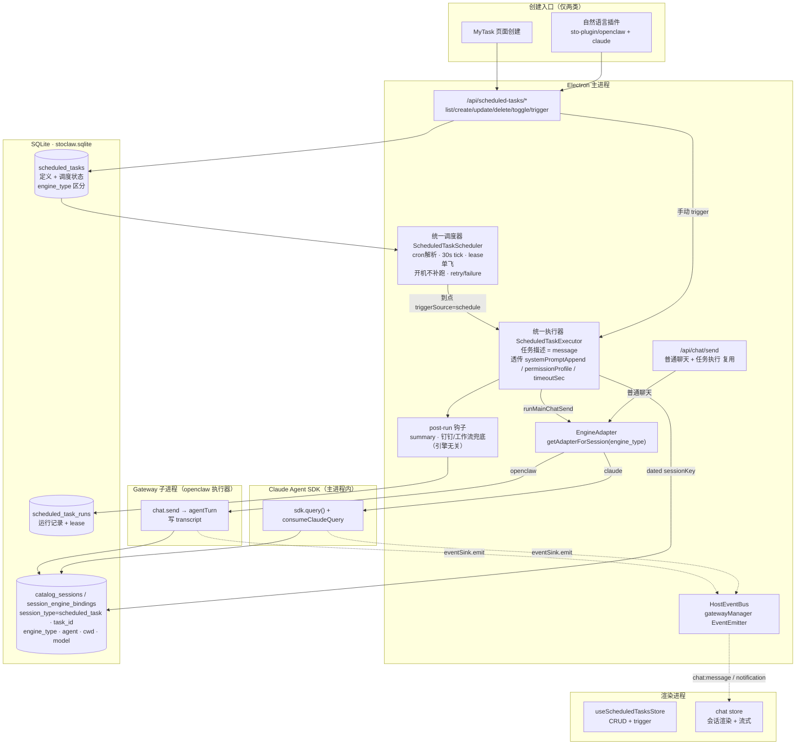

# 定时任务统一重构 — 实施计划

> 状态：**已交付（P4，2026-07-24）**。进度真相源见 [定时任务重构-交接与执行计划.md](./定时任务重构-交接与执行计划.md)；表契约见 [sqlite/schedule-tasks.md](./sqlite/schedule-tasks.md)。
> 关联文档：[定时任务架构设计.md](./定时任务架构设计.md)（极简现行架构）、[scheduled-task-stream-unification.md](./scheduled-task-stream-unification.md)（G1/G2 由本重构消解；G3–G5 仍独立）。

### 决策变更 / 作废指引（阅读下文前先看）

下列原稿目标或清理指引**已被后续约定否决，勿再按原稿执行**：

| 原稿位置 | 原稿说法 | 现行约定 |
|---|---|---|
| §1.2 #5 / Phase 5 / U6 | 收敛 `session_type` → 单一 `scheduled_task` | **P2-C 否决**：保留 `cron` / `claude_task`；侧栏只展示 dated 的这两种 |
| §1.2 #2 / Phase 2 | 废弃并清空 `definitions.json` | **不清空**；迁移后只读保留 |
| §2.6.1～§2.6.2 / Phase 6 | 删插件 `create_scheduled_task`；NL 走内置 `cron` | **保留** live `create_scheduled_task`→HostApi `/api/scheduled-tasks`；内置 `cron` 已切断双写 |
| 全文表名 `scheduled_tasks` | 带 d | 现网表名 **`schedule_tasks` / `schedule_task_runs`（无 d）** |
| §2「现状」整节 | Gateway cron / definitions.json / 历史回放 | **重构前快照**，仅作考古；生产路径见交接文档 |

---

## 1. 背景与目标

### 1.1 背景：为什么要做这件事

StoClaw 当前对定时任务支持 **openclaw / claude 两种引擎**，但二者的**存储、调度、执行三套完全割裂**：

| 维度 | openclaw | claude |
|---|---|---|
| 存储 | 外部 Gateway 进程的 `~/.stoclaw/openclaw/cron/jobs.json` + `cron/runs/{jobId}.jsonl` | 本仓库 `definitions.json` + `scheduler-state.json` + `leases.json` + `runs/{taskId}.jsonl` |
| 调度 | Gateway 进程内部计时（黑盒，本仓库不可控） | 主进程内自写 cron 解析 + 30s tick（`claude-task-scheduler.ts`） |
| 执行 | Gateway 跑 `payload:{kind:'agentTurn',message}`（`cron.run force`） | `ClaudeTaskWorker` 自建 runtime 直调 Claude Agent SDK |

割裂带来一串具体问题：

1. **三套存储 / 两套调度 / 两套执行**，任何跨引擎的能力（重试策略、失败暂停、按天聚合、钉钉必发、超时兜底）都得在两处各实现一遍，长期维护成本高、行为容易漂移。
2. **运行态呈现分叉**：claude 手动触发实时流、定时触发事后从 jsonl 回放；openclaw 存在 base/dated sessionKey 不一致，后台流式丢失、卡 loading、无红点（详见 [scheduled-task-stream-unification.md](./scheduled-task-stream-unification.md)；**G1/G2/G6 已由本重构消解，G3–G5 仍独立**）。
3. **历史加载机制复杂且重复**：任务会话靠"按天聚合虚拟会话 + 从 run 日志回放"（`buildCronSessionFallbackMessages` / `virtual-task-history.ts` / `/api/cron/session-history` / `/api/claude-scheduled-tasks/session-history`），与普通聊天的 `chat.history` 是两套，bug 面被放大。
4. **引擎差异无法收敛**：`catalog_sessions.session_type` 有 `cron` / `claude_task` / `scheduled_task` 三个枚举，钉钉"指定即必发"语义在两套烘焙路径各写一遍（`buildCronMessage` vs `buildClaudeRuntimeOptions` 的 systemPromptAppend）。
5. **openclaw 调度不可控**：nextRunAt 由 Gateway 算，本仓库只能读 `state.nextRunAtMs`；"关机不补跑""编辑后重算"等策略无法对 openclaw 强制。

但**现有基础设施其实已为统一铺好路**：

- SQLite 已有 `catalog_sessions`（含 `session_type` / `task_id`）与 `session_engine_bindings`（含 `engine_type` / `agent_id` / `cwd` / `model` / `provider` / `account_id` / `extra_json`），见 [docs/sqlite/](./sqlite/)。
- 普通聊天的发送管线**两引擎已共用**：渲染进程 `POST /api/chat/send`（`dispatch-chat-request.ts:43`）→ 主进程 `runMainChatSend`（`chat-send-service.ts:15`）→ `getAdapterForSession(engineType).sendMessage(...)` → openclaw 走 `gatewayManager.rpc('chat.send')`（`openclaw-adapter.ts:243`）、claude 走 `createClaudeQuery`+`consumeClaudeQuery`（`claude-adapter.ts:1187`）。引擎差异封在 `EngineAdapter` 内。
- `DispatchChatRequestInput` **已支持** `systemPromptAppend` + `engineType` 透传（`dispatch-chat-request.ts:16-19`），claude adapter `sendMessage` 已接 `systemPromptAppend`（`claude-adapter.ts:1191`）。

因此关键洞察是：**"任务执行 = 普通聊天"在管线层面已基本成立**——统一执行器到点以"任务描述"为 `message` 调 `runMainChatSend`，即可自动继承两引擎的既有分叉，引擎差异不必重写。

### 1.2 目标

1. **统一任务定义字段**：一张表，靠 `engine_type` 区分 openclaw / claude，引擎专属字段走 `extra_json`。
2. **统一存储**：任务定义 + 运行记录进 SQLite（沿用现有 Kysely + migration 约定）；`jobs.json` 迁后清已迁条目；**`definitions.json` 不清空**（只读保留）。
3. **统一调度**：单一进程内调度器（泛化现有 `ClaudeTaskScheduler`），两引擎共用 nextRunAt / tick / lease 单飞 / 开机不补跑 / retry / failure 策略；openclaw 不再依赖 Gateway 计时。
4. **统一执行**：任务执行 = 以任务描述为 user message 走 `runMainChatSend` → `adapter.sendMessage`（与普通聊天同一条管线），保留**按天聚合**会话模型。
5. ~~**收敛 `session_type`**~~ → **已否决（P2-C）**：保留 `cron` / `claude_task`；侧栏过滤 dated；引擎差异仍看 `session_engine_bindings.engine_type`。
6. **删除历史回放机制**：任务会话历史改用 `chat.history` / `getSessionMessages`（与普通聊天一致），删 `buildCronSessionFallbackMessages` / `virtual-task-history.ts` 等。✅ 已完成。
7. **聊天界面自然语言建任务一并迁移**：两引擎 NL → 统一 `ScheduledTaskService` / `/api/scheduled-tasks`。✅ openclaw 走插件 `create_scheduled_task`→HostApi（**保留工具**，与 §2.6.2 原稿相反）。
8. **Gateway 退化为纯 `chat.send` 执行器**：openclaw 任务不再经 Gateway cron（`cron.add`/`cron.run`），Gateway 只负责执行 `chat.send`。✅ 已完成。

### 1.3 非目标（明确不做）

- 不改 Python 后端工作流运行记录（"执行记录"视图 `useMyTaskStore → /api/my-tasks/agent/v1/my-workflow-runs` 保持原样）。
- 不统一 dated sessionKey 的字符串格式（openclaw `agent:{a}:cron:{id}:{date}`、claude `claude-task:{id}:{date}` 保留，chat store 已能路由；仅收敛 `session_type` 枚举）。后续如需统一 key 前缀，另起小重构。
- 不改普通聊天的 `/api/chat/send` 主链路，只在其上**补两个 override 透传**（`permissionProfile` / `timeoutSec`）。
- 不优化钉钉提示词内容；本期只把"指定即必发"注入**收口到一处**（统一执行器从 `dingtalk_recipients_json` 经单一共享函数生成 `systemPromptAppend`），提示词本身的优化后续单独做。

### 1.4 目标架构图



读图要点：

- **创建**：仅 MyTask 页面 + 自然语言插件两类，均 `delivery:'none'`，统一经 `/api/scheduled-tasks/*` 落 `scheduled_tasks`。
- **存储统一**：`scheduled_tasks` + `scheduled_task_runs` 取代 `jobs.json` / `definitions.json` / 各自 jsonl；会话组织沿用既有 `catalog_sessions` / `session_engine_bindings`（`session_type` 收敛为 `scheduled_task`）。
- **调度统一**：`ScheduledTaskScheduler`（泛化自 `ClaudeTaskScheduler`）取代 Gateway 内部 cron + claude 自写调度，两引擎共用。
- **执行统一**：统一执行器到点以任务描述为 `message` 走 `runMainChatSend` → `EngineAdapter`——**与普通聊天同一管线**（图中央 `ChatRoute` 与 `Exec` 汇入同一 `Adapter`）。
- **引擎分叉封在 Adapter 内**：openclaw → Gateway `chat.send`（Gateway 退化为纯执行器，不再注册 cron）；claude → 主进程内 SDK。引擎差异不外溢。
- **事件回流**：两引擎流式事件统一经 `HostEventBus`（`gatewayManager` 仅当 EventEmitter 用）→ 渲染进程 chat store，与普通聊天完全一致。
- **按天聚合保留**：执行器解析当天 dated sessionKey（openclaw `agent:a:cron:id:date` / claude `claude-task:id:date`）写入 catalog。

---

## 2. 现状（重构前快照 · 已作废作生产指引）

> ⚠ 本节是 cutover 前的盘点原文。生产路径以交接文档与 `electron/scheduled-tasks/*` 为准。

### 2.1 openclaw：外部 Gateway 进程全权负责

- 入口：路由 `electron/api/routes/cron.ts` 仅 `ctx.gatewayManager.rpc('cron.add'|'cron.list'|'cron.update'|'cron.remove'|'cron.run'|'cron.toggle')` 转发。
- Gateway 是独立 `utilityProcess.fork`（`gateway/process-launcher.ts:89`，`serviceName:'OpenClaw Gateway'`），入口 `<openclaw包>/openclaw.mjs`（`utils/paths.ts:509-511`），协议 JSON-RPC 2.0（`gateway/protocol.ts`）。
- 存储：`~/.stoclaw/openclaw/cron/jobs.json`（`GatewayCronJob`，`cron.ts:21-40`）、`cron/runs/{jobId}.jsonl`、`agents/{agentId}/sessions/{runSessionId}.jsonl`。
- 调度/执行全在 Gateway 内部，本仓库只读磁盘产物做 UI。
- 手动触发 `cron.run {mode:'force'}`（`cron.ts:929`），与定时到点不同。

### 2.2 claude：进程内自管

- 入口：路由 `electron/api/routes/claude-scheduled-tasks.ts` → `getClaudeScheduledTaskService()`（`claude-scheduled-task-service.ts:284`）。
- 存储（`claude-scheduled-task-store.ts`）：`definitions.json` / `scheduler-state.json` / `leases.json` / `runs/{taskId}.jsonl`，原子写 + 串行 mutationQueue。
- 调度（`claude-task-scheduler.ts`）：自写 5 段 cron 解析、`computeNextRunAt` 逐分钟扫描、30s `setTimeout` tick、lease 单飞、`discardMissedOnStartup` 开机不补跑、`refreshSchedule` 编辑后重算。
- 执行（`claude-task-worker.ts:75` `executeClaudeTask`）：`buildClaudeTaskRuntimeContext` → `createClaudeQuery`（直接 `@anthropic-ai/claude-agent-sdk` `query()`，`claude-sdk-runtime.ts:209`）→ `consumeClaudeQuery`（`claude-adapter.ts:601`，**与交互式 claude 聊天同一条流式路径**）→ 超时 `query.close()` + 钉钉/工作流兜底看门狗（`worker.ts:337-397`）。

### 2.3 普通聊天的发送链路（两引擎共用，3 层）

```
渲染进程 ──POST /api/chat/send (hostApiFetch, dispatch-chat-request.ts:43)──► 主进程
   gateway.ts:258 → runMainChatSend (chat-send-service.ts:15) → adapter.sendMessage
        ├─ openclaw: gatewayManager.rpc('chat.send', {sessionKey,message,deliver,idempotencyKey})  (openclaw-adapter.ts:243)  → Gateway 子进程执行
        └─ claude:   startClaudeQuery({eventSink: ctx.gatewayManager, systemPromptAppend})  (claude-adapter.ts:1187)  → 主进程内 sdk.query()
```

- `chat.send` 有两个含义：① renderer→main 的 HTTP `/api/chat/send`（两引擎共用）；② main→Gateway 的 JSON-RPC `chat.send`（**仅 openclaw**）。claude 不向 Gateway 发 `chat.send`，Gateway 只当 EventEmitter 事件总线用。
- `DispatchChatRequestInput` 已有 `systemPromptAppend` + `engineType`；缺 `permissionProfile` + `timeoutSec`。

### 2.4 任务结果进入聊天 UI（按天聚合虚拟会话模型）

- 两引擎 trigger 均返回 `{executionSessionKey, executionModel, executionAgentId}`，dated key：openclaw `agent:{a}:cron:{id}:{date}`（`cron.ts:960`）、claude `claude-task:{id}:{date}`（`claude-scheduled-tasks.ts:137`）。
- 前端 `MyTask/index.tsx:280` `handleTrigger`：`markScheduledSessionActivating` → `applyTaskExecutionModelToChatSession` → `switchSession(datedKey)` → `loadSessions`。
- 历史回放：openclaw `/api/cron/session-history`→`buildCronSessionFallbackMessages`（`cron.ts:529`，读 run 日志+转录）、claude `/api/claude-scheduled-tasks/session-history`→`readClaudeScheduledTaskSessionHistory`；前端 `virtual-task-history.ts`。
- 侧栏分组：`task-group-key.ts`（`cron:{jobId}` / `claude-task:{taskId}`）。
- `cron-session-utils.ts` 定义 dated key 解析 + run→daily 聚合映射；`isVirtualTaskSessionKey`（`:156`）防 `loadSessions` 挪走 currentSessionKey。

### 2.5 SQLite 现有表（`docs/sqlite/`）

- `catalog_sessions`（`(workspace_id, session_key)` 复合 PK）：`session_type` 枚举含 `chat/cron/scheduled_task/claude_task/app/channel/workflow`、`task_id`、软删、`idx_catalog_sessions_session_type`。
- `session_engine_bindings`（`session_key` PK）：`engine_type`(openclaw|claude)、`agent_id`、`engine_session_id`、`cwd`、`model`、`provider`、`account_id`、`extra_json`。
- `_shared-fields.md` 约定：`created_at/updated_at/deleted_at/version` + JSON 列 `json_valid` 校验 + 软删查询 `WHERE deleted_at IS NULL`。
- 当前 schema 版本 4（`0001`–`0004`），下一个 migration 预计 `0005`。

### 2.6 创建链路现状（已核实）

**现状 = Option B**：两引擎 NL 都**直接创建成功、无 modal、无确认**。割裂只在后端存储（openclaw→Gateway jobs.json，claude→主进程 definitions.json），不在创建交互。

| 创建入口 | openclaw 任务 | claude 任务 |
|---|---|---|
| MyTask 页面 (TaskCreateModal) | 主进程路由 `/api/cron/jobs` → `gatewayManager.rpc('cron.add')` → **Gateway 建** jobs.json（`cron.ts:851`）✅ | 主进程路由 `/api/claude-scheduled-tasks` → `service.createTask` → **主进程建** definitions.json（`claude-scheduled-tasks.ts:54`）✅ |
| 自然语言 | agent 调 openclaw runtime **内置 `cron` 工具**（`cron` 已从 `tools.deny` 移除，`openclaw-auth.ts:1643`）→ HostApi IPC `case 'cron' action:'create'`（`ipc-handlers.ts:525`）→ `cron.add` → **Gateway 直接建** jobs.json（无 modal）✅ | agent 调 claude 插件 `create_claude_scheduled_task`（主进程内）→ `service.createTask`（`tools.ts:239`）→ **主进程直接建** definitions.json（无 modal）✅ |

> 注意：openclaw NL **不走** `sto-scheduled-task-tool` 插件的 `create_scheduled_task` 工具——该工具被 `tools.deny` 封了（`openclaw-auth.ts:1631`），且下游 modal 链路是死代码。openclaw NL 走的是 runtime 内置 `cron` 工具，插件那个是云端时代的遗留（见 §2.6.1/§2.6.2）。

### 2.6.1 openclaw NL 的真实路径：内置 `cron` 工具

> ⚠ **本节描述的是重构前路径，已作废。** 现行 openclaw NL：插件 `create_scheduled_task` → HostApi `/api/scheduled-tasks` → `schedule_tasks`。内置 `cron` 不再作为建任务入口。

（以下为考古快照，保留原文结构供对照。）

`openclaw-auth.ts` 重构前曾：(1) deny 插件 `create_scheduled_task`；(2) 从 deny 移除内置 `cron`。即当时 NL 走 runtime 内置 `cron` → HostApi `case 'cron'` → Gateway `jobs.json`。插件仅剩执行期 hook。**上述链路已切断。**

### 2.6.2 NL 建任务死代码删除备注

> ⚠ **本节大部作废（2026-07-24）**。confirmation→modal 链已删（Step 0 ✅）；但原稿「删 `create_scheduled_task` / 走内置 `cron`」已被否决。
>
> **现行**：插件 `create_scheduled_task` **live** → `POST /api/scheduled-tasks` → `schedule_tasks`；`openclaw-auth` **移除**对 `create_scheduled_task` 的 deny；内置 `cron` 不再作为建任务入口（防 Gateway `jobs.json` 双写）。
>
> 下表仅保留「confirmation 死代码」已执行项；划线行为原稿错误指引，**勿再执行**。

| 代码 | 处置（现行） |
|---|---|
| `use-scheduled-task-tool-listener` / `use-builtin-tool-listener` / confirmation 分支 / `ScheduledTaskConfirmationData` | ✅ 已删（无 modal） |
| ~~删 `create_scheduled_task` 工具注册~~ | ❌ **作废** — **保留**，改 HostApi |
| ~~移除后随工具删 deny~~ | ❌ **作废** — 现行是 **允许** 该工具（从 deny 列表滤出） |
| ~~openclaw NL 继续走内置 `cron`~~ | ❌ **作废** — 禁止内置 cron 建任务 |

> `shared/scheduled-task-instruction.ts` 中执行期 prompt / creation guard 工具名列表仍 **live**。

### 2.7 数据来源对照（重构后）

| UI 位置 | 数据源 | 说明 |
|---|---|---|
| 侧边栏会话列表（含任务会话分组） | `catalog_sessions`（`session_type='scheduled_task'` + `task_id`）JOIN `session_engine_bindings` | 任务会话 = 按天聚合 dated session（`agent:..:cron:id:date` / `claude-task:id:date`），首次触发后写 catalog；侧栏分组键 `scheduledTaskGroupKey(taskId)`。**侧栏读 catalog，不读 `scheduled_tasks`** |
| MyTask「定时任务」视图 | `scheduled_tasks` 表（CRUD 经 `/api/scheduled-tasks/*`） | 任务定义列表（name/cron_expr/enabled/next_run_at）；"最近运行状态"从 `scheduled_task_runs` 取 latest by task_id |
| MyTask「执行记录」视图 | Python 后端 `/api/my-tasks/agent/v1/my-workflow-runs`（`useMyTaskStore`） | 工作流运行记录，**不变** |
| 任务会话历史 | `chat.history`（openclaw）/ `getSessionMessages`（claude） | 与普通聊天一致；P5 删除 jsonl 回放后生效 |
| 任务运行记录 | `scheduled_task_runs`（新建表） | 每次触发的 status/timing/summary；调度器 lease 单飞 + 失败重试 + "最近运行"列 |

> 注意区分两类"执行记录"：`scheduled_task_runs`（本地任务每次触发的运行记录，**新建表**）≠ MyTask「执行记录」视图（Python 后端工作流运行记录，不变）。

---

## 3. 差距清单

| ID | 差距 | 说明 | 本计划对应 Phase |
|---|---|---|---|
| U1 | 无统一任务定义存储 | openclaw 在 Gateway `jobs.json`、claude 在 `definitions.json` | P1 |
| U2 | 无统一调度器 | openclaw 调度在 Gateway 黑盒，claude 自写 | P2 |
| U3 | 执行未统一到 chat-send 管线 | claude worker 自建 runtime 直调 SDK，未走 `runMainChatSend` | P3 |
| U4 | send 管线缺 `permissionProfile`/`timeoutSec` override | `DispatchChatRequestInput` 与 adapter `sendMessage` 签名都无 | P3 |
| U5 | openclaw 绑定 Gateway cron | `cron.add`/`cron.run`/`cron.list` 耦合 | P4 |
| U6 | `session_type` 三枚举未收敛 | `cron`/`claude_task`/`scheduled_task` 并存 | ~~P5~~ → **P2-C 否决，不收敛** |
| U7 | 历史回放机制重复 | `buildCronSessionFallbackMessages` + 两个 session-history 端点 + `virtual-task-history.ts` | P5 |
| U8 | 建任务插件走两套 store | openclaw 插件、claude 插件（`tools.ts:239`） | P6 |
| U9 | 自治运行编排未引擎无关化 | 超时/钉钉/工作流兜底硬编码在 `claude-task-worker` | P3 |

---

## 4. 实施阶段

> **已锁决定（评审后）**
> - **表名**：文档现用 `scheduled_tasks` / `scheduled_task_runs`（带 d、复数），对齐现有 `session_type='scheduled_task'` 枚举 + `ScheduledTaskService`。你选的 `schedule_task`（无 d）若坚持，需同步改表名/迁移 `0005`/索引名/表模型文件名（约 20 处）——见下"待定"。
> - **sessionKey 前缀**：沿用 `agent:..:cron:id`（openclaw）/ `claude-task:id`（claude），不收敛为单一 `scheduled-task:` 前缀（与 P5 line 299 一致；`session-type.ts` 已含这三类 `cron`/`claude_task`/`scheduled_task`，前缀保留即此意）。
> - **`deliver`**：执行器复用交互 send 默认，不特殊设（见 P3）。
>
> **待定（不阻塞 Phase 0/1，到对应 Phase 再决）**
> - **表名拼法**：`scheduled_tasks`（带 d，零改动，推荐）vs `schedule_task`（无 d，你写的，约 20 处改名）。DB 表名 vs 枚举/Service 拼法是否要一致，请你定。
> - **P5 line 296 session_type 收敛**：是否把 `cron`/`claude_task` 收敛为单一 `scheduled_task`？若收敛，`agent:..:cron:*` key 的 inferred type 变 `scheduled_task`（key 前缀仍留）；若不收敛，保留双类型 + 删仅历史回放用的 `scheduled-task:{taskId}` 虚拟聚合 key/枚举值。影响红点/侧栏迁移，Phase 5 前定。

### Phase 0 — 盘点与基线（不动逻辑）

- [ ] 存量盘点：统计 `jobs.json` 任务数、`definitions.json` 任务数、历史 run jsonl 体量，导出样本。**仅用于"任务定义迁移"验证——执行历史记录不迁移**（见 P2）。
- [x] 插件盘点：Claude/PI 的自然语言管理已统一迁到 `electron/agent-extensions/extensions/sto-scheduled-task-tool/`，通过 capability/Host API 访问 Main 进程定时任务服务；OpenClaw 仍保留 legacy 插件直至下线。
- [x] 范围确认（已确认）：创建定时任务的途径**仅两类**——MyTask 页面创建 + 自然语言扩展创建（OpenClaw legacy 插件、Claude/PI 公共 `sto-scheduled-task-tool`），**无其他途径**。两类均 `delivery:'none'`（结果推回聊天页），不存在依赖 Gateway `delivery` 渠道投递的外部任务。结论：P4 可干净切割，统一表不保留 `delivery` 列。
- [ ] 基线埋点：手动 + 定时各触发一次 openclaw / claude 任务，记录 dated 会话、流式事件、历史加载行为，供 P5 回归对照。

### Phase 1 — 统一存储（SQLite，migration 0005）

新增表（沿用 `_shared-fields.md` 约定）：

- **`scheduled_tasks`**（定义，`TEXT id` PK）：
  - 公共列：`id, name, enabled(INT), cron_expr, engine_type, prompt, agent_id, workflow_code, dingtalk_recipients_json, created_at, updated_at, deleted_at, version`
  - 高频引擎列（可空）：`model, provider, account_id, workspace_path, permission_profile, timeout_sec, retry_policy_json, failure_policy_json`
  - 兜底：`extra_json`（`json_valid`），承载引擎专属未列字段。创建途径仅 MyTask + 插件两类、均 `delivery:'none'`，故 Gateway cron 专属的 `session_target`/`wake_mode`/`schedule_kind` 不再需要；`extra_json` 预留未来扩展。
  - 调度状态：`next_run_at, last_scheduled_for, last_recovered_at, cron_expr_snapshot`（合并进本表，或单列 `scheduled_task_scheduler_state`；推荐合并以减少 JOIN）
  - 索引：`idx_scheduled_tasks_enabled_due (enabled, next_run_at) WHERE deleted_at IS NULL`、`idx_scheduled_tasks_engine (engine_type)`、`idx_scheduled_tasks_agent (agent_id)`
- **`scheduled_task_runs`**（运行记录，`TEXT run_id` PK，**新建表**）：`run_id, task_id(FK→scheduled_tasks.id), status(queued/running/succeeded/failed/timed_out/cancelled), trigger_source(manual/schedule/recovery), scheduled_for, started_at, completed_at, attempt, idempotency_key, session_key, summary, error, runtime_result_json`
  - lease 单飞可并入：`lease_until` 列 + `idx_scheduled_task_runs_active_lease (task_id) WHERE status='running'`，或保留单表 `scheduled_task_leases`（对齐现有 claude 模式）。
  - 用途：调度器 lease 单飞 / 失败重试决策 + MyTask「定时任务」视图"最近运行状态"列。**历史 run 不导入，起始为空**，重构后新 run 累积。
- [ ] Kysely 表类型 `electron/db/models/tables/scheduled-task-tables.ts`、领域模型 `electron/db/models/domain/scheduled-task.ts`、Repository `electron/db/repositories/scheduled-task-repository.ts`、`scheduled-task-run-repository.ts`。
- [ ] migration `electron/db/migrations/0005-scheduled-tasks.ts`。
- [ ] **并行期不动** `jobs.json` / `definitions.json`，新旧并存。

### Phase 2 — 统一调度器（泛化 ClaudeTaskScheduler）

- [ ] 新建 `electron/services/scheduled-task-scheduler.ts`：泛化 `claude-task-scheduler.ts` 的 cron 解析 / `computeNextRunAt` / 30s tick / `discardMissedOnStartup` / `refreshSchedule` / lease 单飞，改为从 `scheduled_tasks` 表读写、引擎无关。
- [ ] 到点 → 调统一执行器（P3 产出），`triggerSource='schedule'`；手动 trigger 走同一执行器、`triggerSource='manual'`。
- [ ] **一次性数据迁移**（独立脚本 `scripts/migrate-scheduled-tasks.ts`，启动时检测并执行一次；**仅迁移任务定义，不迁移执行历史**）：
  - 读 `definitions.json` → 写 `scheduled_tasks`（engine_type='claude'，补齐 claude 专属列）。
  - 读 `jobs.json` → 写 `scheduled_tasks`（engine_type='openclaw'，`description` JSON 解出 `agentId/dingTalkMentions/workflowCode` → 分别落 `agent_id`/`dingtalk_recipients_json`/`workflow_code`；`schedule.expr`→`cron_expr`；`payload.message`→`prompt`）。
  - 对每个已导入的 openclaw 任务调 `cron.remove` 清 Gateway cron（避免双调度）；claude `definitions.json` 标记迁移完成、不再读取。
  - `scheduler-state.json` 的 `nextRunAt` 迁入 `scheduled_tasks.next_run_at`（仅未到期的；已过期的按"开机不补跑"推进到未来）。
  - **`scheduled_task_runs` 起始为空**：历史 run jsonl 不导入；`leases.json` 不迁移（重启时本无活跃 lease）；重构后新 run 从空累积。
  - **已知后果（按决策接受）**：重构前的任务执行历史（dated 会话历史）在 P5 删除回放机制后不可见；用户如需保留个别历史，可在迁移脚本里把指定任务的 run jsonl 导出为离线归档（不入库）。
- [ ] claude 现有 `ClaudeTaskScheduler` 标记 deprecated，行为迁入统一调度器后删除。

### Phase 3 — 统一执行器 + send 管线 override

- [ ] 新建 `electron/services/scheduled-task-executor.ts`：输入 `taskId + triggerSource`，输出 run 记录。流程：
  1. 取定义、准备 run（runId / idempotencyKey / lease，复用 P1 表）。
  2. 解析**当天 dated sessionKey**（openclaw `agent:{agentId}:cron:{id}:{date}` / claude `claude-task:{id}:{date}`，复用 `cron-session-utils.ts` 既有构造），`ensureCronDatedExecutionSessionPlaceholder` / `ensureClaudeDatedExecutionSessionPlaceholder` 预建占位（沿用现状）。
  3. 以任务 `prompt` 为 `message`，透传 `systemPromptAppend`（P0 必发，复用 `buildClaudeRuntimeOptions` / openclaw `prepareDingTalkAgentTurnMessage scenario:'scheduled-task'`）、`permissionProfile`、`timeoutSec`，调 `runMainChatSend` / `getAdapterForSession(engineType).sendMessage(...)`（server 侧直调，不经 HTTP）。
  4. 落 run 记录 + summary（`appendClaudeScheduledTaskSummaryRun` 的等价通用化）。
- **`deliver` 不特殊设（已定）**：执行器直接复用交互式 send 路径默认——`deliver` 留 undefined，openclaw `chat.send` 照常跑 agent turn + 流式回 dated 会话；claude adapter 本就不读 `deliver`。即"任务执行=交互聊天"的直接推论，无额外开关。QA 验证任务 turn 实际触发。
- [ ] **send 管线补 override**（U4）：
  - `DispatchChatRequestInput` + `/api/chat/send` 路由 body + `MainChatSendInput` + `EngineSendParams` 增 `permissionProfile?` / `timeoutSec?`。
  - claude adapter `sendMessage`：`permissionProfile → permissionMode`（复用 `claude-task-runtime-builder.ts:70` `mapPermissionProfile`）、`timeoutSec → setTimeout + query.close()`（复用 `claude-task-worker.ts:295`）。
  - openclaw adapter `sendMessage`：`permissionProfile` 透传给 `chat.send` rpc params（Gateway 若不识别则忽略，权限仍由 agent 配置约束）；`timeoutSec` 由主进程 watchdog 到点调 `chat.abort`（`openclaw-adapter.ts:296`）。
- [ ] **自治运行编排引擎无关化**（U9）：把 `claude-task-worker.ts:198-397` 的 `onMessage` 捕获（workflowRunIds / pendingDwsSendToolUseIds / dingtalkAlreadySent）+ `sendWorkflowResultFallback` 提炼为 `ScheduledTaskCompletionHooks`，挂在执行器 post-run，两引擎共用（openclaw 任务同样可能含工作流 + 钉钉）。

### Phase 4 — openclaw 剥离 Gateway cron（U5）

- [ ] 路由收敛：`/api/cron/*` → `/api/scheduled-tasks/*`（list/create/update/delete/toggle/trigger/refresh/scheduler-status），`trigger` 调统一执行器（不再 `cron.run force`）。
- [ ] 移除 `gatewayManager.rpc('cron.add'|'cron.list'|'cron.update'|'cron.remove'|'cron.run'|'cron.toggle')` 全部调用；Gateway 仅保留 `chat.send` / `chat.history` / `sessions.*` / `chat.abort` 能力。
- [ ] openclaw 任务执行 = `chat.send` 到 dated session（Gateway 仅执行器）。
- 无 `delivery` 保留需求（已确认创建途径仅 MyTask + 自然语言插件两类、均 `delivery:'none'`）：统一表不设 `delivery` 列，执行器一律走"结果回 dated 会话"。

### Phase 5 — ~~收敛 session_type~~ + 删除历史回放（U6 / U7）

> ⚠ **U6 / session_type 收敛已否决（P2-C）**。本 Phase 实际只完成「删历史回放 + 侧栏改读 catalog dated」。下列 checklist 中划线项勿执行。

- [x] ~~`inferSessionCatalogMeta` → 一律 `scheduled_task`~~ → **不做**；保留 `cron`/`claude_task`
- [x] 侧栏：`session_type∈{cron,claude_task}` + dated key；一天一行；滤 run/base
- [x] 删历史回放：`buildCronSessionFallbackMessages`、session-history 端点、`virtual-task-history.ts` 等；历史改用 `chat.history`
- [x] dated sessionKey 格式保留（不统一前缀）
- [x] `markScheduledSessionActivating` 乐观态保留

### Phase 6 — 前端与插件迁移（U8）

> ⚠ 原稿「按 §2.6.2 删 `create_scheduled_task`」**作废**。现行：**保留**该工具并走 HostApi。

- [x] CRUD/trigger 打 `/api/scheduled-tasks/*`（`src/stores/cron.ts`）
- [x] 建任务真相源 = `ScheduledTaskService`；MyTask + NL 均经此
- [x] openclaw NL：`create_scheduled_task` → HostApi（**保留工具**）
- [x] confirmation→modal 死代码已删（Step 0）
- [x] 「指定即必发」收口到执行器 `buildExecutionSystemPromptAppend`

### Phase 7 — 验收与交付

- [x] §5 验收矩阵对照（见 §5.2）
- [x] 回滚预案（见 §6.2）
- [x] 旧路径/过时指引标注作废
- [x] 进度更新交接文档
- [ ] （可选）发布后冒烟：两引擎手动+定时各一次；工作流+钉钉任务一次

---

## 5. 验收矩阵

### 5.1 目标矩阵（设计期望）

| 场景 | 引擎 | 定义存 SQLite | 统一调度到点 | 执行走 chat-send 管线 | dated 会话按天聚合 | 前台流式 | 后台红点 | 失败态 | 历史用 chat.history |
|---|---|---|---|---|---|---|---|---|---|
| 普通聊天 | openclaw | n/a | n/a | ✅(基线) | n/a | ✅(基线) | n/a | ✅(基线) | ✅(基线) |
| 普通聊天 | claude | n/a | n/a | ✅(基线) | n/a | ✅(基线) | n/a | ✅(基线) | ✅(基线) |
| 手动触发任务 | openclaw | ✅ | n/a | ✅ | ✅ | ✅ | ✅ | ✅ | ✅ |
| 手动触发任务 | claude | ✅ | n/a | ✅ | ✅ | ✅(已有) | ✅(已有) | ✅ | ✅ |
| 定时触发任务 | openclaw | ✅ | ✅ | ✅ | ✅ | ✅ | ✅ | ✅ | ✅ |
| 定时触发任务 | claude | ✅ | ✅ | ✅ | ✅ | ✅(已有) | ✅(已有) | ✅ | ✅ |
| 自然语言建任务 | openclaw | ✅ | ✅ | ✅ | ✅ | — | — | — | ✅ |
| 自然语言建任务 | claude | ✅ | ✅ | ✅ | ✅ | — | — | — | ✅ |
| 关机错过 | 两引擎 | ✅ | 开机不补跑 ✅ | — | — | — | — | — | — |

### 5.2 P4 验收结果（2026-07-24）

| 场景 | 引擎 | 结果 | 依据 |
|---|---|---|---|
| 定义存 SQLite | 两引擎 | ✅ | `schedule_tasks` + `/api/scheduled-tasks`；migration `0011`；启动迁移 `migrate-scheduled-tasks.ts` |
| 统一调度到点 | 两引擎 | ✅ 代码 | `ScheduledTaskScheduler` 30s tick + claim 单飞；`startScheduler`→`discardMissedOnStartup` |
| 执行走 chat-send | 两引擎 | ✅ 代码 | `EngineScheduledTaskDispatcher` → `runMainChatSend`（同普通聊天） |
| dated 按天聚合 | 两引擎 | ✅ 代码+P2 手测 | 执行时 upsert 当天 dated key；侧栏一天一行 |
| 历史 chat.history | 两引擎 | ✅ P2 手测 | `history-load-actions` 仅 `chat.history`；旧 session-history 已 404 |
| 侧栏「任务」 | — | ✅ P2 手测 | catalog `session_type∈{cron,claude_task}` + dated；滤 run/base |
| NL 建任务→SQLite | openclaw | ✅ 代码 | 插件 `create_scheduled_task`→HostApi；deny 已放开 |
| NL 建任务→SQLite | claude | ✅ 代码 | 插件/service → `ScheduledTaskService.createTask` |
| 关机不补跑 | 两引擎 | ✅ 代码 | `discardMissedOnStartup` 推进 `next_run_at` + `cancelAllActiveRuns` |
| 前台流式 / 后台红点 / 失败态 | 两引擎 | ✅ 管线对齐 | 与普通聊天同 `HostEventBus`；细项 G3/G4/G5 仍见流式统一计划 |
| Gateway cron 双写切断 | openclaw | ✅ | 无 `cron.add/run` 生产调用；`/api/cron` 路由已删 |
| 旧符号残留 | — | ✅ 可接受 | 无 live `ClaudeTaskScheduler` / `buildCronSessionFallbackMessages` / `virtual-task-history`；注释提及仅考古 |

> 已知残留：无。`jobs.json` 残留写入工具（`sync-openclaw-cron-first-job-model` / `advance-openclaw-cron-next-runs`）已删除。

---

## 6. 风险与回滚

### 6.1 已知风险（原稿 + 现行状态）

- ~~**openclaw 渠道投递依赖**~~ **已排除**。
- ~~**session_type 收敛破坏旧数据**~~ **已否决收敛（P2-C）**，无此风险。
- **钉钉发送**：依赖 agent 自调 `dws chat message send`（终态系统兜底已移除）；发布后对「工作流+钉钉」任务做一次冒烟。
- **迁移双调度窗口**：迁移写 `schedule_tasks` 后从 `jobs.json` 移除已迁条目；统一调度器为唯一 tick 源。
- **send override**：`permissionProfile`/`timeoutSec` 仅执行器注入；renderer 默认不传。

### 6.2 回滚预案（P4 交付）

**原则**：以 git 回退代码为主；SQLite 统一表数据**保留不删**（回滚后可作为只读对照）；`definitions.json` 本就未清空，可作 claude 定义对照；`jobs.json` 迁移后可能已空，**不能**指望自动恢复 Gateway cron 任务。

| 步骤 | 动作 | 说明 |
|---|---|---|
| 1. 判定 | 确认是「调度/执行回归」还是「侧栏/历史 UI」 | UI-only 可只 revert P2 提交；执行链路需整段回退 |
| 2. 停调度 | 回退版本启动前，勿依赖旧 Gateway cron 自动接管 | 现网已无 cron 双写 |
| 3. 代码回滚 | `git revert` 或重置到 cutover 前已知好点（建议按提交粒度）：P3 `416c7c1d` → P2 `f2dfca6d` → P1 `7c9cbccb` → cutover `6b37ec20` | **禁止**在未备份 SQLite 时对 `stoclaw.sqlite` 做破坏性操作 |
| 4. 数据 | 保留 `schedule_tasks` / `schedule_task_runs`；需要旧引擎路径时，从备份或 `definitions.json` **人工**重建，不自动反向迁移 | 无官方「SQLite→jobs.json」脚本 |
| 5. 验证 | 回滚后：MyTask 列表、手动 trigger、侧栏 dated、一次关机重启不补跑 | 对照 §5.1 |
| 6. 前进修复（优选） | 若仅单点 bug，优先在 `feat_refactor_2` 上 hotfix，避免整包 revert | 统一管线已稳定于 `runMainChatSend` |

**不可回滚 / 勿做**：

- 不要为回滚而**清空** `definitions.json` 或 catalog 历史行。
- 不要重新打开 HostApi `case 'cron'` 转发（已否决）。
- 不要把「删 `create_scheduled_task`」当回滚手段（工具是现行 NL 入口）。

---

## 7. 与既有重构计划的关系

- [scheduled-task-stream-unification.md](./scheduled-task-stream-unification.md) 的 **G1 / G2**：**已由本重构消解**（执行全程 dated key + `runMainChatSend`）。
- **G3（卡 loading 兜底）/ G4（失败态路由）/ G5（SSE 对等）** 仍独立有效，本重构不替代。

---

## 8. 执行记录

| 日期 | 阶段 | 说明 |
|---|---|---|
| 2026-07 | cutover / P0–P1 | `schedule_tasks` + 统一调度/执行器 → `runMainChatSend`；切断 Gateway cron 双写；NL→HostApi |
| 2026-07-24 | P2 `f2dfca6d` | 历史只走 `chat.history`；侧栏任务 = catalog dated cron/claude_task；**不**收敛 session_type |
| 2026-07-24 | P3 `416c7c1d` | 删 claude 旧 store/util；删/reset → `deleteClaudeSessionByKey` |
| 2026-07-24 | P4 | §5 验收矩阵代码/手测对照；§6.2 回滚预案；§2.6.2 等作废标注；进度见交接文档 |
