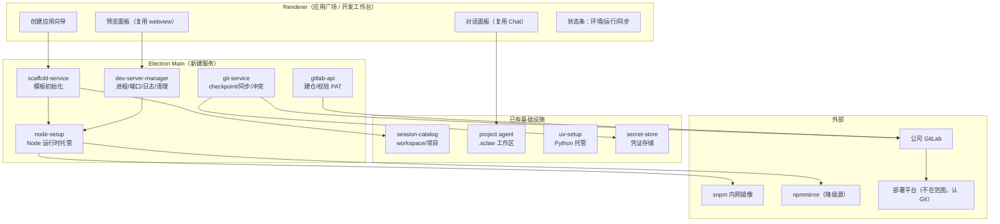
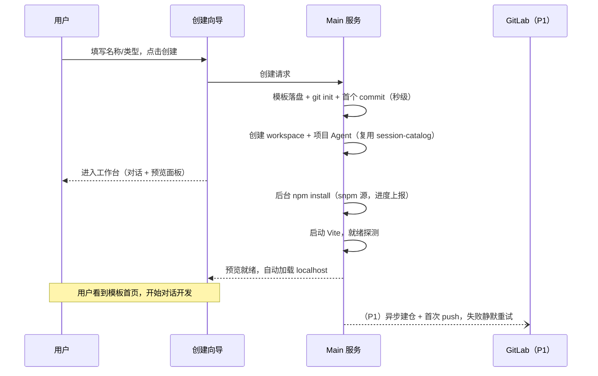

# 应用广场·用户应用开发能力 技术方案

> 状态：方案评审稿（用于汇报）
> 日期：2026-07-27
> 范围：SClaw 客户端内的应用创建、对话式开发、所见即所得预览、Git 托管同步
> 后续流程：评审通过后按 OpenSpec 流程（proposal → design → specs → tasks → apply）拆解实施

---

## 1. 背景与目标

公司提供一批基础业务接口，希望让**业务人员（非专业开发者）**基于这些接口，通过自然语言在 SClaw 内开发自己的应用（前端为主，后端可选），并通过 Git 提交对接公司现有的基于 Git 的部署平台。

SClaw 需要补齐的产品能力：

1. **创建应用**：选择目录与项目类型（前端 / 后端 / 前端+后端），从工程模板初始化项目；
2. **代码托管**：在公司 GitLab 创建仓库，静默处理认证、commit、pull、push 与冲突，用户全程不接触 Git 概念；
3. **对话式开发 + 所见即所得预览**：左侧对话、右侧实时预览，包含 dev server 的启动与生命周期管理；
4. **环境自动化**：用户无翻墙能力、机器上大概率没有 Node/Git 等开发环境，全部由 SClaw 静默准备，依赖走公司镜像。

**部署不在本方案范围内**：公司部署平台基于 Git，SClaw 做到"代码推送到 GitLab"即完成交付；后续可通过自然语言调用部署平台 API/CLI 触发部署（由部署平台侧负责）。

### 1.1 核心体验原则

| 原则 | 含义 |
|---|---|
| 用户只需要会"说话" | 全程不出现 npm、commit、conflict、dev server 等技术术语，只有"创建 / 对话 / 预览 / 保存并发布 / 恢复上一版" |
| 秒级反馈 | 创建应用后尽快看到第一个可运行页面（TTFP，Time To First Preview），长耗时步骤全部后台化 + 进度条 |
| 错误不甩给用户 | 编译报错、运行报错自动回流给 AI 修复，用户不需要读日志 |
| 可反悔 | 每轮 AI 改动自动形成 checkpoint，"改坏了"可一键恢复上一版 |
| 不污染用户环境 | 所有运行时（Node/Python）、缓存、配置都收敛在 `~/.stoclaw` 与项目目录内，不改系统 PATH、不改全局配置 |

---

## 2. 关键决策（已确认）

| 决策项 | 结论 | 理由 |
|---|---|---|
| 前端技术栈 | **React + Vite** | 公司组件库基于 React，未来向用户提供组件库；Vite HMR 提供最好的"所见即所得"体验 |
| 后端技术栈 | **Python（FastAPI + uv）** | SClaw 已捆绑 uv（含国内 PyPI 镜像逻辑），用户无需自装 Python |
| 仓库结构 | **Monorepo 单仓**（`frontend/` + `backend/`） | 一个应用 = 一个 GitLab 仓库 = 一个本地 workspace = 一个 Agent；git 同步、权限、分享复杂度减半 |
| GitLab 认证 | **Personal Access Token（PAT）** | 公司 GitLab 无法注册 OAuth 应用；通过 URL 预填 + 内嵌浏览器把 PAT 获取压缩为一次性低摩擦操作 |
| npm 依赖源 | **公司 snpm 镜像**（`http://snpm-registry.sto.cn`） | 模板内置项目级 `.npmrc`，不改用户全局配置；组件库也发布在 snpm |
| Node 环境 | **运行时托管下载**（便携版 Node 22 LTS，参照现有 uv 托管模式） | 零新增依赖、零打包配置改动、版本可控；详见 §5 |
| 交付节奏 | **本地优先**：MVP 先跑通本地闭环，GitLab 同步放 P1 | 长链路解耦，任何远端故障不阻塞用户开发 |
| 接口与组件库知识 | 接口清单为 **Markdown 文档**，随模板进入项目并注册为 Agent 上下文；组件库从 snpm 预装 + 用法文档作为 Agent skill | 决定自然语言开发成功率的第一要素 |

---

## 3. 分期规划

```
MVP ──────────► P1 ──────────► P2 ──────────► P3
本地闭环        GitLab 同步     后端能力        广场生态
```

| 阶段 | 内容 | 交付判断 |
|---|---|---|
| **MVP** | 创建应用（React+Vite 模板，monorepo 预留 `backend/`）；Node 运行时托管；后台 `npm install`（snpm）；对话式开发（复用 Chat + 项目 Agent）；Vite HMR 实时预览；本地 git 自动 checkpoint + 一键回滚；错误自动回流 AI | 新用户从"点创建"到"看到第一个页面"< 3 分钟（含环境准备）；对话改页面实时生效；改坏可恢复 |
| **P1** | PAT 引导与凭证管理；GitLab 建仓 + 静默同步；"保存并发布"（对接部署平台的 Git 入口）；导入已有应用（换机恢复）；冲突自动处理 | 用户全程无 Git 术语感知；断网/失败静默重试不阻塞 |
| **P2** | Python 后端模板（uv + FastAPI）+ 前后端联调预览；组件库用法 skill 深度整合；后端日志/状态面板 | 自然语言可完成一个"调公司接口 + 展示数据"的全栈应用 |
| **P3** | 应用广场上架/分享（与现有 URL 型应用的实体模型融合）；自然语言触发部署 | — |

---

## 4. 总体架构

### 4.1 复用与新建

本功能大量复用 SClaw 已有基础设施，新建部分集中在 Main 进程的四个服务模块：

| 能力 | 现状 | 方案 |
|---|---|---|
| 项目目录选择、workspace、项目 Agent | ✅ 已有（session-catalog、`pickProjectFolder`、`.sclaw` 项目工作区、`ensureProjectAgent`） | 直接复用 |
| 对话式开发 | ✅ 已有（Chat + project agent 绑定 workspace） | 直接复用 |
| 内嵌预览容器 | ✅ 已有（应用广场 webview + AI 对话联动） | 复用容器，加载 `http://localhost:<port>` |
| Python 运行时 + PyPI 镜像 | ✅ 已有（捆绑 uv，`uv-setup.ts` / `uv-env.ts`，区域探测镜像） | 直接复用（P2） |
| **项目脚手架（scaffold-service）** | ❌ | 新建，见 §6.1 |
| **Node 运行时托管（node-setup）** | ❌ | 新建，见 §5 |
| **dev server 管理（dev-server-manager）** | ❌ | 新建，见 §6.2 |
| **Git 服务（git-service + gitlab-api）** | ❌ | 新建，见 §6.3 / §7 |

所有新能力遵循既有边界：Renderer 只经 `host-api.ts` / `api-client.ts` 调用，新能力在 Main 进程以 Host API 路由 / IPC 通道暴露，不在 Renderer 直连任何本地进程或 GitLab。

### 4.2 架构图



---

## 5. Node 运行时托管方案（核心技术前置）

**问题**：目标用户机器上大概率没有 Node.js，而 React + Vite 路线要求本地执行 `npm install` 与 Vite dev server。

**方案**：完全参照项目内已验证的 uv/Python 托管模式（`electron/utils/uv-setup.ts`），在首次需要时下载**便携版 Node 22 LTS** 到 SClaw 私有目录，解压即用，不需要安装器与管理员权限。

### 5.1 目录与解析

```
~/.stoclaw/runtime/node/v22.x.y/
  bin/node, bin/npm     # macOS（npm 随 Node 发行包自带）
  node.exe, npm.cmd     # Windows
~/.stoclaw/npm-cache/    # npm 缓存统一收敛，二次 install 加速
```

解析顺序：托管 Node 存在 → 直接使用；不存在 → 触发下载。**统一使用托管版本**（即使系统有 Node 也不用），版本 pin 死，保证模板/组件库/Vite 行为完全可预测，消除"用户机器 Node 版本奇怪"一整类支持成本。

### 5.2 下载源（三级降级，复用现有 `shouldOptimizeNetwork()` 区域探测）

| 优先级 | 源 | 说明 |
|---|---|---|
| 1 | 公司内网（与 snpm 同套基建挂 Node 便携包） | 最快最稳，需基建配合一次性放置文件 |
| 2 | npmmirror Node 镜像（`registry.npmmirror.com/-/binary/node/`） | 国内公网可达；现有 uv 的 Python 镜像同源 |
| 3 | 官方 nodejs.org | 兜底 |

下载后校验官方 `SHASUMS256.txt`；解压到临时目录后**原子改名**至最终位置（避免半成品残留）。解压零新增依赖：macOS 自带 `tar`，Windows 10+ 自带 `tar.exe`（bsdtar，支持 zip）。并发下载用单飞锁防重（同 `setupManagedPythonPromise` 写法）。

### 5.3 触发时机与用户感知

- **后台预热**：用户首次打开"创建应用"入口即后台开始下载（30–50MB，大概率在用户填完创建表单前完成）；
- **创建流程兜底**：未就绪时创建向导显示"正在准备运行环境…"字节级进度条，就绪后自动串联 `npm install` → 启动 Vite → 打开预览，用户看到的是**一条连续进度**，而非多个技术步骤。

### 5.4 使用方式与隔离

- Main 进程 spawn 用户项目命令时，以**绝对路径**调用托管 npm/node，或仅对该子进程前置 `PATH`；
- `npm_config_cache` 指向 `~/.stoclaw/npm-cache`；
- registry 由模板内置的项目级 `.npmrc` 决定（见 §6.1），**不修改任何全局配置**。

### 5.5 升级与回滚

版本号在代码中 pin 定；SClaw 发版可升级 pin 版本，新版本就绪前旧版本持续可用，天然可回滚。

---

## 6. 核心模块设计

### 6.1 应用创建与工程模板（scaffold-service）

**创建向导（一步式表单）**：应用名称 + 项目类型（前端 / 前端+后端；后端单独类型 P2 开放）+ 存放目录（提供默认值，如 `~/SClawApps/<应用名>`，可改）。用户点击"创建"后的动作链：



**模板内容（monorepo）**：

```
<app>/
  .npmrc                 # registry=http://snpm-registry.sto.cn（含 @sto scope）
  frontend/              # React + Vite + TS，预装公司组件库（snpm）
  backend/               # P2：FastAPI + uv；MVP 仅占位
  docs/api/              # 公司接口清单 md 文档（随模板注入，Agent 固定上下文）
  .sclaw/                # 项目 Agent 工作区（复用现有机制）
```

模板本体存放于 **GitLab 模板仓库**，模板迭代不依赖客户端发版；客户端内置一份离线兜底快照。

**AI 上下文注入**（自然语言开发质量的第一要素）：接口 md 文档 + 组件库用法说明注册为项目 Agent 的固定上下文/skill，AI 生成代码时优先调用公司接口与公司组件。

### 6.2 dev server 生命周期管理（dev-server-manager）

Main 进程新建统一的用户项目进程管理器：

- **启动**：spawn Vite（前端）/ uvicorn（后端，P2），注入托管 Node/uv 环境；
- **端口**：自动分配空闲端口，多应用并行不冲突；就绪探测（HTTP 探活）后通知预览加载；
- **日志**：stdout/stderr 采集入环形缓冲，供状态面板与 AI 消费；
- **崩溃自愈**：异常退出自动重启（带退避），连续失败转交 AI 诊断；
- **清理（硬性要求）**：SClaw 退出 / 应用关闭时必须终止全部子进程及其进程树，不在用户机器残留僵尸进程。

### 6.3 对话开发、预览与错误闭环

- **布局**：工作台左对话右预览分栏；预览复用现有应用广场 webview 容器加载 localhost；
- **实时性**：Vite HMR 天然支持"说完话页面就变"；
- **错误闭环（体验成败关键）**：Vite 编译错误、页面运行时 console error / 白屏，自动采集并回流给项目 Agent 触发自修复；用户只看到"正在修复…"状态，不需要读任何日志；
- **一键回滚**：AI 每轮改动后自动 commit 形成 checkpoint；工作台提供"恢复上一版"，按 checkpoint 粒度回退（应对"AI 把页面改坏了"这一最高频挫败场景）。

---

## 7. Git / GitLab 集成（P1）

### 7.1 认证：PAT 低摩擦引导

公司 GitLab 无法注册 OAuth 应用，采用 PAT 并将摩擦压至一次性：

1. SClaw 内嵌浏览器直接打开 GitLab PAT 创建页，**URL 预填名称与权限**：`/-/user_settings/personal_access_tokens?name=SClaw&scopes=api,read_repository,write_repository`（`api` scope 用于建仓）；
2. 用户登录 → 点"创建" → 复制粘贴回 SClaw；
3. 粘贴即校验（调 `/user` 接口），凭证存入现有 secret-store（评估升级 OS keychain）；
4. 过期前主动提醒续期；此后用户不再接触任何 Git 操作。

### 7.2 同步策略（用户无感知）

- **自动 commit**：AI 每轮改动后自动 commit（即 checkpoint）；
- **异步 push**：后台静默推送，失败排队重试；状态条仅以图标呈现"已同步 / 同步中 / 待同步（离线）"；
- **"保存并发布"**：因公司部署平台认 Git，push 即发布入口。提供一个用户可感知的明确动作 + 状态反馈，而非纯静默（用户需要"我发布了"的确定感）；
- **pull 默认 rebase**；单人单仓场景冲突罕见，真冲突时先由 **Agent 自动解决**，无法解决时给用户"保留我的 / 用云端的"二选一，不暴露 diff 与冲突标记；
- **导入已有应用**：换机场景从 GitLab clone 恢复项目并重建 workspace/Agent。

### 7.3 git 执行层（待评审决策）

不能假设用户装有 git（macOS 自带，Windows 未必）。候选：依赖系统 git + Windows 引导安装 / 捆绑便携 git / 纯 JS 实现（isomorphic-git，冲突能力弱）。倾向 **Windows 下托管便携 git（MinGit，下载方式同 Node）**，与 Node 托管共用一套下载基建；最终由工程负责人评审确定。**引入任何新依赖均需工程负责人操作，AI/开发不得自动修改依赖配置。**

---

## 8. 对外依赖与配合事项

| 事项 | 配合方 | 说明 |
|---|---|---|
| 内网挂载 Node（及 MinGit）便携包 + SHASUMS | 基建 | 一次性，几个文件；无内网源时降级 npmmirror |
| snpm 镜像稳定性与组件库发布 | 基建 / 组件库团队 | 模板依赖 `http://snpm-registry.sto.cn`；需要组件库包名、类型定义与用法文档 |
| 接口清单 md 文档 | 接口提供方 | 随模板注入 `docs/api/`，作为 Agent 上下文 |
| GitLab：模板仓库、用户建仓的 group/命名空间与权限策略 | GitLab 管理员 | PAT 所需 scope：`api, read_repository, write_repository` |
| 运行时下载路线确认（不动打包配置） | 工程负责人 | 推荐运行时下载而非打入安装包（安装包免增 40MB+） |
| 部署平台对接（Git 之后的链路） | 部署平台团队 | 不在本方案范围；P3 可加自然语言触发 |

---

## 9. 风险与应对

| 风险 | 影响 | 应对 |
|---|---|---|
| 用户在内网外使用（在家/无 VPN），snpm 与 GitLab 不可达 | install 失败、无法同步 | 所有远端操作离线降级：排队重试 + 状态提示；npm 源降级 npmmirror；本地开发闭环不受影响（本地优先架构的直接收益） |
| 首次体验耗时（下载 Node + npm install） | 用户流失在第一分钟 | 后台预热 + 连续进度条 + npm 缓存收敛复用；模板依赖精简 |
| AI 生成代码不符合公司接口/组件规范 | 应用质量差、返工 | 接口 md + 组件库 skill 作为固定上下文；模板内置最佳实践示例页 |
| 子进程残留 / 端口冲突 | 用户机器被拖慢 | dev-server-manager 统一管理端口分配与进程树清理，退出必杀 |
| PAT 过期/权限不足 | 同步中断 | 粘贴即校验、到期主动提醒、同步失败明确指引重新授权 |
| GitLab 建仓失败、首推失败 | 创建流程受阻 | 本地优先：远端动作全部异步化 + 重试，不阻塞创建与开发 |
| 冲突处理超出自动能力 | 用户数据风险 | 冲突前自动本地备份分支；用户二选一后原始版本仍可恢复 |

---

## 10. 实施流程

本功能属 **Tier 3 高风险变更**，评审通过后按项目 OpenSpec 流程执行：

1. 按能力拆分 change（初步：`app-create-scaffold`、`runtime-node-managed`、`dev-server-manager`、`service-git-gitlab`、`app-dev-workbench`）；
2. 每个 change 走 `proposal → design → specs → tasks → apply`，接口契约以 GitLab API 官方文档与公司接口清单为准；
3. 新增 IPC/Host API 通道、凭证存储、进程管理均属高风险项，逐项技术评审；
4. 实施按 §3 分期，每期独立可验证、可回滚。
