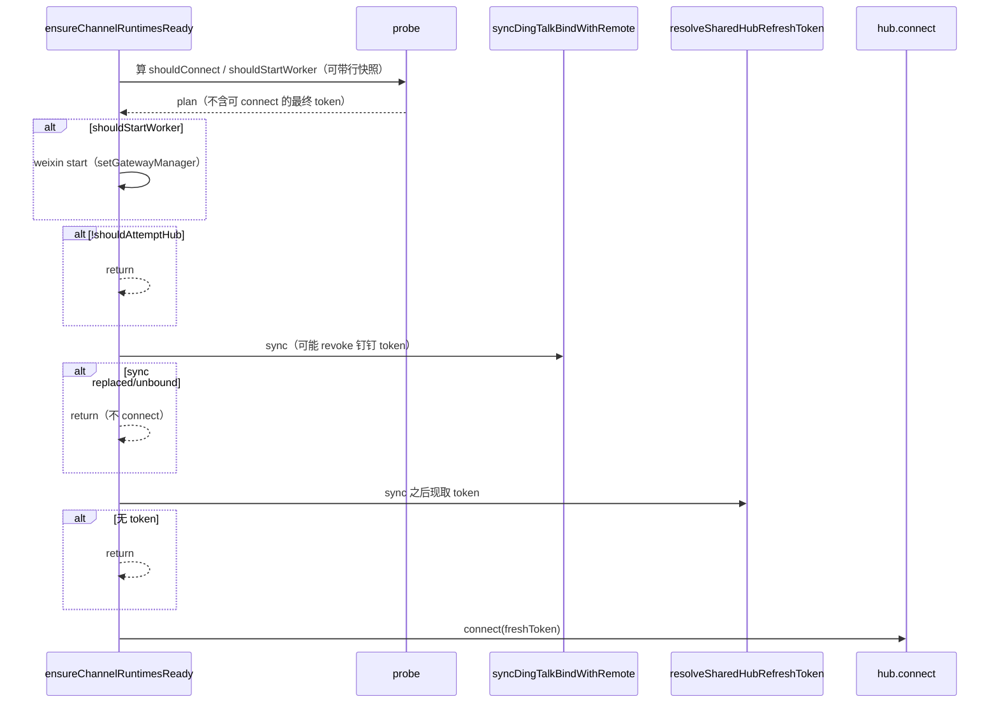

# 渠道运行时按需拉起（钉钉 / Mobile / 微信）

> 状态：**已实施**（ensureChannelRuntimesReady / 严格 resolve / list 只读）  
> 原非正式名：微信 Worker 按需拉起  
> 与 [`频道行固定引擎与扫码操作方案.md`](./频道行固定引擎与扫码操作方案.md) **分开**：本文件只谈 **运行时连接 / 进程何时拉起**。  
> 运维说明（极简）：[`electron/message-channel/README.md`](../electron/message-channel/README.md)  
> 绑定状态展示原理见 [`src/pages/Channels/README.md`](../src/pages/Channels/README.md)。

## 1. 问题

三渠道传输层不同，但启动入口挤在同一个 [`ensureSclawHubConnected`](../electron/message-channel/hub/startup.ts) 里，策略不对称：

| 通道 | 传输 | 启动现状 | 浪费点 |
| --- | --- | --- | --- |
| 钉钉 | Hub WebSocket（与 Mobile **共用**一条） | 无共享 `refreshToken` 则 skip connect | 已基本按需 |
| Mobile | 同上（共用 WS） | 同上；仅 `bound` 时参与 hubSync | 已基本按需 |
| 微信 | Host Worker（utilityProcess） | **无条件** `svc.start()` → 先 fork 再查凭证 | 未绑定也常驻空进程 |

目标：

**先探测本机是否具备该通道凭证 / 绑定；有才拉起对应运行时；收到一个公共启动方法里编排；且不得破坏现状「sync 之后再取 token」的时序。**

## 2. 三通道对照

### 2.1 凭证

| 通道 | 「可以连」的本地条件 | 存储 |
| --- | --- | --- |
| 钉钉 | `dingtalk` + `bound` + `refresh_token`（可与 Mobile 共享） | SQLite |
| Mobile | `sto-mobile`/`mobile` + `bound` + `enabled` + 共享 token | SQLite |
| 微信 | 本地 bot `token`（`hasWeixinBotBound` / `resolvePrimaryAccount`） | 凭证文件 + 可选 DB |

### 2.2 运行时

- Hub 平面：钉钉/Mobile **一条** WS（主进程 `ws`）
- 微信平面：独立 utilityProcess，与 Hub 解耦

### 2.3 现状启动顺序（必须保留的保护）

```
ensureSclawHubConnected
  ├─ wire 入站 / 换绑监听
  ├─ Weixin.start() 无条件 fork     ← 本方案要改成有凭证才 start
  ├─ 无 hubBaseUrl → return
  ├─ syncDingTalkBindWithRemote     ← 可能 revoke 钉钉行 refresh_token
  ├─ resolveSharedHubRefreshToken   ← 必须在 sync 之后（现状刻意如此）
  ├─ hubSyncChannels
  └─ hub.connect(refreshToken)
```

**禁止**把「取 token」挪到 sync 之前再拿缓存去 connect。

## 3. 目标策略

| 时机 | 钉钉 / Mobile（Hub WS） | 微信 Worker |
| --- | --- | --- |
| App 启动 / 登录后 | sync 后现取 token，有才 connect | 有 bot 凭证才 `start()` |
| 扫码绑钉钉 / 开 Mobile | claim/enable 成功后 **只** `hub.connect` | — |
| 扫码绑微信 | — | `ensureReady` 预热 + `applyLoginSuccess` → `start` |
| 解绑 / 崩溃 | 见 §6 | 见 §6 |

绑定成功路径：**禁止**为图省事再调全量 `ensureChannelRuntimesReady`（会重跑 Hub sync + 可能再 fork）；只调本通道的 `connect` / `start`。

## 4. Token 时序与 sync 交互（硬约束）

### 4.1 缺陷回顾（成立）

`syncDingTalkBindWithRemote` 在 remote 抢占/解绑时会 `handleDingTalkBindReplaced` → `revokeDingTalkHubBind()`，把 **dingtalk 行 `refresh_token` 置 null**。

若 probe 提前缓存的 token 来自钉钉行，sync 后再用该缓存 `hub.connect` → **用已吊销 token 建连**。

现状避开方式：[`startup.ts`](../electron/message-channel/hub/startup.ts) 在 **sync 之后**才 `resolveSharedHubRefreshToken()`。

### 4.2 写死规则

1. **probe 阶段**：可查库、可算布尔；**不得**把 `refreshToken` 字符串当作「可拿去 connect 的最终凭证」缓存进 plan 供 sync 后使用。
2. **sync 之后**：再 `resolveSharedHubRefreshToken()`（或从 probe 透传的行对象在 sync 后失效则重读）。
3. **sync === `replaced` | `unbound`**：与现状对齐——先 **skip connect 并 return**（钉钉已被吊销；是否用 mobile 残留 token 重连属另案，本方案不扩大行为）。日志标明 reason。
4. **Hub 路径等价范围**：除 **§7 登记的收紧点**外，相对现状仅允许「少查几次 DB / 结构重排」；**token 取值时点**（必须在 sync 之后）与现状一致。不再承诺「含 latent 误连在内的逐字节行为等价」。

### 4.3 `shouldAttempt` vs `resolveSharedHubRefreshToken`（收口选 B）

`resolveSharedHubRefreshToken` 末尾有 fallback：`return mobile?.refreshToken || dingTalk?.refreshToken || null`——**不要求 bound**。  
而 `disableMobileAppBind` 置 `revoked` + `enabled=0` 时 **不清** `refresh_token`，故存在真实状态：

> mobile revoked 但仍有残留 `refreshToken`，钉钉未绑。

| 路径 | 行为 |
| --- | --- |
| 现状 startup | sync=`skip` → resolve 走 fallback → **仍 connect（陈旧 token）** — latent bug |
| §5.2 严格 `shouldAttempt` | 两行皆非「bound+可用」→ `shouldAttempt=false` → **不进 Hub** |

**本期选择 (B)：** 保留严格判定，把「不再用 revoked 残留 token 建连」登记为 **有意行为变更**（见 §7）。不选 (A) 放宽判定去继承误连。

实施时建议 **同 PR** 收紧 [`resolveSharedHubRefreshToken`](../electron/message-channel/hub/binding-service.ts)：删除「不看 bound 的 fallback」，只返回 bound（mobile 还需 enabled）行上的 token，避免其它调用方绕过 `shouldAttempt` 再次误连。



## 5. 公共方法设计

**命名：** `ensureChannelRuntimesReady(gatewayManager?)`  
**落点：** 优先重构 [`hub/startup.ts`](../electron/message-channel/hub/startup.ts)；或抽到 `common/runtime-bootstrap.ts`。  
旧名 `ensureSclawHubConnected` / `maybeConnectSclawHubOnStartup` 薄封装转调。

### 5.1 Plan 形状（修订）

```ts
type ChannelRuntimePlan = {
  hub: {
    /** 是否值得尝试 Hub 路径（有 baseUrl，且探测时本地像有可用共享凭证） */
    shouldAttempt: boolean;
    dingtalkBound: boolean;
    mobileBound: boolean;
    /**
     * 一次查出的行快照，供后续 hubSync 少打 DB。
     * 不变量：仅当 sync ∈ {ok, skip}（未 revoke）时才会传到 syncHubChannelStatesAndConnect；
     * replaced/unbound 分支已 return，故快照与「sync 后现读」等价。禁止在 revoke 分支误用快照去 sync/connect。
     */
    dingtalkRow?: ChannelConnection | null;
    mobileRow?: ChannelConnection | null;
  };
  weixin: {
    shouldStartWorker: boolean;
  };
};
```

**不要**在 plan 上放 `refreshToken: string` 供 sync 后 connect。

### 5.2 probe 契约（修订）

- **不是纯只读**：微信探测会触发 `ensureWeixinCredentialsMigrated()` 写盘。契约：**「轻量探测，允许一次性凭证迁移副作用」**；禁止 list 热路径高频调用。
- **一次** `Promise.all` 取 dingtalk + mobile 行；**不要**在 probe 内再调 `resolveSharedHubRefreshToken()`（避免重复查库）。最终 token 留给 sync 后解析。

**`shouldAttempt` 判定式（写死；对齐 resolve 正路径，不含 unbound fallback，见 §4.3）：**

```ts
const hasHubBaseUrl = Boolean(resolveSclawHubBaseUrl());

const mobileHasToken = Boolean(
  mobile?.bindStatus === 'bound'
  && mobile.enabled
  && mobile.refreshToken,
);
const dingtalkHasToken = Boolean(
  dingtalk?.bindStatus === 'bound'
  && dingtalk.refreshToken,
);
// 任一行「仍有效绑定」上有 token 即 true（含「仅 Mobile、钉钉未绑」）
// 不含：revoked/disabled 行上残留的 refreshToken（相对旧 fallback 更严）
const hasUsableSharedToken = mobileHasToken || dingtalkHasToken;

shouldAttempt = hasHubBaseUrl && hasUsableSharedToken;
dingtalkBound = dingtalk?.bindStatus === 'bound';
mobileBound = mobile?.bindStatus === 'bound' && mobile.enabled !== false;
```

- 微信：`ensureWeixinCredentialsMigrated()` 一次 + `resolvePrimaryAccount()` → `shouldStartWorker = Boolean(primary?.data.token)`。
- **测试**：仅 Mobile bound+token、钉钉未绑 → `shouldAttempt=true` → sync 后仍能建 **一条** WS。
- **测试（收紧）**：mobile revoked+残留 token、钉钉未绑 → `shouldAttempt=false` → 不 connect。

### 5.3 编排伪码（修订）

```ts
export async function ensureChannelRuntimesReady(gm?: GatewayManager | null): Promise<void> {
  if (gm) setChannelGatewayManager(gm);
  wireSclawInboundListener();
  wireSclawBindReplacedListener();

  const plan = await probeChannelRuntimeNeeds();

  if (plan.weixin.shouldStartWorker) {
    const svc = getWeixinChannelService();
    if (gm) svc.setGatewayManager(gm);
    void svc.start(gm ?? null).catch((err) => {
      logger.warn('[ChannelRuntime] weixin start failed', err);
    });
  } else {
    logger.info('[ChannelRuntime] skip Weixin worker: no local credentials');
  }

  if (!plan.hub.shouldAttempt) {
    logger.info('[ChannelRuntime] skip Hub path: no baseUrl or local hub credential signal');
    return;
  }

  const sync = await syncDingTalkBindWithRemote();
  if (sync === 'replaced' || sync === 'unbound') {
    logger.info(`[ChannelRuntime] skip Hub connect after sync=${sync}`);
    return; // 与现状等价；不拿 probe 缓存 token 建连；也不用行快照
  }

  // sync 之后现取 —— 硬约束（sync ∈ {ok, skip}，行快照仍可用）
  const refreshToken = await resolveSharedHubRefreshToken();
  if (!refreshToken) {
    logger.info('[ChannelRuntime] skip Hub connect: no shared refreshToken after sync');
    return;
  }

  await syncHubChannelStatesAndConnect({ refreshToken, plan });
}
```

### 5.4 职责切分

| 函数 | 职责 |
| --- | --- |
| `probeChannelRuntimeNeeds` | 一次查行 + 微信迁移/探测；按 §5.2 判定式输出 `shouldAttempt` / `shouldStartWorker`（**不含最终 refreshToken**） |
| `ensureChannelRuntimesReady` | 编排；**sync → 再取 token → connect** |
| `syncDingTalkBindWithRemote` | 保持现有 |
| `syncHubChannelStatesAndConnect` | 打包现有 `hubSyncChannels` + 可选 `syncSharedHubRefreshToken` + `hub.connect`：**hubSync 可用 plan 行快照**（仅 sync 未 revoke 路径传入）；**connect 只用入参 `refreshToken`**，内部不得再偷偷用 probe 旧 token 或在未重读时假定快照 token 仍有效 |
| Weixin `start` | 仅在 `shouldStartWorker` 时调用；`setGatewayManager`；调用方必须 `.catch` |

## 6. 生命周期：解绑、list、崩溃

### 6.1 解绑

| 事件 | Hub WS | Weixin Worker | 归属 |
| --- | --- | --- | --- |
| 解绑钉钉，Mobile 仍 bound | 保持 | 不变 | [`routes` unbind](../electron/message-channel/hub/routes.ts) 已有 |
| 解绑 Mobile，钉钉仍 bound | 保持 | 不变 | [`routes` disable](../electron/message-channel/hub/routes.ts) 已有 |
| 解绑后另一侧也无 bound | `disconnect` | 不变 | **已有**：unbind 看 mobile；disable 看 dingtalk。**不是** `disableMobileAppBind` / ensure 内逻辑；`ensureChannelRuntimesReady` **本期不重复实现** |
| 解绑微信 | 不变 | `stopMonitor` → `account.remove` → `unbindWeixinBot` → **`shutdown()` 杀进程** | `DELETE /api/channels/config/wechat`（[`channels.ts`](../electron/api/routes/channels.ts)）已实现 |

说明：`disableMobileAppBind` 本身只改 DB；disconnect 在 **route handler**。远程抢绑 `handleDingTalkBindReplaced` 走 `disconnectPermanently`（可能比「看另一侧」更狠），保持现状，本方案不改。

### 6.2 list 与启动分流（成立，应改）

现状 [`host/list.ts`](../electron/message-channel/host/list.ts) 在 `mergeHubDingTalkChannel` 里每次列表都 `ensureSclawHubConnected()`，重组后若整包 probe+迁移会更重。

**写死：**

| API | 行为 |
| --- | --- |
| 启动 / 登录 | `ensureChannelRuntimesReady`（完整：probe + 按需 start/connect） |
| 渠道列表 | **只读运行时状态**：`hub.getStatus().connected` / `connecting`、微信 `isReady`/`isMonitorRunning`；**不**查凭证、**不**调 probe、**不**跑完整 ensure |

「应连未连」判定 **仅看运行时**：例如 `!hub.getStatus().connected`（在已展示钉钉/Hub 行的前提下）。可选：`void ensureChannelRuntimesReady().catch…` **防抖**触发一次作自愈，或只打 warn log。  
**禁止**为判断「有没有凭证」在 list 里再跑 probe（会带迁移副作用）。

### 6.3 Worker 崩溃恢复（补范围）

现状：`service.ts` exit 后 `state='failed'`、`monitorStarted=false`，**不自动重启**。

**本方案声明：**

- **不**做后台无限自动拉起。
- 恢复触发点：下一次 `ensureChannelRuntimesReady`（启动/登录）、或扫码/`applyLoginSuccess`/`ensureReady`、或（可选）入站前 Host 发现 failed 再 `start` 一次。
- 与「按需」一致：无凭证不拉；有凭证则懒拉，不常驻监督进程。

## 7. 明确不改 / 有意收紧

**不改：**

- UI 固定引擎 / 扫码按钮（另一方案）
- Hub WS 迁到 Worker（另评估，本期不做）
- sync 后 `replaced/unbound` 仍用 mobile token 强行重连（保持现状 skip；若要改另立行为变更）

**有意收紧（相对现状，登记以免被「行为等价」卡住）：**

- **mobile `revoked`（或未 enabled）但行内仍残留 `refresh_token`、且钉钉未绑时：不再触发 Hub `connect`。**  
  现状 `resolveSharedHubRefreshToken` 的 unbound fallback 会拿陈旧 token 误连；本期用严格 `shouldAttempt`（并建议同步收紧 resolve）修掉该 latent bug。

## 8. 测试建议

- 无绑定启动：不 connect、不 fork
- 仅钉钉 / **仅 Mobile（bound+token）** / 都有：一条 WS；微信不起
- **收紧**：mobile `revoked` + 残留 `refreshToken`、钉钉未绑 → **不** `hub.connect`（相对旧 fallback）
- 仅微信：fork；Hub 不连
- **回归（阻断）**：本地钉钉 bound，remote `unbound`/`other_device` → revoke 后 **不得**用旧钉钉 token connect；行为与现 startup 一致（skip）
- list 渠道：不触发完整 ensure / 不迁移刷盘；不连时只读 `getStatus`（+ 可选防抖 ensure）
- Worker exit 后：再调 ensure/start 能拉起；自动不重启
- 扫码成功路径只 `start`/`connect`，不整包 ensure
- `svc.start` 失败有 `.catch`，无 unhandledRejection
- （若同 PR 收紧 resolve）单元测：revoked 行残留 token → `resolveSharedHubRefreshToken()` 返回 null

## 9. 实施顺序

1. 定死 §4 时序 + §5.2 严格判定 + §4.3/(B) 收紧登记；重排 ensure；**建议同 PR 去掉 resolve 的 unbound fallback**
2. probe 一次查行；补 `syncHubChannelStatesAndConnect`；行快照仅 ok/skip 路径使用
3. list 与启动分流（list 只看运行时状态）
4. 解绑两侧皆无 → disconnect：**确认 routes 已有即可，ensure 不做**；**解绑微信已 `shutdown()` 销毁 Worker**
5. 单测：token 时序、mobile-only WS、revoked 残留不连、未绑定不 fork、start reject 被 catch

## 10. 相关代码

- [`electron/message-channel/hub/startup.ts`](../electron/message-channel/hub/startup.ts)
- [`electron/message-channel/hub/binding-service.ts`](../electron/message-channel/hub/binding-service.ts)（`revokeDingTalkHubBind` / `resolveSharedHubRefreshToken`）
- [`electron/message-channel/weixin/service.ts`](../electron/message-channel/weixin/service.ts) / [`binding.ts`](../electron/message-channel/weixin/binding.ts)
- [`electron/message-channel/host/list.ts`](../electron/message-channel/host/list.ts)
- [`electron/main/main.ts`](../electron/main/main.ts)、[`electron/api/routes/auth.ts`](../electron/api/routes/auth.ts)
