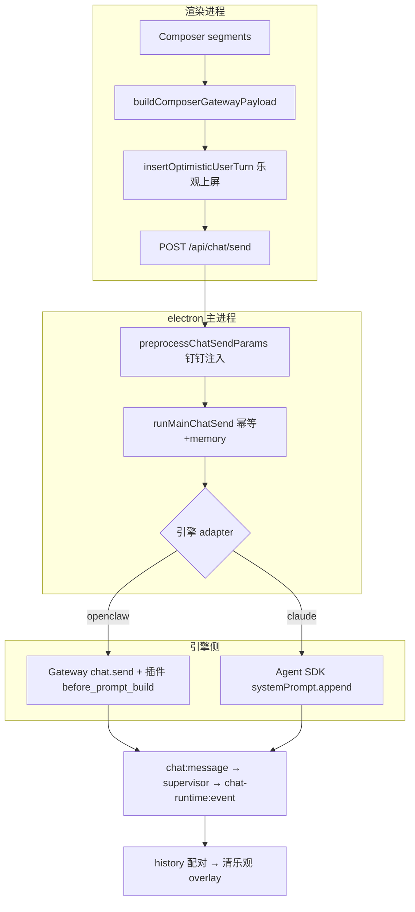

# 提示词拼接链路：Chat 与定时任务全结构分析

> 日期：2026-08-14
> 范围：Chat 自然对话（输入 → 乐观更新 → 组装 → 模型接收 → echo 回显）与定时任务（创建 → 存储 → 执行 → 弹窗回填）的提示词逐环节结构
> 关联：`src/pages/Chat/ChatInput.tsx`、`src/lib/composer-gateway-text.ts`、`src/stores/chat/send-actions.ts`、`electron/services/chat-send-service.ts`、`electron/engines/openclaw-adapter.ts`、`electron/engines/claude-adapter.ts`、`electron/scheduled-tasks/`、`shared/system-prompt-append.ts`、`shared/dingtalk-prompts/`、`shared/agent-memory-prompt.ts`

---

## 0. 一句话结论

提示词不是单点组装，而是**三层叠加**：

| 层 | 位置 | 职责 |
|----|------|------|
| 业务 bake | **渲染进程** | `buildComposerGatewayPayload`：技能 defaultPrompt 前置、`[文件:]`/`[技能:]` 占位、`@mention` 文本化、workflow 执行句、SClaw-Skill marker |
| 引擎装饰 | **electron 主进程** adapter | memory 块注入、`systemPromptAppend` 合并、media 行拼装（`runMainChatSend` 统一编排） |
| system 补丁 | **分引擎** | OpenClaw 在 Gateway 子进程插件 `before_prompt_build` hook；Claude 在主进程 SDK `systemPrompt.append` |

定时任务执行复用**同一个** `runMainChatSend` 发送核心：链路与自然对话在「主进程及以下」完全一致；差异只在上游——提示词在**创建时已 bake 入库**，执行时读库直发，**无前端乐观更新**。



---

## 1. Chat 链路：逐环节提示词结构

贯穿示例：用户输入 `[技能:写日报] 帮我总结今天 @张三`，并挂一个 `report.pdf`。

### 1.1 环节一：Composer 输入（渲染进程）

`DingTalkMentionEditor` 序列化为 `MentionComposerSnapshot`（`src/lib/dingtalk-mention-composer.ts`）：

```ts
type ComposerSegment =
  | { type: 'text'; text: string }
  | { type: 'mention'; mention: DingTalkMention }          // displayName / userId / openConversationId
  | { type: 'skill'; slug: string; title: string }
  | { type: 'workflow'; id: string; name: string; source?: 'mine' | ... }
  | { type: 'file'; attachmentId: string };

// 示例快照
{
  segments: [
    { type: 'skill', slug: 'daily-report', title: '写日报' },
    { type: 'text', text: ' 帮我总结今天 ' },
    { type: 'mention', mention: { displayName: '张三', userId: '...' } },
    { type: 'file', attachmentId: 'att_1' },               // → report.pdf (status: ready)
  ],
  plainText: ' 帮我总结今天 @张三',
  mentions: [DingTalkMention],
}
```

### 1.2 环节二：Bake（渲染进程，核心拼接）

`ChatInput.handleSend`（L337）→ `buildComposerGatewayPayload`（`composer-gateway-text.ts` L56-166），产出**双文本**：

```ts
{
  // 模型侧正文（下传主进程）
  gatewayText: string,
  // 用户可见文案（气泡用，不下传模型语义之外的内容）
  displayText: string,
  attachments: FileAttachment[],      // 按 segment 顺序过滤 ready
  skillMetas: [{ slug, title }],
  workflows: [{ id, name, source }],
  persistedSegments: PersistedComposerSegment[],  // file 展开为 fileName/mimeType/filePath/provenance
}
```

各 segment 的占位符规则（L21-54）：

| segment | gateway 正文 | display 正文 |
|---------|--------------|--------------|
| `text` | 原文 | 原文 |
| `mention` | `@displayName` | `@displayName` |
| `file` | `[文件: report.pdf]` | （空，气泡靠 `_attachedFiles`） |
| `skill` | `[技能: 写日报]`，且 defaultPrompt **前置**到整段开头 | （空，靠 skill tag） |
| `workflow`(mine) | `帮我执行 id 为：{id} 的工作流 【{name}】` | （空） |

拼接规则（L114-134）：

```
gatewayBody = skillPrompts.join('\n\n') + '\n\n' + bodyParts.join('')   // 有技能时 defaultPrompt 前置
gatewayText = gatewayBody + 每个 skill 的 <!-- SClaw-Skill {...} --> marker
displayText = text/mention 部分 join
```

示例产出：

```text
# gatewayText（模型方向）
{写日报技能的 defaultPrompt 全文}

[技能: 写日报] 帮我总结今天 @张三[文件: report.pdf]
<!-- SClaw-Skill {"slug":"daily-report","title":"写日报","displayText":"帮我总结今天 @张三"} -->

# displayText（气泡方向）
帮我总结今天 @张三
```

> 注意：发送前输入框已清空（ChatInput L392-395），体验上"已发出"；真正的乐观插入在下一步 store 内。

### 1.3 环节三：乐观更新（渲染进程）

`sendMessage`（`send-actions.ts` L53）→ `insertOptimisticUserTurn`（`optimistic-turn.ts` L46-153），**先于 IPC**：

```ts
// 写入 runtime-v2 overlay（不污染正式 transcript）
optimisticUserMessage: RawMessage = {
  role: 'user',
  content: displayText,                  // 用户可见文案，不含 defaultPrompt / 文件占位
  id: crypto.randomUUID(),               // ★ 同时作为后续 idempotencyKey
  timestamp: nowMs / 1000,
  _skillMeta / _skillMetas,              // 气泡 skill tag
  _composerSegments,                     // 气泡内联渲染
  _attachedFiles,                        // 气泡附件 chip
}
```

- 显示投影：`display-model.ts` 在 transcript 未配对时把 optimistic append 进列表
- 失败不回滚气泡；主进程 supervisor 广播失败态

### 1.4 环节四：HTTP 发送体（渲染 → 主进程）

`dispatchChatRequest`（`dispatch-chat-request.ts` L28-66）→ `hostApiFetch` → IPC `hostapi:fetch` → `POST /api/chat/send`：

```jsonc
{
  "sessionKey": "agent:main:...",
  "message": "{gatewayText + prepareSendContext 追加的 workflow/embed 上下文}",
  "sourceText": "帮我总结今天 @张三",        // memory 检索锚定用
  "deliver": false,
  "idempotencyKey": "{乐观消息 id}",
  "systemPromptAppend": "...",              // 可选
  "engineType": "openclaw | claude",        // 可选
  "media": [{ "filePath": "...", "mimeType": "application/pdf", "fileName": "report.pdf" }],
  // 钉钉 extras（mentions / attachedFiles）经 preprocessChatSendParams 注入 message 后 strip
}
```

> `skillMetas` / `composerSegments` / `gatewayText` **只留渲染进程**做乐观 UI，不再下传——模型侧靠已 bake 进 `message` 的正文。

### 1.5 环节五：主进程装饰（electron main）

`/api/chat/send`（`gateway.ts` L259）→ `runMainChatSend`（`chat-send-service.ts` L20-96）：

```
幂等检查 runIdempotentChatSend
  → runtimeSupervisor.begin（replay / expired 拦截）
  → agentMemoryContextService.prepare(sourceText || message)
  → adapter.prepareMemoryInjection(params, memory)
  → dispatch → adapter.sendMessage / sendMessageWithMedia
```

**OpenClaw 最终 user message 组装顺序**（`openclaw-adapter.ts`）：

1. `prepareMemoryInjection`（L227-236）：execution memory 先前置、preference memory 再前置——**真实用户请求保持在最后**（注释：让 skill 匹配锚定到真实请求）
2. `resolveOpenClawSendMessage`（L48-54）：`systemPromptAppend` 再前置到整个 message 最前
   - 普通聊天：`prependSystemPromptAppend` → `{append}\n\n{body}`
   - 定时任务：`wrapScheduledTaskSystemPromptAppend` → `{append}\n\n---\n\n用户消息：\n{body}`（`shared/system-prompt-append.ts`，边界让历史展示可还原正文）
3. media（L370-386）：每个文件一行 `[media attached: {filePath} ({mimeType}) | {filePath}]` 附到末尾；图片额外转 base64 进 `attachments`

最终形态：

```text
{systemPromptAppend}                        ← 如有（定时任务钉钉规则等）

<!-- StoClaw-Agent-Memory -->               ← preference memory 块（如有）
...
<!-- StoClaw-Agent-Memory -->

<!-- StoClaw-Agent-Execution-Memory -->     ← execution memory 块（如有）
...
<!-- StoClaw-Agent-Execution-Memory -->

{写日报 defaultPrompt}

[技能: 写日报] 帮我总结今天 @张三[文件: report.pdf]
<!-- SClaw-Skill {...} -->

[media attached: /path/report.pdf (application/pdf) | /path/report.pdf]
```

随后 `gatewayManager.rpc('chat.send', { sessionKey, message, deliver, idempotencyKey, attachments? })`（L311-348）。Gateway schema `additionalProperties:false` **不接受 systemPromptAppend 字段**，所以 append 必须合并进 user message（L40-45 注释）。

**Claude 分叉**（`claude-adapter.ts`）：memory **不进 user message**，而是进 `systemPromptAppend`（L1334-1344）。

### 1.6 环节六：模型实际接收的结构

**OpenClaw**（Gateway 子进程 + `sto-plugin/openclaw` 插件）：

```ts
// RPC 入参（非 OpenAI messages 数组）
{ sessionKey, message: "上节最终形态", deliver, idempotencyKey, attachments?: [base64 图片] }

// 模型视角
system:  Gateway 内置 system + 各插件 before_prompt_build append
         （sto-dynamic-agent-route：SSO/工作区/废弃技能；sto-dingtalk-send-guard：钉钉规则…）
user:    单条长字符串（memory + append + bake 正文 + media 引用）
history: Gateway 自管 session transcript（chat.history 回读，requiresHistoryProjection=true）
```

**Claude**（主进程 Agent SDK，`startClaudeQuery` L1115-1133）：

```ts
{
  systemPrompt: {
    type: 'preset',
    preset: 'claude_code',
    append: systemPromptAppend,   // cwd 工作区说明 + claude 扩展(钉钉/workflow/scheduled-task/user-skill…)
                                  // + params.systemPromptAppend(含 memory) + pending historyBridge
  },
  prompt: string | AsyncIterable<SDKUserMessage>,  // 纯文本，或 Anthropic blocks: [image, text]
  resume: existing.sessionId,     // 续会话历史由 SDK 管理
}
```

发送前日志：`shared/user-send-log.ts` 的 `[USER-SEND]` 打印 agentToModelUserMessage。

### 1.7 环节七：server echo 回显与乐观配对

```
引擎事件（OpenClaw WS event / Claude SDK stream）
  → GatewayManager.emit('chat:message')        ← Claude 也复用此总线（claude-adapter L35-40）
  → ChatRuntimeSupervisor.handleEngineEvent    ← 归一化 canonical event
  → IPC broadcast 'chat-runtime:event'
  → 渲染 runtime-v2 overlay.streamingMessage   ← token 级流式
  → run.completed → loadHistory                ← 固化 transcript
```

乐观消息**不是 ID 硬替换**，而是配对制（`user-message-merge.ts` L263-354）：

1. history 中出现 `role:'user'` echo
2. `isSameUserMessage`：`candidate.id === optimistic.id`（idempotency 回显）优先；否则 displayText / media / composer 结构 + 时间窗
3. `mergeOptimisticUserIntoHistory` → 保留 history 记录，把 display content / segments / skill / 附件从乐观供体 patch 回去
4. 清 overlay：`setOptimisticUserMessage(null)`（`history-apply-loaded.ts` L193-203）
5. 日志关键字：`[USER-QUESTION] server-echo`

---

## 2. 定时任务链路：逐环节提示词结构

### 2.1 创建（双入口，同一 bake）

**UI 入口**：`TaskCreateModal.handleSubmit`（L820-883）→ **同一个** `buildComposerGatewayPayload` → `POST /api/scheduled-tasks` → `ScheduledTaskService.createTask`（L92-117）。

**NL 入口**：模型工具 `create_scheduled_task`（openclaw 插件）/ `create_claude_scheduled_task`（claude 插件）→ host-api → 同一 `createTask` → `alignScheduledTaskCreateToComposerModel`（`scheduled-task-nl-create.ts` L181-300）重建 segments，三列强制 null。

### 2.2 存储结构（SQLite `schedule_tasks`）

```ts
{
  prompt: string,        // ★ 创建时已 bake 的 gateway 正文（含 defaultPrompt 前置、占位符、@文本、SClaw-Skill marker）
  extra_json: {
    composerSegments: PersistedComposerSegment[],   // UI 真源：file/skill/text/mention/workflow（可多技能多工作流）
    composerAttachments: [{ id, fileName, mimeType, persistentPath, provenance }],
  },
  skill_code: null,                  // 恒 null（extra 真源收敛，列仅历史兼容）
  workflow_code: null,               // 恒 null
  dingtalk_recipients_json: null,    // 恒 null
  cron_expr, engine_type, model, workspace_path, ...
}
```

附件持久化：`~/.stoclaw/scheduled-tasks/{taskId}/attachments/{attachmentId}-{fileName}`，`persistentPath` 回写 extra（`scheduled-task-attachments.ts` L305-391）。

### 2.3 执行组装（cron 触发）

`Scheduler.tick` → `claimRun` → `EngineScheduledTaskDispatcher.dispatch`（`scheduled-task-executor.ts` L82-203）：

```ts
sessionKey = buildDatedSessionKey(task, date)
  // Claude:   claude-task:{taskId}:{YYYY-MM-DD}
  // OpenClaw: agent:{agentId}:cron:{taskId}:{YYYY-MM-DD}

message    = task.prompt                 // ★ 读库直发，执行期不再 bake
sourceText = task.prompt
systemPromptAppend = buildExecutionSystemPromptAppend(task)   // 见下
media      = buildMediaFromComposerAttachments(task.extra)    // 只认 persistentPath 仍存在的文件
runtimePolicy = { origin: 'scheduled_task' }
```

**钉钉 systemPromptAppend 结构**（`scheduled-task-service.ts` L310-319）：有 resolved 收件人时 = 收件人块 + 模块 C：

```text
# buildDingTalkMentionSystemContextForScheduledTask（dingtalk-mention-context.ts L297-310）
StoClaw DingTalk Recipients JSON: [{ userId, name, ... }]   ← 收件人 header（块内 id 禁止再搜人）
4. 定时任务：以上 JSON 内收件人必须发送，发送不是可选项（指定即必发）……
5. 【P0 收件人并集 + 同一正文】……
6. 【P0 禁止回执上钉钉】……
+ 定时任务版格式细则 + 命令示例

# SCHEDULED_TASK_DINGTALK_RULES（模块 C，scheduled-task-dingtalk.ts L8+）
定时任务钉钉发送规则：
- 【P0 强制】块内收件人必须发送……
- 【P0】须由你调用 dws chat message send 完成必发……
- 禁止发送前询问 / 业务完成后再发 / 同一正文 / 禁止回执上钉钉 / 产物规则 / 收件人并集 / 场景覆盖
```

降级链（`scheduled-task-dingtalk-lift.ts` L47-61）：`extra.composerSegments` mention → 列（历史）→ prompt 内 Recipients 块（最老历史）；均无则 `buildScheduledTaskDingTalkPromptAppend(prompt)` 条件拼接；再否则 null（CORE 由引擎 hook 注入）。

随后进入**同一个** `runMainChatSend` → `adapter.sendMessageWithMedia`（有 media）/ `sendMessage`。

### 2.4 模型实际接收（与 Chat 的差异）

OpenClaw 定时任务最终 user message（注意 `wrapScheduledTaskSystemPromptAppend` 的稳定边界）：

```text
{钉钉收件人块 + 模块 C 规则}

---

用户消息：
{task.prompt：bake 后的任务正文，含 @displayName / [文件:] / [技能:] / defaultPrompt}

[media attached: ~/.stoclaw/scheduled-tasks/{id}/attachments/xxx.pdf (application/pdf) | ...]
```

与 Chat 的差异仅在：message 来自**库内 prompt** 而非当轮 bake；systemPromptAppend 固定为钉钉规则；无乐观更新、无 `dispatchChatSend`。**主进程及以下（memory 注入、adapter、回显总线）完全一致。**

### 2.5 执行结果回显

- 消息写入 dated 任务会话（user prompt + assistant 回复同会话）
- 侧栏 catalog `cron` / `claude_task` 分组可见；「立即执行」后 `switchSession` 跳进该会话
- 运行记录落 `schedule_task_runs`；事件 `scheduled-task:run:succeeded|failed` 经 Gateway IPC
- `scheduled-task-user-echo.ts` 仅用于 history 合并时识别同 prompt 的任务 user 回显，**不是**执行前乐观插入

> **修正（2026-08-14 增补）**：「无乐观更新」仅指**渲染进程不插入**（无 `insertOptimisticUserTurn`）。实际上主进程 `ChatRuntimeSupervisor.begin` 会在 `run.dispatching` 事件 payload 里携带一条 server 侧构造的 `optimisticUserMessage`（content = `displayText` = `task.prompt` 原文，id = run 幂等键），渲染 reducer 收到后放入 overlay 并标记 `_scheduledTaskOptimistic`——任务会话在 history 回读前就能显示 user 气泡。详见 §5.6。**该机制已决策移除（X2，§5.7）：定时任务 user 气泡完全由 server echo 渲染。**

### 2.6 编辑回填

```
GET task → TaskCreateModal(job)
  → computeInitialValues（L89-165）
      stripInstructionFromTaskMessage(prompt) → 正文
      extra.composerSegments + composerAttachments.persistentPath enrich file segment
  → TaskInstructionComposer initialSegments（L255-292）
      persistedSegmentsToComposer → setSegments（mention/skill/file/workflow token 还原）
  → 保存走同一 handleSubmit 重写 prompt + extra
```

---

## 3. Chat vs 定时任务执行：链路对比

| 维度 | Chat 自然对话 | 定时任务执行 | 一致性 |
|------|--------------|--------------|--------|
| 入口 | 前端 `sendMessage` → `/api/chat/send` | Scheduler → Executor，不经前端 | 不同 |
| 提示词来源 | 当轮 bake：composer → gatewayText | 读库 `task.prompt`（创建时已 bake） | 同源不同期 |
| 乐观更新 | `insertOptimisticUserTurn` 先上屏 | 无（MyTask 注释明确避免） | 不同 |
| 发送核心 | `runMainChatSend`（幂等 + memory + supervisor） | **同一个** `runMainChatSend` | 一致 |
| 引擎 adapter | `sendMessage` / `sendMessageWithMedia` | 同左，media 来自 persistentPath | 一致 |
| systemPromptAppend | 可选（workflow/embed 上下文） | 钉钉收件人规则块（指定即必发） | 机制一致 |
| append 承载 | OpenClaw 前置进 message；Claude 进 SDK append | 同左（定时任务 OpenClaw 多一层 `---` 边界） | 一致 |
| 回显总线 | `chat:message` → supervisor → `chat-runtime:event` | 同左，事件带 `origin=scheduled_task` | 一致 |
| 结果落点 | 当前会话气泡（乐观 → history 配对） | dated 任务会话，侧栏「任务」分组 | 不同 |

**最终判断**：执行过程与 Chat 链路「核心一致、上游不同」。这正是设计文档「执行等价于自然对话」的实现方式——把 bake 前置到保存时，让 cron 执行与自然对话共享同一条主进程发送管线。

---

## 4. 关键文件索引

| 环节 | 文件 |
|------|------|
| Bake | `src/lib/composer-gateway-text.ts`（L56-166）、`src/lib/dingtalk-mention-composer.ts` |
| 乐观更新 | `src/stores/chat/send-actions.ts`（L53-263）、`src/stores/chat/optimistic-turn.ts`（L46-153） |
| 发送体 | `src/stores/chat/dispatch-chat-request.ts`（L28-66）、`src/lib/host-api.ts`（L160-170） |
| 主进程编排 | `electron/services/chat-send-service.ts`（L20-96）、`electron/api/routes/gateway.ts`（L259-299） |
| OpenClaw 装饰 | `electron/engines/openclaw-adapter.ts`（L40-54、L227-236、L311-416）、`shared/system-prompt-append.ts` |
| Claude 装饰 | `electron/engines/claude-adapter.ts`（L1016-1134、L1334-1344） |
| memory 块 | `shared/agent-memory-prompt.ts`（marker L7-8） |
| echo 配对 | `src/stores/chat/user-message-merge.ts`（L263-354）、`src/stores/chat/history-apply-loaded.ts`（L193-203） |
| 任务创建/存储 | `src/pages/MyTask/components/TaskCreateModal.tsx`、`electron/scheduled-tasks/scheduled-task-service.ts`（L92-156）、`electron/scheduled-tasks/scheduled-task-attachments.ts` |
| 任务执行 | `electron/scheduled-tasks/scheduled-task-executor.ts`（L82-203）、`shared/dingtalk-send/scheduled-task-dingtalk-lift.ts`（L47-61） |
| 钉钉规则 | `shared/dingtalk-prompts/dingtalk-mention-context.ts`（L297-310）、`shared/dingtalk-prompts/scheduled-task/scheduled-task-dingtalk.ts` |
| NL 创建 | `sto-plugin/openclaw/sto-scheduled-task-tool/`、`sto-plugin/claude/claude-scheduled-task-tool/`、`electron/scheduled-tasks/scheduled-task-nl-create.ts` |

---

## 5. 编辑体验对齐：Chat 输入框 vs 任务描述框（2026-08-14 增补）

### 5.1 目标与保留分叉

两条链路的「编辑」语义本就不同，**分叉保留、表现对齐**：

| 维度 | Chat 自然对话 | 定时任务 | 决策 |
|------|--------------|----------|------|
| 乐观更新 | `insertOptimisticUserTurn` 先上屏 | 无（cron 触发，无等待气泡场景） | **保留分叉** |
| 编辑持久化 | 不存「编辑」本身；编辑重发 = 新一轮消息，旧轮次保留在 transcript | 存：重写 `prompt` + `extra_json`（`updateTask` 链路） | **保留分叉** |
| 编辑回填数据源 | 内存态 `_composerSegments`（乐观/配对 donor）；冷读 history 时 `hydrateComposerSegmentsOnMessages` 降级重建 | 持久化 `extra.composerSegments`（真源，天然优于 chat 冷读） | 机制不同，质量对齐 |
| 回填还原入口 | `useInputComposerEditDraft` → `persistedSegmentsToComposer` | `TaskInstructionComposer` seed → **同一个** `persistedSegmentsToComposer` | 已统一 |
| 富文本展现 | `DingTalkMentionEditor` | **同一个** `DingTalkMentionEditor` | 已统一，修两个残留问题 |

### 5.2 两个已知问题的根因（代码实证）

#### 问题一：任务描述框重新编辑时 @联系人选择不了

**主因：mention 浮层未 portal，被 Modal 滚动容器裁切。**

- `DingTalkMentionPopover` 渲染在 `InputComposerShell` 的 `mentionPopover` 槽位（`input-composer-shell.tsx` L115），定位为 `absolute left-0 bottom-full z-50`（`DingTalkMentionPopover.tsx` L190）——相对输入壳向上弹出，**未 portal**。
- Chat 输入框位于页面底栏，祖先无 overflow 裁切上下文 → 浮层正常。
- `TaskCreateModal` 表单区为 `flex-1 overflow-y-auto min-h-0`（L929）→ 向上弹出的浮层被滚动容器**裁切**，表现为「选不了」（看不见/点不到）。
- 佐证：同仓 `WorkflowPicker` / `QuickInputPicker` / 附件菜单已用 `createPortal(..., document.body)` + fixed 规避同一问题（`QuickInputPicker.tsx` L185/L277；`docs/Composer附件-上传菜单与数据中心选文件.md` L80 明确记录「弹窗挂 portal … 避免被 Task modal、composer overflow 裁切」）。mention 浮层是唯一漏网的。

**次因（chat 已修过的那个问题，task 同源受益）：** 提交 `0de30f22` 修复「编辑重填后 file/skill 前导空白导致 `insertMentionAtTrigger` 静默失败」——修在共享内核 `dingtalk-mention-composer.ts`（`serializeMentionEditor` L335-351 剥前导空白并回写 `skillOffsets`；`findPlainTextBoundary` L547-552 同步跳过策略）。因任务描述框与 chat 共用内核，该修复对 task 同样生效；若线上仍复现，需确认运行构建包含此提交。

**portal 化的安全性依据**：mention 浮层的关闭**不依赖**「点击外部 DOM 包含」判断（`use-composer-dingtalk-mention.ts` 无 mousedown/contains 监听，靠 `detectActiveMentionTrigger` 返回 null 关闭，L54-57）；选中项用 `onMouseDown preventDefault` 保持编辑器焦点（`DingTalkMentionPopover.tsx` L94-97）。因此移出 DOM 树不破坏现有交互，风险低。

#### 问题二：任务描述框换行被压缩

**逐环节验证结论：UI 创建（有 `composerSegments`）的主链路在当前代码下应保留换行**——

| 环节 | 代码 | 对 `\n` 的行为 |
|------|------|----------------|
| 编辑器写入 | `appendTextWithLineBreaks`（`dingtalk-mention-composer.ts` L124-137） | `\n` → `<br>` 还原 |
| 编辑器序列化 | `serializeMentionEditor`（L280-315） | `BR` → `\n`；块级 DIV 间补 `\n`（混合模式 `59eb3aa1` 已修） |
| bake | `buildComposerGatewayPayload`（`composer-gateway-text.ts` L114-120） | text 原样 `join('')`，仅整段 `trim()` |
| 持久化 | `persistedSegments`（L155） | 直接 `push(seg)`，text 不动 |
| 回填清洗 | `sanitizePersistedTextSegmentForEdit`（`use-input-composer-edit-draft.ts` L102） | 仅 `\n{3,}`→`\n\n` |
| weave 清洗 | `mergeInstructionTextIntoSegments`（`TaskInstructionComposer.tsx` L121） | `[ \t]{2,}`→空格；`\n{3,}`→`\n\n` |
| NL 重建 | `extractInstructionTextForSegments`（`scheduled-task-nl-create.ts` L171） | 同上，保留已有 `\n` |

**真正会压换行的点（按嫌疑排序）：**

1. **`sanitizeEditPlainText`（`use-input-composer-edit-draft.ts` L75）**：`.replace(/\s+/g, ' ')` 把一切空白（含换行）压成单空格。当前仅 chat 编辑草稿**无 segments 降级路径**使用（冷读 history 后编辑重发），task 描述框不走它——但这是「二者表现不一致」的隐患：同一段多行文本，chat 冷读编辑会丢换行，task 不丢。
2. **NL 创建的任务**：模型工具入参 `message` 本身无换行时，`extractInstructionTextForSegments` 只能保留已有 `\n`，不会创造——编辑框里自然没有换行。属创建期数据质量，非编辑链路丢失。
3. **历史构建**：`59eb3aa1` 之前的块级换行序列化 bug；若用户环境为旧构建，「保存→重开」即丢换行。
4. **老数据边界**：`stripDingTalkMentionContextForDisplay` 对「只有收件人块、无 `用户消息：` 边界」的老 prompt 返回 `''`（`dingtalk-mention-context.ts` L124-125），编辑框直接空白（比压换行更严重）。
5. **顺序不一致（「没有保持和原始输入一致」的另一层）**：`mergeInstructionTextIntoSegments` 的 weave 路径会把 segments 重排为 `files → skills → text → mentions → rest → workflows`（L136-143），NL 任务（segments 无 text）编辑时正文被移到 chip 之后，与原始输入顺序不同。

### 5.3 解决方案 A：mention 浮层 portal 化（修问题一）

仿照 `QuickInputPicker` 的双模式（有 anchor 时 portal + fixed，无则退回 absolute 保持兼容）：

1. `DingTalkMentionPopover` 新增可选 `anchorRef`（或经 `dingTalkPopoverProps` 透传 `mentionPopoverHostRef`——`useInputComposerCore` 已持有该 ref，L61/L267）。
2. 有 `anchorRef` 时：`createPortal(panel, document.body)`，定位改 fixed：`left = rect.left`；向上弹出用 `bottom = window.innerHeight - rect.top + 8`（**以视口 bottom 锚定，无需测量浮层自身动态高度**）。
   - **向上空间不足兜底**：当 `rect.top < 浮层预估最小高度（如 240px）` 时翻转为向下弹出（`top = rect.bottom + 8`），并对 panel 设 `max-height: min(rect.top, window.innerHeight - rect.bottom) - 16` + 内部 `overflow-y-auto`，避免极端情况下（大量联系人/搜索结果）浮层顶部溢出视口——否则只是把「裁切」从 Modal 内换到视口外。
3. 监听 `scroll`（capture）/ `resize` 更新坐标；Modal 滚动时浮层跟随（或关闭，取 QuickInputPicker 同款策略）。
4. z-index 提升：当前 `z-50` 与 Modal 同级，portal 后需高于 Modal 层（参考 `QuickInputListItem` tooltip 的 `z-[60000]`）。**需确认与同屏其它 portal（附件菜单、WorkflowPicker、QuickInputPicker）同时出现时的层叠顺序**，建议统一到 `z-[60000]` 一档并按出现先后稳定排序，避免 mention 浮层盖住本应更靠前的浮层。
5. 无 `anchorRef` 调用方保持现状，逐调用方迁移（ChatInput / TaskInstructionComposer / 首页输入框）。**注意：问题一的根因正是 `TaskInstructionComposer` 未传 anchor，若 portal 化只改 `DingTalkMentionPopover` 而不同步把 `mentionPopoverHostRef` 透传到 `TaskInstructionComposer`，问题一仍然存在**——迁移必须以「TaskInstructionComposer 先接 anchor」为前提，否则方案对该调用方失效。

**验收**：Task Modal 新建/编辑态 `@` 浮层可见、可点选、键盘上下选择正常；Chat 底栏与首页输入框不回归；Modal 内部滚动不裁切；**向上空间不足场景浮层翻转向下且不溢出视口**；**TaskInstructionComposer 已接 `anchorRef` 并验证浮层 portal 生效**。

### 5.4 解决方案 B：换行保真对齐（修问题二）

1. **统一清洗函数**：`sanitizeEditPlainText` 改为与 `sanitizePersistedTextSegmentForEdit` 相同的换行策略——`[^\S\n]+`→单空格、`\n{3,}`→`\n\n`、`trim()`（参考 `normalizeUserMessageForDisplay` L116-123 的成熟做法）。消除 chat 降级路径与 task 的行为差。**落地需同步跑 chat 冷读编辑降级路径（无 segments → `sanitizeEditPlainText` → `insertPlainText`/`insertMentionAtTrigger`）的编辑重发回归**，确认下游对含 `\n` 文本的插入稳健——提交 `0de30f22` 修的正是「前导空白导致 insert 静默失败」同类问题，换行保留后需复验不回归。
2. **老数据兜底**：`stripInstructionFromTaskMessage` 返回 `''` 且 segments 无 text 时，回退为「原始 prompt 经 `stripDingTalkMentionContextForDisplay` + `stripComposerModelBakeForDisplay` **组合**清洗」的版本，避免编辑框空白。**单用 `stripComposerModelBakeForDisplay` 不够**：它只剥 `[文件:]`/`[技能:]` 占位，不剥钉钉收件人块；老 prompt 若同时含无 `用户消息：` 边界的收件人块，回退版本仍会带收件人 header 泄漏到编辑框，必须组合两函数。
   - **影响范围**：`stripInstructionFromTaskMessage` 不只在编辑回填用，`MyTask/index.tsx` L89 的列表 `description` 也调用它。兜底逻辑改动会**同步影响任务列表的描述列显示**，需确认列表在兜底后不会出现「带 `[文件:]` 占位 / 收件人 header 的原始 prompt」泄漏到列表描述。改动文件清单需补 `MyTask/index.tsx`。
3. **回归单测**：在 `tests/unit/task-instruction-composer-seed.test.ts` 扩展「多行文本（含 `\n\n` 段落）→ bake → persistedSegments → 回填 `setSegments` → 再序列化」往返不变用例；同步覆盖 chat 降级路径（`sanitizeEditPlainText` 多行输入）。
4. **（可选）NL 入口**：`alignScheduledTaskCreateToComposerModel` 重建时保留模型 message 原始换行（现状已保留），并在工具 schema 描述中提示模型多行任务描述用 `\n`。

### 5.5 解决方案 C：对齐验收矩阵

| 场景 | Chat 输入框 | 任务描述框 | 目标 |
|------|------------|-----------|------|
| `@` 触发浮层 | 正常 | 被 Modal 裁切 | 方案 A 后一致 |
| 编辑回填多行文本（有 segments） | 保留 | 保留 | 已一致，单测锁死 |
| 编辑回填多行文本（无 segments 降级） | **压成单行** | 保留（weave） | 方案 B-1 后一致 |
| 编辑回填 chip（文件/技能/工作流/mention） | `persistedSegmentsToComposer` | 同一函数 | 已一致 |
| 老数据（无边界 prompt） | n/a | 编辑框空白 | 方案 B-2 兜底 |
| 乐观更新 | 有 | 无 | **保留分叉** |
| 编辑持久化 | 不存（重发新轮次） | 存（重写 prompt+extra） | **保留分叉** |

**改动文件清单**：

| 方案 | 文件 | 改动 |
|------|------|------|
| A | `src/components/dingtalk/DingTalkMentionPopover.tsx` | 新增 `anchorRef`，portal + fixed 双模式，向上空间不足翻转 + max-height 兜底 |
| A | `src/components/input-composer/use-composer-dingtalk-mention.ts` / `use-input-composer-core.ts` | `dingTalkPopoverProps` 透传 `mentionPopoverHostRef` |
| A | `src/pages/MyTask/components/TaskInstructionComposer.tsx` | **接线 `mentionPopoverHostRef` 作为 anchor**（问题一的前提，否则 portal 化对该调用方失效） |
| B | `src/components/input-composer/use-input-composer-edit-draft.ts` | `sanitizeEditPlainText` 换行策略对齐（L75） |
| B | `src/lib/scheduled-task-recipients.ts` / `TaskCreateModal.tsx` / `src/pages/MyTask/index.tsx` | `stripInstructionFromTaskMessage` 空串兜底（`index.tsx` L89 列表 description 同步受影响，需一并验证不泄漏占位/收件人 header） |
| B | `tests/unit/task-instruction-composer-seed.test.ts` 等 | 多行往返回归用例 |

### 5.6 问题三：定时任务「立即执行」的乐观更新与气泡显示（2026-08-14 增补）

**现象**（截图 + 日志实证）：

- 图 2：立即执行后任务会话的 user 气泡显示 `[文件: 客户流向_202607_合计_20260711_181547.xlsx]` 占位符，且正文中出现**字面 `\n\n`**（反斜杠字符可见）。
- 日志：`phase=merge-optimistic action=insert-optimistic session=claude-task:{taskId}:2026-08-14 reason=history-missing-user optimisticId={taskId}:manual:2026-08-14T05:57:12.518Z`，`optimisticContent` 为 `[文件: …]\n\n姚磊html网… \\n\\n然后  发送给 @侯正亚 \\n\\n然后在查询上海青浦天气 @谷研硕`——**真换行（`\n`）与字面换行（`\\n`）混杂**。

#### 5.6.1 机制澄清：定时任务并非「完全无乐观更新」

文档 §2.5 已修正。完整链路：

```
MyTask「立即执行」/ cron tick
  → Scheduler.claimRun(triggerSource: 'manual'|'schedule')
      buildIdempotencyKey = {taskId}:manual:{scheduledFor}   ← scheduled-task-scheduler.ts L332-340
  → EngineScheduledTaskDispatcher.dispatch
      displayText: task.prompt                                ← scheduled-task-executor.ts L151（★ gateway 原文）
      idempotencyKey: run.idempotencyKey
  → runMainChatSend → ChatRuntimeSupervisor.begin
      displayText 非空 → 包装 optimisticUserMessage           ← chat-runtime-supervisor.ts L370-381
        { id: idempotencyKey, role: 'user', content: displayText, timestamp }
      → publish('run.dispatching', dispatchPayload)
  → 渲染 client-session-reducer（L208-217）
      startsNewRun → overlay.optimisticUserMessage = dispatchUserMessage
      并标记 _scheduledTaskOptimistic: true
  → display-model：history 无 user echo 时乐观上屏（日志 reason=history-missing-user）
  → echo 到达 → isScheduledTaskUserEcho 配对（scheduled-task-user-echo.ts：
      id 命中 或 时间窗(referenceMs -2s ~ +120s)内 normalizeUserMessageForDisplay 文本全等）
```

> **该机制已决策移除（X2，见 §5.7）**：定时任务不再注入乐观消息，user 气泡完全由 server echo 渲染。

与 Chat 乐观更新的差异：

| 维度 | Chat | 定时任务 |
|------|------|----------|
| 插入方 | 渲染进程 `insertOptimisticUserTurn`（先于 IPC） | 主进程 supervisor 随 `run.dispatching` 广播 |
| content | `displayText`（气泡向文案，无 `[文件:]` 占位） | **`task.prompt` 原文（gateway 向，含 `[文件:]` 占位）** |
| 附带字段 | `_composerSegments` / `_attachedFiles` / `_skillMetas`（富文本气泡） | 无（纯文本气泡） |
| id | 渲染 UUID = idempotencyKey | run 幂等键 = idempotencyKey |

#### 5.6.2 显示 bug A：气泡直接显示 `[文件:]` 占位符

`scheduled-task-executor.ts` L151 `displayText: task.prompt` 把 **gateway 版本**正文当用户可见文案，未做 display 清洗。Chat 链路的乐观消息用的是 `displayText`（bake 时已剥离占位符），任务链路没有对等物。

**修复**：**随 X2（§5.7）整类消失**——乐观消息移除后，user 气泡由 echo 渲染，echo 显示走 `normalizeUserMessageForDisplay` 管线（`stripComposerModelBakeForDisplay` 剥 `[文件:]`/`[技能:]` 占位符、`stripDingTalkMentionContextForDisplay` 剥 `用户消息：` 包装）。executor 的 `displayText` 传参随 X2 清单一并移除，无需单独清洗。

#### 5.6.3 显示 bug B：prompt 混入字面 `\n`（换行问题的真正源头之一）

日志铁证：`[文件: …]` 后是真 `\n\n`（`buildGatewayBody` 拼接前缀，`scheduled-task-nl-create.ts` L114 模板字符串），正文内却是字面 `\\n\\n`——**该任务为 NL 创建，模型在工具 JSON 参数里把换行双重转义成了字面 `\n`**。

字面 `\n` 的连锁破坏：

| 环节 | 行为 | 结果 |
|------|------|------|
| 执行气泡 | `whitespace-pre-wrap` 只认真换行 | 字面 `\n` 原样显示（图 2） |
| 编辑回填 `appendTextWithLineBreaks` | `split('\n')` 只切真换行 | 字面 `\n` 不转 `<br>`，残留为字符或随布局折叠（图 1 下「换行消失」的直接原因） |
| 清洗正则 `\n{3,}`→`\n\n` | 只匹配真换行 | 字面 `\n` 逃逸所有清洗 |
| echo 配对 `normalizeUserMessageForDisplay` | 两侧同样保留字面 `\n` | 配对可命中（侥幸），但 echo 若经任何一侧转义则配对失败 → 乐观消息重复插入（日志第二轮 `insert-optimistic userMessageAt: null` 疑似此情况，待确认） |

**修复**（三层防御）：

1. **NL 入库前归一化**：`alignScheduledTaskCreateToComposerModel`（或 `ScheduledTaskService.createTask`/`updateTask` 的 NL 分支）对 `prompt` 做字面 `\n`→真换行（先例：`dws-send-text.ts` L15-21 `unescapeLiteralDwsSendText`）。**只限 NL 入口**——UI 输入的字面 `\n` 是用户故意输入（正则/代码示例），不能误转。归一化范围应覆盖常见 JSON 转义反斜杠序列（`\n` / `\r` / `\t`），不只 `\n`，避免其它转义残留逃逸。
2. **编辑回填防御**：`persistedSegmentsToComposer` / `mergeInstructionTextIntoSegments` 清洗管线先把字面 `\n` 归一化再处理。**边界收紧**：不能无条件对所有任务归一化——UI 创建的任务若用户故意在描述里打了字面 `\n`（如发给模型的代码示例/正则），归一化会破坏数据。需按任务来源区分：仅对「NL 创建」标记的任务（或 `extra` 中无 UI 创建特征、且 segments text 含字面 `\n` 的任务）归一化，否则保留原样。该原则与 C-2「只限 NL 入口」必须一致，否则 C-3 与 C-2 自相矛盾。
3. **存量数据**：提供一次性迁移/或在 `computeInitialValues` 读取时归一化（只改显示，不回写，用户保存时自然固化）。归一化逻辑需**幂等**（多次打开结果一致），且对「用户不保存就关闭」的情况，下次打开仍能稳定归一化。

#### 5.6.4 与图 1（编辑回显换行丢失）的关联——按澄清后的时序重新定位

**时序澄清**：图 1 上 = 初始编辑（第一次打开编辑框，多行正常）；图 1 下 = 二次编辑（第一次保存后再次打开，换行丢失变一行）；图 2 = 执行到达会话的气泡。

重新定位结论：

1. **初始编辑正常多行** → 创建时 `extra.composerSegments` 的 text 含**真换行**，`setSegments → appendTextWithLineBreaks` 还原正常。回填链路无罪。
2. **二次编辑换行丢失** → 丢失发生在**第一次编辑的保存链路**：`serializeMentionEditor`（DOM→segments）→ `buildComposerGatewayPayload`（原样 push）→ 入库。bake 与入库均不改写 text，**唯一可能丢换行的是保存时的编辑器序列化**——即第一次编辑期间 DOM 中的 `<br>`/块级结构已不存在（用户编辑操作触发 contenteditable 重组、或运行构建早于块级换行修复 `59eb3aa1`）。
3. **prompt 与 segments 的劣化形态不同**（重要线索）：图 2 的 prompt 含**字面 `\n`**，图 1 下的 segments text 是**空格分隔**——二者在第一次保存后并不同源。最可能的解释：第一次保存时 `handleSubmit` 的 `message: payload.gatewayText.trim() || instructions.trim()`（`TaskCreateModal.tsx` L861）发生了 fallback 或 snapshot 与入库 segments 走了不同分支；需要运行时数据确认。
4. **待确认数据**（打印该任务即可收敛）：
   - `schedule_tasks.prompt` 原文（确认字面 `\n` 的位置与数量）
   - `extra_json.composerSegments` 各 text segment 内容（确认是空格还是字面 `\n`、是否含 U+2028 等非常规换行）
   - 第一次保存时 `composerSnapshotRef.current` 的 segments/plainText（确认序列化产物）
   - 运行构建是否包含 `59eb3aa1`（块级换行序列化修复）

### 5.7 设计决策：定时任务去掉乐观更新，直接接手 server-echo（已决策 X2，2026-08-14）

**决策**：采用 X2——定时任务执行不再注入任何形式的乐观 user 消息，任务会话的 user 气泡完全由 server echo（history 回读）渲染。

**决策依据**（本次暴露的问题全部来自这条乐观消息）：

| 代价 | 实证 |
|------|------|
| displayText 用 gateway 原文，气泡显示 `[文件:]` 占位符 | 图 2 第一行 |
| 字面 `\n` 脏数据未经清洗直接上屏 | 图 2 |
| 依赖 `isScheduledTaskUserEcho` 时间窗+文本全等配对；配对失败则乐观消息与 echo **重复上屏** | 日志第二轮 `insert-optimistic userMessageAt: null` |
| 与 Chat 乐观更新同总线但语义不同（无 segments/附件/skillMeta），渲染分支复杂化 | reducer `_scheduledTaskOptimistic` 标记 |

**空窗期评估（X2 的唯一代价）**：执行 → echo 上屏之间，任务会话无 user 气泡，assistant 流式可能先出现。**接受裸奔，不加「执行中」状态条**：

- **cron 触发**：用户以「事后查看」为主，不盯着会话，空窗无感知。
- **「立即执行」**：用户主动操作，跳转会话后可能在 echo 到达前看到 assistant 流式先出现（无 user 气泡）。接受这一割裂——echo 由 supervisor 的 history 轮询（`scheduleHistoryPoll`）主动拉回，非被动等待；「立即执行」跳转后 history 首次加载通常已含 echo。即便偶有空窗，也优于乐观消息带来的占位符泄漏 / 字面 `\n` 上屏 / 重复气泡等问题。

**`transcriptContainsCompletedTurn` 时钟边界（X2 落地需验证）**：删除 `_scheduledTaskOptimistic` 分支后，scheduled 会话在 echo 到达前 `overlay.optimisticUserMessage` 恒 null，完成判定走 L143-148 兜底（`messageTimestampMs(message) >= startedAt` 的首条 user + 其后非空 assistant）。**边界风险**：若 echo 的 user 消息 timestamp 因数据库写入顺序/时钟偏移**略早于 `startedAt`**，该 user 会被 `>= startedAt` 漏过，`transcriptContainsCompletedTurn` 误判「未完成」，影响「执行中」状态收敛。落地时需补一个用例覆盖「echo user timestamp 早于 startedAt」场景，必要时把判定改为 `>= startedAt - 容差（如 2s）` 或改用 run 完成事件驱动而非时间戳比较。

**X2 的附带收益**：图 2 的 `[文件:]` 占位符问题随乐观消息移除**整类消失**——echo 上屏走 `normalizeUserMessageForDisplay` 显示清洗管线（`stripComposerModelBakeForDisplay` 剥占位符、`stripDingTalkMentionContextForDisplay` 剥 `用户消息：`包装），无需再修 executor 的 displayText。**注意：字面 `\n` 不在显示清洗范围内，仍需 §5.6.3 的 C-2/C-3 修复。**

#### 5.7.1 实施清单（精确到行）

**主进程（2 处）**

| # | 文件 | 位置 | 改动 |
|---|------|------|------|
| 1 | `electron/services/chat-runtime-supervisor.ts` | L370-381 | **主防线**：构造 `dispatchPayload` 时，`normalizeRuntimePolicy(input.runtimePolicy, now).origin === 'scheduled_task'` 则不携带 `optimisticUserMessage`（chat 链路行为不变：渲染侧已有同 id 乐观消息，dispatch 携带的本来就会被 `currentOptimisticBelongsToRun` 忽略） |
| 2 | `electron/scheduled-tasks/scheduled-task-executor.ts` | L151 | 移除 `displayText: task.prompt` 传参（清理；注意 `chat-send-service.ts` L33 有 `sourceText` fallback，仅靠本行不够，必须配合 #1） |

**渲染进程（4 处 + 1 文件删除）**

| # | 文件 | 位置 | 改动 |
|---|------|------|------|
| 3 | `src/stores/chat/client-session-reducer.ts` | L210-222 | 删除 `_scheduledTaskOptimistic` 标记分支（L213-215）；`preserveExistingOptimistic` 的 `origin !== 'scheduled_task'` 条件简化为仅 `currentOptimisticBelongsToRun \|\| Boolean(state.overlay.optimisticUserMessage)`（scheduled 会话乐观消息恒 null，原条件成死代码） |
| 4 | `src/stores/chat/history-apply-loaded.ts` | L14、L64-68 | 删除 `findOptimisticUserEcho` 的 `_scheduledTaskOptimistic` 分支与 `isScheduledTaskUserEcho` import（落到既有通用配对 `findHistoryUserEcho` / `isSameUserMessage`） |
| 5 | `src/stores/chat/runtime-v2-store.ts` | L7、L128-136 | 删除 `transcriptContainsCompletedTurn` 的 `_scheduledTaskOptimistic` 分支与 import；scheduled 会话的完成判定由既有兜底覆盖（L143-148：`startedAt` 之后的首条 user 消息 + 其后有非空 assistant） |
| 6 | `src/stores/chat/types.ts` | L87 | 删除 `_scheduledTaskOptimistic?: boolean` 字段 |
| 7 | `src/stores/chat/scheduled-task-user-echo.ts` | 全文件 | 删除 |

**测试（3 个文件 + 2 项补查）**

| # | 文件 | 改动 |
|---|------|------|
| 8 | `tests/unit/chat-client-session-reducer.test.ts`（L212/L229/L246） | scheduled dispatch 用例改为断言**不产生**乐观消息 |
| 9 | `tests/unit/history-apply-loaded.test.ts`（L15） | 删除 `_scheduledTaskOptimistic` 配对用例 |
| 10 | `tests/unit/chat-runtime-selectors.test.ts`（L114） | 同上 |
| 11 | **补查**：搜索 `isScheduledTaskUserEcho` / `scheduled-task-user-echo` 在 `tests/` 下所有引用 | `scheduled-task-user-echo.ts` 全文件删除后，其自身测试/其它引用需一并清理，避免遗留断引用 |
| 12 | **新增**：`transcriptContainsCompletedTurn` 时钟边界用例 | 覆盖「echo user timestamp 早于 `startedAt`」场景，验证完成判定不误判（见上节「时钟边界」） |

#### 5.7.2 验收标准

1. 「立即执行」→ 跳转会话：不再出现含 `[文件:]` 占位符 / 字面 `\n` 的乐观气泡；echo 到达后 user 消息正常显示（占位符被显示清洗剥离）。
2. cron 到点执行：任务会话 user/assistant 轮次完整，无重复 user 气泡。
3. Chat 自然对话回归：乐观上屏、配对清除、编辑重发不受影响（chat 链路不经过 scheduled 分支）。
4. 执行失败（引擎报错）：会话中无残留乐观气泡（原本就没有 user 消息，失败态由 run.failed 事件呈现）。
5. `transcriptContainsCompletedTurn` 对 scheduled 会话的完成判定正常（echo user + assistant 均在 transcript 后判定完成）。

#### 5.6.5 改动文件清单（问题三）

| 方案 | 文件 | 改动 |
|------|------|------|
| ~~C-1~~ | ~~`electron/scheduled-tasks/scheduled-task-executor.ts`（L151）~~ | **已由 X2 取代**（§5.7.1 #1/#2）：乐观消息移除，`[文件:]` 占位符问题整类消失 |
| C-2 | `electron/scheduled-tasks/scheduled-task-nl-create.ts`（`alignScheduledTaskCreateToComposerModel` 入口） | prompt 字面 `\n`→真换行归一化（仅 NL 入口） |
| C-3 | `src/components/input-composer/use-input-composer-edit-draft.ts` / `TaskInstructionComposer.tsx` | 回填清洗管线前置字面 `\n` 归一化 |
| C-4 | `src/pages/MyTask/components/TaskCreateModal.tsx`（`computeInitialValues`） | 读取时显示侧归一化（存量数据兜底，不回写） |
| C-5 | `tests/unit/` | 字面 `\n` 混入的 NL 创建→编辑回填→执行 echo 显示全链路用例 |

---

## 6. 实施顺序与前置确认（2026-08-14 增补）

### 6.1 前置：先打印待确认数据，再定 C 的正则

§5.6.4 列了 4 项待确认数据（`schedule_tasks.prompt` 原文、`extra_json.composerSegments` 各 text segment、第一次保存时 `composerSnapshotRef.current`、运行构建是否含 `59eb3aa1`）。**C-2/C-3 的归一化正则基于「字面 `\n` 是脏数据」的假设**，若数据证伪假设（如 segments text 实含 U+2028 / U+0085 等非常规换行，或换行丢失实为序列化 bug 而非字面 `\n`），C 的正则可能改完不生效。

**落地顺序**：先打印数据收敛假设 → 再写 C-2 归一化正则 → 再写 C-3/C-4。不要在数据未确认前直接照假设改正则。

### 6.2 方案间实施顺序与依赖

| 顺序 | 方案 | 依赖 / 说明 |
|------|------|-------------|
| 1 | **X2**（§5.7） | 独立，优先落地。移除乐观消息后 C-1 整类消失，减少后续干扰 |
| 2 | **C-2**（NL 入库归一化） | 依赖 §6.1 数据确认。与 X2 无耦合，可并行，但建议 X2 先行以隔离变量 |
| 3 | **A**（mention 浮层 portal 化） | 独立于 B/C。**前提：`TaskInstructionComposer` 必须先接 `anchorRef`**，否则 portal 化对问题一失效 |
| 4 | **B**（换行保真对齐） | B-1 改 `sanitizeEditPlainText` 影响 chat 降级路径，需跑回归；B-2 与 C-4 在「老数据/存量数据」上有重叠，建议 B-2 兜底逻辑与 C-4 归一化合并设计，避免两套清洗互相覆盖 |
| 5 | **C-3 / C-4**（回填 + 存量归一化） | 依赖 C-2 的归一化函数（复用），依赖 §6.1 数据确认。C-3 边界需按「NL 创建标记」区分，不能无条件归一化 |

### 6.3 已排除项（本次不处理）

- **多 run 并发配对可靠性**：不考虑「同一任务短时间内多次触发（cron tick 与手动立即执行撞在一起）」场景。X2 移除乐观消息后，配对逻辑简化为 `findHistoryUserEcho` / `isSameUserMessage`，在单次 run 语义下足够；并发 run 的配对可靠性不在本次范围。
- **自动与立即执行冲突**：不考虑 cron 自动触发与「立即执行」同时发生的竞态。

### 6.4 验收补充

- §5.7.2 验收 #5 `transcriptContainsCompletedTurn` 完成判定：需补「echo user timestamp 早于 `startedAt`」边界用例（§5.7.1 #12），确认不误判「未完成」。
- 「立即执行」空窗期：**接受裸奔，不加状态条**（§5.7 空窗期评估已定），无需补状态条用例。
