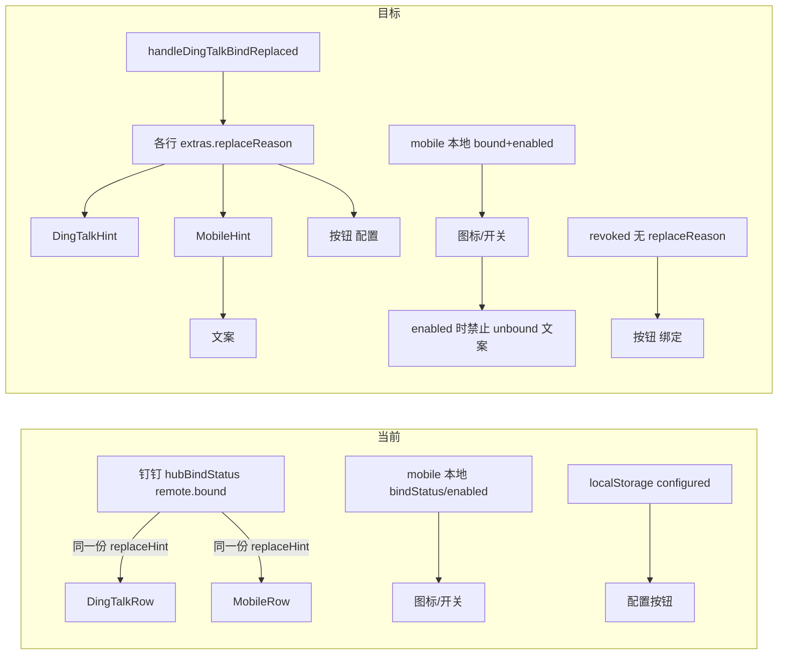

# 移动端频道行状态错位修复计划

> 状态：已落地（P0–P3 + 单测）  
> 范围：频道页「SClaw 移动端」行的图标 / 文案 / 按钮一致性  
> 对照：[`频道破坏性重绑与运行时收敛计划.md`](./频道破坏性重绑与运行时收敛计划.md) §5（钉钉与 Mobile 共用 Hub）+ [`频道行固定引擎与扫码操作方案.md`](./频道行固定引擎与扫码操作方案.md)  
> 现象：有时图标高亮（或开关仍开），副标题却是「已解绑，请重新绑定」；点刷新后恢复正常。

## 根因（已确认）

同一行用了 **三套互不校验的状态**：

| UI | 实际依据 | 问题 |
| --- | --- | --- |
| 图标高亮 / Switch | `mobileBinding.enabled` ← 本地 `bindStatus === 'bound'` 且 `enabled !== false` | 正确读本地 |
| 按钮「配置」 | 现：`enabled` + `localStorage sclaw.mobile.configured`（只 set 不清）；目标：`replaceReason` →「配置」，主动 revoke →「绑定」 | configured 残值会撑出「配置」；抢绑不经 toggle，清不了 |
| 「已解绑，请重新绑定」 | **钉钉** `hubBindStatus().remote.bound === false` 算出的 `replaceHint` | 误用钉钉远端状态 |

关键错位点在 [`src/pages/Channels/index.tsx`](../src/pages/Channels/index.tsx)：

```ts
// Hub is device-level: DingTalk replace also invalidates Mobile.
replaceHint,  // 把钉钉的 hint 直接赋给 mobileBinding
```

`hubBindStatus()` 固定查 `channelType=dingtalk`。钉钉从未绑定、或已解绑到「扫码绑定」时，远端正常返回 `bound: false`，移动端就会长期显示「已解绑」。钉钉行若走 `AvailableChannelRow`，根本不读 `replaceHint`，所以只有移动端中招。

叠加因素：

1. **`fetchPageData` 无请求序号**：进页 / `gateway:channel-status` / `channel:dingtalk-bind-replaced` / Gateway running / 手动刷新都会并发拉取；旧响应可把已 disable 的状态盖回 `enabled=true`。刷新「修好」是因为最新请求赢了。
2. **`syncDingTalkBindWithRemote` 仅在本地钉钉仍 bound 时**才 `disableMobileAppBind`；钉钉已是未绑定列表项时该路径 `skip`，移动端本地可能仍 bound。
3. **`sclaw.mobile.configured` 从不清理**：解绑后按钮常停在「配置」而非「绑定」。



## 目标

移动端这一行的 **图标、文案、按钮必须来自同一条「移动端本地状态」**（`bindStatus` / `enabled` / `extras.replaceReason`），不能再借用钉钉 Hub 的 `remote.bound`，也不能靠 `localStorage sclaw.mobile.configured` 撑按钮文案。

钉钉被其它设备抢走时，仍可提示「已在其它设备绑定 / 已解绑」，但必须满足：

1. 本机已经把对应频道 revoke / disable 完  
2. 提示写在该频道自己的记录上  
3. 未绑过钉钉、或只解绑钉钉而移动端仍开启时，移动端 **不能** 显示「已解绑」

刷新不应再成为「修好状态」的手段。

## 成功标准

| 场景 | 期望 UI |
| --- | --- |
| 钉钉从未绑定（「扫码绑定」） | 移动端默认文案「通过移动端操作本地 agent」；按钮按本地是否开启；**禁止**「已解绑」 |
| 只解绑钉钉、移动端仍 bound | 移动端保持高亮 / 开关；默认文案；无 replaceHint |
| Hub 整机被抢 | 先 disable 移动端 + revoke 钉钉，再通知 UI；移动端灰色 +**「配置」**（由 `replaceReason` 驱动，不靠 localStorage）+「已解绑 / 已在其它设备绑定」 |
| 用户主动关掉 App 绑定 | 灰色 +**「绑定」**+ 默认文案；**不要**抢绑文案 |
| 并发刷新乱序 | 后到的旧响应不能盖住新状态 |
| 重新绑定 / 重新打开 App | replace 文案消失 |

## 方案：按频道持久化 replaceReason，页面不再共用钉钉 remote

不改 Hub 协议，不加 migration。`channel_connections.extras_json` 已有，写入 `replaceReason`。

### P0 — 立刻消掉误报（前端）

文件：[`src/pages/Channels/index.tsx`](../src/pages/Channels/index.tsx)、[`src/pages/Channels/MobileAppChannelRow.tsx`](../src/pages/Channels/MobileAppChannelRow.tsx)

1. **抽出两个纯函数**（建议 `src/pages/Channels/binding-hint.ts`），**签名不共享 remote 入参**，避免扩大 blast radius：

```ts
// 只切断「钉钉 remote → mobile hint」耦合；不读 remote
mobileReplaceHint({ bindStatus, enabled, replaceReason })
// enabled === true 或 bindStatus === 'bound' → 永远 null
// replaceReason 仅在 bindStatus === 'revoked' && !enabled 时生效

// 钉钉行自己的 hint：仍由钉钉 local + remote 决定（现有 other_device/unbound 行为保留）
dingTalkReplaceHint({ local, remote, deviceId })
```

**范围限定（写死）**：P0 只切断「钉钉 `remote` → 移动端文案」这条耦合。钉钉行用自家 `remote` 显示 `other_device` / `unbound` 是正确行为，**不得**改成「钉钉 hint 只看 local」。`dingTalkReplaceHint` 可把现有 [`index.tsx`](../src/pages/Channels/index.tsx) 里 remote 推导逻辑搬进纯函数，语义不变。

**接线（写死）**：`fetchPageData` 里 `setMobileBinding.replaceHint` 改为调用 `mobileReplaceHint`，`replaceReason` 取 **`mobileLocal.extras?.replaceReason`**，禁止再读钉钉算出来的 `replaceHint` / dingTalk `remote`。`GET /api/channels/hub/mobile/status` 的 `local` 已是 `getChannelConnection` 全量（含 `extras`），路由不用改；给前端 local 类型补 `extras?: { replaceReason?: 'unbound' | 'other_device' }`。P0 阶段 extras 恒为 `undefined` → hint 恒 `null`，即下方已知窗口；P2 落库后同一条读路径自动生效。钉钉行仍走 `dingTalkReplaceHint({ local, remote, deviceId })`，**不读**钉钉 extras。

2. **删除** `setMobileBinding` 里把钉钉 `replaceHint` 赋给 mobile 的那一行，换成上一条接线。

3. **防御**：`MobileAppChannelRow` 在 `mobileEnabled` 时忽略 `replaceHint`，只走默认文案或 Hub 离线提示。

> **已知窗口（可接受）**：P0 step 2 删掉共用 `replaceHint` 后、P2 落地前，真实 Hub 整机被抢时移动端只能显示「灰色 + 默认文案」，暂时没有「已在其它设备绑定 / 已解绑」。实施顺序明确接受这点；**PR 描述必须标注**，避免 QA 误判为回归。

### P1 — 丢掉过期 fetch（前端）

同一文件 `fetchPageData`：用 `useRef` 序号，每次 +1；`await` 之后若不是最新一次则 `return`，不要写绑定相关 `setState`。

覆盖入口（含 handler 内调用）：进页、`gateway:channel-status`、`channel:dingtalk-bind-replaced`、Gateway → running、手动刷新、以及 [`handleMobileToggle`](../src/pages/Channels/index.tsx) / [`handleUnbind`](../src/pages/Channels/index.tsx) 成功后的 `await fetchPageData()`。

**守卫边界（写死）**：序号守卫 **只拦** `fetchPageData` 内部的 `setChannelGroups` / `setMobileBinding` / `setDingTalkBinding` / `setError`（以及同函数内其它页面数据 setState）。过期时 **`return`，不要 throw**，以免 `handleMobileToggle` 把成功 toast 打成失败。**不影响**调用方后续逻辑——例如 toggle / unbind 成功后的 `toast.success`、`setDeleteTarget(null)` 仍在 `await fetchPageData()` 之后照常执行；乐观 toast 也可在 fetch 之前发，别被守卫吞掉。过期 fetch 被丢弃时，调用方仍视为「这次用户操作已成功」，只是 UI 数据以更新的并发请求为准。

### P2 — 主进程持久化抢绑原因

文件：[`electron/message-channel/hub/binding-service.ts`](../electron/message-channel/hub/binding-service.ts)、[`electron/message-channel/hub/startup.ts`](../electron/message-channel/hub/startup.ts)、[`electron/message-channel/hub/routes.ts`](../electron/message-channel/hub/routes.ts)

1. 新增 `setChannelReplaceReason(channelType, reason | null)`，作为 extras 上 `replaceReason` 的**唯一**读写入口：
   - 值：`'unbound' | 'other_device'`；`null` = 清除
   - **合并** extras，不得整份覆盖（保留 `ensureFixedChannelBindings` 写入的 `preFixedBinding` 等既有键）
   - 清除时删掉 `replaceReason` 键；若 extras 因此变空则写回 `extras_json: null`（不要写 `"{}"`）
   - 行不存在：**no-op**，不新建行
   - revoke / disable / enable / upsert 清 reason 都走这个函数，禁止在各 UPDATE 里手写 `{ ...extras, replaceReason: undefined }`
2. **抢绑写入与 revoke/disable 解耦（写死选这条；禁止给 revoke/disable 加 `reason?` 可选参数）**。[`handleDingTalkBindReplaced`](../electron/message-channel/hub/startup.ts) 顺序必须是：

   ```
   disconnectPermanently()
   revokeDingTalkHubBind()                 // 只清钉钉 replaceReason
   disableMobileAppBind()                  // 只清 mobile replaceReason
   setChannelReplaceReason('dingtalk', mapped)
   setChannelReplaceReason('mobile', mapped)
   notifyRendererBindReplaced(reason)
   ```

   `mapped`：`'bound_on_another_device'` → `'other_device'`；`'unbound'` 保持 `'unbound'`。revoke/disable **不删行**，只改 `bind_status`，因此随后的 set 能写到同一行；某行不存在则该次 set no-op（例如只开过 App、没绑过钉钉，只写 mobile）。**禁止**在 revoke/disable「时带上」reason——先清后写，顺序反了会被自己清掉。
3. **用户主动路径：revoke/disable 永远是 clearer，签名保持无参**：
   - `disableMobileAppBind` 内部 `setChannelReplaceReason('mobile', null)`
   - `revokeDingTalkHubBind`（当前不碰 extras）内部 `setChannelReplaceReason('dingtalk', null)`
   - 调用点不用改：频道页 [`handleUnbind`](../src/pages/Channels/index.tsx) 钉钉分支 → `/api/channels/hub/dingtalk/bind/unbind` → [`routes.ts`](../electron/message-channel/hub/routes.ts):125；开关关掉 → `:226` `disableMobileAppBind`
4. **重绑时清掉**（同样 `setChannelReplaceReason(..., null)`）：
   - `enableMobileAppBind`
   - `upsertDingTalkHubBind` / claim 成功
5. **status 透出：路由不改**（空操作）。`GET /mobile/status` 与 `/dingtalk/status` 的 `local` 已含 `extras`。页面读路径见 P0 接线。钉钉行 P0 仍用 remote 算 hint，不读钉钉 extras。

### P3 — 按钮文案改由 DB 语义驱动（写死选这条）

**问题链（已确认）**：抢绑走 `handleDingTalkBindReplaced` → `disableMobileAppBind`，**不经** `handleMobileToggle`，清不了 `sclaw.mobile.configured`。下次 `fetchPageData` 仍 `storedConfigured=true` → `mobileConfigured=true` → 又把 `'1'` 写回。结果抢绑后「配置」靠 localStorage 残值撑着，换机/重装后会掉成「绑定」，与成功标准不稳定。

**按钮决策（写死；与 localStorage 脱钩）**——建议抽到 `binding-hint.ts` 的 `mobileBindButtonKind`（或同等纯函数），[`MobileAppChannelRow`](../src/pages/Channels/MobileAppChannelRow.tsx) **禁止**再用 `mobileBinding.configured`（含 `storedConfigured`）决定文案：

```
enabled / Switch 展示中 → 无按钮
replaceReason 有值（unbound | other_device）→ 「配置」
bindStatus === 'revoked' 且无 replaceReason → 「绑定」
其余（从未绑过等）→ 「绑定」
```

因此：抢绑后有 P2 写入的 `replaceReason` → 稳定「配置」，与本机是否还有 `sclaw.mobile.configured` 无关；用户主动关掉（reason 已清）→ 「绑定」。

**localStorage 仅退场清理，不再驱动按钮**：

- 用户主动关掉：[`handleMobileToggle(false)`](../src/pages/Channels/index.tsx) 与侧栏 [`SidebarMobileConnectTooltip`](../src/components/layout/SidebarMobileConnectTooltip.tsx) disable 路径都 `removeItem('sclaw.mobile.configured')`。
- `fetchPageData`：**禁止**在 `!mobileBound && !mobileEnabled` 时因旧 `storedConfigured` 再 `setItem('1')`；`configured` 字段若仍保留给别用，也不得 OR 进按钮文案。
- 抢绑路径**不必**为按钮去清 localStorage（主进程碰不到 renderer storage）；按钮已由 `replaceReason` 保证。可选：收到 `channel:dingtalk-bind-replaced` 时顺手 `removeItem`，只减残值，不是正确性依赖。

## 不改什么

边界与 [`binding-service.ts`](../electron/message-channel/hub/binding-service.ts) / [`startup.ts`](../electron/message-channel/hub/startup.ts) 实际结构对齐，无暗坑：

- 钉钉 / 移动端共用一条 Hub WS 和 refreshToken（产品定调保留，见破坏性重绑计划 §5）；`syncSharedHubRefreshToken` / `resolveSharedHubRefreshToken` 语义不变
- `handleDingTalkBindReplaced` 仍然会 disable 移动端（`startup.ts` 内 `disableMobileAppBind`）；revoke/disable **签名保持无参**，`routes.ts` unbind/disable 调用点不改
- 不加新表、不改 Hub HTTP 路径；status 路由已返回含 `extras` 的 `local`，不另加字段
- 不在页面加主题 / `.dark` 颜色分支
- **钉钉行**用 `remote` 推导 `other_device` / `unbound` 的现有行为保留（P0 不改钉钉行语义）

## 测试

### 纯函数 `binding-hint.ts`

- `mobileReplaceHint`：钉钉未绑场景不入参；移动端 bound+enabled → null；revoked + replaceReason + !enabled → unbound/other_device；enabled=true 即使误传 replaceReason → null
- `dingTalkReplaceHint`：本地未绑 / null → null；本地 bound + remote.bound=false → unbound；本地 bound + remote.deviceId 不一致 → other_device（与现网一致，确认 P0 未改钉钉语义）
- `mobileBindButtonKind`：有 replaceReason → configure；revoked 无 reason → bind；localStorage `'1'` 不得改变结果

### [`tests/unit/channels-page.test.tsx`](../tests/unit/channels-page.test.tsx)

- mock：钉钉 `remote.bound=false`、移动端 `local.bound+enabled` → 无「已解绑」，有开关 / 高亮
- mock：移动端 revoked + `local.extras.replaceReason` → 有「已解绑」，按钮文案「配置」（确认读 extras，不是钉钉 remote / 不是 localStorage）
- mock：移动端 revoked、无 replaceReason，即使 localStorage 仍为 `'1'` → 按钮「绑定」；`fetchPageData` 不得再把 `'1'` 写回
- 两次 fetch 乱序：最终以较新请求为准；旧请求更晚完成不得回写
- toggle / unbind 成功路径：即便某次 `fetchPageData` 因序号被丢弃，toast / `setDeleteTarget(null)` 仍执行

### [`tests/unit/channel-runtime-bootstrap.test.ts`](../tests/unit/channel-runtime-bootstrap.test.ts)

- 该文件整模块 mock binding-service，需补 `setChannelReplaceReason` mock
- `handleDingTalkBindReplaced`：`revokeDingTalkHubBind` → `disableMobileAppBind` → `setChannelReplaceReason('dingtalk', mapped)` → `setChannelReplaceReason('mobile', mapped)`（**断言顺序**）；revoke/disable **无** reason 参数
- `enableMobileAppBind` 清掉 replaceReason

### DB / binding 单测（可扩 [`tests/db/disable-mobile-clear-token.test.ts`](../tests/db/disable-mobile-clear-token.test.ts)）

- 用户主动 `disableMobileAppBind` / `revokeDingTalkHubBind`：签名仍无参；**不写** replaceReason，且清掉旧 reason；不得整份覆盖 extras（`preFixedBinding` 仍在）
- `setChannelReplaceReason(ch, null)`：extras 变空时 `extras_json` 为 `null`，不是 `"{}"`

## 实施顺序

| 步 | 内容 | 立刻修掉的现象 |
| --- | --- | --- |
| 1 | `mobileReplaceHint` + `dingTalkReplaceHint` 拆分；`replaceHint` 改读 `mobileLocal.extras?.replaceReason`；停止共用钉钉 hint | 截图那种误报「已解绑」 |
| 2 | `fetchPageData` 请求序号（仅拦内部绑定 setState） | 「刷新才好」的竞态 |
| 3 | extras.replaceReason：revoke/disable 只清；`handleDingTalkBindReplaced` 之后 `setChannelReplaceReason` 写两行（路由不改） | 真抢绑时仍有正确提示 |
| 4 | 按钮改 `mobileBindButtonKind`（replaceReason→配置，主动 revoke→绑定）；localStorage 只清理、禁写回撑按钮 | 抢绑「配置」稳定；主动关掉变「绑定」 |
| 5 | 补测并跑上述单测 | 回归 |

第 1、2 步即可修用户可见误报；第 3 步补回真抢绑提示。**PR / 分步合入时须写明**：P0–P2 之间移动端在整机被抢后暂时只有「灰色 + 默认文案」，不是回归。
