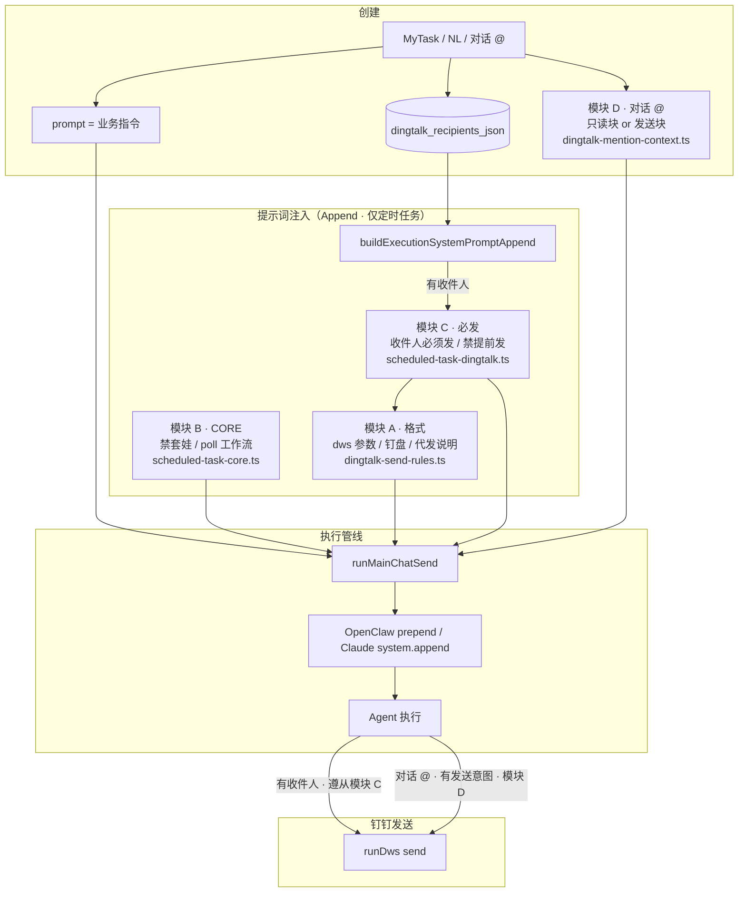

# 钉钉通知（现行架构）

> 定时任务底层：[定时任务架构设计.md](./定时任务架构设计.md)、[定时任务统一重构.md](./定时任务统一重构.md)
>
> **2026-07 临时回退**：工作流已改本地运行，原「Tracker 终态程序代发钉钉」已移除；待本地工作流事件机制就绪后再接入。当前一律由 **Agent 按提示词** 调用 `dws send`（可接受偶发漏发）。

**原则**：收件人落列（`dingtalk_recipients_json`）；定时任务与普通 chat 共用 `runMainChatSend`；提示词 SSOT 在 `shared/dingtalk-prompts/` + `shared/dingtalk-send/`。

---

## 架构图

> **模块** = `shared/dingtalk-prompts/` 下的系统提示词片段，按场景注入 Agent 上下文。

**模块速查**

| 代号 | 含义 | 谁发钉钉 |
|------|------|----------|
| **B** | 定时任务执行上下文（含工作流 poll 指引，不含发送格式） | — |
| **C** | 有收件人的定时任务（含工作流）：Agent **必须**在任务终态后 `dws send` | Agent |
| **A** | 发送格式细则（配合 C 或对话发送场景） | Agent |
| **D** | 对话 @：无意图只读 / 有意图才允许 send | Agent 或 不发 |

---

## 谁发钉钉

| 场景 | 发送方 | 提示词 |
|------|--------|--------|
| 定时任务 · 有收件人（含工作流） | Agent | 模块 B + C + A |
| 对话 @ · 有发送意图（含工作流） | Agent | 模块 D（发送块） |
| 对话 @ · 无意图 | 不发 | 模块 D（只读块） |
| **无**收件人 / 无意图 | 不发 | — |

---

## 工作流钉钉 · Agent 职责边界

**有收件人的工作流：钉钉由 Agent 在终态后发送（提示词控制）。**

| Agent **要做** | Agent **不用做** |
|----------------|------------------|
| `execute_workflow` | 假设系统会自动发钉钉 |
| `get_workflow_status` poll 至 completed / failed / timeout | 把工作流原始 JSON 当 `--text` |
| 有收件人时：组织结果正文并 `dws send`（定时任务遵从模块 C） | — |
| 在 StoClaw 对话确认/汇报 | — |

**前提**

1. **有收件人** — 定时任务列 / 对话 @；无收件人则不发。
2. **定时任务识别工作流** — 模块 B 仍要求 `execute_workflow` + poll；钉钉发送不再按「是否工作流」分流，一律模块 C。

> Tracker（`workflow:startTracking`）仅负责 UI 状态轮询，**不再**代发钉钉。

---

## 提示词模块（文件索引）

| 模块 | 文件 | 何时注入 |
|------|------|----------|
| **B** CORE | `scheduled-task/scheduled-task-core.ts` | 所有定时执行 session（引擎 hook） |
| **C** 必发 | `scheduled-task/scheduled-task-dingtalk.ts` | 有收件人（Append） |
| **A** 格式 | `dingtalk-send-rules.ts` | 配合 C，或 prompt 含 `dws send` |
| **D** 对话 @ | `dingtalk-mention-context.ts` | 普通对话 @ |

OpenClaw 插件副本：`pnpm run sync:plugin-shared`。

---

## 关键代码

| 职责 | 路径 |
|------|------|
| 定时 append 烘焙 | `electron/scheduled-tasks/scheduled-task-service.ts` |
| 执行 session 识别 | `shared/scheduled-task-instruction.ts` |
| Tracker（仅 UI 状态） | `electron/main/services/workflow-execution-tracker.ts` |

sessionKey：`agent:{id}:cron:{taskId}:{date}` / `claude-task:{taskId}:{date}`。

---

## 已删除 / 待做

- **已删** `scheduled-task-dingtalk-fallback`（`lastAssistantText` 兜底，易双发/错发）
- **已删** 工作流终态程序代发：`workflow-dingtalk-delivery`、`resolve-workflow-dingtalk-recipients`、`WORKFLOW_DELEGATE` / `workflowProgramDelivery`
- **待做** 本地工作流上线后，再评估是否恢复「终态事件 → 程序代发」

---

## 验收要点

1. 有收件人列 → 双引擎执行期可见模块 C（指定即必发）；工作流任务**不再**出现「系统自动发送」
2. 非工作流 / 工作流定时任务 → Agent 遵从模块 C；无系统兜底
3. 对话 @ → 仍按模块 D（有意图才发）
4. 创建时收件人落列，`prompt` 不含规则大块
5. Tracker 终态日志无 `[workflow-dingtalk]`
