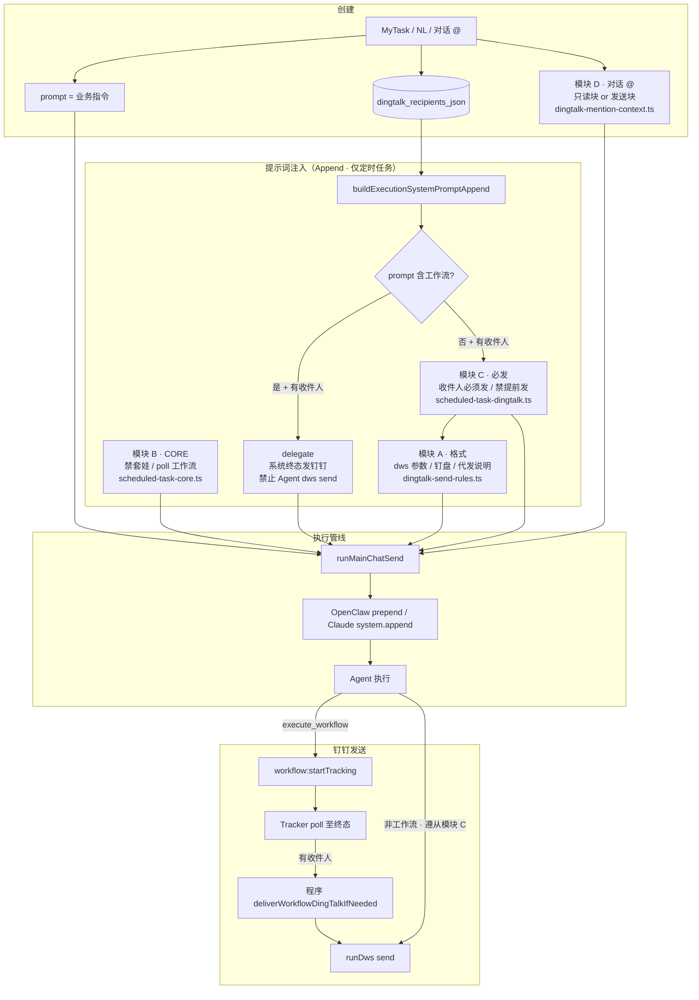

# 钉钉通知（现行架构）

> 定时任务底层：[定时任务架构设计.md](./定时任务架构设计.md)、[定时任务统一重构.md](./定时任务统一重构.md)

**原则**：收件人落列（`dingtalk_recipients_json`）；定时任务与普通 chat 共用 `runMainChatSend`；提示词 SSOT 在 `shared/dingtalk-prompts/` + `shared/dingtalk-send/`。

---

## 架构图

> **模块** = `shared/dingtalk-prompts/` 下的系统提示词片段，按场景注入 Agent 上下文。

**模块速查**

| 代号 | 含义 | 谁发钉钉 |
|------|------|----------|
| **B** | 定时任务执行上下文（与工作流 poll 相关，不含发送格式） | — |
| **C** | 有收件人的**非工作流**定时任务：Agent **必须**在任务终态后 `dws send` | Agent |
| **A** | 发送格式细则（配合 C 或对话发送场景） | Agent |
| **delegate** | 有收件人的**工作流**任务：终态由程序发，Agent **禁止** send | 程序 |
| **D** | 对话 @：无意图只读 / 有意图才允许 send | Agent 或 不发 |

---

## 谁发钉钉

| 场景 | 发送方 | 提示词 |
|------|--------|--------|
| 定时任务 · 非工作流 · 有收件人 | Agent | 模块 B + C + A |
| 定时任务 · **工作流** · 有收件人 | **程序**（Tracker） | delegate（Append） |
| 对话 · **工作流** · 有收件人 | **程序**（Tracker） | 模块 D；**无** delegate |
| 对话 @ · 非工作流 · 有发送意图 | Agent | 模块 D（发送块） |
| 对话 @ · 无意图 | 不发 | 模块 D（只读块） |
| 工作流 · **无**收件人 | 无程序发送 | — |

收件人解析（工作流）：IPC 参数 → 任务列 → 对话 pending @（`resolve-workflow-dingtalk-recipients.ts`）。

---

## 工作流钉钉 · Agent 职责边界

**有收件人的工作流：钉钉由程序在终态代发，Agent 不负责发钉钉。**

| Agent **仍要做** | Agent **不用做** |
|------------------|------------------|
| `execute_workflow` | 组织 summary / 产物正文并发 `dws send` |
| `get_workflow_status` poll 至 completed / failed / timeout | 遵从模块 C 必发、逐个收件人 send |
| 在 StoClaw 对话确认/汇报 | 把工作流原始 JSON 当 `--text` |

程序触发链：`workflow:startTracking` → Tracker poll → `deliverWorkflowDingTalkIfNeeded` → `runDws`（completed / failed / timeout 均发）。

**前提**

1. **有收件人** — 无列 / 无 @ / 无 IPC 传入 → 程序不发，也无 delegate。
2. **进 Tracker** — 须 `workflow:startTracking`（前端、API、Agent 工具路径均需注册）。
3. **定时任务识别工作流** — prompt 含 `wf_`、`execute_workflow`、`执行 id 为…工作流` 等才注入 delegate；识别失败时可能仍走模块 C（边界情况）。

**尚未硬隔离**：提示词已禁止 Agent send，但 `TODO(workflow-dingtalk-guard)` 未落地，send-guard 尚不拦截 Agent 自发 `dws send`，存在偶发双发风险。

---

## 提示词模块（文件索引）

| 模块 | 文件 | 何时注入 |
|------|------|----------|
| **B** CORE | `scheduled-task/scheduled-task-core.ts` | 所有定时执行 session（引擎 hook） |
| **C** 必发 | `scheduled-task/scheduled-task-dingtalk.ts` | 有收件人、**非工作流**（Append） |
| **A** 格式 | `dingtalk-send-rules.ts` | 配合 C，或 prompt 含 `dws send` |
| **delegate** | 同上 C 文件内 `WORKFLOW_DELEGATE` | 有收件人 + **工作流**（Append） |
| **D** 对话 @ | `dingtalk-mention-context.ts` | 普通对话 @ |

工作流判定：`scheduled-task/prompt-involves-workflow.ts`。OpenClaw 插件副本：`pnpm run sync:plugin-shared`。

---

## 关键代码

| 职责 | 路径 |
|------|------|
| 定时 append 烘焙 | `electron/scheduled-tasks/scheduled-task-service.ts` |
| 工作流终态发送 | `electron/services/workflow-dingtalk-delivery.ts` |
| 正文格式化 | `shared/dingtalk-send/workflow-dingtalk-delivery.ts` |
| Tracker 触发 | `electron/main/services/workflow-execution-tracker.ts` |
| 执行 session 识别 | `shared/scheduled-task-instruction.ts` |

sessionKey：`agent:{id}:cron:{taskId}:{date}` / `claude-task:{taskId}:{date}`。

---

## 已删除 / 待做

- **已删** `scheduled-task-dingtalk-fallback`（`lastAssistantText` 兜底，易双发/错发）
- **待做** `TODO(workflow-dingtalk-guard)`：工作流 track 期间 send-guard 拦截 Agent 自发 dws（防偶发双发）

---

## 验收要点

1. 有收件人列 → 双引擎执行期可见对应提示词（OpenClaw 经 prepend）
2. 工作流 + 收件人 → 终态由程序发 summary/失败说明；同 run 不重复（`dingtalkDeliveryDone`）
3. 非工作流定时任务 → Agent 遵从模块 C；无系统兜底
4. 创建时收件人落列，`prompt` 不含规则大块
