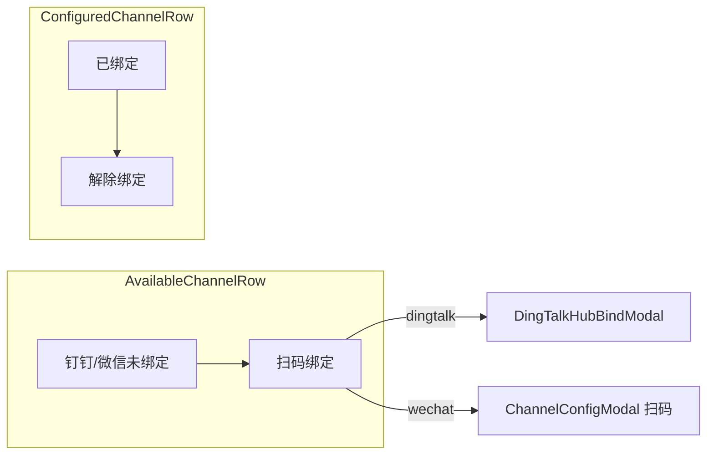

# 频道行固定引擎与扫码操作

频道页「支持的移动端」+「支持的频道」（钉钉 / 微信）的现行约定。  
进程按需拉起见 [`docs/微信Worker按需拉起方案.md`](./微信Worker按需拉起方案.md)；启动入口 [`ensureChannelRuntimesReady`](../electron/message-channel/hub/startup.ts)。

## UI

| 行 | 引擎 / Agent | 右侧操作 |
| --- | --- | --- |
| 移动端 | 固定 `pi` + `main` | Switch / 配置入口 |
| 钉钉 | 同上 | 未绑定：「扫码绑定」；已绑定：「解除绑定」 |
| 微信 | 同上 | 同上 |

约定：

- **SAgent** = `engineType: 'pi'`
- **Main Agent** = `agentId: 'main'`
- 已绑定不可直接重扫；需先解绑再扫
- 解绑使用页面 `ConfirmDialog`（文案「解除绑定」）

未绑定钉钉/微信通常走 [`AvailableChannelRow`](../src/pages/Channels/AvailableChannelRow.tsx)；已配置走 [`ConfiguredChannelRow`](../src/pages/Channels/ConfiguredChannelRow.tsx)。

## 绑定与引擎

- 常量：[`FIXED_CHANNEL_BINDING`](../electron/message-channel/hub/binding-service.ts) = `{ engineType: 'pi', agentId: 'main' }`
- 启动：`ensureFixedChannelBindings()` 将已 bound 行规范化为上述常量（覆盖 `dingtalk` / `wechat` / `sto-mobile` / `mobile`）
- 入站读路径：`resolveChannelBinding` / `getWeixinBinding` 直接返回固定值，不在读路径写库
- Agent 改绑 API（钉钉 / Mobile / 微信）请求体忽略，落库仍为固定值

## 会话

- Mobile：请求带 `sessionKey` 时校验 registry 引擎；不一致或非 `claude|pi` → `forceNew` 且清空 `requestedKey`，不复用 latest
- 钉钉 / 微信：策略 C — registry 引擎与绑定不一致，或 registry 为 `openclaw` → 新开会话；registry 缺失则复用旧 key（打 warn）
- `createOrGetSession` 默认引擎为 `pi`
- App 历史：[`history-facade`](../electron/message-channel/mobile/history-facade.ts) 按 registry 选 `claude|pi` adapter

## 解绑与列表

- 微信解绑：Host 清凭证 / stop / shutdown Worker；不经 OC Gateway restart
- 列表合并：[`mergeWeixinHostChannel`](../electron/message-channel/host/list.ts) 以 `getWeixinBinding()` 为准（`bound` 才出列表）
- 频道页无「网关未运行」黄条；刷新不依赖 gateway running

## 关键文件

| 区域 | 文件 |
| --- | --- |
| 绑定常量 / ensure | `hub/binding-service.ts`、`hub/startup.ts` |
| 会话 | `common/session-facade.ts`、`common/session-lifecycle.ts` |
| 微信绑定 / 列表 | `weixin/binding.ts`、`host/list.ts`、`api/routes/channels.ts` |
| UI | `src/pages/Channels/*`、i18n `channels.json` |
