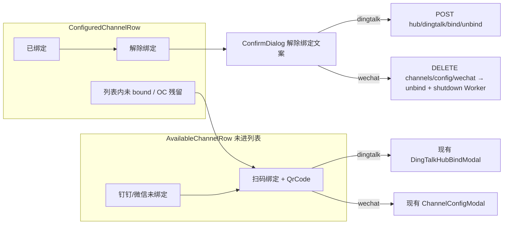
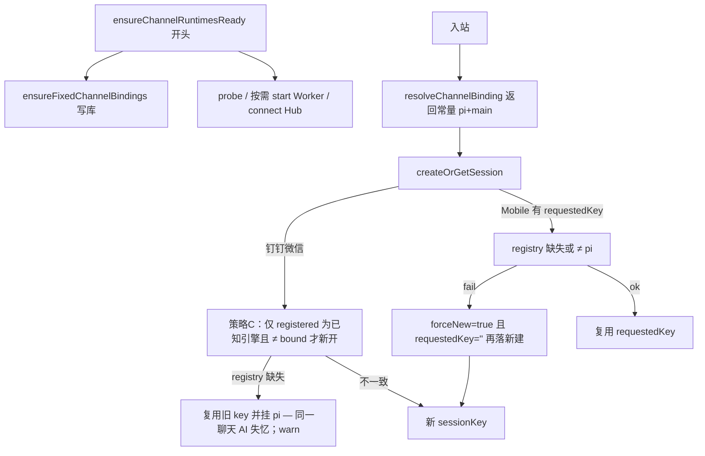

# 频道行固定引擎与扫码操作

> 状态：已执行（含跟进：解绑 UI / Confirm loading / 去网关黄条 / 微信 DELETE 不重启 OC）  
> 范围：频道页「支持的移动端」+「支持的频道」（钉钉 / 微信）  
> 修订：历史已绑定强制改为 SAgent(`pi`) + Main Agent(`main`)；修正会话边界、热路径、清理面与 mobile 兼容查询  
> 对照：启动入口以 [`ensureChannelRuntimesReady`](../electron/message-channel/hub/startup.ts) 为准；与 [`docs/微信Worker按需拉起方案.md`](./微信Worker按需拉起方案.md) 正交（那份管进程何时拉起，本份管绑定引擎与行内操作）

## 实现风险（按严重度）

| 严重度 | 项 | 结论 |
| --- | --- | --- |
| **高** | Mobile 门禁不能照插 | 必须重构早返：①续聊 `return` 只放在 `engineOk`；②`!engineOk` 时 **`forceNew=true` 且 `requestedKey = ''`**，否则 line 131 仍带着原 key 复用 latest，门禁等于没装。见下方「会话与 Mobile 捷径」伪代码。 |
| **中** | 钉钉/微信 registry 缺失 → 同会话失忆 | **产品接受**：切到 `pi` 后无感知历史（同一聊天 AI「失忆」）。不改策略 C、**不发**渠道通知；命中时打带 `sessionKey` 的 `warn` 即可。 |
| **低** | 读路径常量 + 启动写库 → DB/运行时短暂错位 | 故意双轨；入站以读路径常量为准。列表/status 仍可能吐旧 `engineType`；实现前扫非入站消费者（已列 `history-facade` 必修）。 |

执行者勿被旧表述误导：

- **不要**去 `resolveChannelBinding` / `getWeixinBinding` 里找「要取消的 ensure 调用」——`ensureFixedChannelBindings` 是**新函数**；约束是「**不在读路径引入**」。
- 读路径常量化后，`resolveChannelBinding` 原 fallback 分支**不可达**；改成 `'pi'` 仅防御。
- `createOrGetSession` 未知 `engineType` 的 default（约 line 68–71）也要改成 `'pi'`，与 fallback 对齐。

## 目标 UI

| 行 | 引擎/Agent | 右侧操作 |
| --- | --- | --- |
| 移动端 | 去掉两个下拉；固定 `pi` + `main` | 保持现有 Switch / 配置入口不变 |
| 钉钉 | 同上 | 未绑定：扫码 icon +「扫码绑定」；已绑定：「解除绑定」（去掉铅笔与垃圾桶） |
| 微信 | 同上 | 同上 |

约定：

- **SAgent** = `engineType: 'pi'`（见 [`src/lib/agent-engine-display-name.ts`](../src/lib/agent-engine-display-name.ts)）
- **Main Agent** = `agentId: 'main'`（工作区身份；与 agent 列表里 `main` 是否标成 `claude` 无关，`engineType` 才是运行时）
- 「弹窗先不考虑」= 不改扫码弹窗内部；扫码仍打开现有入口
- 解绑沿用页面已有 `ConfirmDialog`，但文案从「删除」改为「解除绑定」（见 UI §2）
- **已绑定不能直接重扫**：去掉铅笔后，必须先解绑再扫。不要把扫码 icon 留在已绑定态。
- **产品转向（有意）**：本分支已接的微信行内多引擎 UI / 改绑入口一并回退为固定 `pi`+`main`，并清理前端死调用；见下方「与多引擎能力的关系」

未绑定钉钉/微信在页面上通常是 [`AvailableChannelRow`](../src/pages/Channels/AvailableChannelRow.tsx)（accounts 列表无 overlay）；[`ConfiguredChannelRow`](../src/pages/Channels/ConfiguredChannelRow.tsx) 的未绑定只覆盖 OC 残留等边角。两处按钮文案都要改成「扫码绑定」。



---

## 评审结论：问题是否存在

### 1. 中途切引擎 / 上下文断裂 — 部分成立，失败链需纠正

**评审描述的失败链（钉钉/微信「同键翻引擎 + 清句柄」）不成立。**

钉钉 / 微信入站**不传** `sessionKey`（见 [`hub/ingress.ts`](../electron/message-channel/hub/ingress.ts)：`sessionKey: channelType === 'mobile' ? … : null`；微信 [`bridge-inbound.ts`](../electron/message-channel/weixin/bridge-inbound.ts) 不传）。走 [`createOrGetSession`](../electron/message-channel/common/session-facade.ts) 时，在复用 `latestSession` 前已有 **策略 C**：

```ts
// session-facade.ts — registered ≠ bound → forceNew
forceNew = shouldForceNewDingTalkSessionForEngine({
  boundEngineType: engineType,
  registeredEngineType: registered?.engineType,
});
```

绑定归一化为 `pi` 后，若 latest 在 registry **有明确非 `pi` 引擎**，idle 窗口内下一条消息会 **新开 sessionKey**，再 `rememberSessionEngineType(新key, 'pi')`，**不会**在旧 key 上把 `claude` 静默翻成 `pi` 并清掉句柄。

**用户可见结果仍会断上下文**——但这是既有「换引擎 → 新会话」策略，不是「同键续聊却换引擎」。

**真正要补的洞：Mobile 续聊捷径。**  
`createOrGetSession` 若带有效 `sessionKey`（App 路径 A），现状是 `if (usable) { remember…; return usable; }`，**绕过策略 C**。绑定改 `pi` 后，App 若仍带着旧 Claude 会话的 key 续聊，才会出现「同键翻引擎 + 清句柄」。

**补充 A：策略 C 对「registry 缺失」的盲区（承认，钉钉/微信本阶段不收紧策略）。**  
`shouldForceNewDingTalkSessionForEngine` 仅当 `registered` 为 `claude|openclaw|pi` 且与绑定不一致时才 `forceNew`；`registered` 为 `null/undefined/未知` 时返回 `false` → **复用旧 key**，再 `rememberSessionEngineType(旧key, 'pi')`（`engineChanged === false`，不清场）。

用户感知：同一聊天线程里引擎从 claude 静默切到 pi，而 pi 侧没有任何 claude 历史 → **「同一聊天但 AI 失忆」**（与 Mobile 要防的「同键翻引擎」同类，命中面更窄：老会话 / registry 裁剪缺失）。  
**产品定调（写死）：可接受——切换到 `pi` 无感知历史。** 不改策略 C，不发渠道通知，只加强日志：

| 项 | 决定 |
| --- | --- |
| 策略 | 钉钉/微信维持既有盲区，不 forceNew |
| 日志 | 命中「registry 缺失却复用 + 挂 pi」时打 **`warn`**，带 `sessionKey` / `channelType` / `boundEngineType` |
| 用户通知 | **不发**「引擎已升级 / 已开启新对话」；接受无感知历史 |

**补充 B：Mobile「不可用 key」必须是起新会话，禁止 fall-through 续 latest。**  
若只把 `requestedKey` 标不可用后自然落到 `getLatestChannelCatalogSession` + 策略 C，可能出现：App 请求续 X（claude/无 registry），而 latest 是另一条已是 `pi` 的 Y → 静默改成续 Y。与「请求续 X」语义不符。  
**写死：Mobile 在 requestedKey 引擎门禁失败时直接 `forceNew=true`，跳过 latestSession 复用，强制新建 sessionKey。**  
`findUsableSessionKey` 因格式 / 渠道 / agent 失败而 fall-through，保持现状，不要误伤。

**本方案修订：**

| 项 | 决定 |
| --- | --- |
| 钉钉 / 微信 | 依赖既有策略 C；registry 缺失盲区**产品接受**（切 pi 无感知历史）；命中打 `warn` |
| Mobile | `requestedKey` 门禁：**registry 缺失或 ≠ 绑定引擎** → **`forceNew=true` + `requestedKey=''`** 起新会话（不复用 latest） |
| 用户通知 | 一律不发渠道系统消息；盲区仅 `warn` |
| 实现 | Mobile 必须重构早返，禁止在原 `return usable` 前只加一行 `forceNew` |

**会话边界（写死）：**

- 钉钉/微信：绑定改 `pi` 后，若 latest 在 registry 有明确非 `pi` 引擎 → 策略 C 开新 key；若 registry **缺失** → 仍可能复用旧 key 并挂上 `pi`（既有盲区，接受；打 warn）。
- Mobile：续聊 key 在 registry **缺失或 ≠ `pi`** → **一律新开会话**，不续 requestedKey，也不改续其它 latest。
- 不批量改写 registry / catalog 历史行；旧引擎会话仍留在库里。

### 2. 与分支多引擎能力冲突 — 成立，且为有意产品转向

确认：**有意回退**行内引擎/Agent 选择，固定 SAgent + Main。不等于整分支作废（微信 Host Worker、扫码绑定、按需拉起等仍保留），但 **UI 多引擎与改绑交互要拆掉**。

清理面：

- 前端：去掉钉钉/微信/移动端下拉与 `on*BindingChange` 接线；删除页面对 `/api/channels/wechat/binding/agent`、`/api/channels/hub/*/binding/agent` 的调用
- i18n：行内用的 `hub.wechat.engineLabel` / `hub.dingtalk.engineLabel` / `hub.mobile.engineLabel` 等若无引用则删除
- [`ChannelInlineSelect`](../src/pages/Channels/ChannelInlineSelect.tsx) 目前只被这两行使用，去掉下拉后若无其它引用则删除
- 后端：`updateWeixinBindingAgent` / hub `binding/agent` **本阶段保留实现**（避免大删 API），请求体无论带什么引擎都 **钳制成** `pi`+`main`（不要 400，旧客户端/单测仍会 POST）
- 单测：删改依赖下拉/改绑的用例（尤其 [`tests/unit/channels-page.test.tsx`](../tests/unit/channels-page.test.tsx)「微信可切换 Claude/SAgent」），改为固定绑定与扫码/解绑断言

### 3. 入站热路径 ensure — 成立；`ensureFixedChannelBindings` 是新函数

全仓目前 **没有** `ensureFixedChannelBindings`；`resolveChannelBinding` / `getWeixinBinding` **从不**调用它。本节不是「取消既有调用」，而是：

**写死：不在读路径 / 入站路径引入 `ensureFixedChannelBindings`（禁止为归一化扫三类通道写库）。**

| 层 | 做法 | 谁是 source of truth |
| --- | --- | --- |
| DB 写回 | **仅**在 [`ensureChannelRuntimesReady`](../electron/message-channel/hub/startup.ts) **开头**（probe / skip Hub / skip Weixin 之前）跑一次新函数 `ensureFixedChannelBindings()` | 持久化真相：启动后 DB 应尽快变成 `pi`+`main` |
| 新写入 | upsert 默认 `pi`+`main` | 新行直接正确 |
| 读路径钳制 | `resolveChannelBinding` / `getWeixinBinding` **直接返回常量** `{ engineType: 'pi', agentId: 'main' }`（仍可校验已 bound，**不写库**） | **入站路由真相**：无视两次启动之间的 DB 滞后 |

这是故意的双轨防御：读路径让 ensure 对入站「部分冗余」——启动漏跑时入站仍走 SAgent；下次启动再把 DB 纠齐。**接受**启动前窗口内 DB ≠ 运行时。

**不要**挂在 `weixin/service.ts` `start` 或 `hub.connect` 上：按需拉起后无凭证会 skip Worker、无 token 会提前 return，ensure 会漏跑。扫码成功路径禁止回灌全量 ensure（只 `hub.connect` / `ensureReady`）。

**读路径常量化后，`resolveChannelBinding` 里 `conn.engineType === 'openclaw' \|\| 'pi' ? … : 'claude'` 分支对入站已不可达。** 把非法 / 缺失 fallback 改为 `'pi'` 仅作防御，避免将来有人去掉常量返回时又默回 claude；不要花时间纠结「还要不要保留 openclaw 分支」。

**`createOrGetSession` 参数默认也要对齐：** 现状 `params.engineType` 未知时 default `'claude'`（约 line 68–71）。入站经读路径会拿到 `pi`，但其它 caller 若省略 `engineType` 会与新绑定不一致。**一并改为 default `'pi'`。**（当前 caller 仅 ingress / weixin bridge，均会传 binding；改默认是对齐，不是行为大变。）

#### DB 旧 `engineType` 的其它消费者（实现前确认）

下拉去掉后频道页不展示绑定引擎，但下列路径仍读 DB / binding 上的 `engineType`，两次启动之间可能看到 `claude`：

| 消费者 | 影响 | 本方案动作 |
| --- | --- | --- |
| Hub / Mobile status API → 频道页 state | 去掉下拉后 UI 不用 | 可不改；可选 status 也返回常量 |
| [`host/list.ts`](../electron/message-channel/host/list.ts) `mergeWeixinHostChannel` | accounts 里带 `engineType` | 下拉去掉后页面不用；可选改为常量 |
| [`mobile/history-facade.ts`](../electron/message-channel/mobile/history-facade.ts) | **读 registry**，且 `openclaw` 以外一律当 `claude` | **已修**：仅 `claude` \| `pi`；legacy `openclaw` 登记 warn 后走 `pi` adapter，不再调用 openclaw adapter |
| 导出 / 审计 / 其它页面 | 实现时再 `rg engine_type\|engineType` 扫非入站读取点 | 若发现展示绑定引擎的 UI，改为常量或等 ensure 写齐 |

### 4. 静默破坏性覆盖 — 成立为产品取舍，加强日志

保持强制覆盖、不做回滚 UI。日志加强：

- `info` 打出 `normalized` 条数，以及按通道的 `fromEngine/fromAgent → pi/main` 抽样或计数（至少 `dingtalk:claude→pi ×N`）
- 命中行把旧值写入 `extras_json.preFixedBinding = { engineType, agentId, at }`（有则覆盖）；表上已有 `extras`，成本低，便于日后若恢复多引擎可查

### 5. mobile 旧 `channel_type` — 成立

`ensureFixedChannelBindings` 查询必须：

```sql
channel_type IN ('sto-mobile', 'mobile')
```

或分别查后合并；**禁止**只查 `toDbChannelType('mobile') === 'sto-mobile'` 而漏掉未迁移的 `'mobile'` 行。钉钉 / 微信按字面类型查即可。`getChannelConnection('mobile')` 已有单行 fallback，但 bulk UPDATE 不能只走它。

---

## 历史已绑定：强制切到 SAgent

### 目标常量

```ts
const FIXED_CHANNEL_BINDING = { engineType: 'pi', agentId: 'main' } as const;
```

### 归一化（幂等，仅启动入口）

**新函数** `ensureFixedChannelBindings()`（[`binding-service.ts`](../electron/message-channel/hub/binding-service.ts)）：

1. 查 `bind_status = 'bound'` 且 `channel_type IN ('dingtalk','wechat','sto-mobile','mobile')`
2. 非 `pi`/`main` 则 UPDATE，写入 `extras_json.preFixedBinding`，并打结构化日志（含原值）
3. 已是目标则跳过

触发：**仅** [`ensureChannelRuntimesReady`](../electron/message-channel/hub/startup.ts) 函数开头一次；**不**入站写库，**不**挂 Weixin `start` / Hub `connect`，**不**在 `resolveChannelBinding` / `getWeixinBinding` 内引入。

### 读路径

[`resolveChannelBinding`](../electron/message-channel/common/session-facade.ts) / [`getWeixinBinding`](../electron/message-channel/weixin/binding.ts)：已 bound 时返回固定 `pi`+`main`，**不写库**。凭证-only 微信 fallback 已是 `pi`+`main`，保持。

### 新写入默认

- `upsertDingTalkHubBind` / `enableMobileAppBind`：`engine_type` 默认 `'claude'` → `'pi'`
- 微信 upsert 保持默认 `pi` + `main`（已是）
- 钉钉 update 分支「不改 engine」注释可保留；启动归一化会纠历史，新插入已是 `pi`

### 会话与 Mobile 捷径（实现必须重构早返，不能照插）

- 钉钉/微信：依赖策略 C（已有；registry 缺失不 forceNew；命中盲区打 `warn`）
- Mobile（比策略 C 更严）：**必须改掉**现状 `if (usable) { remember…; return usable; }` 的早返结构

**错误写法（无效）：** 在原 `return usable` **之前**只加 `forceNew = true` —— line 上的 `return` 仍会直接返回旧 key，门禁完全失效。

**正确结构：** 把「续聊 return」搬进 `engineOk` 的 else；`!engineOk` 时**不要 return**，落到下方 `resolveChannelSessionKey` 建新 key。且必须让下方「mobile 跳过 latest」条件成立：

现状约 line 131：

```ts
latestSession: channelType === 'mobile' && !requestedKey ? null : latestSession
```

依赖 `requestedKey` 为空才会丢掉 latest。因此 `!engineOk` 分支**必须同时** `requestedKey = ''`（或等价：临时变量清空后再参与后续判断），并设 `forceNew = true`。只设 `forceNew` 不清 `requestedKey`，mobile 仍会带着原 key 语义落到复用路径。

```ts
// 伪码 — 替换现有 if (usable) { remember; return } 整块，不要在 return 前塞一行
const requestedKeyInitial = params.sessionKey?.trim() || '';
let requestedKey = requestedKeyInitial;
let forceNew = !!params.forceNew;

if (requestedKey) {
  const usable = await findUsableSessionKey({
    sessionKey: requestedKey,
    channelType,
    agentId,
  });
  if (usable) {
    // 仅 Mobile 做引擎门禁；钉钉/微信入站根本不带 sessionKey，走不到这里
    if (channelType === 'mobile') {
      const registered = await getEngineSessionRegistryEntry(usable);
      const engineOk =
        registered?.engineType === 'claude'
        || registered?.engineType === 'openclaw'
        || registered?.engineType === 'pi'
          ? registered.engineType === engineType // 绑定侧已钳制为 pi
          : false; // registry 缺失或未知 → 不可用

      if (!engineOk) {
        forceNew = true;
        requestedKey = ''; // 写死：清空，才能走「mobile && !requestedKey → latest=null」
        // 不要 return usable；不要仅靠策略 C / latest
        logger.warn('[SessionFacade] mobile sessionKey engine gate failed, forceNew', {
          requestedKey: requestedKeyInitial,
          boundEngineType: engineType,
          registeredEngineType: registered?.engineType ?? null,
        });
      } else {
        await rememberSessionEngineType(usable, engineType);
        // …既有 catalog upsert …
        return { sessionKey: usable, engineType, agentId };
      }
    } else {
      await rememberSessionEngineType(usable, engineType);
      // …既有续聊 return（非 mobile 保留）
      return { sessionKey: usable, engineType, agentId };
    }
  }
}

// 下方：mobile 无 requestedKey 时 latestSession 传 null；forceNew 已可能为 true
```



---

## UI 改动点

### 1. 去掉三行引擎 / Agent 下拉

- [`ConfiguredChannelRow.tsx`](../src/pages/Channels/ConfiguredChannelRow.tsx)、[`MobileAppChannelRow.tsx`](../src/pages/Channels/MobileAppChannelRow.tsx)、[`index.tsx`](../src/pages/Channels/index.tsx)：删下拉与 `handle*BindingChange` 接线
- 改这些文件时不要新增页面级 `dark:` 颜色分支（存量不在本方案范围）

### 2. 钉钉 / 微信 → 扫码绑定 / 解除绑定

- **Available 行**（常见未绑定）：按钮由「绑定」改为扫码 icon +「扫码绑定」，仍分别 `openDingTalkHub` / 打开 `ChannelConfigModal`
- **Configured 已绑定**：单一「解除绑定」替换铅笔 + 垃圾桶；去掉铅笔 = 已绑定不能直接重扫
- **Configured 未绑定**（边角）：同样「扫码绑定」，不要留下拉
- i18n：新增 `account.scanBind` / `account.unbind` / `account.unbinding` / `account.unbindConfirm`（zh / en / ja）；成功 toast 用 `toast.unbindSuccess`
- **ConfirmDialog loading**：`onConfirm={() => handleUnbind()}`，必须把 Promise 交回对话框（禁止 `void handleUnbind()`），否则内置 `confirming` / `Loader2` 不生效；可用 `confirmingLabel`
- 微信解绑：`DELETE /api/channels/config/wechat` → **仅** Host 路径 `stopMonitor` → `account.remove` → `unbindWeixinBot` → `shutdown`；**禁止**再走 `deleteChannelConfig` / `clearAllBindingsForChannel` / `scheduleGatewayChannelRestart`（Host 微信不依赖 OC Gateway）
- 频道页**去掉**「网关未运行」黄条；刷新按钮不再因 gateway 非 running 禁用（列表读 Hub/Weixin Host，不依赖 OC）

### 3. 明确不改

- 扫码弹窗 UI / 轮询（`DingTalkHubBindModal` / `ChannelConfigModal` 内部）
- 圆点与副标题绑定检测（见 [`src/pages/Channels/README.md`](../src/pages/Channels/README.md)）
- 不批量删历史 catalog/registry 会话行
- 不把 `ensureFixedChannelBindings` 塞进扫码成功路径或入站 / 读路径
- Agents / Skills 页各自的 gateway 黄条不在本方案范围

### 4. 测试

- 前端：无下拉；Available「扫码绑定」；Configured 已绑定「解除绑定」且无铅笔/垃圾桶；无 gateway 黄条
- 后端：`ensureFixedChannelBindings`（含 `mobile` 旧类型 + 在 `ensureChannelRuntimesReady` 开头调用，skip Hub/Weixin 时仍跑）；读路径返回常量；`binding/agent` POST 其它引擎被钳成 `pi`+`main`
- 微信 DELETE：断言 `unbind` + `shutdown`，且 **`debouncedRestart` 未被调用**
- **新建** `createOrGetSession` 单测（仓库里目前没有）：
  - Mobile：`registry` 缺失或 `claude` → **新 key**，且 **不是**其它 latest；`registry=pi` → 续 requestedKey
  - 断言：引擎门禁失败后 `requestedKey` 已清空语义生效（不会复用旧 usable）
  - 钉钉/微信策略 C：binding=`pi`、registry=`claude` → forceNew；registry 缺失 → 复用（可另断言 warn 被调用）
- `history-facade`：registry=`pi` 时走 pi adapter（修开 openclaw/claude 二元假设）

## 落地后补充（跟进缺陷）

| 项 | 处理 |
| --- | --- |
| 解绑后仍显示「解除绑定」 | `getWeixinBinding`：DB `revoked` 不复活凭证；`mergeWeixinHostChannel` 只信 binding，不 OR `getBoundWeixinAccountId` |
| 刷新无 loading | 页级 `refreshing` + `animate-spin`；`fetchPageData` 返回 Promise |
| 确认无 loading | ConfirmDialog 接收 `handleUnbind` 的 Promise |
| 解绑闪「网关未运行」 | 频道页去黄条；微信 DELETE 与 OC restart 解耦 |

## 主要文件

前端：ConfiguredChannelRow / MobileAppChannelRow / AvailableChannelRow / index / ChannelInlineSelect（可删） / channels.json×3 / channels-page.test.tsx

后端：binding-service（ensure 新函数 + 默认值 + mobile IN + preFixedBinding）/ hub `startup.ts`（ensure 开头一次）/ weixin `binding.ts`（读路径钳制）/ session-facade（读路径常量 + Mobile 早返重构 + default/`fallback` 改 `pi`）/ mobile `history-facade.ts`（支持 pi）/ 对应单测

清理关注：页面侧 wechat/hub `binding/agent` 调用、行内引擎相关 i18n、依赖下拉的单测、无引用的 `ChannelInlineSelect`

## 待办

1. Host：`ensureChannelRuntimesReady` **开头**调**新函数** `ensureFixedChannelBindings`（含 mobile 双类型 + 详细日志 + `preFixedBinding`）；upsert 默认 `pi`；读路径返回常量（**不在读路径引入 ensure**）；`binding/agent` 钳制成固定值；**不**入站写库，**不**挂 Weixin `start` / Hub `connect`
2. session-facade：**重构** Mobile 路径 A 早返 — `!engineOk` 时 `forceNew=true` **且** `requestedKey=''`，把续聊 `return` 只放在 `engineOk` 分支；钉钉/微信策略 C 盲区保持 + 命中 `warn`；`createOrGetSession` 未知 `engineType` default 与 resolve fallback 均改为 `pi`（常量化后原 fallback 分支不可达，仅防御）
3. `history-facade`：registry=`pi` 走 pi adapter；实现前再扫一遍非入站 `engineType`/`engine_type` 消费者
4. 三行去下拉；Available + Configured 扫码绑定 / 已绑定解除绑定 + i18n + ConfirmDialog 解绑文案；已绑定不可重扫
5. 前端/后端单测（含新建 `createOrGetSession`：无 registry / claude → 新 key 且非 latest；有 pi → 续聊；门禁失败必须清空 requestedKey 语义）与死调用 / `ChannelInlineSelect` 清理
6. 跟进：ConfirmDialog 解绑 loading；频道页去掉 gateway 黄条；微信 Host 解绑与 OC `debouncedRestart` 解耦；解绑后列表不因 revoked+残留凭证复活
