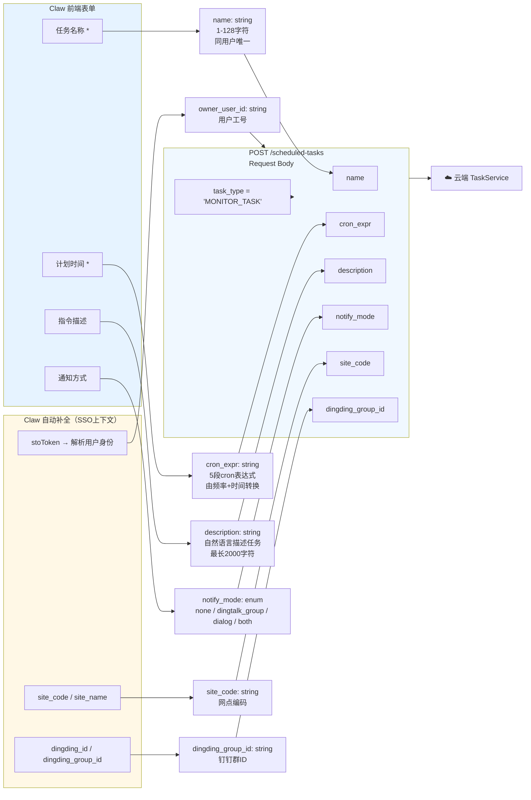

# Claw 创建 → 云端执行 → 产物推送 完整流程图

> 覆盖：用户在 Claw 端创建定时任务、传入云端的内容、云端执行的全部分支（模型问问题 / sai-cli 取数 / 取数后计算）、产物生成（markdown 直接推送 / PPT Word Excel 文件生成）及推送。

---

## 图 1：总览（Claw 端 → 云端 → 执行 → 产物 → 推送）

```mermaid
flowchart TD
    subgraph CLAW["🖥️ Claw 前端（Electron）"]
        C1[用户点击<br/>新建定时任务] --> C2[填写表单]
        C2 --> C3["传入云端的内容"]
    end

    C3 --> API["📡 POST /scheduled-tasks<br/>Main 进程 → 云端 Task API"]

    subgraph CLOUD_CREATE["☁️ 云端：任务创建 & 脚本生成"]
        API --> V1[校验 & 落库]
        V1 --> V2{description<br/>非空?}
        V2 -->|是| V3[script_status='pending'<br/>异步触发 LLM 生成]
        V2 -->|否| V4[script_status='ready'<br/>无脚本，走回退模式]
        V3 --> V5[LLM 根据 description<br/>生成 Python 脚本]
        V5 --> V6[AST 安全扫描]
        V6 -->|通过| V7[上传 OSS<br/>script_v1.py]
        V6 -->|失败| V8[script_status='error']
        V7 --> V9[script_status='ready']
    end

    V4 --> SCHEDULE["⏰ XXL-JOB 定时调度"]
    V9 --> SCHEDULE
    V8 --> C10[前端显示错误<br/>用户可重试]

    subgraph EXECUTE["⚙️ 云端：执行引擎"]
        SCHEDULE --> E1[到期任务触发]
        E1 --> E2[下载脚本到 Sandbox]
        E2 --> E3["脚本执行<br/>（ Docker + seccomp ）"]

        E3 --> E4{"脚本内部逻辑分支"}
    end

    subgraph BRANCH_A["🔷 分支 A：纯模型问问题"]
        E4 -->|description 要求<br/>直接问模型| A1[调用内部 LLM API<br/>将 description 作为 prompt]
        A1 --> A2[接收模型返回的<br/>markdown / 文本]
        A2 --> A3[stdout 输出 JSON 摘要]
        A3 --> A4[产物：markdown 字符串]
    end

    subgraph BRANCH_B["🔷 分支 B：sai-cli 取数 → 直接推送"]
        E4 -->|description 要求<br/>查询数据并展示| B1[ Sandbox 内调用<br/>sai-cli &lt;product&gt; &lt;module&gt; &lt;action&gt; ]
        B1 --> B2[sai-cli 返回 JSON 数据]
        B2 --> B3[脚本格式化数据为 markdown 表格 / 文本]
        B3 --> B4[stdout 输出 JSON 摘要]
        B4 --> B5[产物：markdown 字符串]
    end

    subgraph BRANCH_C["🔷 分支 C：sai-cli 取数 → 计算 → markdown"]
        E4 -->|description 要求<br/>取数后分析计算| C1[ Sandbox 内调用<br/>sai-cli 取数 ]
        C1 --> C2[得到原始 JSON 数据]
        C2 --> C3[Python 计算逻辑]<br/>统计 / 比对 / 异常检测
        C3 --> C4[生成分析结论文本]
        C4 --> C5[stdout 输出 JSON 摘要]
        C5 --> C6[产物：markdown 字符串<br/>含分析结论 + 数据表格]
    end

    subgraph BRANCH_D["🔷 分支 D：sai-cli 取数 → 计算 → 生成文件"]
        E4 -->|description 要求<br/>生成报表/PPT| D1[ Sandbox 内调用<br/>sai-cli 取数 ]
        D1 --> D2[得到原始 JSON 数据]
        D2 --> D3[Python 计算 / 整理数据]
        D3 --> D4{"生成什么文件?"}

        D4 -->|Excel| D5[openpyxl / xlsxwriter<br/>生成 .xlsx]
        D4 -->|Word| D6[python-docx<br/>生成 .docx]
        D4 -->|PPT| D7[python-pptx<br/>生成 .pptx]
        D4 -->|PDF| D8[ReportLab / fpdf2<br/>生成 .pdf]
        D4 -->|图片| D9[matplotlib / pillow<br/>生成 .png/.jpg]

        D5 --> D10[写入 OUTPUT_DIR]
        D6 --> D10
        D7 --> D10
        D8 --> D10
        D9 --> D10
        D10 --> D11[stdout 输出 JSON 摘要<br/>含产物文件名列表]
        D11 --> D12[产物：文件集合<br/>在 OUTPUT_DIR 中]
    end

    A4 --> COLLECT
    B5 --> COLLECT
    C6 --> COLLECT
    D12 --> COLLECT

    subgraph COLLECT_PHASE["📦 产物收集 & 存储"]
        COLLECT[收集产物] --> COL1{产物类型?}
        COL1 -->|markdown 文本| COL2[写入 task_run<br/>execution_result]
        COL1 -->|文件| COL3[扫描 OUTPUT_DIR]
        COL3 --> COL4[上传 OSS<br/>artifacts/{run_id}/xxx]
        COL4 --> COL5[INSERT task_artifact 表]
        COL5 --> COL6{需钉钉推送?}<br/>notify_mode
        COL6 -->|是| COL7[同步到 CDN<br/>获取 cdn_url]
        COL6 -->|否| COL8[仅 oss_key]
    end

    COL2 --> PUSH
    COL7 --> PUSH
    COL8 --> PUSH

    subgraph PUSH_PHASE["📤 推送通知"]
        PUSH[推送] --> P1{notify_mode?}
        P1 -->|none| P2[不推送<br/>仅保存记录]
        P1 -->|dingtalk_group| P3[构建 markdown 消息]
        P1 -->|dialog| P4[推送到 Claw 对话]
        P1 -->|both| P5[同时推送钉钉+对话]

        P3 --> P6{产物是文件?}
        P6 -->|是| P7[钉钉消息附 CDN 下载链接]
        P6 -->|否| P8[钉钉消息直接附 markdown 正文]

        P4 --> P9[Claw 前端展示执行结果]
        P5 --> P6
        P5 --> P9
    end

    P2 --> END1([结束])
    P7 --> END1
    P8 --> END1
    P9 --> END1

    style CLAW fill:#e6f3ff
    style CLOUD_CREATE fill:#fff4e6
    style EXECUTE fill:#e6ffe6
    style BRANCH_A fill:#f0f8ff
    style BRANCH_B fill:#f0f8ff
    style BRANCH_C fill:#f0f8ff
    style BRANCH_D fill:#f0f8ff
    style COLLECT_PHASE fill:#fff0f5
    style PUSH_PHASE fill:#f5f0ff
```

---

## 图 2：Claw 端创建任务 —— 传入云端的完整字段



---

## 图 3：云端脚本执行 —— 四大分支详细对比

```mermaid
flowchart TD
    START([Sandbox 启动<br/>脚本执行]) --> S1[注入环境变量]
    S1 --> S2[TASK_ID, RUN_ID, OWNER_ID]
    S1 --> S3[SITE_CODE, STO_TOKEN]
    S1 --> S4[OUTPUT_DIR]
    S1 --> S5[sai-cli 已在容器内安装<br/>~/.sai/bin/sai-cli]

    S5 --> S6{"脚本内容决定分支"}

    subgraph A["分支 A：纯模型问问题<br/>（无取数，直接调用模型）"]
        A1["场景：用户问'总结最近物流行业动态'<br/>或'分析这段数据的意义'"]
        A1 --> A2[脚本内调用内部 LLM API]
        A2 --> A3[POST /llm/chat<br/>prompt = description]
        A3 --> A4[接收 streaming / blocking 响应]
        A4 --> A5[整理为 markdown 格式]
        A5 --> A6[print{"summary": "...", "type": "markdown"})]
        A6 --> A7["产物：markdown 字符串<br/>存入 execution_result"]
    end

    subgraph B["分支 B：sai-cli 取数 → 直接推送<br/>（无计算，原始数据展示）"]
        B1["场景：用户说'每天早上9点推送昨日总部对账结果'"]
        B1 --> B2[sai-cli hq reconciliation query<br/>--params '{site_code, date}']
        B2 --> B3["sai-cli 返回 JSON<br/>{'items': [...]}"]
        B3 --> B4[脚本将 JSON 转为 markdown 表格]
        B4 --> B5[print({"summary": "...", "type": "markdown"})]
        B5 --> B6["产物：markdown 表格<br/>存入 execution_result"]
    end

    subgraph C["分支 C：sai-cli 取数 → 计算 → markdown<br/>（有分析结论）"]
        C1["场景：用户说'检查异常客户，标注差异超过10%的'"]
        C1 --> C2[sai-cli customer cost query<br/>--params '{site_code, month}']
        C2 --> C3["返回客户成本数据<br/>[{code, cost, avg_cost}]"]
        C3 --> C4[Python 计算：deviation = |cost - avg| / avg]
        C4 --> C5[筛选 deviation > 10% 的客户]
        C5 --> C6[生成分析文本：<br/>"发现5家异常客户，其中XX客户偏差达25%..."]
        C6 --> C7[print({"summary": "...", "abnormal_count": 5, "type": "markdown"})]
        C7 --> C8["产物：markdown 含分析结论+数据表格<br/>存入 execution_result"]
    end

    subgraph D["分支 D：sai-cli 取数 → 计算 → 生成文件<br/>（PPT / Word / Excel / PDF）"]
        D1["场景：用户说'每月1号生成本月客户成本分析报表'"]
        D1 --> D2[sai-cli 取数]
        D2 --> D3[Python 计算 / 整理数据]
        D3 --> D4{"文件类型判断"}

        D4 -->|表格类数据| D5["生成 Excel<br/>openpyxl / xlsxwriter"]
        D4 -->|文字报告| D6["生成 Word<br/>python-docx"]
        D4 -->|汇报演示| D7["生成 PPT<br/>python-pptx"]
        D4 -->|固定版式报告| D8["生成 PDF<br/>fpdf2 / reportlab"]
        D4 -->|图表可视化| D9["生成图片<br/>matplotlib / pillow"]

        D5 --> D10[文件写入 OUTPUT_DIR]
        D6 --> D10
        D7 --> D10
        D8 --> D10
        D9 --> D10

        D10 --> D11[print({"summary": "...", "artifacts": ["report.xlsx"], "type": "files"})]
        D11 --> D12["产物：文件集合<br/>上传 OSS + CDN"]
    end

    S6 --> A
    S6 --> B
    S6 --> C
    S6 --> D

    A7 --> PUSH
    B6 --> PUSH
    C8 --> PUSH
    D12 --> PUSH

    subgraph PUSH["📤 推送阶段"]
        PUSH --> P1{notify_mode}
        P1 -->|dialog| P2[推送到 Claw 对话<br/>前端展示 execution_result<br/>或文件下载链接]
        P1 -->|dingtalk_group| P3[钉钉群机器人推送]
        P1 -->|both| P4[同时推送]

        P3 --> P5{产物类型?}
        P5 -->|markdown| P6[钉钉消息体直接包含 markdown<br/>支持表格、加粗、链接]
        P5 -->|文件| P7[钉钉消息：<br/>标题 + 摘要 + 文件下载链接<br/>（CDN URL，长期有效）]
    end

    style A fill:#e6f3ff
    style B fill:#e6f3ff
    style C fill:#e6f3ff
    style D fill:#ffe6cc
    style PUSH fill:#f0f8ff
```

---

## 图 4：云端 Prompt 设计 —— LLM 如何生成不同分支的脚本

```mermaid
flowchart TD
    START([用户 description]) --> P1[构建 LLM Prompt]

    P1 --> P2["System Prompt（固定）"]
    P2 --> P2a["你是一个申通快递业务数据分析助手"]
    P2 --> P2b["生成 Python 3 标准库脚本"]
    P2 --> P2c["必须使用环境变量：STO_TOKEN, SITE_CODE, OUTPUT_DIR"]
    P2 --> P2d["禁止 os.system/subprocess/eval/exec/socket"]
    P2 --> P2e["网络只能访问 *.sto.cn"]
    P2 --> P2f["stdout 最后一行必须是 JSON 摘要"]

    P1 --> P3["User Prompt（动态）"]
    P3 --> P3a["任务名称：{name}"]
    P3 --> P3b["任务描述：{description}"]
    P3 --> P3c["网点编码：{site_code}"]

    P1 --> P4["Few-shot Examples（按场景选择）"]

    subgraph EX1["示例 A：纯模型问问题"]
        E1A["输入：分析昨日对账异常原因"]
        E1B --> E1B1["脚本内直接调用 LLM API"]
        E1B1 --> E1B2["将数据和问题一起发给模型"]
        E1B2 --> E1B3["print({summary: 模型返回})"]
    end

    subgraph EX2["示例 B：sai-cli 取数 → markdown"]
        E2A["输入：查询昨日总部对账"]
        E2B --> E2B1["subprocess.run(['sai-cli', ...])"]
        E2B1 --> E2B2["json.loads(stdout)"]
        E2B2 --> E2B3["格式化为 markdown 表格"]
        E2B3 --> E2B4["print({summary: markdown})"]
    end

    subgraph EX3["示例 C：取数 → 计算 → markdown"]
        E3A["输入：找出偏差超过10%的客户"]
        E3B --> E3B1["sai-cli 取数"]
        E3B1 --> E3B2["for item in data: calc deviation"]
        E3B2 --> E3B3["filter deviation > 0.1"]
        E3B3 --> E3B4["生成分析文本 + 表格"]
        E3B4 --> E3B5["print({summary: ..., abnormal_count: N})"]
    end

    subgraph EX4["示例 D：取数 → 生成 Excel"]
        E4A["输入：生成本月客户成本报表"]
        E4B --> E4B1["sai-cli 取数"]
        E4B1 --> E4B2["整理数据"]
        E4B2 --> E4B3["import openpyxl"]
        E4B3 --> E4B4["wb.save(OUTPUT_DIR + '/report.xlsx')"]
        E4B4 --> E4B5["print({summary: ..., artifacts: ['report.xlsx']})"]
    end

    P4 --> EX1
    P4 --> EX2
    P4 --> EX3
    P4 --> EX4

    EX1 --> OUT[LLM 输出 Python 脚本]
    EX2 --> OUT
    EX3 --> OUT
    EX4 --> OUT

    OUT --> SCAN[AST 安全扫描]
    SCAN -->|通过| STORE[上传 OSS 存储]
    SCAN -->|失败| ERR[返回错误<br/>前端提示重试]

    style EX1 fill:#e6f3ff
    style EX2 fill:#e6f3ff
    style EX3 fill:#e6f3ff
    style EX4 fill:#ffe6cc
    style P2 fill:#f0f8ff
    style P3 fill:#f0f8ff
```



---

## 图 5：产物推送链路 —— markdown vs 文件

```mermaid
flowchart TD
    START([执行完成]) --> R1{产物类型?}

    subgraph MD["📄 Markdown 产物"]
        R1 -->|execution_result<br/>是 markdown 文本| M1[markdown 内容]
        M1 --> M2{notify_mode?}
        M2 -->|dialog| M3[推送到 Claw 对话]
        M2 -->|dingtalk_group| M4[钉钉群机器人]
        M2 -->|both| M5[同时推送]

        M3 --> M6[Claw 前端渲染 markdown]
        M6 --> M7[用户在前端查看结果]

        M4 --> M8[钉钉消息：markdown 格式]
        M8 --> M9[用户直接在钉钉查看]

        M5 --> M6
        M5 --> M8
    end

    subgraph FILE["📎 文件产物"]
        R1 -->|OUTPUT_DIR 中有文件| F1[扫描产物文件]
        F1 --> F2[上传 OSS]
        F2 --> F3{notify_mode 含 dingtalk?}
        F3 -->|是| F4[同步到 CDN]
        F3 -->|否| F5[仅 OSS]

        F4 --> F6[生成 CDN URL]
        F5 --> F7[生成签名 URL<br/>有效期1小时]

        F6 --> F8{推送方式}
        F7 --> F9{推送方式}

        F8 -->|dialog| F10[Claw 对话展示]<br/>文件列表 + 下载链接
        F8 -->|dingtalk| F11[钉钉消息]<br/>标题 + 摘要 + CDN 下载链接
        F8 -->|both| F12[同时推送]

        F9 -->|dialog| F13[Claw 对话展示]<br/>签名 URL 下载
        F9 -->|dingtalk| F14[钉钉消息]<br/>标题 + 摘要 + 签名 URL]
        F9 -->|both| F15[同时推送]

        F10 --> F16[用户点击下载]
        F13 --> F16
        F11 --> F17[用户点击 CDN 链接下载]
        F14 --> F18[用户点击签名 URL 下载]
    end

    M7 --> END([结束])
    M9 --> END
    F16 --> END
    F17 --> END
    F18 --> END

    style MD fill:#e6f3ff
    style FILE fill:#ffe6cc
```

---

## 关键字段映射表

| 阶段 | Claw 前端 | 传入云端字段 | 云端处理 | 产物 | 推送 |
|------|----------|-------------|---------|------|------|
| **纯模型** | description: "分析昨日异常原因" | name, description, cron_expr | LLM 生成脚本 → 脚本内调 LLM API | markdown 文本 | dialog / 钉钉 |
| **sai-cli 取数** | description: "推送昨日对账结果" | name, description, cron_expr, site_code | 脚本调用 `sai-cli hq recon query` | markdown 表格 | dialog / 钉钉 |
| **取数+计算** | description: "找出偏差超10%的客户" | name, description, cron_expr, site_code | sai-cli 取数 → Python 计算偏差 → 筛选 | markdown 含分析结论 | dialog / 钉钉 |
| **生成文件** | description: "生成本月成本报表" | name, description, cron_expr, site_code | sai-cli 取数 → Python 整理 → openpyxl 生成 xlsx | .xlsx 文件 | 钉钉 CDN 链接 + Claw 下载 |

---

## 待确认事项

1. **sai-cli 在云端 Sandbox 中的安装**：sai-cli 二进制是否已打包进 Sandbox 镜像？还是需要执行时动态下载安装？
2. **模型调用方式**：纯模型分支是调用内部 LLM 服务（HTTP API）还是通过 Gateway 的 Agent？
3. **文件生成库**：Sandbox 镜像中是否预装 `openpyxl`、`python-pptx`、`python-docx` 等库？还是让 LLM 生成 `pip install` 脚本（安全风险）？
4. **PPT/Word 模板**：生成 PPT/Word 是否有预设模板（公司 Logo、配色）？还是纯数据填充？
5. **钉钉文件推送**：钉钉群机器人是否支持直接上传文件？还是只能通过 CDN 链接方式？
