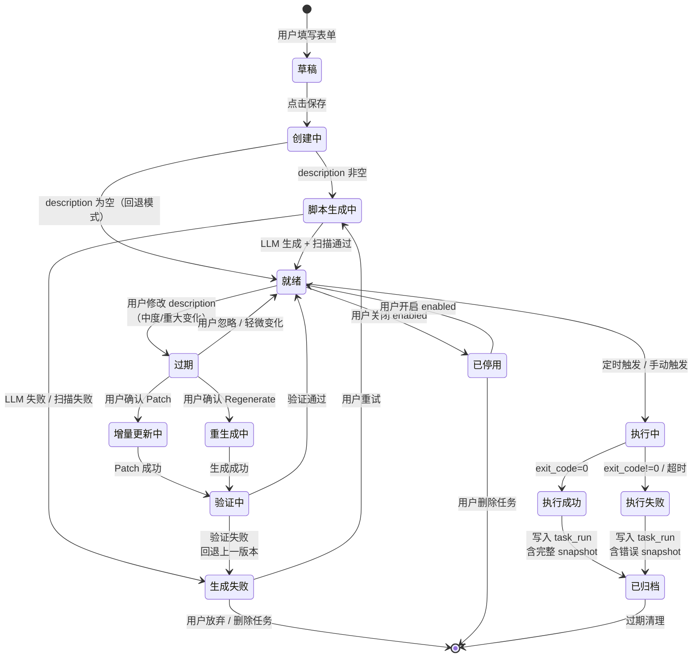

# 执行链路快照保存 & 用户调整后重新创建 流程图方案

> 不涉代码实现，纯流程图方案。覆盖：每次执行如何保存完整执行链路（脚本、skill、环境）以便追溯和复用；用户调整定时任务后如何重新创建/验证/平滑过渡。

---

## 图 1：执行链路快照保存（每次执行时的完整记录）

```mermaid
flowchart TD
    START([XXL-JOB 触发<br/>或用户手动触发]) --> E1[准备执行]

    subgraph SNAP["📸 执行前：快照采集"]
        E1 --> S1[读取任务当前配置]
        S1 --> S2{采集快照项}

        S2 --> S2A["脚本快照"]
        S2 --> S2B["Skill/命令快照"]
        S2 --> S2C["环境变量快照"]
        S2 --> S2D["任务元信息快照"]

        S2A --> S2A1[当前 script_version]
        S2A --> S2A2[当前 oss_object_key]
        S2A --> S2A3[脚本内容 hash]
        S2A --> S2A4[若 script_content ≤64KB<br/>直接存原文快照]

        S2B --> S2B1[sai-cli 命令路径<br/>product/module/action]
        S2B --> S2B2[命令参数 JSON]
        S2B --> S2B3[数据源接口 endpoint]

        S2C --> S2C1[cron_expr]
        S2C --> S2C2[site_code]
        S2C --> S2C3[notify_mode]
        S2C --> S2C4[dingding_group_id]

        S2D --> S2D1[task_id, name]
        S2D --> S2D2[description]
        S2D --> S2D3[owner_user_id]
    end

    SNAP --> E2[INSERT task_run<br/>status='running']
    E2 --> E3[将快照写入<br/>task_run.execution_snapshot]

    subgraph EXE["⚙️ 执行中"]
        E3 --> E4[按快照的 oss_key<br/>下载脚本执行]
        E4 --> E5[脚本内按快照的 skill 配置<br/>调用 sai-cli]
        E5 --> E6{执行结果?}
    end

    E6 -->|成功| E7[UPDATE task_run<br/>status='success']
    E6 -->|失败| E8[UPDATE task_run<br/>status='failed']
    E6 -->|超时| E9[UPDATE task_run<br/>status='timeout']

    E7 --> E10[执行后补充记录]<br/>execution_result / artifacts / duration
    E8 --> E10
    E9 --> E10

    E10 --> END([结束])

    style SNAP fill:#e6f3ff
    style EXE fill:#e6ffe6
```

---

## 图 2：执行快照数据结构（存在哪、存什么）

```mermaid
flowchart LR
    subgraph RUN["task_run 表（执行记录）"]
        direction TB
        R1["run_id: uuid<br/>本次执行唯一标识"]
        R2["task_id: bigint<br/>关联任务"]
        R3["status: success/failed/timeout"]
        R4["started_at / completed_at"]
        R5["duration_ms"]

        R6["script_version_used: int<br/>执行时脚本版本号"]
        R7["script_oss_key_snapshot: string<br/>执行时脚本的 OSS 路径"]
        R8["script_content_snapshot: text<br/>脚本内容原文（≤64KB）"]
        R9["script_hash_snapshot: string<br/>SHA256 哈希"]

        R10["skill_snapshot: json<br/>sai-cli 命令/参数/数据源"]
        R11["env_snapshot: json<br/>执行环境变量"]
        R12["task_meta_snapshot: json<br/>任务元信息快照"]

        R13["execution_result: text<br/>执行结果 markdown"]
        R14["artifacts: json<br/>产物列表"]
        R15["error_code / error_message"]
    end

    subgraph OSS["OSS 存储"]
        O1["脚本：scheduled-tasks/{owner_id}/{task_id}/script_v{N}.py"]
        O2["产物：scheduled-tasks/{owner_id}/{task_id}/artifacts/{run_id}/xxx"]
        O3["日志：scheduled-tasks/{owner_id}/{task_id}/logs/{run_id}.log"]
    end

    subgraph PURPOSE["快照用途"]
        P1["追溯：查历史执行<br/>用了哪个版本的脚本"]
        P2["复现：用快照重新跑<br/>排查问题"]
        P3["对比：脚本更新前后<br/>执行结果差异"]
        P4["审计：完整记录<br/>谁在什么时间做了什么"]
    end

    RUN --> PURPOSE
    OSS --> PURPOSE

    style RUN fill:#fff4e6
    style OSS fill:#e6f3ff
    style PURPOSE fill:#e6ffe6
```



---

## 图 3：用户调整定时任务 → 重新创建完整流程

```mermaid
flowchart TD
    START([用户编辑任务<br/>修改 description]) --> U1[前端提交 /update]

    U1 --> D1[TaskService.updateTask]
    D1 --> D2[description_hash 对比]
    D2 --> D3{hash 变化?}

    D3 -->|否| D4[仅更新其他字段] --> D5[返回 scriptStale: false] --> END_NOCHG([无变化结束])

    D3 -->|是| D6[ScriptService.evaluateSemanticChange]
    D6 --> D7[LLM 评估 change_score]

    D7 --> D8{change_score?}

    %% ====== 轻微变化 ======
    D8 -->|≤30| L1[change_type='minor']
    L1 --> L2[UPDATE task<br/>description=new<br/>script_status 不变]
    L2 --> L3[返回 scriptStale: false]
    L3 --> END_MINOR([结束：无感更新])

    %% ====== 中度变化：增量 Patch ======
    D8 -->|30-70| M1[change_type='moderate']
    M1 --> M2[UPDATE task<br/>script_status='stale']
    M2 --> M3[返回 scriptStale: true<br/>action='patch']
    M3 --> M4[前端提示"描述有调整<br/>建议应用增量更新"]

    M4 --> M5{用户操作?}
    M5 -->|忽略| END_IGNORE([结束：保持旧脚本])

    M5 -->|应用 Patch| M6[POST /{id}/patch-script]
    M6 --> M7[ScriptService.patchScript]
    M7 --> M8[构建 Patch Prompt]<br/>current_script + old_desc + new_desc
    M8 --> M9[LLM 生成修改后脚本]
    M9 --> M10[AST 安全扫描]

    M10 -->|通过| M11[上传 OSS<br/>script_v{n+1}.py]
    M10 -->|失败| M12[返回 patch_failed] --> M13[前端提示"增量更新失败<br/>建议全量重生成"] --> M14

    M11 --> M15[INSERT script_version<br/>记录 patch 来源]
    M15 --> M16[UPDATE task<br/>script_status='ready'<br/>script_version+1]
    M16 --> M17[触发验证执行]<br/>见"图 4：验证执行流程"
    M17 --> M18{验证通过?}
    M18 -->|是| M19[WebSocket 推送 ready<br/>前端更新状态] --> END_PATCH_OK([结束：增量更新成功])
    M18 -->|否| M20[标记 script_status='error'<br/>保留旧脚本可用] --> END_PATCH_ERR([结束：验证失败<br/>回退旧版本])

    %% ====== 重大变化：全量重生成 ======
    D8 -->|>70| H1[change_type='major']
    H1 --> H2[UPDATE task<br/>script_status='stale']
    H2 --> H3[返回 scriptStale: true<br/>action='regenerate']
    H3 --> H4[前端弹窗"需求已变更<br/>建议重新生成脚本"]

    H4 --> M14{用户操作?}
    M14 -->|忽略| END_IGNORE

    M14 -->|重新生成| H5[POST /{id}/regenerate-script]
    H5 --> H6[ScriptService.regenerateScript]
    H6 --> H7[完整生成流水线]<br/>Context + LLM + Scan + Format
    H7 --> H8[上传 OSS<br/>script_v{n+1}.py]
    H8 --> H9[INSERT script_version<br/>记录 regenerate 来源]
    H9 --> H10[UPDATE task<br/>script_status='ready'<br/>script_version+1]
    H10 --> H11[触发验证执行]<br/>见"图 4：验证执行流程"
    H11 --> H12{验证通过?}
    H12 -->|是| H13[WebSocket 推送 ready] --> END_REGEN_OK([结束：重生成成功])
    H12 -->|否| H14[script_status='error'<br/>保留旧脚本可用] --> END_REGEN_ERR([结束：验证失败<br/>回退旧版本])

    style L1 fill:#e6ffe6
    style M1 fill:#fff4e6
    style H1 fill:#ffe6cc
    style M11 fill:#e6f3ff
    style H8 fill:#e6f3ff
    style M17 fill:#f0f8ff
    style H11 fill:#f0f8ff
```

---

## 图 4：验证执行流程（重新生成后的必做步骤）

```mermaid
flowchart TD
    START([触发验证执行]) --> V1[创建"验证运行"记录]
    V1 --> V2[INSERT task_run<br/>status='running'<br/>run_type='validation'<br/>非正式执行]

    V2 --> V3[使用新生成的脚本<br/>script_version={n+1}]
    V3 --> V4[在 Sandbox 中执行]
    V4 --> V5{执行结果?}

    V5 -->|成功| V6[检查产物完整性]
    V5 -->|失败| V7[检查错误类型]
    V5 -->|超时| V8[验证超时]

    %% 成功分支
    V6 --> V9{产物符合预期?}
    V9 -->|是| V10[UPDATE task_run<br/>status='success'<br/>validation_passed=true]
    V9 -->|否| V11[UPDATE task_run<br/>status='success'<br/>validation_passed=false<br/>warn: 产物异常]

    V10 --> V12[新脚本正式生效]<br/>下次定时调度使用 v{n+1}
    V11 --> V13[新脚本生效但告警<br/>前端显示"脚本已更新，但产物异常"]

    %% 失败分支
    V7 --> V14{错误可修复?}<br/>如字段缺失、参数错误
    V14 -->|是| V15[尝试 Auto-fix] --> V16[LLM 根据错误修正脚本] --> V17[重新验证] --> V4
    V14 -->|否| V18[UPDATE task_run<br/>status='failed'<br/>validation_passed=false]

    V8 --> V19[UPDATE task_run<br/>status='timeout'<br/>validation_passed=false]

    V18 --> V20[新脚本标记为 error<br/>**保留旧脚本 v{n} 继续可用**]
    V19 --> V20

    V20 --> V21[前端提示"新脚本验证失败<br/>已回退到上一版本"]
    V21 --> V22[用户可查看验证日志<br/>手动调整 description 后重试]

    V12 --> END_OK([验证通过<br/>新脚本上线])
    V13 --> END_WARN([验证通过<br/>但有告警])
    V22 --> END_FAIL([验证失败<br/>回退旧版本])

    style V4 fill:#e6ffe6
    style V10 fill:#e6ffe6
    style V12 fill:#e6ffe6
    style V20 fill:#ffcccc
    style V14 fill:#fff4e6
    style V16 fill:#f0f8ff
```

---

## 图 5：版本回退与平滑过渡机制

```mermaid
flowchart TD
    subgraph VERSIONS["脚本版本历史"]
        direction TB
        V_CUR["当前执行版本：v2<br/>script_status='ready'"]
        V_OLD["上一版本：v1<br/>保留在 OSS"]
        V_ERR["验证失败的 v3<br/>script_status='error'"]
    end

    START([用户修改 description<br/>触发重生成]) --> G1[生成 v3 脚本]
    G1 --> G2[验证执行 v3]
    G2 --> G3{验证结果?}

    G3 -->|通过| G4[v3 变为当前版本]
    G4 --> G5[下次定时调度<br/>使用 v3 执行]
    G4 --> G6[v2 保留为历史版本<br/>90 天后清理]

    G3 -->|失败| G7[v3 标记 error]
    G7 --> G8["**回退机制**"]
    G8 --> G9[定时调度继续使用 v2]
    G8 --> G10[用户无感知<br/>任务正常执行]
    G8 --> G11[前端显示"v3 验证失败<br/>已回退到 v2"]

    G5 --> USER1([用户查看执行历史])
    G10 --> USER1

    USER1 --> H1[选择某次执行记录]
    H1 --> H2[查看 execution_snapshot]
    H2 --> H3[知道那次执行用的是 v2 还是 v3]
    H3 --> H4[可对比 v2/v3 脚本差异]

    style VERSIONS fill:#fff4e6
    style G4 fill:#e6ffe6
    style G7 fill:#ffcccc
    style G8 fill:#ffe6cc
```

---

## 图 6：执行链路快照 → 追溯与复现

```mermaid
flowchart TD
    START([用户反馈<br/>"昨天执行结果不对"]) --> Q1[运维/开发查询]

    Q1 --> Q2[按 task_id + 日期<br/>查 task_run 表]
    Q2 --> Q3[找到对应 run_id]

    Q3 --> Q4[读取 execution_snapshot]
    Q4 --> Q5{快照内容}

    Q5 --> S1["脚本：script_oss_key_snapshot<br/>+ script_content_snapshot"]
    Q5 --> S2["Skill：skill_snapshot<br/>{product, module, action, params}"]
    Q5 --> S3["环境：env_snapshot<br/>{site_code, cron_expr, notify_mode}"]
    Q5 --> S4["结果：execution_result<br/>+ artifacts"]

    S1 --> C1[从 OSS 下载该版本脚本]
    S2 --> C2[复现 sai-cli 命令]
    S3 --> C3[复现环境变量]

    C1 --> R1[在本地/Sandbox 重新执行]
    C2 --> R1
    C3 --> R1

    R1 --> R2{复现结果一致?}
    R2 -->|是| R3[问题在数据源变化<br/>非脚本问题]
    R2 -->|否| R4[对比新旧执行差异<br/>定位脚本逻辑问题]

    R3 --> FIX1[检查数据源接口<br/>是否返回异常数据]
    R4 --> FIX2[修复脚本逻辑<br/>生成新版本]

    style Q4 fill:#e6f3ff
    style R1 fill:#e6ffe6
    style R3 fill:#fff4e6
    style R4 fill:#ffe6cc
```

---

## 图 7：定时任务全生命周期状态机（含快照 & 重建）



---

## 关键设计决策总结

| 决策点 | 方案 | 理由 |
|--------|------|------|
| **快照存哪里** | `task_run.execution_snapshot` JSON 字段 + OSS 脚本版本 | 执行记录自带上下文，追溯时一条记录就能还原全貌 |
| **快照存什么** | 脚本版本/内容/Hash、Skill 命令路径+参数、环境变量、任务元信息 | 缺一不可，否则无法完整复现 |
| **重新生成后是否立即生效** | **否，必须先验证执行** | 防止坏脚本上线导致定时任务持续失败 |
| **验证失败怎么办** | 标记 error，**保留旧版本继续可用** | 用户无感知，任务不中断 |
| **旧版本保留多久** | 90 天 或 最近 10 个版本 | 平衡存储成本和回滚需求 |
| **用户能否手动选择版本** | v1 不支持，v2 可扩展 | 降低复杂度，自动回退已足够 |
| **验证执行是否产生正式产物** | 否，验证运行的产物单独标记<br/>或仅在临时目录，不推送到钉钉 | 避免验证过程中的半成品推送给用户 |

---

## 待确认事项

1. **验证执行的环境**：验证执行是否在与正式执行相同的 Sandbox 环境中？还是独立的验证集群？
2. **验证执行的数据源**：验证时是否访问真实数据源？还是用 Mock 数据？（Mock 可能无法发现问题，真实数据可能产生副作用）
3. **快照存储大小限制**：`execution_snapshot` JSON 字段如果很大（如脚本 >64KB），是否只存 Hash 和 OSS 路径？
4. **用户手动回退**：v1 是否支持用户在执行历史中选择"回退到这个版本"？还是仅自动回退？
5. **并发控制**：验证执行期间，是否阻塞定时调度？还是允许定时调度继续使用旧版本？
