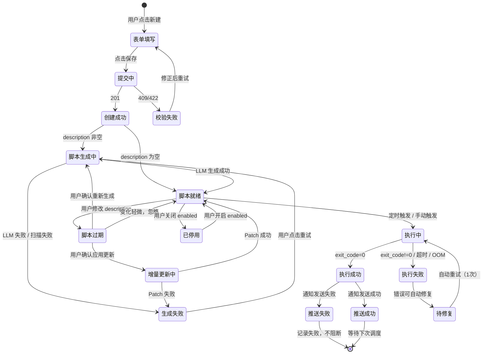

# 定时任务完整流程图（细化版）

> 本文档用 Mermaid 语法绘制定时任务全生命周期的细粒度流程图，覆盖：创建→脚本生成→定时调度→执行→产物→修改→更新。
>
> 可在支持 Mermaid 的编辑器（VS Code / Typora / Notion / GitHub）中渲染查看。

---

## 图 1：总览泳道图（端到端全链路）

```mermaid
sequenceDiagram
    autonumber
    actor U as 用户
    participant F as Claw 前端
    participant M as Main 进程<br/>(API Proxy)
    participant A as Task API<br/>(后端)
    participant T as Task Service
    participant S as Script Service
    participant L as LLM 服务
    participant D as Dispatch Service<br/>(XXL-JOB)
    participant E as Execution Service
    participant X as Sandbox<br/>(Docker)
    participant O as OSS
    participant N as Notification<br/>Service
    participant DB as MySQL / Redis
    participant DS as 数据源服务
    participant DT as 钉钉服务

    %% ====== 创建任务 ======
    rect rgb(230, 245, 255)
        Note over U,F: 【阶段一】创建任务
        U->>F: 填写表单：名称、描述、频率、时间
        F->>F: 前端将频率转为 cron_expr
        F->>M: POST /scheduled-tasks<br/>{name, cron_expr, description, ...}
        M->>A: 透传请求 + stoToken
        A->>T: createTask(input, user)
        T->>T: 校验 name 唯一性
        T->>T: 校验 cron_expr 合法性
        T->>T: 计算 next_run_at
        T->>DB: INSERT scheduled_task<br/>script_status='pending'
        T-->>A: TaskDTO
        A-->>M: 201 Created
        M-->>F: 201 Created
        F-->>U: 显示任务卡片（脚本生成中...）
        T->>DB: publish TaskCreatedEvent
    end

    %% ====== 异步生成脚本 ======
    rect rgb(255, 245, 230)
        Note over S,L: 【阶段二】异步生成脚本（后台）
        DB->>S: consume TaskCreatedEvent
        S->>S: 构建 Context<br/>(任务信息 + 用户上下文 + 数据源 Schema)
        S->>L: generateScript(context)
        L->>L: Prompt 工程 + 生成
        L-->>S: script_content
        S->>S: AST 安全扫描
        alt 扫描通过
            S->>O: upload script_v1.py
            O-->>S: oss_key
            S->>DB: UPDATE task<br/>script_status='ready'<br/>oss_object_key=xxx<br/>script_version=1
            S->>F: WebSocket: script_ready
            F->>U: 卡片显示"脚本就绪"
        else 扫描失败
            S->>DB: UPDATE task<br/>script_status='error'
            S->>F: WebSocket: script_error
            F->>U: 显示"脚本生成失败，点击重试"
        end
    end

    %% ====== 定时调度执行 ======
    rect rgb(230, 255, 230)
        Note over D,X: 【阶段三】定时调度执行
        D->>DB: 每 30s: SELECT 到期任务<br/>FOR UPDATE SKIP LOCKED
        DB-->>D: tasks[]
        loop 每个到期任务
            D->>DB: Redis SET lock EX 60 NX
            alt 获取锁成功
                D->>E: execute(task)
                E->>DB: INSERT task_run<br/>status='running'
                
                alt task.oss_object_key 存在
                    E->>E: 检查本地脚本缓存
                    alt 缓存 miss
                        E->>O: download script
                        O-->>E: script_file
                        E->>E: 写入本地缓存
                    end
                    E->>X: 启动 Sandbox<br/>(Docker + seccomp)
                    X->>DS: HTTP 拉取数据
                    DS-->>X: data
                    X->>X: 执行分析/计算
                    X->>X: 产物写入 OUTPUT_DIR
                    X->>X: stdout 输出 JSON 摘要
                    X-->>E: exit_code, stdout, stderr
                    E->>O: upload artifacts
                    E->>DB: INSERT task_artifacts
                else 无脚本（回退）
                    E->>L: 知多星 dispatch<br/>(description 作为 question)
                    L-->>E: markdown_result
                end
                
                E->>N: push(task, run, artifacts)
                N->>DT: 钉钉群推送
                E->>DB: UPDATE task_run<br/>status='success'<br/>execution_result=xxx
                E->>DB: UPDATE task<br/>last_run_at, last_run_status
                E->>T: calc_next_run(cron_expr)
                T->>DB: UPDATE task<br/>next_run_at
                D->>DB: Redis DEL lock
            else 获取锁失败
                D->>D: skip (另一节点执行)
            end
        end
    end

    %% ====== 用户查看结果 ======
    rect rgb(255, 230, 245)
        Note over U,F: 【阶段四】用户查看结果
        U->>F: 打开定时任务页面
        F->>M: GET /scheduled-tasks/list
        M->>A: 透传
        A->>DB: SELECT tasks
        DB-->>A: tasks[]
        A-->>M: tasks[]
        M-->>F: tasks[]
        F->>U: 渲染卡片网格
        
        U->>F: 点击"测试运行"
        F->>M: POST /trigger {task_id}
        M->>A: 透传
        A->>T: trigger(task_id)
        T->>T: 校验：enabled=true, site_code 非空
        T->>E: execute_now(task)
        E-->>T: run_result
        T-->>A: TriggerResult
        A-->>M: 200 OK
        M-->>F: 200 OK
        F->>U: 展示执行结果弹窗
    end

    %% ====== 用户修改描述 ======
    rect rgb(255, 250, 230)
        Note over U,S: 【阶段五】用户修改 → 脚本更新
        U->>F: 编辑任务，修改描述
        F->>M: POST /update {task_id, description}
        M->>A: 透传
        A->>T: updateTask(task_id, patch)
        T->>T: hash(new_description) != old_hash?
        
        alt hash 不同
            T->>S: evaluateSemanticChange(old, new, current_script)
            S->>L: semanticDiff(old, new, script_summary)
            L-->>S: change_score
            
            alt change_score > 70
                T->>DB: UPDATE script_status='stale'
                T-->>A: {task, scriptStale: true, action: 'regenerate'}
                A-->>M: 200 OK
                M-->>F: 200 OK
                F->>U: 弹窗"需求变更，建议重新生成脚本"
                U->>F: 点击"重新生成"
                F->>M: POST /{id}/regenerate-script
                M->>A: 透传
                A->>S: regenerateScript(task_id)
                S->>L: generateScript(full_context)
                L-->>S: new_script
                S->>S: AST 扫描
                S->>O: upload script_v2.py
                S->>DB: UPDATE script_status='ready'<br/>script_version=2
                S->>F: WebSocket: script_ready
                F->>U: 更新卡片状态
            else 30 < change_score <= 70
                T-->>A: {task, scriptStale: true, action: 'patch'}
                A-->>M: 200 OK
                M-->>F: 200 OK
                F->>U: 提示"描述有调整，是否应用增量更新？"
                U->>F: 点击"应用更新"
                F->>M: POST /{id}/patch-script
                M->>A: 透传
                A->>S: patchScript(task_id, new_desc)
                S->>L: generatePatch(current_script, old, new)
                L-->>S: patched_script
                S->>S: AST 扫描
                S->>O: upload script_v2.py
                S->>DB: UPDATE script_status='ready'<br/>script_version=2
            else change_score <= 30
                T->>DB: UPDATE description<br/>(script_status 不变)
                T-->>A: {task, scriptStale: false}
                A-->>M: 200 OK
                M-->>F: 200 OK
            end
        else hash 相同
            T->>DB: UPDATE 其他字段
            T-->>A: {task, scriptStale: false}
            A-->>M: 200 OK
            M-->>F: 200 OK
        end
    end
```



---

## 图 2：创建任务 + 脚本生成（详细决策图）

```mermaid
flowchart TD
    START([用户点击"新建定时任务"]) --> F1[前端渲染创建弹窗]
    F1 --> F2[用户填写表单]
    F2 --> F3[选择计划时间频率]
    
    F3 --> F3a{频率类型}
    F3a -->|每天| F3b[cron_expr = 0 {hour} * * *]
    F3a -->|工作日| F3c[cron_expr = 0 {hour} * * 1-5]
    F3a -->|每周| F3d[cron_expr = 0 {hour} * * {weekday}]
    F3a -->|每月| F3e[cron_expr = 0 {hour} {monthday} * *]
    F3a -->|一次性| F3f[特殊处理：记录 at 时间<br/>或前端到达后自动禁用]
    
    F3b --> F4[前端校验：name 非空, description 可选]
    F3c --> F4
    F3d --> F4
    F3e --> F4
    F3f --> F4
    
    F4 --> F5{校验通过?}
    F5 -->|否| F6[前端展示校验错误] --> F2
    F5 -->|是| F7[POST /scheduled-tasks]
    
    F7 --> B1[TaskAPI 接收请求]
    B1 --> B2[SSO 鉴权：解析 stoToken]
    B2 --> B3{鉴权通过?}
    B3 -->|否| B4[返回 401] --> END1([结束])
    B3 -->|是| B5[TaskService.createTask]
    
    B5 --> B6[校验 name 在同用户下唯一]
    B6 --> B7{唯一?}
    B7 -->|否| B8[返回 409 Conflict] --> F9[前端：名称重复提示] --> F2
    B7 -->|是| B9[校验 cron_expr 合法性<br/>croniter 解析]
    
    B9 --> B10{合法?}
    B10 -->|否| B11[返回 422] --> F10[前端：cron 格式错误] --> F2
    B10 -->|是| B12[计算 next_run_at<br/>Asia/Shanghai 时区]
    
    B12 --> B13[自动补全 SSO 上下文]<br/>site_code, dingding_group_id
    B13 --> B14[INSERT scheduled_task]
    B14 --> B15{description 非空?}
    
    B15 -->|是| B16[script_status='pending']
    B15 -->|否| B17[script_status='ready'<br/>oss_object_key=null]
    
    B16 --> B18[发布 TaskCreatedEvent]
    B17 --> B19[返回 201 Created]
    B18 --> B19
    
    B19 --> F11[前端：关闭弹窗<br/>新增任务卡片]
    F11 --> F12{script_status?}
    F12 -->|pending| F13[卡片显示"脚本生成中..."动画]
    F12 -->|ready|null| F14[卡片显示正常状态]
    
    %% 异步脚本生成分支
    B18 --> ASYNC1[ScriptService 消费 Event]
    ASYNC1 --> ASYNC2[构建 Context]
    ASYNC2 --> ASYNC3[包含：任务名/描述/网点/数据源Schema/当前时间]
    ASYNC3 --> ASYNC4[调用 LLM 生成脚本]
    
    ASYNC4 --> ASYNC5{生成成功?}
    ASYNC5 -->|否| ASYNC6[记录失败原因] --> ASYNC7[UPDATE script_status='error']
    ASYNC5 -->|是| ASYNC8[AST 安全扫描]
    
    ASYNC8 --> ASYNC9{扫描通过?}
    ASYNC9 -->|否| ASYNC10[记录违规调用] --> ASYNC7
    ASYNC9 -->|是| ASYNC11[autopep8 格式化]
    ASYNC11 --> ASYNC12[计算 content_hash]
    ASYNC12 --> ASYNC13[上传 OSS: script_v1.py]
    ASYNC13 --> ASYNC14{文件大小 <= 64KB?}
    ASYNC14 -->|是| ASYNC15[script_content 存 MySQL]
    ASYNC14 -->|否| ASYNC16[script_content = null]
    
    ASYNC15 --> ASYNC17[INSERT script_version 历史表]
    ASYNC16 --> ASYNC17
    ASYNC17 --> ASYNC18[UPDATE task<br/>script_status='ready'<br/>script_version=1]
    ASYNC7 --> ASYNC19[WebSocket / SSE 推送状态]
    ASYNC18 --> ASYNC19
    
    ASYNC19 --> F15[前端接收状态变更]
    F15 --> F16{status?}
    F16 -->|ready| F17[卡片更新为"脚本就绪"<br/>显示"查看代码"按钮]
    F16 -->|error| F18[卡片显示错误图标<br/>tooltip 展示失败原因]
    
    F17 --> END2([结束])
    F18 --> END2
    F14 --> END2
    
    style ASYNC4 fill:#ffe6cc
    style ASYNC8 fill:#ffe6cc
    style ASYNC13 fill:#e1f5e1
    style ASYNC7 fill:#ffcccc
    style ASYNC18 fill:#e1f5e1
```

---

## 图 3：定时调度执行（细粒度执行链路）

```mermaid
flowchart TD
    START([XXL-JOB 定时触发<br/>每 30s]) --> D1[DispatchService.dispatchTick]
    D1 --> D2[SELECT 到期任务<br/>enabled=1 AND is_delete=0<br/>AND next_run_at <= NOW]<br/>FOR UPDATE SKIP LOCKED
    
    D2 --> D3{查到任务?}
    D3 -->|否| END1([无任务<br/>等待下次 tick]) 
    D3 -->|是| D4[遍历 tasks]
    
    D4 --> D5[Redis SET<br/>task:{id}:lock<br/>EX 60 NX]
    D5 --> D6{获取锁?}
    D6 -->|否| D7[记录 skip 日志] --> D8{还有任务?}
    D6 -->|是| D9[提交 ExecutionService.execute]
    
    D8 -->|是| D4
    D8 -->|否| END1
    
    D9 --> E1[INSERT task_run<br/>status='running'<br/>run_id=uuid]
    E1 --> E2{task.oss_object_key?}
    
    %% 有脚本分支
    E2 -->|存在| E3[脚本模式]
    E2 -->|不存在| E4[知多星回退模式]
    
    %% ====== 脚本模式详细流程 ======
    E3 --> E5[计算本地缓存路径<br/>/var/cache/{hash(oss_key)}.py]
    E5 --> E6{缓存存在且未过期?}
    E6 -->|是| E8[读取本地脚本]
    E6 -->|否| E7[从 OSS 下载脚本] --> E7a[写入本地缓存] --> E8
    
    E8 --> E9[创建工作目录<br/>/tmp/scheduled-tasks/{task_id}/{run_id}]
    E9 --> E10[创建 OUTPUT_DIR]
    E10 --> E11[构建环境变量]
    E11 --> E12{site_code 非空?}
    E12 -->|否| E13[记录错误<br/>site_code 缺失] --> ERR1
    E12 -->|是| E14[启动 Docker Sandbox]
    
    E14 --> E15[容器限制]<br/>cpu=1核, mem=512MB<br/>timeout=30s, 只读根目录
    E15 --> E16[seccomp 过滤系统调用]
    E16 --> E17[iptables 网络白名单<br/>只允许 *.sto.cn]
    
    E17 --> E18[脚本执行中...]
    E18 --> E19{执行结果?}
    E19 -->|exit_code=0| E20[正常结束]
    E19 -->|exit_code!=0| E21[执行错误] --> ERR2
    E19 -->|超时| E22[SandboxTimeout] --> ERR3
    E19 -->|OOM| E23[SandboxOOM] --> ERR4
    
    E20 --> E24[解析 stdout 最后一行 JSON]
    E24 --> E25{解析成功?}
    E25 -->|是| E26[提取 summary/rows/abnormal_count]
    E25 -->|否| E27[summary = "脚本执行完成"]
    
    E26 --> E28[扫描 OUTPUT_DIR]
    E27 --> E28
    E28 --> E29{有产物文件?}
    E29 -->|是| E30[遍历产物文件]
    E29 -->|否| E31[无产物]
    
    E30 --> E32[上传 OSS<br/>artifacts/{run_id}/{filename}]
    E32 --> E33[INSERT task_artifact]
    E33 --> E34{notify_mode 含 dingtalk?}
    E34 -->|是| E35[同步到 CDN] --> E36[记录 cdn_url]
    E34 -->|否| E37[仅记录 oss_key]
    
    E36 --> E38{还有产物?}
    E37 --> E38
    E38 -->|是| E30
    E38 -->|否| E39[生成 execution_result markdown]
    
    E31 --> E39
    E39 --> E40[UPDATE task_run<br/>status='success'<br/>execution_result=xxx]
    E40 --> E41[UPDATE task<br/>last_run_at, last_run_status='success']
    
    %% ====== 知多星回退模式 ======
    E4 --> E42[调用知多星 dispatch API]
    E42 --> E43[description 作为 question]
    E43 --> E44{dispatch 成功?}
    E44 -->|是| E45[接收 markdown 结果] --> E46[UPDATE task_run status='success']
    E44 -->|否| E47[记录 dispatch_failed] --> ERR5
    
    %% ====== 推送通知 ======
    E41 --> N1[NotificationService.push]
    E46 --> N1
    
    N1 --> N2{notify_mode?}
    N2 -->|none| N3[跳过推送] --> CLEANUP
    N2 -->|dingtalk_group| N4[钉钉群机器人推送]
    N2 -->|dialog| N5[Claw 对话推送]
    N2 -->|both| N6[同时推送钉钉+对话]
    
    N4 --> N7{推送成功?}
    N7 -->|是| N8[UPDATE notify_dingtalk_ok=true]
    N7 -->|否| N9[重试 3 次<br/>间隔 30s] --> N10{仍失败?}
    N10 -->|是| N11[UPDATE notify_dingtalk_ok=false] --> CLEANUP
    N10 -->|否| N8
    N8 --> CLEANUP
    
    N5 --> N12{推送成功?}
    N12 -->|是| N13[UPDATE notify_dialog_ok=true] --> CLEANUP
    N12 -->|否| N14[重试 3 次] --> N15{仍失败?} -->|是| N16[UPDATE notify_dialog_ok=false] --> CLEANUP
    
    %% ====== 清理与收尾 ======
    CLEANUP --> C1[删除本地工作目录<br/>/tmp/scheduled-tasks/{task_id}/{run_id}]
    C1 --> C2[释放 Redis 锁<br/>DEL task:{id}:lock]
    C2 --> C3[计算 next_run_at = croniter(cron_expr, now)]
    C3 --> C4[UPDATE task<br/>next_run_at = next_run_at]
    C4 --> C5{还有到期任务?}
    C5 -->|是| D4
    C5 -->|否| END2([本次 tick 结束])
    
    %% ====== 错误处理分支 ======
    ERR1 --> E48[UPDATE task_run<br/>status='failed'<br/>error_code='MISSING_SITE_CODE']
    ERR2 --> E49[UPDATE task_run<br/>status='failed'<br/>error_code='EXEC_FAILED']
    ERR3 --> E50[UPDATE task_run<br/>status='timeout'<br/>error_code='EXEC_TIMEOUT']
    ERR4 --> E51[UPDATE task_run<br/>status='failed'<br/>error_code='OOM']
    ERR5 --> E52[UPDATE task_run<br/>status='dispatch_failed']
    
    E48 --> E53[UPDATE task<br/>last_run_status='failed'] --> N1
    E49 --> E53
    E50 --> E53
    E51 --> E53
    E52 --> E53
    
    style E14 fill:#e1f5e1
    style E18 fill:#e1f5e1
    style ERR3 fill:#ffcccc
    style ERR4 fill:#ffcccc
    style E40 fill:#e1f5e1
    style CLEANUP fill:#fff4e1
```

---

## 图 4：用户修改描述 → 脚本更新决策树

```mermaid
flowchart TD
    START([用户编辑任务<br/>修改 description]) --> U1[前端提交<br/>POST /update]
    U1 --> U2[TaskService.updateTask]
    U2 --> U3[计算 new_description_hash]
    U3 --> U4{hash != old_hash?}
    
    U4 -->|否| U5[仅更新其他字段] --> U6[返回 {scriptStale: false}] --> END1([结束])
    
    U4 -->|是| U7[ScriptService.evaluateSemanticChange]
    U7 --> U8[构建语义检测 Prompt]
    U8 --> U9[调用 LLM：对比 old/new description<br/>评估脚本需改变的程度]
    U9 --> U10[返回 change_score<br/>0-100 分]
    
    U10 --> U11{change_score?}
    
    %% 轻微变化
    U11 -->|≤30| U12[change_type = 'minor']
    U12 --> U13[UPDATE task<br/>description = new<br/>script_status 不变] --> U14[返回 {scriptStale: false}] --> END1
    
    %% 中度变化
    U11 -->|30-70| U15[change_type = 'moderate']
    U15 --> U16[UPDATE task<br/>script_status = 'stale']
    U16 --> U17[返回 {scriptStale: true<br/>action: 'patch'<br/>message: '建议增量更新'}]
    U17 --> U18[前端弹窗提示]
    U18 --> U19{用户操作?}
    U19 -->|忽略| END1
    U19 -->|应用更新| U20[POST /{id}/patch-script]
    U20 --> U21[ScriptService.patchScript]
    U21 --> U22[构建 Patch Prompt]<br/>current_script + old_desc + new_desc
    U22 --> U23[调用 LLM 生成修改后脚本]
    U23 --> U24[AST 安全扫描]
    U24 --> U25{扫描通过?}
    U25 -->|否| U26[返回 patch_failed<br/>建议 regenerate] --> U27[前端提示"增量更新失败，建议全量重生成"] --> U28
    U25 -->|是| U29[上传 OSS: script_v{n+1}.py]
    U29 --> U30[INSERT script_version]
    U30 --> U31[UPDATE task<br/>script_status='ready'<br/>script_version+1]
    U31 --> U32[WebSocket 推送 ready]
    U32 --> U33[前端更新卡片] --> END1
    
    %% 重大变化
    U11 -->|>70| U34[change_type = 'major']
    U34 --> U35[UPDATE task<br/>script_status = 'stale']
    U35 --> U36[返回 {scriptStale: true<br/>action: 'regenerate'<br/>message: '需求已变更，建议重新生成'}]
    U36 --> U37[前端弹窗提示]
    U37 --> U28{用户操作?}
    U28 -->|忽略| END1
    U28 -->|重新生成| U38[POST /{id}/regenerate-script]
    U38 --> U39[ScriptService.regenerateScript]
    U39 --> U40[完整生成流水线]<br/>Context + LLM + Scan + Format
    U40 --> U41[上传 OSS: script_v{n+1}.py]
    U41 --> U42[INSERT script_version]
    U42 --> U43[UPDATE task<br/>script_status='ready'<br/>script_version+1]
    U43 --> U44[WebSocket 推送 ready]
    U44 --> U33
    
    style U12 fill:#e1f5e1
    style U15 fill:#fff4e1
    style U34 fill:#ffe6cc
    style U31 fill:#e1f5e1
    style U43 fill:#e1f5e1
    style U26 fill:#ffcccc
```

---

## 图 5：前端状态流转与界面响应



---

## 图 6：数据流与状态映射表

| 用户操作 | 前端状态 | 后端状态（DB） | 异步事件 | 最终前端表现 |
|---------|---------|---------------|---------|-------------|
| 点击新建，填表保存 | 弹窗 loading | 无 | — | — |
| 创建成功 | 卡片"脚本生成中..." | `script_status='pending'` | `TaskCreatedEvent` | 转圈动画 |
| LLM 生成成功 | 卡片"脚本就绪" | `script_status='ready'` | WebSocket push | 显示"查看代码" |
| LLM 生成失败 | 卡片"生成失败" | `script_status='error'` | WebSocket push | 错误图标 + 重试按钮 |
| 定时触发执行 | 卡片"上次执行：运行中" | `task_run.status='running'` | — | 状态点闪烁 |
| 执行成功 | 卡片"上次执行：成功" | `task_run.status='success'` | — | 绿色对勾 + 产物下载 |
| 执行失败 | 卡片"上次执行：失败" | `task_run.status='failed'` | — | 红色叹号 + 查看日志 |
| 修改 description（轻微） | 无变化 | `description` 更新 | 无 | 无感知 |
| 修改 description（中度） | 提示"建议增量更新" | `script_status='stale'` | — | 黄色警告徽章 |
| 修改 description（重大） | 弹窗"需求已变更" | `script_status='stale'` | — | 红色警告 + 重新生成按钮 |
| 点击重新生成 | 卡片"脚本生成中..." | `script_status='generating'` | LLM 调用 | 转圈动画 |
| 重新生成成功 | 卡片"脚本就绪 v2" | `script_status='ready'`<br/>`script_version=2` | WebSocket push | 显示版本号 |

---

> **使用方式**：将上述 Mermaid 代码复制到支持 Mermaid 的编辑器中即可渲染为流程图。
> 
> 如果需要我调整某个分支的粒度、补充异常场景、或导出为其他格式（PlantUML / Draw.io），告诉我。
