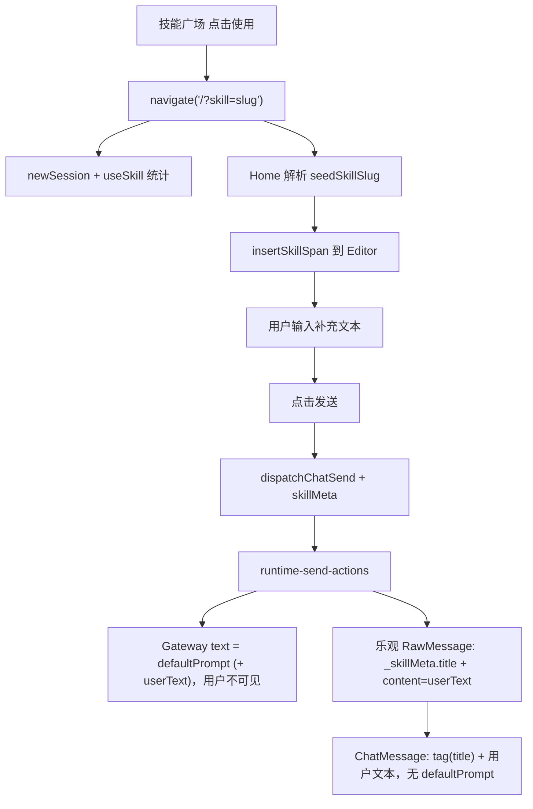

## Context

技能广场（`openspec/changes/archive/2026-05-28-skill-plaza`）已实现「使用 → 跳转对话并预填充 `defaultPrompt`」能力。当前实现路径为：

1. `SkillCard.handleUse` / `SkillDetailModal.handleUse`：`newSession()` → `navigate('/?q=<encodedPrompt>')` → `useSkill(slug)`
2. `Home/index.tsx`：解析 `?q=`，Gateway `running` 后调用 `handleHubSend` **自动发送**
3. 发送内容为 `skill.defaultPrompt || skill.title` 纯文本，无 skill 元数据
4. 用户气泡通过 `renderUserMessageMentionNodes(text)` 渲染纯文本

聊天输入框已有三类可复用模式：

| 模式 | 位置 | 发送行为 |
|------|------|----------|
| Agent target chip | `ChatInput` 输入框上方 | 独立 state，不走 editor |
| 钉钉 @mention span | `contentEditable` 内 | 计入 plainText + `dingTalkMentions` |
| Workflow inline token | `contentEditable` 内 | plainText 含 `/${name}`，`workflowId` 独立字段 |

产品新稿要求技能标签出现在**输入框内部首位**（橙色 wrench + **技能名称 `title`**），发送后气泡同样展示 tag + 用户文本。**`defaultPrompt` 是隐藏的系统 prompt，仅注入 Gateway，不在 UI 任何可见层展示。**

## Goals / Non-Goals

**Goals:**

- 点击技能广场「使用」/「立即使用」后，首页输入框出现**技能标签 token**，不自动发送
- 用户可在标签后自由输入补充文本，点击发送按钮后才发送
- 用户消息气泡展示 **[技能标签（title）] + [用户输入文本]**，视觉上与输入框 tag 一致
- **`defaultPrompt` 仅在发送时注入 Gateway RPC，MUST NOT 出现在输入框 tag、气泡正文或 URL 参数中**
- 发送给 Gateway 的 prompt 能正确触发技能（基于 `defaultPrompt` 拼接策略）
- `POST /api/skill-plaza/use` 统计行为保持不变（点击「使用」即上报）
- 不影响现有 `?q=` / `?workflowId=` 深链的 auto-send 行为（无 `?skill=` 时逻辑不变）

**Non-Goals:**

- 不要求 Gateway history 回写携带 skill 元数据（历史消息无 tag 可接受）
- 不实现输入框内手动输入 `/skill` 命令选择技能（仅从技能广场入口 seed）
- 不修改技能安装 / 卸载 / 分类 / 搜索等广场其他能力
- 不在本期实现 Chat 页（非 Home）独立 deep link seed skill（可后续扩展 `navigateToMainChatHome` 的 `extraSearchParams.skill`）

## Decisions

### 1. 导航参数：用 `?skill=<slug>` 替代 `?q=<defaultPrompt>`

**Rationale**: `?q=` 已被 Home 绑定为 auto-send 触发器；继续传 `defaultPrompt` 无法区分「仅预填」与「立即发送」。`?skill=` 语义明确，且 slug 可稳定关联 `title` / `defaultPrompt`。

**Alternative considered**: 保留 `?q=` 但增加 `?autoSend=0` 查询参数 → 需改动所有 `?q=` 调用方并维护兼容矩阵。Rejected：参数组合易混淆，且 `q` 仍会被 seed 为纯文本而非 tag。

**Implementation sketch**:

```typescript
// SkillCard / SkillDetailModal — 删除现有 defaultPrompt URL 编码
// ❌ const prompt = encodeURIComponent(skill.defaultPrompt || skill.title);
// ❌ navigate(`/?q=${prompt}`);
navigate(`/?skill=${encodeURIComponent(skill.slug)}`);
```

**字段在导航层的职责**：

| 字段 | 导航 / URL | 输入框 tag | 气泡 | Gateway RPC |
|------|------------|------------|------|-------------|
| `slug` | ✅ `?skill=` | dataset | `_skillMeta.slug` | 可选透传 |
| `title` | ❌ | ✅ 展示 | ✅ tag 文案 | ❌ |
| `defaultPrompt` | ❌ | ❌ | ❌ | ✅ 发送时注入 |

### 2. 字段职责分离：`title` 可见、`defaultPrompt` 隐藏注入

**Rationale**: 产品稿中标签展示的是技能**名称**（如「总部结算对账」），而非完整的系统 prompt。`defaultPrompt` 是给模型的任务指令，对用户可见会造成噪音，且与「标签 + 用户补充」的交互语义冲突。

**Rules**:

1. **Composer skill token** 的可见文案 MUST 为 `skill.title`（fallback: `slug`），MUST NOT 使用 `defaultPrompt` 作为 tag 文本
2. **`defaultPrompt` 解析时机** MUST 为用户点击「发送」时，按 `skill.slug` 从 `useSkillPlazaStore` / `GET /api/skill-plaza/skill/:slug` 缓存读取
3. **乐观消息 `RawMessage.content`** MUST 仅保存用户输入文本（`plainText`）；技能标签 MUST 通过 `_skillMeta.title` 独立渲染
4. **Gateway RPC `text`** MUST 由 `defaultPrompt`（及可选用户输入）拼接生成，与 `content` / 气泡展示字段分离

**Alternative considered**: 气泡同时展示 `defaultPrompt` 作为灰色副文本 → 与设计稿不符，信息冗余。Rejected。

### 3. Composer 实现：复用 Workflow Token 架构，扩展 Skill Token

**Rationale**: `dingtalk-mention-composer.ts` 已有 `createWorkflowSpan` / `insertWorkflowSpan` / `serializeMentionEditor` 完整链路；skill token 与之同层，改动面可控，且符合「标签在 editor 内部」的设计稿。

**Alternative considered**: Agent Chip 模式（标签放在输入框上方独立行）→ 实现更简单，但与设计稿（tag 在输入框内首位）不一致，且发送后气泡需额外拆分 tag/text。Rejected。

**Skill token 规则**:

| 属性 | 值 |
|------|-----|
| CSS class | `skill-token` |
| DOM | `contentEditable="false"` |
| dataset | `data-skill-slug`, `data-skill-title` |
| 位置 | 编辑器最开头，唯一（再次 seed 替换） |
| serialize | **不计入** `plainText`（与 workflow 不同）；写入 `snapshot.skill` |
| 删除 | Backspace 在 token 后整块删除 |
| 图标 | `Wrench`（lucide-react），与产品稿一致 |

**`MentionComposerSnapshot` 扩展**:

```typescript
export interface SkillMeta {
  slug: string;
  title: string;
}

export interface MentionComposerSnapshot {
  plainText: string;
  mentions: DingTalkMention[];
  workflowId?: string;
  skill?: SkillMeta;  // 新增
  isEmpty: boolean;
}
```

**`isEmpty` / `canSend` 规则**:

- `isEmpty = !skill && plainText.trim() === '' && mentions.length === 0`
- 有 `skill` 即可发送（即使用户未输入补充文本）

### 4. Home 深链：skill seed 与 q auto-send 解耦

**Rationale**: 现有 `useEffect` 在 Gateway running 后对任意 `seedText` 自动发送；skill 场景必须跳过。

**Rules**:

| URL 参数 | 行为 |
|----------|------|
| 仅有 `?skill=` | seed skill token，**不** auto-send |
| 仅有 `?q=` | 保持现有 auto-send（工作流等场景） |
| `?skill=` + `?q=` | 本期不支持；若同时出现，**优先 skill seed**，忽略 `q` auto-send |

解析完成后 `setSearchParams({}, { replace: true })` 清 URL，防止刷新重复插入。

**Seed 流程**:

1. Home 读取 `seedSkillSlug`
2. 从 `useSkillPlazaStore`（或 manifest 缓存）解析 `title`
3. `DingTalkMentionEditor.insertSkill(slug, title)`
4. focus 编辑器，光标置于 token 后

Gateway 未就绪时：仅完成路由跳转与 editor seed；用户就绪后手动点发送。

### 5. 发送给 Gateway 的文本：UI 与后端分离

**Rationale**: UI 气泡需展示 tag（title）+ 用户文本；Gateway 需完整 `defaultPrompt` 触发技能。三者（tag 文案 / 气泡正文 / RPC text）职责不同，MUST NOT 共用同一段字符串。

**策略**:

| 用户输入 | Gateway RPC `text` | 气泡 `content`（用户可见正文） | 气泡 tag |
|----------|-------------------|-------------------------------|----------|
| 无补充文本 | `defaultPrompt`（fallback: `title`） | 空（不展示 defaultPrompt） | `title` |
| 有补充文本 | `` `${defaultPrompt}\n\n${userText}` `` | `userText` only | `title` |

**关键约束**:

- `defaultPrompt` MUST NOT 写入 `RawMessage.content`
- `defaultPrompt` MUST NOT 出现在 skill token 的 DOM `textContent`
- `defaultPrompt` MUST NOT 通过 URL `?q=` 传递

`defaultPrompt` 在发送时按 `skill.slug` 从 skill-plaza store / API 缓存读取。

**Alternative considered**: Gateway 仅收用户输入，skill 靠 RPC extras 的 `skillSlug` 触发 → 依赖后端路由能力，联调成本高。Rejected 作为默认方案；可作为可选增强（见 Decision 7）。

### 6. 用户消息展示：本地 `_skillMeta` 字段

**Rationale**: 参照现有 `_attachedFiles` 模式，在 `RawMessage` 上增加 local-only 元数据，不污染 Gateway content。

```typescript
export interface RawMessage {
  // ...existing
  _skillMeta?: SkillMeta;
}
```

**渲染**（`ChatMessage.tsx`）:

```tsx
{skillMeta && <SkillMessageTag title={skillMeta.title} />}
{skillMeta && text && '\u00A0'}
{renderUserMessageMentionNodes(text)}
```

- 有 `_skillMeta` → tag（`title`）+ `content`（仅用户输入）
- 无 `_skillMeta` → 保持现有纯文本（旧会话兼容）
- Gateway history 回写不含 `_skillMeta` → 仅显示 text（可接受；history 中的 text 可能含 defaultPrompt，本期不反向解析）
- **`defaultPrompt` MUST NOT 作为气泡正文渲染**，即使用户未输入补充文本

**样式**（`src/lib/surfaces.ts`，对齐 `docs/sto-design.md`）:

- 背景：Brand-1（浅橙）
- 文字 / 图标：Brand-6 `#FF6F00`
- 圆角 pill，与产品稿 wrench + 技能名一致

### 7. RPC 透传 `skillSlug`（可选，待后端确认）

**Rationale**: 便于 telemetry、动态路由或后端显式绑定技能上下文。

**Decision**: 设计阶段在 `SendMessageOptions` 预留 `skillMeta`；实现阶段若后端确认需要，在 `/api/chat/send` body 增加 `skillSlug` 字段。若不需要，仅 UI 层使用 `_skillMeta`，Gateway 仅靠拼接后的 `text` 触发技能。

**Alternative considered**: 强制 RPC 传 slug → 需 Main Process / Gateway 联调。Deferred。

### 8. Skill token 与 Workflow token 互斥

**Rationale**: 同一消息携带 skill + workflow 语义冲突，且 serialize / send 分支复杂度高。

**Decision**: 插入 skill token 时清除 workflow token（及 `workflowId`）；插入 workflow token 时清除 skill token。本期不支持二者共存。

**Alternative considered**: 允许共存并定义优先级 → 产品无此场景。Rejected。

### 9. 消息队列与发送链路一致性

**Rationale**: `ChatInput` 在 `sending` 状态下可 queue 消息；skill 上下文不能丢失。

**Decision**: `QueuedMessage` 对称增加 `skillMeta?`；`dispatchChatSend` → `sendMessage` 全链路透传。

## Architecture Overview



## Risks / Trade-offs

- **[Risk]** `?skill=` 与现有 `?q=` auto-send 逻辑冲突，导致仍自动发送或 double send  
  **→ Mitigation**: Home `useEffect` 增加 guard：`seedSkillSlug` 存在时跳过 `handleHubSend`；单测覆盖三种 URL 组合

- **[Risk]** skill slug 在 store 中找不到 title / defaultPrompt（缓存未加载、离线）  
  **→ Mitigation**: title fallback 为 slug；defaultPrompt fallback 为 title；必要时 `GET /api/skill-plaza/skill/:slug` 按需拉取

- **[Risk]** Gateway history 回写后 `_skillMeta` 丢失，刷新会话气泡只剩纯文本  
  **→ Mitigation**: 本期 Non-Goal；后续可考虑在 send RPC 写入 hidden metadata block 或 transcript 约定格式

- **[Risk]** serialize 将 skill token 文本误计入 plainText，导致气泡重复显示技能名  
  **→ Mitigation**: skill span walk 时不 append textContent；单测 `serializeMentionEditor` 用例

- **[Risk]** 与工作流 token、@mention 的 Backspace / 光标行为回归  
  **→ Mitigation**: 复用 workflow token 的 DOM 操作模式；手工测试三种 token 的删除与发送

- **[Risk]** 修改 `skills-plaza-marketplace` / `skills-plaza-detail` 既有 spec 行为，与 archived change 文档不一致  
  **→ Mitigation**: 本 change 新增 `skills-plaza-use-composer` spec，并在 MODIFIED requirements 中完整复制原 requirement 块后修订（遵循 openspec spec 规则）

## Open Questions

1. **Gateway 是否必须在 RPC 层接收 `skillSlug`？** 若仅依赖拼接 `text`，Decision 7 可降级为纯 UI 实现。
2. **Chat 页（非 Home）是否也需要支持 `?skill=` deep link？** 本期 Non-Goal，可后续扩展 `navigateToMainChatHome` 的 `extraSearchParams`。

## Resolved Questions

- **用户仅点发送、无补充输入时，气泡是否只显示 tag？** ✅ 是。气泡仅渲染 `_skillMeta.title` 对应的技能标签；Gateway RPC 仍发送 `defaultPrompt`，但气泡 MUST NOT 展示 `defaultPrompt` 正文。
- **标签文案用 `title` 还是 `defaultPrompt`？** ✅ 仅用 `title`。`defaultPrompt` 仅在发送时注入 Gateway，不参与任何 UI 可见层。

## Implementation Phases (for tasks.md)

| Phase | 范围 | 估时 |
|-------|------|------|
| 1 | 导航 + Home 解耦 + composer skill token | 0.5d |
| 2 | 发送链路 + Gateway 文本拼接 | 0.5d |
| 3 | 气泡渲染 + 样式 + i18n | 0.5d |
| 4 | 单测 + 回归（`?q=` workflow、@mention、message queue） | 0.5d |
