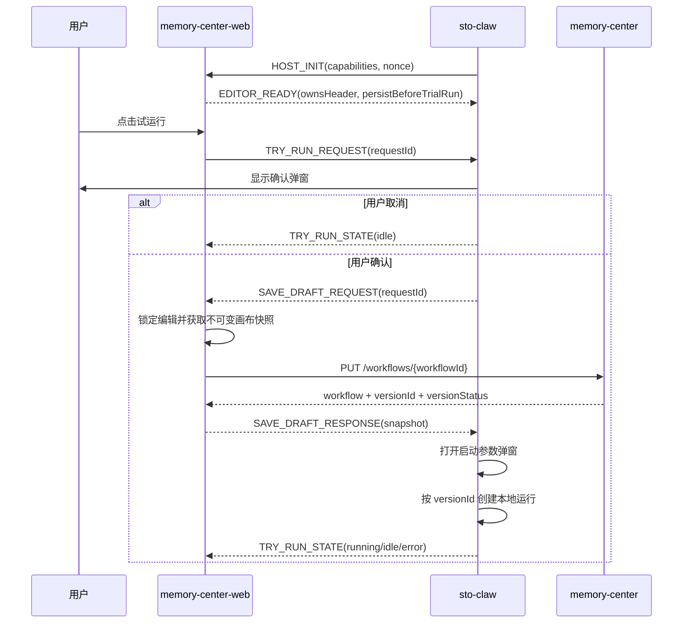

## Context

本变更跨越三个独立项目：

| 项目 | 当前职责 | 本变更后的职责 |
|---|---|---|
| `sto-claw` | Electron 宿主、外层 ContentHeader、本地试运行、iframe bridge | 原生窗口控制、确认/启动参数/结果 UI、本地执行、bridge 编排；不重复渲染工作流业务顶栏 |
| `memory-center-web` | React Flow 设计器、工作流名称/版本/保存/发布顶栏、画布状态 | 独占工作流业务顶栏，保存当前画布，并向宿主发起返回与试运行意图 |
| `memory-center` | 工作流 API、版本持久化、运行日志接口 | 继续提供现有草稿保存与版本读取语义，不参与本地 UI 编排 |

当前 StoClaw bridge 只支持 `workflow-draft-request/response/error` 和性能指标。Web 收到请求后直接返回当前 `versionId`，注释和实际行为都明确不会保存新内容。与此同时，Web 已有 `persistWorkflowDefinition()`，通过 `PUT /workflows/{id}` 保存完整定义；后端在目标为草稿时覆盖该草稿，在已发布版本上首次保存时创建新草稿。因此无需新增后端生产接口，只需把现有保存能力接入受控 bridge 流程。

MasterGo 目标节点为 `48:45962`：单条 52px 工作流顶栏，左侧包含返回、工作流名称和最近保存时间，右侧包含版本列表、保存草稿、试运行和发布；当前编辑版/当前生效版移入版本列表。颜色、边框、文本层级和交互状态以 `docs/sto-design.md` 的 Brand、Text、Fill、Border 语义 Token 为实现基准，设计稿 hex 仅作为视觉校准参考。

## Goals / Non-Goals

**Goals**

- 嵌入编辑器稳定显示一条工作流业务顶栏，并保留 macOS/Windows 原生窗口操作
- 每次用户确认试运行后都强制持久化当前画布，运行服务端返回的草稿版本
- 沿用当前单草稿更新模型，避免试运行污染版本历史
- 在新旧 StoClaw 与 Web 版本错配时安全降级，不出现可点击但不可用的试运行入口
- 保留 Web 独立访问行为与未保存离开保护
- 为 bridge 安全、并发、错误和超时建立可测试契约

**Non-Goals**

- 不新增 `memory-center` 草稿或试运行 API
- 不让 StoClaw 读取、拼装或保存画布 WorkflowDefinition
- 不把本地 Agent 运行能力开放给浏览器独立访问
- 不删除本地运行历史和浏览器打开的底层能力；本变更只按设计隐藏其顶部栏入口
- 不重做节点库、画布、版本抽屉或运行结果抽屉
- 不改变发布版本的正式运行语义

## Architecture and Data Flow

### Bridge envelope

所有业务消息共享以下字段：

- `protocol`: 受版本控制的 StoClaw workflow bridge 协议
- `type`: 消息类型
- `workflowId`: 当前业务工作流 ID
- `nonce`: iframe URL 与握手绑定的随机值
- `requestId`: 一次用户意图的关联和幂等 ID

消息集合：

| 消息 | 方向 | 作用 |
|---|---|---|
| `workflow-host-init` | Host → Web | 声明本地主机版本与 `localTrialRun`、`hostBack` 等能力 |
| `workflow-editor-ready` | Web → Host | 声明 `ownsHeader`、`persistBeforeTrialRun` 等能力；宿主收到后才切换单顶栏 |
| `workflow-try-run-request` | Web → Host | 请求进入宿主试运行确认流程 |
| `workflow-save-draft-request` | Host → Web | 用户确认后要求 Web 强制保存当前画布 |
| `workflow-save-draft-response` | Web → Host | 返回服务端确认的版本 ID、版本状态、schema 和启动定义 |
| `workflow-save-draft-error` | Web → Host | 返回可展示的保存或校验错误 |
| `workflow-try-run-state` | Host → Web | 同步 `idle/confirming/saving/preparing/running/error` |
| `workflow-back-request` | Web → Host | Web 完成离开检查后请求宿主路由返回 |

现有性能指标消息保留。旧 draft snapshot 消息可在迁移期保留为内部兼容别名，但新试运行链路必须使用“保存后响应”的语义，禁止回退为仅返回当前内存版本 ID。

## Decisions

### 1. 由 Web 独占业务顶栏，宿主只拥有原生窗口区域

- **Decision**: 握手确认 Web 具备 `ownsHeader` 后，StoClaw 隐藏工作流业务 ContentHeader；Web 渲染完整 52px 顶栏。macOS 继续使用原生 traffic lights，Windows 控件由宿主覆盖层渲染。
- **Rationale**: 名称、保存时间、版本和保存/发布状态都源自 Web，交给 Web 可以避免跨 iframe 复制状态；窗口控制必须留在宿主才能保证原生能力和安全。
- **Alternative considered**: 宿主渲染完整顶栏，Web 只渲染画布。否决原因是需要把名称编辑、保存状态和版本操作全面桥接，边界更大且更易失步。

### 2. 试运行由宿主编排，保存由 Web 执行

- **Decision**: Web 只发送试运行意图；宿主复用现有确认、启动参数和结果 UI。用户确认后，宿主请求 Web 保存并返回持久化快照。
- **Rationale**: 本地 Agent 与运行记录属于 StoClaw，画布定义属于 Web。该边界让双方都不读取对方的内部状态。
- **Alternative considered**: Web 完成确认与保存后直接通知宿主运行。否决原因是会迁移现有宿主弹窗并产生两套运行状态管理。

### 3. 沿用现有单草稿模型

- **Decision**: 每次确认试运行都调用保存接口；已有草稿时更新该草稿，当前为已发布版本时创建新草稿。即使 Web 判断为“无修改”，试运行路径仍执行保存请求。
- **Rationale**: 确保服务端版本时间和内容是本次运行的事实来源，同时避免每次试运行新增历史版本。
- **Alternative considered**: 每次试运行创建独立草稿版本。否决原因是版本列表噪声大、需要新增后端协议，而且不符合当前版本模型。

### 4. 通过能力握手控制渐进启用

- **Decision**: Web 只有收到声明 `localTrialRun` 的 host init 才显示试运行；Host 只有收到声明 `ownsHeader` 的 editor ready 才隐藏外层业务顶栏。
- **Rationale**: 三个项目独立发布，新旧版本组合不可避免。双向能力门控可以让未知消息被安全忽略并保留旧界面作为降级。
- **Alternative considered**: 仅依据 `StoClaw` User-Agent 判断。否决原因是 UA 只能识别嵌入环境，无法证明宿主支持新的保存与状态协议。

### 5. 保存阶段锁定编辑并以服务端响应为准

- **Decision**: Web 收到保存请求后锁定影响定义的交互，复制不可变快照，调用 PUT，并用响应更新页面状态；Host 只使用响应中的 `workflowVersionId`。
- **Rationale**: 避免网络请求期间继续编辑导致“页面所见”与保存负载不一致，也禁止运行未被服务端确认的旧版本。
- **Alternative considered**: 允许编辑并在响应后比较 revision。该方式仍需要失败重试或二次保存，体验和状态机更复杂。

### 6. 返回前的脏数据判断留在 Web

- **Decision**: Web 先执行现有未保存修改/未发布草稿确认；只有用户确认离开后才向宿主发送 back request。独立浏览器模式继续执行 Web 路由导航。
- **Rationale**: dirty 与未发布草稿状态由 Web 准确持有；宿主直接返回会绕过保护。
- **Alternative considered**: Host 统一弹离开确认。否决原因是需要复制 Web 的 dirty 和版本状态。

### 7. 主题使用语义 Token 而非复制设计稿硬编码颜色

- **Decision**: 几何尺寸按 MasterGo 校准；颜色、文字、边框、焦点、悬停、禁用和状态反馈使用 `docs/sto-design.md` 的 Brand/Text/Fill/Border 语义 Token，浅色和深色主题分别映射。
- **Rationale**: 保持 StoClaw 壳层和 Web 设计器跨主题一致，避免 light-only 的 `white/#FAFAFA` 硬编码。
- **Alternative considered**: 直接复制设计稿 hex。否决原因是无法满足暗色模式并会绕过项目主题规范。

## Interaction State Model

| 状态 | Web 顶栏表现 | Host 行为 | 可否编辑画布 |
|---|---|---|---|
| `idle` | “试运行”可用 | 无试运行弹层 | 是 |
| `confirming` | 试运行禁用 | 显示确认弹窗 | 由宿主模态层阻止交互 |
| `saving` | “保存中…”；保存/发布/标题编辑禁用 | 等待保存响应 | 否 |
| `preparing` | “准备中…” | 打开或加载启动参数弹窗 | 是 |
| `running` | “运行中”；不可再次启动 | 本地运行与结果抽屉 | 是；本次运行仍绑定已保存版本 |
| `error` | 恢复可点击状态 | 展示一次错误反馈 | 是 |

- 用户取消确认：回到 `idle`，不发送 PUT。
- 用户取消启动参数：草稿保留，不创建运行记录，回到 `idle`。
- 保存成功：不额外弹“草稿已保存”toast，最近保存时间更新并直接进入准备阶段。
- 保存失败、超时、缺少版本 ID、iframe 关闭：终止流程，绝不使用旧版本兜底。
- 本地启动失败：保存的草稿继续保留，状态回到可重试。

## UI and Platform Behavior

- Web 顶栏总高为 52px；名称与最近保存时间横向排列。
- 当前编辑版和当前生效版从顶栏移除，版本抽屉继续以“当前编辑/当前生效”徽标表达。
- 顶栏右侧顺序固定为：版本列表、保存草稿、试运行、发布。
- 嵌入态隐藏宿主工作流标题、本地记录和浏览器打开入口；底层能力不删除。
- 浏览器独立访问不显示本地试运行，保留 Web 自己的返回、保存、版本和发布逻辑。
- macOS Web 顶栏为原生 traffic lights 预留不可点击遮挡的安全区；不得绘制仿原生按钮。
- Windows 的最小化、最大化和关闭按钮继续由 Host 所有，并位于 Web 业务栏之上的宿主窗口控制层。
- 浅色与深色主题都必须使用语义背景、正文、弱文本、边框、焦点、hover、selected、disabled 和 Danger 状态；文本对比遵循 `docs/sto-design.md` 的 Grey 阶梯及可访问性要求。

## Error Handling and Concurrency

- Host 与 Web 都必须校验 `origin`、`event.source`、nonce、workflowId、requestId 和消息结构。
- 同一 iframe 同时最多存在一个保存型试运行请求；重复点击或重复消息返回同一进行中结果，不得创建第二次运行。
- Host 默认保存等待上限沿用 30 秒；超时后清理 pending request，并向 Web 同步 `error → idle`。
- 迟到的成功响应因 requestId 已失效而被忽略，不能在超时后启动运行。
- Web 自动保存错误通过结构化 error message 返回；嵌入态由 Host 统一展示一次用户反馈，避免双 toast。Web 仍保留内部错误状态供诊断。
- iframe reload/unmount 必须拒绝 pending promise 并释放 timer/listener。
- Host route 卸载或 workflowId 变化必须使旧请求失效。

## Rollout and Compatibility

1. `memory-center` 先确认现有 PUT 与版本拉取契约测试通过，无需生产接口发布。
2. `memory-center-web` 发布 bridge 能力握手和保存后响应；没有新 Host 能力时保持现有嵌入表现且不展示 Web 试运行入口。
3. `sto-claw` 发布新 Host bridge；只有握手成功才隐藏旧业务 Header。
4. 新 Host + 旧 Web：保持现有外层 Header 和试运行入口，不切换单顶栏。
5. 旧 Host + 新 Web：Web 不收到 `localTrialRun` 能力，不展示新试运行入口；旧 Host 行为不受影响。
6. 新 Host + 新 Web：启用单顶栏和保存后试运行完整链路。

## Testing Strategy

### `memory-center-web`

- bridge hook：能力握手、安全校验、requestId 去重、保存成功/失败/超时后的消息
- 保存语义：无论 dirty 与否，试运行路径都调用 PUT；手动保存按钮仍保持原有禁用逻辑
- UI：嵌入能力就绪时显示试运行，独立 Web 或旧 Host 不显示；状态标签与禁用行为正确
- 返回：嵌入模式先执行离开保护，再发 back request
- 主题：浅色和深色下检查文字、背景、边框、hover、focus-visible、disabled

### `sto-claw`

- bridge validators：每个 envelope 字段不匹配均被拒绝
- route orchestration：确认、取消、保存响应、启动参数、运行启动的顺序
- 失败路径：保存失败/超时、iframe 关闭、迟到响应、workflowId 切换均不运行旧版本
- 并发：连续点击和重复响应最多创建一次运行
- shell：能力握手前保留旧 Header，握手后只有 Web 业务栏；Windows 控件仍可用
- 本地运行：`startWorkflowLocal` 收到的版本 ID 等于保存响应版本 ID

### `memory-center`

- 当前草稿 PUT 更新同一 `versionId`
- 已发布版本首次 PUT 创建草稿但不替换 active published version
- 保存响应携带稳定的 `versionId`、`versionStatus` 和 `schemaVersion`
- 客户端按该版本 ID 拉取的 DSL 与保存负载一致

### Manual QA

- macOS 和 Windows 分别覆盖编辑、确认、取消、保存、运行、返回和窗口控制
- 浅色和深色主题分别与 MasterGo 几何对齐，并检查状态可读性
- 模拟慢网、断网、iframe reload 和 memory-center 5xx
- 分别验证 AI 创建锁定态、手动创建、已有草稿、已发布版本和无修改画布

## Risks / Trade-offs

- **[Risk] 三项目独立发布导致协议错配** → 通过双向能力握手门控单顶栏与试运行入口，未知组合保持旧行为。
- **[Risk] 保存请求期间画布继续变化** → 保存阶段锁定定义编辑，以不可变快照发起 PUT。
- **[Risk] 迟到或重复响应启动多次本地运行** → requestId 幂等、单 pending 请求和终态后失效处理。
- **[Risk] 隐藏 ContentHeader 后 Windows 窗口控制丢失** → 窗口控件保持 Host-owned overlay，并纳入 Windows 人工验收。
- **[Risk] 自动保存成功但用户取消启动参数造成“只保存未运行”** → 明确定义为正常行为；保存结果保留且不创建运行记录。
- **[Risk] 试运行保存刷新 `updatedAt` 即使内容未变化** → 接受为“本次运行前服务端确认时间”，版本号不增加。
- **[Risk] 顶栏直接复制浅色设计稿导致暗色不可用** → 只复制几何，颜色和交互状态统一走 STO 语义 Token 并纳入暗色验收。
