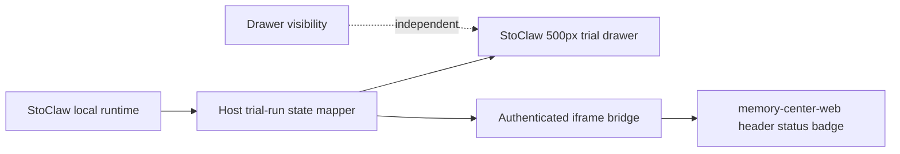

## Context

本变更依赖 `workflow-embedded-editor-integration` 已建立的三端边界：`memory-center-web` 拥有工作流业务顶栏和画布保存，`sto-claw` 拥有本地试运行、结果 UI 和 iframe bridge，`memory-center` 提供草稿版本与运行记录服务。

当前 Host 只向 Web 同步 `idle / confirming / saving / preparing / running / error`。本地运行从活跃态进入取消、失败或完成后，协调器发送 `idle` 并释放请求，因此 Web 顶栏丢失终态。与此同时，`TestRunDrawer` 为共享 800px 详情型布局，操作位于标题栏，完成态使用 Tab，与 MasterGo 节点 `48:46129` 的 500px 状态型抽屉不一致。

MasterGo 的运行中、取消、失败、完成分别对应 Brand、Warning、Danger、Success 语义。颜色实现必须遵循 `docs/sto-design.md`，设计稿颜色只作视觉校准。当前顶部区域已由前置变更完成，本变更不重排其常规操作，只增加运行状态徽标。

## Goals / Non-Goals

**Goals**

- 由本地运行事实驱动顶栏和抽屉的四种稳定状态
- 关闭抽屉后运行和状态继续存在
- 以 500px 抽屉呈现状态、执行过程、产物和固定底部操作
- 保留等待审批、补充输入、事件和产物能力
- 取消后“继续运行”创建新的完整试运行
- 隔离试运行视觉与共享运行详情视觉
- 覆盖浅色、深色、键盘焦点、窄窗口和 reduced motion

**Non-Goals**

- 不修改 `memory-center` 的终态锁或运行 API
- 不支持同一 `runId` 的取消后恢复
- 不复制已完成节点到新运行
- 不重做顶部区域、画布、版本抽屉或本地运行引擎
- 不启用 Web 遗留试运行抽屉

## Architecture and Data Flow



运行状态和抽屉可见性独立维护。状态映射器只接受当前 workflow 会话、request 和 run 的更新。抽屉关闭只修改可见性；工作流切换或 iframe 会话失效才重置状态。

Bridge 状态集合扩展为：

```text
idle | confirming | saving | preparing | running |
cancelled | failed | completed | error
```

`error` 是启动阶段瞬时错误，`failed` 是已创建运行的稳定终态。Web controller 在收到稳定终态后释放 active request ID，但保留 display state，以允许用户从终态发起新 request。

## Decisions

### 1. Host 继续作为运行状态唯一事实来源

- **Decision**: StoClaw 从当前 `WorkflowExecutionState` 和启动状态映射 `running/cancelled/failed/completed`，再同时驱动本地抽屉和 bridge。
- **Rationale**: Web 无法观察 SQLite 本地运行和 Agent 生命周期；单一事实来源可避免两套轮询和状态漂移。
- **Alternative considered**: Web 根据按钮点击和超时推断运行结果。否决原因是不能可靠识别取消、失败或完成。

### 2. 生命周期与抽屉可见性分离

- **Decision**: 关闭抽屉只调用本地 `closeDrawer`，不调用确认取消、不发送 `idle`、不释放活跃运行。
- **Rationale**: MasterGo 明确说明关闭弹窗不会中断运行，顶栏还必须继续展示状态。
- **Alternative considered**: 关闭抽屉同时清理展示状态。否决原因是会破坏后台运行可见性和顶部同步。

### 3. 终态释放请求但保持展示

- **Decision**: Host 发送终态后结束当前 bridge request；Web 清理 active request ID，但保留终态显示，直到新尝试或会话重置。
- **Rationale**: 终态既需要持久展示，也必须允许下一次试运行使用新 request ID。
- **Alternative considered**: 终态继续占用 active request。否决原因是会阻止重跑，或迫使重跑复用旧 request ID。

### 4. “继续运行”创建新完整运行

- **Decision**: 嵌入式取消态的 `onContinue` 使用现有保存后重跑协调器，重新保存最新画布、选择启动参数与引擎，并创建新 `runId`；旧运行保持 `CANCELLED`。
- **Rationale**: 这是改动最小且风险最低的语义，不需要放开 `memory-center` 终态锁，也不会让云端运行记录回退。
- **Alternative considered**: 调用 `resumeWorkflowRun(cancelledRunId)` 从首个未完成节点继续。否决原因是 `memory-center` 将 `CANCELLED` 永久锁定，后续 RUNNING/完成同步会被跳过。

### 5. 试运行与详情模式隔离

- **Decision**: 共享 drawer 保留数据适配函数，但显式区分 `trial` 和 `detail` 视图；只有 `trial` 使用新 500px 结构。
- **Rationale**: 完成通知和历史运行详情具有额外操作与信息密度，直接全量替换会产生无关回归。
- **Alternative considered**: 所有消费者统一切到新抽屉。否决原因是超出本次设计范围且缺少对应详情设计稿。

### 6. 完成态使用折叠区而不是 Tab

- **Decision**: “执行过程”和“产物名称”作为独立折叠区，可分别展开；事件与产物数据继续复用现有适配器。
- **Rationale**: 对齐 MasterGo，并允许用户在同一滚动上下文查看过程和结果。
- **Alternative considered**: 保留现有产物/执行过程 Tab。否决原因是与目标信息层级不一致且隐藏另一类信息。

### 7. 使用语义主题 Token

- **Decision**: 运行中、完成、取消、失败分别使用 Brand、Success、Warning、Danger Token；表面、文本和边框使用当前主题的 Fill/Text/Border Token。
- **Rationale**: 满足 `docs/sto-design.md` 和 OpenSpec 暗色要求，避免复制浅色设计稿 hex。
- **Alternative considered**: 直接硬编码 MasterGo 色值。否决原因是会产生 light-only UI 并绕过主题体系。

## Interaction State Model

| 状态 | 顶栏 | 抽屉 | 底部操作 |
|---|---|---|---|
| `confirming/saving/preparing` | 沿用现有忙碌入口反馈 | 确认或启动参数弹窗 | 无 |
| `running` | 运行中徽标 | 提示条、状态、执行过程 | 取消运行 |
| `cancelled` | 运行已取消徽标 | 状态、已产生执行过程 | 继续运行（新 run） |
| `failed` | 运行失败徽标 | 状态、错误、已产生执行过程 | 重新运行 |
| `completed` | 运行完成徽标 | 状态、折叠执行过程、产物 | 重新运行 |

本地 `waiting_approval` 和 `waiting_input` 映射为 `running`，并在抽屉执行过程区域保留可操作表单。`timeout` 和 `interrupted` 映射为 `failed`。

## UI Structure

- MasterGo 节点 `48:46129` 和用户确认的五联状态图共同构成视觉验收基准；实现截图必须分别对照运行中、取消、失败、完成-过程收起、完成-过程展开五个画面。
- Drawer：500px，窄窗口最大 100vw。
- Header：52px，“试运行结果”与关闭按钮。
- Body：12px 横向内边距，可滚动。
- Running notice：仅运行中出现，说明关闭不终止运行。
- Status row：476×42px，图标、文字、当前版本。
- Process：纵向事件时间线，长输出可换行或内部滚动。
- Cards：状态行、执行过程和产物区域使用 1px 语义描边与 10–12px 圆角，不沿用旧摘要卡的大阴影。
- Timeline：圆点和连续竖线位于左侧，事件标题与时间左右分布，详细内容在下一行缩进对齐；卡片标题固定，内容区滚动。
- Completed collapsed：执行过程折叠入口位于完成状态条右侧，产物卡填充主要内容区。
- Completed expanded：执行过程成为产物卡上方的独立卡片，两块卡片保持相同描边、圆角和间距。
- Artifact header：右侧保留放大/打开和下载图标及完整交互状态。
- Footer：60px 固定操作区，左右 12px 内边距；整行按钮高 36px、圆角 10px，浅色稿为黑底白字，暗色使用等价高强调 Token。

所有状态必须由图标和文字共同表达。关闭、折叠、审批、补充输入和底部操作必须支持键盘与 `focus-visible`。非必要动画响应 `prefers-reduced-motion`。

## Error Handling and Concurrency

- 继续沿用 origin、source、protocol、nonce、workflow ID、request ID 和 schema 校验。
- 旧 request、旧 run 或旧 workflow 会话的迟到状态不得覆盖当前展示。
- 同一会话同时最多一个启动请求或一个活跃运行。
- 保存/启动错误不创建 run、不运行旧版本，并只展示一次反馈。
- 新尝试失败后结束其 request；瞬时 `error` 不得伪装为本地运行失败。
- 关闭抽屉不得触发 request 终止。

## Testing Strategy

### StoClaw

- 协议和 validator 覆盖新增终态与非法输入。
- 状态协调器覆盖本地状态映射、终态保持、旧事件拒绝和会话重置。
- route 测试证明关闭抽屉不发送 `idle`，取消态继续创建新 run 且不调用 same-run resume。
- drawer 组件覆盖 4 类状态、5 个视觉视图、固定 footer、折叠区、等待审批/输入、空产物和 detail 隔离。
- 主题测试检查语义 Token、暗色 hook、focus、disabled 和 reduced motion。

### memory-center-web

- 协议/controller 覆盖终态接收、释放 active request、保留 display state 和新 request。
- 顶栏覆盖四种徽标、图标文字双表达、浅色与深色语义状态。
- 独立浏览器模式和不兼容 Host 保持当前行为。

### Cross-project

- 运行相关类型检查、单元测试和 lint。
- 运行 `pnpm run comms:replay` 和 `pnpm run comms:compare`。
- 手工覆盖运行中关闭抽屉、取消后继续、失败重跑、完成折叠区、审批/输入、窄窗口和 light/dark。
- 复核三份 README 的同步需求。

## Risks / Trade-offs

- **[Risk] 关闭抽屉仍调用当前 `cancelConfirmation` 并清成 idle** → 拆开 close handler，只关闭 drawer。
- **[Risk] 终态清理 request 时一并丢失顶栏状态** → Web controller 分离 active request 与 display state。
- **[Risk] 旧运行迟到事件覆盖新运行** → 同时校验 request、run 和 workflow session 身份。
- **[Risk] “继续运行”被误解为断点续跑** → 用户可见文案保持设计稿，规格和测试明确新 run、全量执行。
- **[Risk] 共享 drawer 改造影响详情消费者** → `trial/detail` 视图隔离并添加回归测试。
- **[Risk] MasterGo 浅色值污染暗色主题** → 只采用几何，颜色统一使用语义 Token 并执行双主题验收。
- **[Risk] 新旧 Web/Host 协议错配** → 延续能力握手，未知终态安全忽略，配套发布后启用完整体验。

## Rollout

1. 先在 StoClaw 与 memory-center-web 中配套扩展 bridge 类型和测试。
2. Web 可以先接受新终态；旧 Host 不发送时行为不变。
3. Host 在确认 Web 支持既有 bridge 能力后发送终态；未知组合保持旧表现。
4. 不发布 `memory-center` 生产变更。
5. 完成跨项目自动化和人工验收后再关闭前置 change 的剩余视觉 QA。
