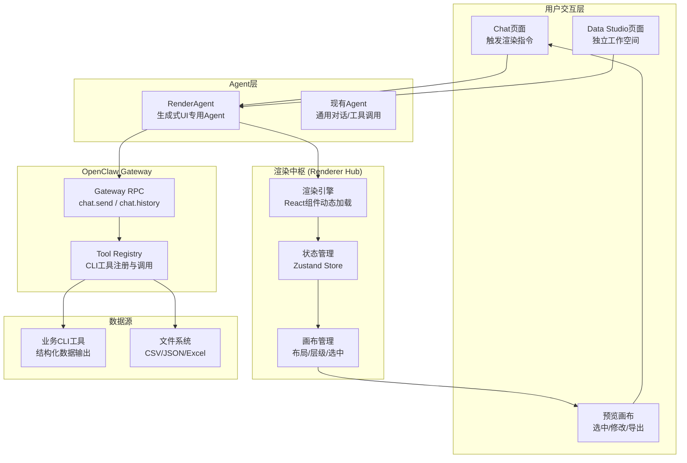
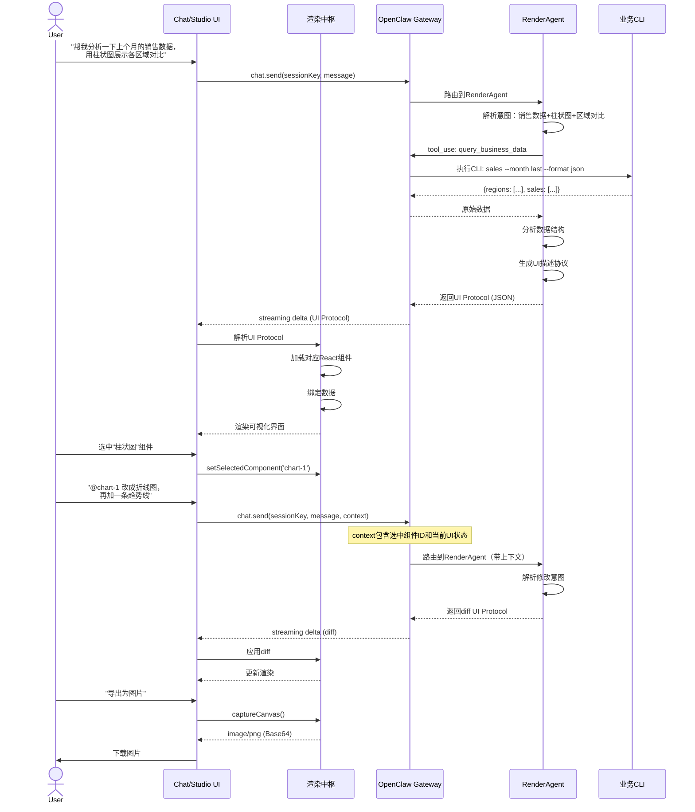
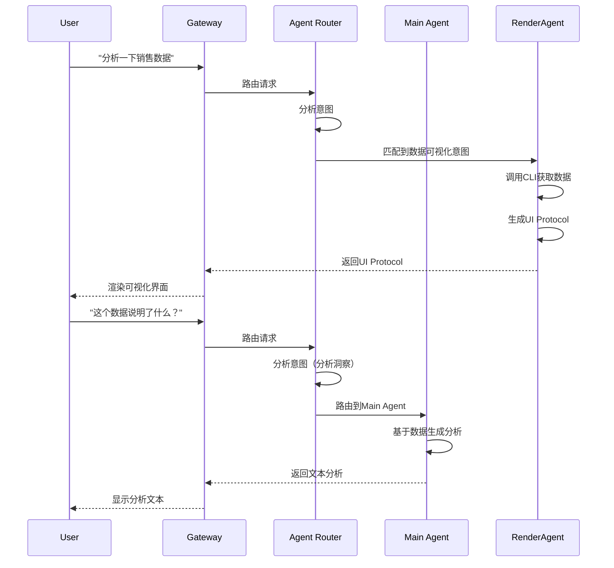

# StoClaw 生成式UI架构方案

## 1. 核心概念定义

### 1.1 什么是生成式UI（Generative UI）

生成式UI是指通过自然语言指令，由AI自动分析数据、理解用户意图，并生成可交互的数据可视化界面。核心特征：

- **意图驱动**：用户用自然语言描述需求，而非手动配置图表
- **数据感知**：自动理解结构化数据的 schema、关系和统计特征
- **迭代优化**：支持选中组件进行对话式修改
- **多模态输出**：生成页面、导出图片、生成文件等

### 1.2 与现有Chat的关系

```
┌─────────────────────────────────────────────────────────────────┐
│                         StoClaw Desktop                          │
│                                                                  │
│  ┌─────────────────────┐    ┌─────────────────────────────────┐│
│  │   Chat (现有)        │    │   Data Studio (新增)             ││
│  │   - 通用对话         │    │   - 数据查询与分析               ││
│  │   - Agent协作        │    │   - 生成式UI渲染                 ││
│  │   - 工具调用         │    │   - 可视化预览与导出             ││
│  └──────────┬──────────┘    └─────────────────────────────────┘│
│             │                                                    │
│             ▼                                                    │
│  ┌─────────────────────────────────────────────────────────────┐│
│  │              OpenClaw Gateway (共享)                         ││
│  │   - RenderAgent (新增专用Agent)                              ││
│  │   - 现有Agent (main, custom agents)                          ││
│  └─────────────────────────────────────────────────────────────┘│
└─────────────────────────────────────────────────────────────────┘
```

## 2. 整体架构设计

### 2.1 架构概览



### 2.2 核心组件定义

#### 2.2.1 RenderAgent（渲染专用Agent）

RenderAgent 是一个专门设计的 OpenClaw Agent，其核心职责：

1. **意图解析**：将自然语言转换为结构化的渲染指令
2. **数据查询**：调用业务CLI获取原始数据
3. **UI生成**：输出标准化的UI描述协议（JSON Schema）
4. **迭代修改**：根据用户反馈调整UI描述

**RenderAgent 配置示例：**

```json
{
  "id": "render-agent",
  "name": "RenderAgent",
  "description": "生成式UI渲染专用Agent，负责将自然语言指令转换为可视化界面",
  "model": "claude-sonnet-4-20250514",
  "system_prompt": "SOUL.md 中的系统提示词",
  "tools": [
    "query_business_data",
    "analyze_data_schema", 
    "generate_ui_layout",
    "modify_ui_component",
    "export_to_image",
    "export_to_file"
  ],
  "memory": {
    "session_context": true,
    "user_preferences": true
  }
}
```

#### 2.2.2 渲染中枢（Renderer Hub）

渲染中枢是前端的核心模块，负责：

1. **协议解析**：将RenderAgent输出的UI描述协议转换为React组件
2. **组件注册**：管理可渲染组件库（图表、表格、卡片等）
3. **画布管理**：处理布局、层级、选中状态
4. **交互代理**：将用户操作（选中、拖拽、修改）转换为对话上下文

**核心模块：**

```typescript
// src/lib/render-hub/types.ts

// UI描述协议（RenderAgent输出，Renderer Hub输入）
interface UIRenderProtocol {
  version: '1.0';
  canvas: {
    layout: 'grid' | 'flex' | 'absolute';
    width: number;
    height: number;
    background?: string;
  };
  components: UIComponent[];
  dataBindings: DataBinding[];
  interactions: InteractionConfig[];
}

// 组件描述
interface UIComponent {
  id: string;
  type: ComponentType; // 'chart' | 'table' | 'card' | 'metric' | 'text' | 'image'
  position: { x: number; y: number; w: number; h: number };
  props: Record<string, unknown>;
  dataSource?: string; // 绑定到哪个数据源
}

// 数据源绑定
interface DataBinding {
  id: string;
  source: 'cli' | 'file' | 'memory';
  query: string; // CLI命令或文件路径
  schema: DataSchema;
  cachePolicy: 'none' | 'session' | 'persistent';
}

// 交互配置
interface InteractionConfig {
  target: string; // 组件ID
  trigger: 'click' | 'hover' | 'select';
  action: 'filter' | 'drilldown' | 'modify' | 'export';
  params?: Record<string, unknown>;
}
```

## 3. 数据流设计

### 3.1 完整数据流



### 3.2 UI描述协议（UIRenderProtocol）

RenderAgent 输出标准化的UI描述协议，渲染中枢解析并渲染：

```typescript
// 示例：销售数据柱状图的UI Protocol
const exampleProtocol: UIRenderProtocol = {
  version: '1.0',
  canvas: {
    layout: 'grid',
    width: 1200,
    height: 800,
    background: '#ffffff'
  },
  components: [
    {
      id: 'title-1',
      type: 'text',
      position: { x: 0, y: 0, w: 12, h: 1 },
      props: {
        content: '上月销售数据 - 区域对比',
        fontSize: 24,
        fontWeight: 'bold',
        align: 'center'
      }
    },
    {
      id: 'chart-1',
      type: 'chart',
      position: { x: 0, y: 1, w: 8, h: 6 },
      props: {
        chartType: 'bar',
        title: '各区域销售额',
        xAxis: { field: 'region', label: '区域' },
        yAxis: { field: 'sales', label: '销售额（万元）' },
        colors: ['#3b82f6', '#10b981', '#f59e0b']
      },
      dataSource: 'ds-sales-001'
    },
    {
      id: 'metric-1',
      type: 'metric',
      position: { x: 8, y: 1, w: 4, h: 2 },
      props: {
        title: '总销售额',
        value: '${ds-sales-001.total}',
        unit: '万元',
        trend: '+12.5%'
      }
    }
  ],
  dataBindings: [
    {
      id: 'ds-sales-001',
      source: 'cli',
      query: 'sales --month last --format json',
      schema: {
        fields: [
          { name: 'region', type: 'string' },
          { name: 'sales', type: 'number' }
        ]
      },
      cachePolicy: 'session'
    }
  ],
  interactions: [
    {
      target: 'chart-1',
      trigger: 'click',
      action: 'drilldown',
      params: { field: 'region' }
    }
  ]
};
```

## 4. UI交互设计

### 4.1 对话式生成界面

参考豆包的交互模式，设计"左对话 + 右预览"的布局：

```
┌─────────────────────────────────────────────────────────────────┐
│  Data Studio                                                   │
│  ┌──────────────────────────┐  ┌─────────────────────────────┐ │
│  │  对话面板                  │  │  预览画布                     │ │
│  │  ┌────────────────────┐  │  │  ┌─────────────────────────┐│ │
│  │  │ 用户: 分析一下上个月的 │  │  │  │  [标题] 上月销售数据       ││ │
│  │  │ 销售数据              │  │  │  │                           ││ │
│  │  └────────────────────┘  │  │  │  │  ┌───────────────────┐  ││ │
│  │  ┌────────────────────┐  │  │  │  │  │ 柱状图            │  ││ │
│  │  │ AI: 好的，正在查询   │  │  │  │  │  │ 华北 ████████    │  ││ │
│  │  │ 数据...             │  │  │  │  │  │ 华东 ██████████  │  ││ │
│  │  └────────────────────┘  │  │  │  │  │ 华南 ██████      │  ││ │
│  │  ┌────────────────────┐  │  │  │  │  └───────────────────┘  ││ │
│  │  │ [文件] sales.json   │  │  │  │  │  ┌─────────┐ ┌─────────┐││ │
│  │  │ 点击预览数据内容     │  │  │  │  │ │总销售额  │ │增长率   │││ │
│  │  └────────────────────┘  │  │  │  │  │ │1,234万  │ │+12.5%   │││ │
│  │                          │  │  │  │  │ └─────────┘ └─────────┘││ │
│  │  ┌────────────────────┐  │  │  │  └─────────────────────────┘│ │
│  │  │ 用户: @chart-1 改成 │  │  │  └─────────────────────────────┘ │
│  │  │ 折线图，加趋势线     │  │  │                                   │
│  │  └────────────────────┘  │  │                                   │
│  │                          │  │                                   │
│  │  [输入框...]             │  │  [导出] [分享] [全屏]             │
│  └──────────────────────────┘  └─────────────────────────────────┘ │
└─────────────────────────────────────────────────────────────────┘
```

### 4.2 选中与修改交互

```typescript
// src/lib/render-hub/interaction.ts

interface ComponentSelection {
  componentId: string;
  componentType: ComponentType;
  boundingBox: { x: number; y: number; w: number; h: number };
  props: Record<string, unknown>;
  dataSnapshot: unknown; // 当前组件的数据快照
}

interface ModificationContext {
  selectedComponent: ComponentSelection;
  userInstruction: string;
  currentProtocol: UIRenderProtocol;
  modificationHistory: ModificationRecord[];
}

// 当用户选中组件并输入修改指令时
function handleModificationRequest(
  context: ModificationContext
): Promise<UIRenderProtocol> {
  // 1. 构建修改上下文
  const prompt = buildModificationPrompt(context);
  
  // 2. 发送到RenderAgent
  return sendToRenderAgent(prompt);
}

function buildModificationPrompt(context: ModificationContext): string {
  return `
当前选中的组件：
- ID: ${context.selectedComponent.componentId}
- 类型: ${context.selectedComponent.componentType}
- 当前属性: ${JSON.stringify(context.selectedComponent.props, null, 2)}

用户修改指令：
${context.userInstruction}

请基于当前UI状态，生成修改后的UI Protocol（仅输出diff部分）。
`;
}
```

### 4.3 导出功能

```typescript
// src/lib/render-hub/export.ts

interface ExportOptions {
  format: 'png' | 'jpg' | 'svg' | 'pdf' | 'html' | 'json';
  quality?: number;
  width?: number;
  height?: number;
  includeData?: boolean;
}

// 导出为图片（截图）
async function exportToImage(
  canvasElement: HTMLElement,
  options: ExportOptions
): Promise<Blob> {
  // 使用html2canvas或类似库
  const canvas = await html2canvas(canvasElement, {
    scale: options.quality || 2,
    width: options.width,
    height: options.height,
    backgroundColor: '#ffffff'
  });
  
  return new Promise((resolve) => {
    canvas.toBlob((blob) => resolve(blob!), options.format, 0.95);
  });
}

// 导出为HTML（可独立运行）
async function exportToHTML(protocol: UIRenderProtocol): Promise<string> {
  // 生成包含所有依赖的独立HTML文件
  return generateStandaloneHTML(protocol);
}

// 导出为JSON（UI Protocol）
function exportToJSON(protocol: UIRenderProtocol): string {
  return JSON.stringify(protocol, null, 2);
}
```

## 5. 技术实现方案

### 5.1 前端架构

```
src/
├── pages/
│   ├── Chat/                    # 现有聊天页面（增强）
│   │   └── index.tsx
│   └── DataStudio/              # 新增：数据分析工作室
│       ├── index.tsx            # 主页面
│       ├── components/
│       │   ├── StudioLayout.tsx    # 左对话右预览布局
│       │   ├── ChatPanel.tsx       # 对话面板
│       │   ├── PreviewCanvas.tsx   # 预览画布
│       │   ├── ComponentToolbar.tsx # 组件工具栏
│       │   └── ExportPanel.tsx     # 导出面板
│       └── hooks/
│           ├── useRenderAgent.ts   # RenderAgent通信
│           ├── useCanvasState.ts   # 画布状态管理
│           └── useComponentSelection.ts # 组件选中管理
│
├── lib/
│   └── render-hub/              # 渲染中枢核心库
│       ├── index.ts             # 入口
│       ├── types.ts             # 类型定义
│       ├── parser.ts            # UI Protocol解析器
│       ├── renderer.tsx         # React渲染器
│       ├── registry.ts          # 组件注册表
│       ├── canvas.ts            # 画布管理
│       ├── selection.ts         # 选中管理
│       ├── export.ts            # 导出功能
│       └── components/          # 内置渲染组件
│           ├── Chart.tsx
│           ├── Table.tsx
│           ├── Metric.tsx
│           ├── Card.tsx
│           └── Text.tsx
│
├── stores/
│   └── dataStudio.ts            # Data Studio状态管理
│
└── types/
    └── render-hub.ts            # 渲染中枢类型定义
```

### 5.2 组件注册表

```typescript
// src/lib/render-hub/registry.ts

import { ChartComponent } from './components/Chart';
import { TableComponent } from './components/Table';
import { MetricComponent } from './components/Metric';
import { CardComponent } from './components/Card';
import { TextComponent } from './components/Text';
import { ImageComponent } from './components/Image';

// 组件注册表
export const componentRegistry = {
  chart: ChartComponent,
  table: TableComponent,
  metric: MetricComponent,
  card: CardComponent,
  text: TextComponent,
  image: ImageComponent,
} as const;

export type ComponentType = keyof typeof componentRegistry;

// 动态加载组件
export function getComponent(type: ComponentType) {
  const component = componentRegistry[type];
  if (!component) {
    throw new Error(`Unknown component type: ${type}`);
  }
  return component;
}
```

### 5.3 渲染引擎

```typescript
// src/lib/render-hub/renderer.tsx

import React from 'react';
import { getComponent } from './registry';
import type { UIRenderProtocol, UIComponent } from './types';

interface RenderCanvasProps {
  protocol: UIRenderProtocol;
  onComponentSelect?: (componentId: string) => void;
  selectedComponentId?: string | null;
}

export function RenderCanvas({ protocol, onComponentSelect, selectedComponentId }: RenderCanvasProps) {
  const { canvas, components } = protocol;
  
  return (
    <div
      className="render-canvas"
      style={{
        width: canvas.width,
        height: canvas.height,
        background: canvas.background,
        display: 'grid',
        gridTemplateColumns: `repeat(12, 1fr)`,
        gap: '16px',
        padding: '24px'
      }}
    >
      {components.map((component) => (
        <ComponentWrapper
          key={component.id}
          component={component}
          isSelected={selectedComponentId === component.id}
          onSelect={() => onComponentSelect?.(component.id)}
        />
      ))}
    </div>
  );
}

function ComponentWrapper({ component, isSelected, onSelect }: {
  component: UIComponent;
  isSelected: boolean;
  onSelect: () => void;
}) {
  const Component = getComponent(component.type);
  
  return (
    <div
      className={`component-wrapper ${isSelected ? 'selected' : ''}`}
      style={{
        gridColumn: `${component.position.x + 1} / span ${component.position.w}`,
        gridRow: `${component.position.y + 1} / span ${component.position.h}`,
        border: isSelected ? '2px solid #3b82f6' : '1px solid transparent',
        borderRadius: '8px',
        cursor: 'pointer'
      }}
      onClick={onSelect}
    >
      <Component {...component.props} />
    </div>
  );
}
```

### 5.4 状态管理

```typescript
// src/stores/dataStudio.ts

import { create } from 'zustand';
import type { UIRenderProtocol, UIComponent, ComponentSelection } from '@/lib/render-hub/types';

interface DataStudioState {
  // 当前UI Protocol
  currentProtocol: UIRenderProtocol | null;
  
  // 选中状态
  selectedComponentId: string | null;
  selectedComponent: ComponentSelection | null;
  
  // 对话历史
  messages: StudioMessage[];
  
  // 加载状态
  isGenerating: boolean;
  
  // Actions
  setProtocol: (protocol: UIRenderProtocol) => void;
  selectComponent: (componentId: string | null) => void;
  addMessage: (message: StudioMessage) => void;
  updateComponent: (componentId: string, updates: Partial<UIComponent>) => void;
  setGenerating: (isGenerating: boolean) => void;
}

interface StudioMessage {
  id: string;
  role: 'user' | 'assistant' | 'system';
  content: string;
  protocol?: UIRenderProtocol; // AI回复可能包含UI Protocol
  timestamp: number;
}

export const useDataStudioStore = create<DataStudioState>((set, get) => ({
  currentProtocol: null,
  selectedComponentId: null,
  selectedComponent: null,
  messages: [],
  isGenerating: false,
  
  setProtocol: (protocol) => set({ currentProtocol: protocol }),
  
  selectComponent: (componentId) => {
    const { currentProtocol } = get();
    if (!componentId || !currentProtocol) {
      set({ selectedComponentId: null, selectedComponent: null });
      return;
    }
    
    const component = currentProtocol.components.find(c => c.id === componentId);
    if (!component) return;
    
    set({
      selectedComponentId: componentId,
      selectedComponent: {
        componentId,
        componentType: component.type,
        boundingBox: component.position,
        props: component.props,
        dataSnapshot: null // 从数据源获取
      }
    });
  },
  
  addMessage: (message) => set((state) => ({
    messages: [...state.messages, message]
  })),
  
  updateComponent: (componentId, updates) => set((state) => {
    if (!state.currentProtocol) return state;
    
    const newComponents = state.currentProtocol.components.map(c =>
      c.id === componentId ? { ...c, ...updates } : c
    );
    
    return {
      currentProtocol: {
        ...state.currentProtocol,
        components: newComponents
      }
    };
  }),
  
  setGenerating: (isGenerating) => set({ isGenerating })
}));
```

## 6. 与现有系统的集成

### 6.1 与Chat页面的集成

在现有Chat页面中，当检测到RenderAgent的回复包含UI Protocol时，自动渲染为可视化组件：

```typescript
// src/pages/Chat/ChatMessage.tsx (增强)

import { RenderCanvas } from '@/lib/render-hub/renderer';

function ChatMessage({ message }: { message: RawMessage }) {
  // 检查消息是否包含UI Protocol
  const uiProtocol = extractUIProtocol(message.content);
  
  if (uiProtocol) {
    return (
      <div className="chat-message-with-ui">
        <RenderCanvas protocol={uiProtocol} />
      </div>
    );
  }
  
  // 原有渲染逻辑...
}
```

### 6.2 与Gateway的集成

RenderAgent作为OpenClaw Gateway中的一个特殊Agent：

```json
// openclaw.json 中的Agent配置
{
  "agents": [
    {
      "id": "render-agent",
      "name": "RenderAgent",
      "description": "生成式UI渲染专用Agent",
      "model": "claude-sonnet-4-20250514",
      "system_prompt_file": "render-agent/SOUL.md",
      "tools": [
        "query_business_data",
        "analyze_data_schema",
        "generate_ui_layout"
      ],
      "triggers": {
        "keywords": ["分析", "图表", "可视化", "展示", "报表"],
        "regex": ["生成.*图", "展示.*数据", "分析.*趋势"]
      }
    }
  ]
}
```

### 6.3 与现有Agent的协作



## 7. 实现计划

### 阶段1：基础架构（2-3周）

1. **渲染中枢核心库**
   - [ ] 定义UI Protocol类型系统
   - [ ] 实现组件注册表
   - [ ] 实现基础渲染引擎
   - [ ] 实现画布管理

2. **内置组件库**
   - [ ] Chart组件（基于ECharts/Recharts）
   - [ ] Table组件
   - [ ] Metric卡片
   - [ ] Text组件
   - [ ] Image组件

3. **Data Studio页面**
   - [ ] 创建基础页面结构
   - [ ] 实现左对话右预览布局
   - [ ] 集成现有Chat组件

### 阶段2：Agent集成（2-3周）

1. **RenderAgent开发**
   - [ ] 编写SOUL.md系统提示词
   - [ ] 实现数据查询工具
   - [ ] 实现UI生成工具
   - [ ] 测试和调优

2. **Gateway集成**
   - [ ] 注册RenderAgent到Gateway
   - [ ] 实现Agent路由逻辑
   - [ ] 测试端到端流程

### 阶段3：交互增强（2-3周）

1. **选中与修改**
   - [ ] 实现组件选中高亮
   - [ ] 实现@组件引用语法
   - [ ] 实现增量修改协议

2. **导出功能**
   - [ ] 截图导出
   - [ ] HTML导出
   - [ ] JSON导出

### 阶段4：优化与扩展（2周）

1. **性能优化**
   - [ ] 大数据量渲染优化
   - [ ] 缓存策略
   - [ ] 懒加载

2. **功能扩展**
   - [ ] 更多图表类型
   - [ ] 自定义主题
   - [ ] 协作分享

## 8. 风险评估

| 风险 | 影响 | 缓解措施 |
|------|------|----------|
| UI Protocol标准化不足 | 高 | 提前定义严格的JSON Schema，版本化管理 |
| 大数据量渲染性能 | 中 | 分页加载、虚拟滚动、数据采样 |
| Agent理解偏差 | 中 | 丰富的示例提示词、人工校验机制 |
| 与现有系统耦合 | 低 | 模块化设计、清晰的接口边界 |

## 9. 成功指标

1. **功能指标**
   - 支持至少5种基础组件类型
   - 支持自然语言生成UI的准确率 > 80%
   - 支持选中修改的响应时间 < 3秒

2. **性能指标**
   - 首次渲染时间 < 2秒
   - 大数据量（10万行）渲染时间 < 5秒
   - 截图导出时间 < 3秒

3. **用户体验**
   - 用户满意度评分 > 4.0/5.0
   - 功能使用频率（DAU/MAU）> 30%
