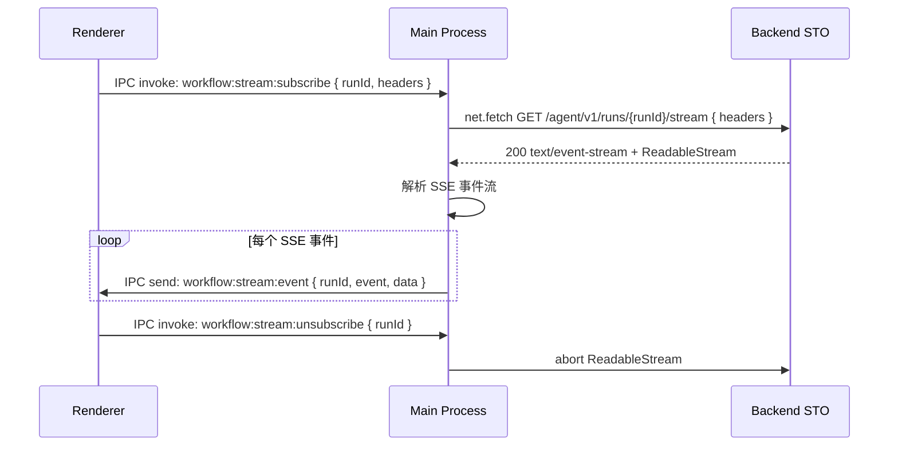

# Workflow SSE 代理通道设计方案

## 背景

接口文档定义了 `GET /agent/v1/runs/{runId}/stream` SSE 流式接口，用于实时推送 workflow 运行状态变化。当前 `hostapi:fetch`（IPC 请求-响应模式）不支持流式响应，需要额外开发 SSE 代理通道。

## 现有架构分析

### 现有 SSE 模式（参考 `/api/events`）

```
Renderer: new EventSource('/api/events')
  → Host API Server (electron/api/server.ts)
    → handleAppRoutes (electron/api/routes/app.ts)
      → res.writeHead(200, {'Content-Type': 'text/event-stream'})
      → ctx.eventBus.addSseClient(res)
      → 持续写入 SSE 事件
```

这是**主进程直接产生事件**的模式（gateway 状态变更 → eventBus → SSE 推送）。

### 需要新增的模式

```
Renderer: subscribeWorkflowStream(runId)
  → IPC: workflow:stream:subscribe({ runId })
    → Main: 建立 SSE 连接到后端
      → net.fetch('https://baseinfo-aimemory.sto.cn/agent/v1/runs/{runId}/stream')
      → 读取 response.body (ReadableStream)
      → 解析 SSE 事件
      → IPC 转发给 renderer: workflow:stream:event({ runId, event, data })
```

## 方案选型

### 方案 A：IPC + ReadableStream 代理（推荐）

**原理**：主进程通过 `net.fetch` 建立 SSE 连接到后端，解析 SSE 事件流，通过 IPC `workflow:stream:event` 转发给 renderer。

**优点**：
- 遵循现有 Electron 安全模型（renderer 不直接访问网络）
- 可复用 `proxyAwareFetch` 的代理配置和超时逻辑
- 与现有 `host-events.ts` 的 `subscribeHostEvent` 模式一致
- 支持认证头（stoToken、X-Trace-Id）注入

**缺点**：
- 需要新增 IPC 通道和解析逻辑
- SSE 解析需要在主进程完成

### 方案 B：直接 EventSource 到 Host API

**原理**：renderer 通过 `new EventSource('/agent/v1/runs/{runId}/stream')` 连接到本地 Host API，Host API 路由代理到后端 SSE。

**优点**：
- renderer 代码最简单（标准 EventSource API）
- 与现有 `/api/events` 模式一致

**缺点**：
- Host API 是 HTTP Server，SSE 代理需要长连接管理
- 需要处理连接断开、重传 ID（Last-Event-Id）等 SSE 协议细节
- 认证头注入需要额外机制（EventSource 不支持自定义头）

### 方案 C：保持轮询，不实现 SSE

**原理**：继续使用 `WorkflowExecutionTracker` 的轮询机制。

**优点**：
- 零额外开发
- 已验证稳定

**缺点**：
- 2 秒轮询间隔，延迟较高
- 服务端负载增加

## 推荐方案：方案 A（IPC + ReadableStream 代理）

### 架构设计



### 文件变更清单

| 文件 | 操作 | 说明 |
|------|------|------|
| `electron/main/ipc/workflow-stream-proxy.ts` | **新建** | SSE 代理 IPC 处理器 |
| `electron/preload/index.ts` | 修改 | 注册 `workflow:stream:subscribe/unsubscribe` 到白名单 |
| `src/lib/workflow-api.ts` | 修改 | 新增 `subscribeWorkflowStream(runId)` 函数 |
| `electron/main/ipc-handlers.ts` | 修改 | 注册 workflow stream IPC 处理 |

### 详细设计

#### 1. `electron/main/ipc/workflow-stream-proxy.ts`（新建）

```typescript
import { ipcMain, webContents } from 'electron';
import { proxyAwareFetch } from '../../utils/proxy-fetch';
import { getStoToken } from '../../utils/auth-store';
import { logger } from '../../utils/logger';
import { PORTS } from '../../utils/config';

interface ActiveStream {
  runId: string;
  controller: AbortController;
  reader: ReadableStreamDefaultReader<Uint8Array>;
}

const activeStreams = new Map<string, ActiveStream>();

function parseSseLine(buffer: string, line: string, state: { event: string; data: string }): { event: string; data: string } | null {
  if (line === '') {
    // 空行 = 事件结束
    if (state.data) {
      const result = { event: state.event, data: state.data };
      state.event = '';
      state.data = '';
      return result;
    }
    return null;
  }
  if (line.startsWith(':')) return null; // 注释
  if (line.startsWith('event:')) {
    state.event = line.slice(6).trim();
    return null;
  }
  if (line.startsWith('data:')) {
    state.data += (state.data ? '\n' : '') + line.slice(5).trim();
    return null;
  }
  return null;
}

async function startStream(runId: string) {
  if (activeStreams.has(runId)) {
    logger.warn(`[WorkflowStream] Stream for ${runId} already active`);
    return;
  }

  const token = await getStoToken();
  const controller = new AbortController();

  const headers: Record<string, string> = {
    'Content-Type': 'text/event-stream',
    'X-Trace-Id': `${Date.now().toString(36)}${Math.random().toString(36).slice(2, 10)}`,
  };
  if (token) headers.stoToken = token;

  try {
    const response = await proxyAwareFetch(
      `http://127.0.0.1:${PORTS.CLAWX_HOST_API}/agent/v1/runs/${runId}/stream`,
      { method: 'GET', headers, signal: controller.signal, timeoutMs: 0 }, // 无超时
    );

    if (!response.ok || !response.body) {
      throw new Error(`SSE connection failed: HTTP ${response.status}`);
    }

    const reader = response.body.getReader();
    activeStreams.set(runId, { runId, controller, reader });

    // 读取流
    const buffer = { value: '' };
    const state = { event: '', data: '' };

    while (true) {
      const { done, value } = await reader.read();
      if (done) break;

      buffer.value += new TextDecoder().decode(value);
      const lines = buffer.value.split('\n');
      buffer.value = lines.pop() || ''; // 保留最后一行（可能不完整）

      for (const line of lines) {
        const parsed = parseSseLine(buffer.value, line, state);
        if (parsed) {
          // 转发给所有 renderer
          for (const wc of webContents.getAllWebContents()) {
            wc.send('workflow:stream:event', { runId, event: parsed.event, data: parsed.data });
          }
        }
      }
    }
  } catch (err) {
    logger.error(`[WorkflowStream] Stream for ${runId} failed:`, err);
    activeStreams.delete(runId);
    // 通知 renderer 连接失败
    for (const wc of webContents.getAllWebContents()) {
      wc.send('workflow:stream:error', { runId, error: String(err) });
    }
  }
}

function stopStream(runId: string) {
  const stream = activeStreams.get(runId);
  if (!stream) return;

  stream.controller.abort();
  activeStreams.delete(runId);
  logger.info(`[WorkflowStream] Stream for ${runId} stopped`);
}

export function registerWorkflowStreamHandlers(): void {
  ipcMain.handle('workflow:stream:subscribe', async (_, runId: string) => {
    await startStream(runId);
    return { success: true };
  });

  ipcMain.handle('workflow:stream:unsubscribe', async (_, runId: string) => {
    stopStream(runId);
    return { success: true };
  });
}
```

#### 2. `electron/preload/index.ts`（修改）

在 `validChannels` 中添加：

```typescript
'workflow:stream:subscribe',
'workflow:stream:unsubscribe',
```

在 `validListenChannels` 中添加：

```typescript
'workflow:stream:event',
'workflow:stream:error',
```

#### 3. `src/lib/workflow-api.ts`（修改）

新增 SSE 订阅函数：

```typescript
export function subscribeWorkflowStream(
  runId: string,
  onUpdate: (event: string, data: unknown) => void,
  onError?: (error: string) => void,
): () => void {
  // 订阅
  invokeIpc('workflow:stream:subscribe', runId).catch((err) => {
    onError?.(`Failed to subscribe: ${err}`);
  });

  const eventHandler = (_: unknown, payload: { runId: string; event: string; data: string }) => {
    if (payload.runId !== runId) return;
    try {
      const parsed = JSON.parse(payload.data);
      onUpdate(payload.event, parsed);
    } catch {
      onUpdate(payload.event, payload.data);
    }
  };

  const errorHandler = (_: unknown, payload: { runId: string; error: string }) => {
    if (payload.runId !== runId) return;
    onError?.(payload.error);
  };

  window.electron?.ipcRenderer?.on('workflow:stream:event', eventHandler);
  window.electron?.ipcRenderer?.on('workflow:stream:error', errorHandler);

  return () => {
    window.electron?.ipcRenderer?.off('workflow:stream:event', eventHandler);
    window.electron?.ipcRenderer?.off('workflow:stream:error', errorHandler);
    invokeIpc('workflow:stream:unsubscribe', runId).catch(() => {});
  };
}
```

#### 4. `electron/main/ipc-handlers.ts`（修改）

在初始化时调用：

```typescript
import { registerWorkflowStreamHandlers } from './ipc/workflow-stream-proxy';

// 在 registerIpcHandlers() 中调用
registerWorkflowStreamHandlers();
```

### SSE 事件映射

后端 SSE 事件格式（接口文档）：

```text
event: run.update
data: {"id":"run_xxx","workflowId":"wf_usr_xxx","status":"running"}
```

Renderer 侧接收：

```typescript
subscribeWorkflowStream(runId, (event, data) => {
  if (event === 'run.update') {
    const run = data as WorkflowRunResponse;
    // 更新 UI 状态
  }
});
```

### 与现有轮询的协同

- **默认行为**：保持 `WorkflowExecutionTracker` 轮询（2 秒间隔）
- **SSE 模式**：可选开启，通过 `subscribeWorkflowStream` 订阅
- **降级策略**：SSE 连接失败时自动退化为轮询（现有 `fetchWorkflowStatus`）

### 待实现的任务清单

| # | 任务 | 文件 | 状态 |
|---|------|------|------|
| 1 | 新建 `workflow-stream-proxy.ts` | `electron/main/ipc/` | 待实现 |
| 2 | 注册 IPC 白名单 | `electron/preload/index.ts` | 待实现 |
| 3 | 新增 `subscribeWorkflowStream` | `src/lib/workflow-api.ts` | 待实现 |
| 4 | 注册 stream handlers | `electron/main/ipc-handlers.ts` | 待实现 |
| 5 | 在 routes/workflows.ts 添加 SSE 代理路由 | `electron/api/routes/workflows.ts` | 可选（方案 A 不需要） |
| 6 | 单元测试 | `tests/unit/workflow-stream-proxy.test.ts` | 待实现 |

### 风险与缓解

| 风险 | 缓解措施 |
|------|----------|
| SSE 连接中断 | 自动退化为轮询，renderer 可重连 |
| 内存泄漏（stream 未关闭） | `stopStream` 清理 + 5 分钟 TTL 自动回收 |
| 多 renderer 重复订阅 | 主进程按 `runId` 去重，只建一条后端连接 |
| 认证过期 | 连接时检查 stoToken 有效性，过期时通知 renderer 重新登录 |
