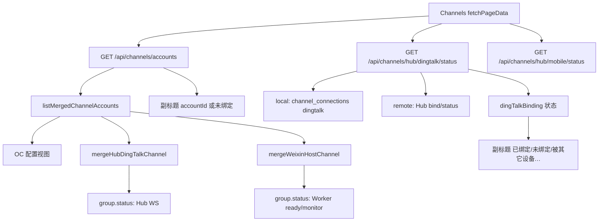

# Channels 页面

频道设置页（`src/pages/Channels`）：移动端、钉钉、微信的展示与操作入口。

后端实现见 [`electron/message-channel/README.md`](../../../electron/message-channel/README.md)。  
引擎与扫码约定见 [`docs/频道行固定引擎与扫码操作方案.md`](../../../docs/频道行固定引擎与扫码操作方案.md)。

---

## 绑定状态检测原理

页面上「已绑定 / 账号 ID」副标题与标题旁圆点是**两套状态**，数据来源也不同。

| UI 元素 | 含义 | 主要数据源 |
| --- | --- | --- |
| 副标题文案 | **绑定**（本机是否完成账号/凭证绑定） | 钉钉：Hub status；微信：accounts 列表账号 |
| 标题旁圆点 | **运行时连接**（WS / Worker 是否在跑） | `/api/channels/accounts` 合并视图里的 `group.status` |
| Logo 是否高亮 | 渠道是否视为「已配置可用」 | 钉钉看 `bindStatus`；微信看是否有 account |

微信绑定判定以 [`getWeixinBinding`](../../../electron/message-channel/weixin/binding.ts) 为准：仅 `bind_status === 'bound'` 视为已绑定；`revoked` 时不以本地凭证文件当作仍绑定。列表合并走 [`mergeWeixinHostChannel`](../../../electron/message-channel/host/list.ts)。

频道页不展示「网关未运行」黄条，刷新也不因 gateway 禁用。微信解绑走 Host 路径。

---

### 1. 钉钉

#### 绑定（副标题「已绑定」）

1. 页面请求 `GET /api/channels/hub/dingtalk/status`（[`index.tsx`](./index.tsx) `fetchPageData`）。
2. Host 读 SQLite `channel_connections`：`channel_type = 'dingtalk'`、`account_id = 'default'`（[`getChannelConnection`](../../../electron/message-channel/hub/binding-service.ts)）。
3. 同时问远程 Hub：`GET …/channel/bind/status?channelType=dingtalk`。
4. 前端组装 `dingTalkBinding`：
   - `bindStatus` ← `local.bindStatus`
   - `replaceHint` ← 远程对照本机 `deviceId`：
     - `remote.bound === false` → `'unbound'`
     - `remote.bound && remote.deviceId !== localDeviceId` → `'other_device'`

副标题逻辑（[`helpers.ts`](./helpers.ts) `configuredChannelSubtitle`）：

| 条件 | 文案 |
| --- | --- |
| `replaceHint === 'other_device'` | 已被其它设备绑定 |
| `replaceHint === 'unbound'` | 远程已解绑 |
| `bindStatus !== 'bound'` | 未绑定，点击扫码绑定 |
| 否则 | **已绑定** |

Logo 高亮：`dingTalkBinding?.bindStatus === 'bound'`（[`ConfiguredChannelRow.tsx`](./ConfiguredChannelRow.tsx)）。

本地 `bound` 写入时机：扫码 claim 成功 → `upsertDingTalkHubBind` 写 `bind_status = 'bound'`。

#### 连接（圆点）

`GET /api/channels/accounts` → [`mergeHubDingTalkChannel`](../../../electron/message-channel/host/list.ts)：

1. 本地必须 `bindStatus === 'bound'`，否则不出现钉钉行（或保留非 Hub 旧数据，当前以 Hub overlay 为准）。
2. 读 Hub WebSocket：`ws.connected` → `connected`（绿）；`connecting` → 黄；否则灰。

圆点 class：[`channelStatusDotClass`](./helpers.ts)（`connected` / `connecting` / `error` / `disconnected`）。

---

### 2. 微信

#### 绑定（副标题显示 bot accountId）

微信**不走**钉钉那套 Hub `bindStatus` 副标题接口。只要列表里能解析出账号，前端就当已配置：

1. `GET /api/channels/accounts` → [`mergeWeixinHostChannel`](../../../electron/message-channel/host/list.ts)。
2. [`getWeixinBinding`](../../../electron/message-channel/weixin/binding.ts) 两路取账号：
   - **优先 DB**：`channel_connections` 中 `channel_type = 'wechat'` 且 `bind_status === 'bound'`
   - **否则本地凭证**：`resolvePrimaryAccount()` 扫描 accounts 目录，找到带 `token` 的 bot
3. 有 `accountId` 才 merge 进列表；`name` 通常就是 `accountId`（如 `c46265e9e6b4-im-bot`）。

副标题：

| 条件 | 文案 |
| --- | --- |
| 无 `weChatAccount` | 未绑定 |
| 有账号 | **显示账号名/ID**（不是「已绑定」固定文案） |

Logo 高亮：`Boolean(weChatAccount)`。

#### 连接（圆点）

同一 merge 里用 Weixin Worker 状态：

| 条件 | `status` | 圆点 |
| --- | --- | --- |
| `isMonitorRunning()`（ready 且 monitor 已起） | `connected` | 绿 |
| `isReady()` 但 monitor 未起 | `connecting` | 黄 |
| 否则 | `disconnected` | 灰 |

---

### 3. 移动端（App）

不在「支持的频道」列表里，单独一行 [`MobileAppChannelRow`](./MobileAppChannelRow.tsx)。

| 概念 | 判定 |
| --- | --- |
| 已配置 / 可展示开关 | `local.bindStatus === 'bound'`，或本地 `localStorage` 标记，或 `enabled` |
| 开关开启 | `bound && enabled !== false` |
| 副文案 | 固定说明文案；开启且 Hub WS 未连时额外提示 offline |

数据：`GET /api/channels/hub/mobile/status`（`channel_connections` 逻辑类型 `mobile`，DB 多为 `sto-mobile`）。与钉钉**共用**同一条 Hub WS / refreshToken。

---

## 对照表

| | 钉钉 | 微信 | 移动端 |
| --- | --- | --- | --- |
| 绑定判定 | DB `bind_status === 'bound'` | DB `bind_status === 'bound'`（无行时可回落本地凭证）；`revoked` 视为未绑定 | DB `bind_status === 'bound'` |
| 远程校验 | 会问 Hub 是否仍绑本机 | 无 | 无（与钉钉共用设备凭证） |
| 副标题 | 「已绑定」等状态文案 | bot `accountId` | 产品说明文案 |
| 圆点 / 在线 | Hub WebSocket | Worker ready + monitor | 行内 WS offline 提示（非同款圆点） |

---

## 相关代码

| 层 | 文件 |
| --- | --- |
| 页面拉取 | [`index.tsx`](./index.tsx) `fetchPageData` |
| 行展示 | [`ConfiguredChannelRow.tsx`](./ConfiguredChannelRow.tsx)、[`MobileAppChannelRow.tsx`](./MobileAppChannelRow.tsx) |
| 副标题 / 圆点 class | [`helpers.ts`](./helpers.ts) |
| 列表合并 | [`electron/message-channel/host/list.ts`](../../../electron/message-channel/host/list.ts) |
| 钉钉/Mobile 绑定库 | [`electron/message-channel/hub/binding-service.ts`](../../../electron/message-channel/hub/binding-service.ts) |
| 钉钉 status API | [`electron/message-channel/hub/routes.ts`](../../../electron/message-channel/hub/routes.ts) |
| 微信绑定 | [`electron/message-channel/weixin/binding.ts`](../../../electron/message-channel/weixin/binding.ts) |
| 微信 Worker 状态 | [`electron/message-channel/weixin/service.ts`](../../../electron/message-channel/weixin/service.ts) |
