# STO-CLAW 业务流程图

## 1. 核心业务流程

### 1.1 首次启动配置流程(Setup Wizard)
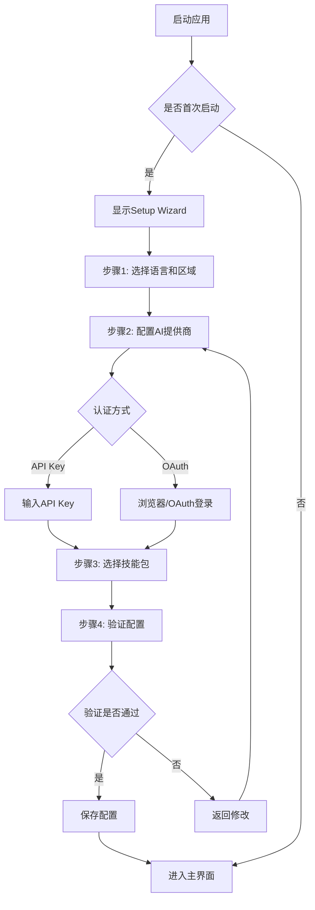

**流程说明:**
| 步骤 | 节点名称 | 处理逻辑 | 异常处理 |
|------|---------|---------|---------|
| 1 | 是否首次启动 | 检查本地配置文件是否存在 | - |
| 2 | 选择语言和区域 | 默认使用系统语言,支持手动切换 | 不支持的语言回退到英文 |
| 3 | 配置AI提供商 | 支持API Key或OAuth两种方式 | API Key格式校验失败提示重新输入 |
| 4 | 选择技能包 | 展示可用技能包列表,支持多选 | 无可用技能包时跳过 |
| 5 | 验证配置 | 调用AI提供商API测试连接 | 连接失败返回步骤2重新配置 |
| 6 | 保存配置 | 将配置写入本地存储 | 写入失败提示用户重试 |

**涉及接口:**
| 接口 | 方法 | 说明 |
|------|------|------|
| config/save | IPC | 保存配置到本地 |
| config/testProvider | IPC | 测试AI提供商连接 |

**涉及数据表:**
| 表名 | 操作 | 说明 |
|------|------|------|
| config.json | 写入 | 存储用户配置 |

### 1.2 AI 聊天交互流程
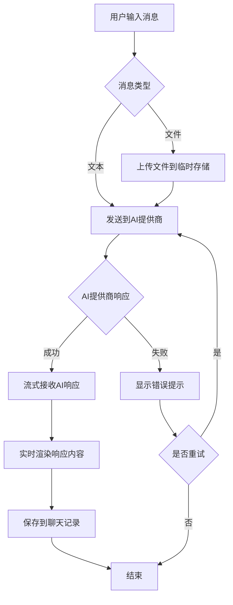

**流程说明:**
| 步骤 | 节点名称 | 处理逻辑 | 异常处理 |
|------|---------|---------|---------|
| 1 | 消息类型判断 | 区分文本消息和文件消息 | - |
| 2 | 发送请求 | 通过IPC发送到主进程,调用AI提供商API | 网络异常提示检查网络 |
| 3 | AI响应 | 支持流式响应,逐步渲染 | 超时或API错误显示错误信息 |
| 4 | 保存记录 | 将对话保存到本地历史记录 | 存储失败不影响展示 |

**涉及接口:**
| 接口 | 方法 | 说明 |
|------|------|------|
| chat/send | IPC | 发送聊天消息 |
| chat/stream | IPC | 流式接收AI响应 |

**涉及数据表:**
| 表名 | 操作 | 说明 |
|------|------|------|
| chat-history.json | 写入 | 保存聊天记录 |

### 1.3 任务(Job)执行流程
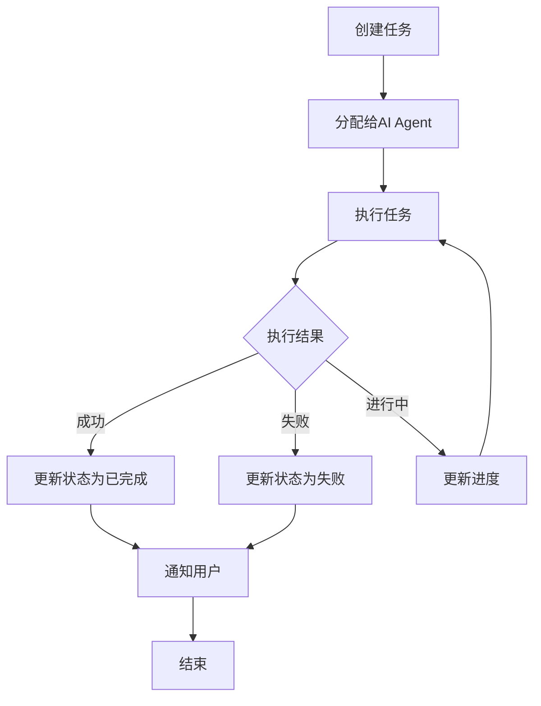

**流程说明:**
| 步骤 | 节点名称 | 处理逻辑 | 异常处理 |
|------|---------|---------|---------|
| 1 | 创建任务 | 用户创建任务,指定任务描述和目标 | 必填项校验 |
| 2 | 分配Agent | 根据任务类型选择合适的AI Agent | 无可用Agent时提示 |
| 3 | 执行任务 | AI Agent执行任务逻辑 | 执行超时自动取消 |
| 4 | 更新状态 | 实时更新任务状态和进度 | 状态更新失败重试 |
| 5 | 通知用户 | 任务完成或失败时通知用户 | 通知失败不影响任务状态 |

### 1.4 技能(Skill)管理流程
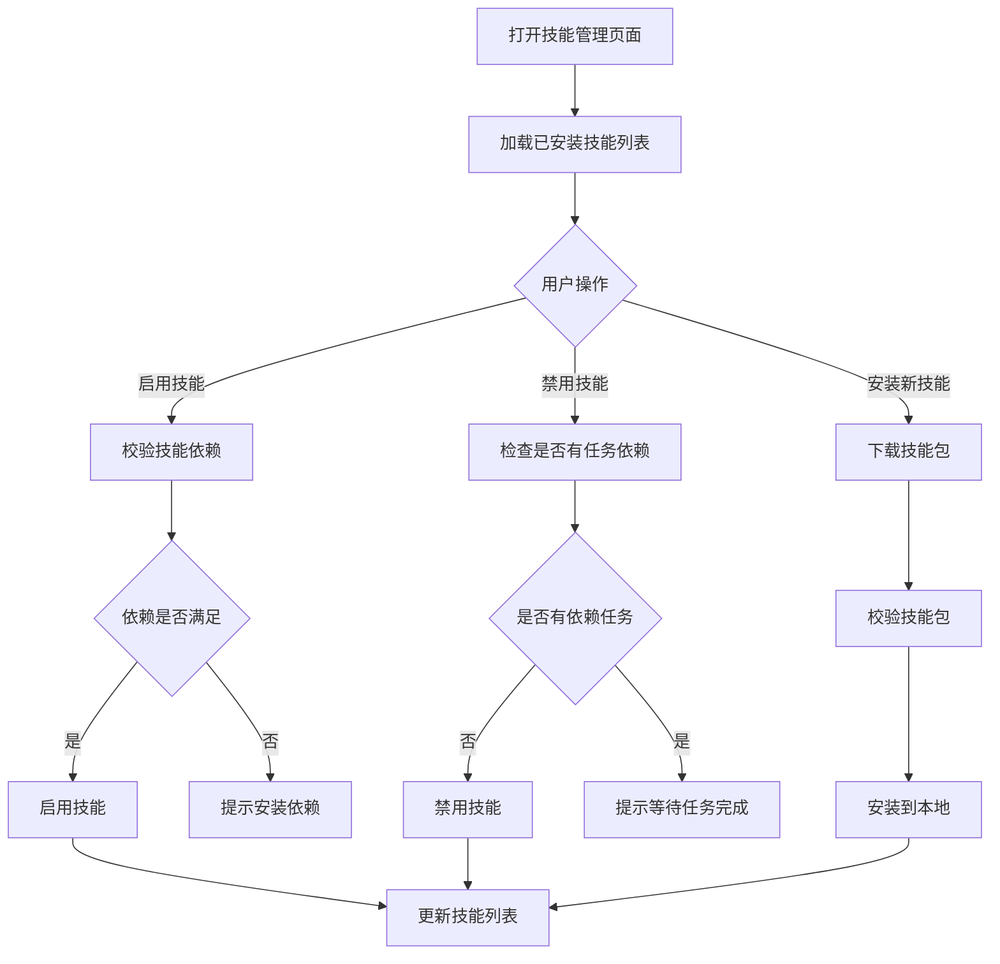

**流程说明:**
| 步骤 | 节点名称 | 处理逻辑 | 异常处理 |
|------|---------|---------|---------|
| 1 | 加载技能列表 | 从本地存储读取已安装技能 | 存储损坏时重建 |
| 2 | 启用技能 | 校验技能依赖是否满足 | 依赖不满足提示安装 |
| 3 | 禁用技能 | 检查是否有运行中的任务依赖该技能 | 有依赖任务时禁止禁用 |
| 4 | 安装技能 | 下载并校验技能包 | 下载失败或校验失败提示重试 |

## 2. 状态流转图

### 2.1 任务(Job)状态流转
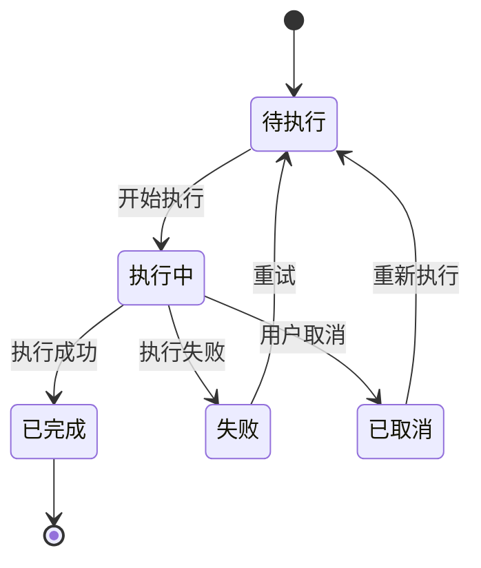

**状态说明:**
| 状态 | 编码 | 说明 | 可流转状态 |
|------|------|------|-----------|
| 待执行 | PENDING | 任务已创建,等待执行 | 执行中 |
| 执行中 | RUNNING | 任务正在执行 | 已完成/失败/已取消 |
| 已完成 | COMPLETED | 任务执行成功 | 终态 |
| 失败 | FAILED | 任务执行失败 | 待执行(重试) |
| 已取消 | CANCELLED | 用户主动取消 | 待执行(重新执行) |

### 2.2 AI 提供商连接状态流转
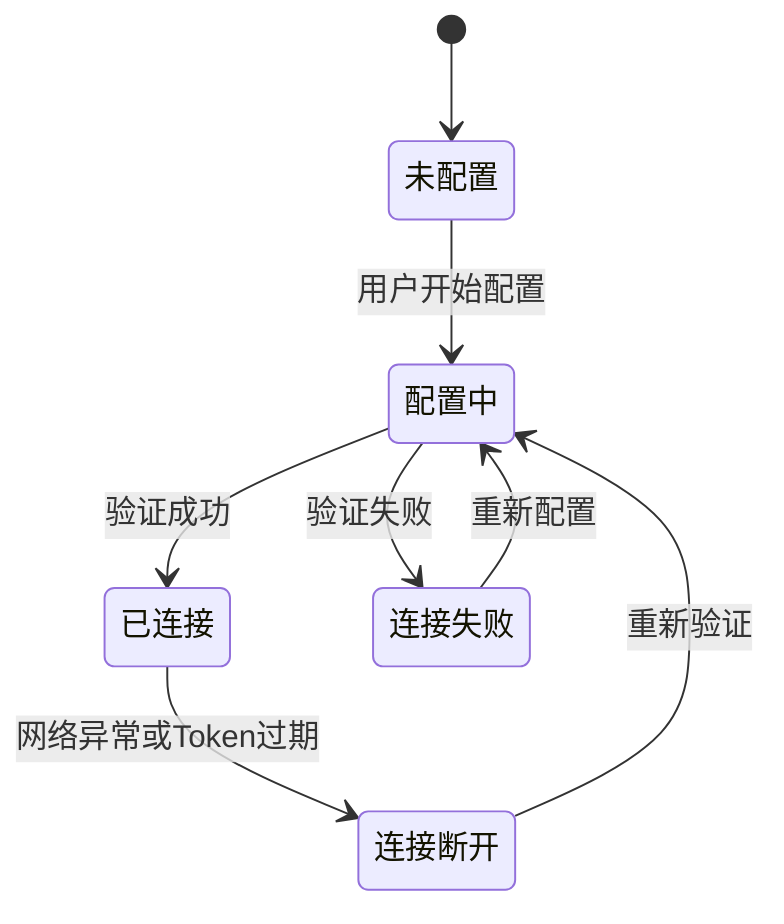

**状态说明:**
| 状态 | 编码 | 说明 | 可流转状态 |
|------|------|------|-----------|
| 未配置 | UNCONFIGURED | 未配置AI提供商 | 配置中 |
| 配置中 | CONFIGURING | 正在配置或验证 | 已连接/连接失败 |
| 已连接 | CONNECTED | 连接正常 | 连接断开 |
| 连接失败 | FAILED | 验证失败 | 配置中 |
| 连接断开 | DISCONNECTED | 网络异常或Token过期 | 配置中 |

## 3. 数据流图

### 3.1 聊天数据流
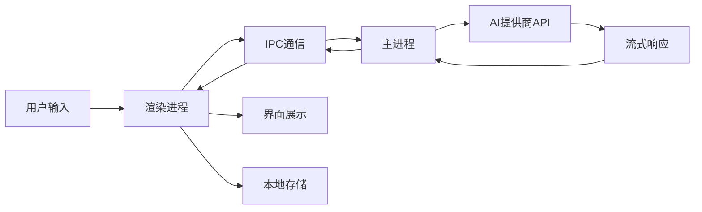

### 3.2 配置数据流
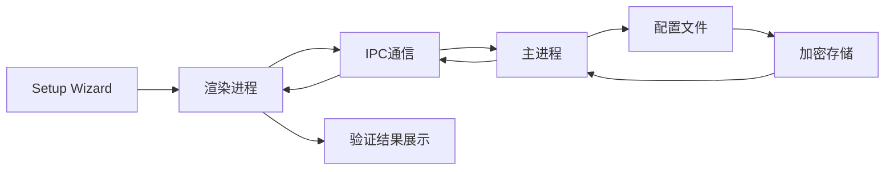

## 4. 时序图

### 4.1 用户登录时序图
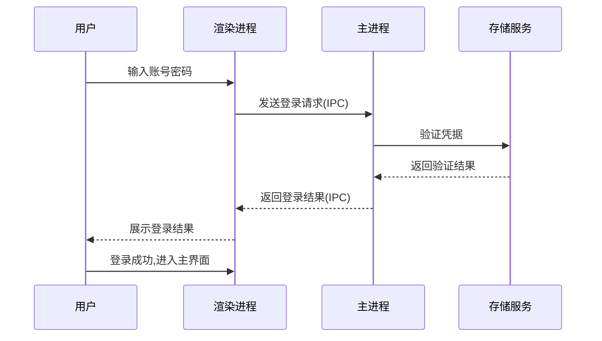

### 4.2 AI 聊天时序图
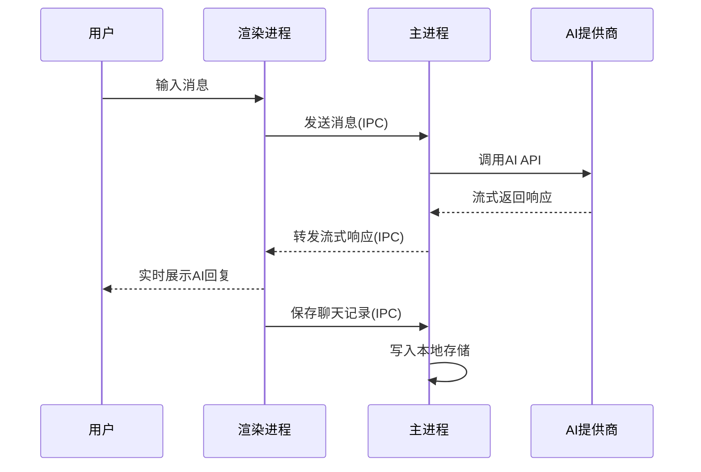

### 4.3 任务执行时序图
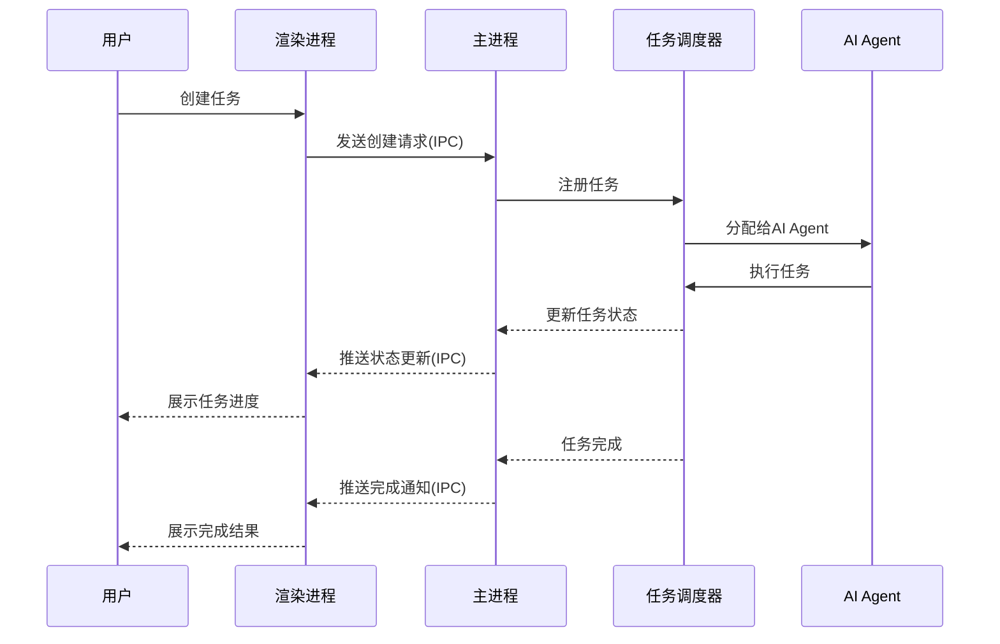
