# 用户电脑设备信息采集系统分析文档

## 0. 文档摘要

| 项目 | 结论 |
| --- | --- |
| 目标 | 采集影响 SClaw 兼容性与配置建议的设备信息，为后续 AgentLoop 分析提供标准设备画像 |
| 范围 | 系统、CPU、内存、磁盘、客户端版本、主显示器、GPU |
| 已有能力 | OS、架构、CPU、内存、磁盘容量、Node 版本已有本地读取能力 |
| 主要缺口 | 磁盘类型、SClaw/Electron 版本归一化、显示信息、GPU/显存、统一数据模型与采集服务 |
| 本期边界 | 仅定义采集与本地快照；AgentLoop 上传、memory-center 入库和后台分析不在本期实现范围 |

## 1. 需求背景

### 1.1 背景与问题

当前设置页通过 `system:summary` 读取部分设备信息，但采集逻辑位于 IPC Handler，数据结构仅服务页面展示，不能直接作为稳定的设备画像用于配置分析。

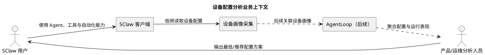

### 1.2 建设目标

1. 建立跨 Windows、macOS、Linux 的统一设备画像模型。
2. 复用现有系统摘要能力，补齐磁盘类型、客户端版本、显示与 GPU 信息。
3. 采集失败必须降级为 `null`，不得影响登录、Agent 启动和主流程。
4. 为后续 AgentLoop 上传预留稳定的 schema 和画像标识。

### 1.3 范围与边界

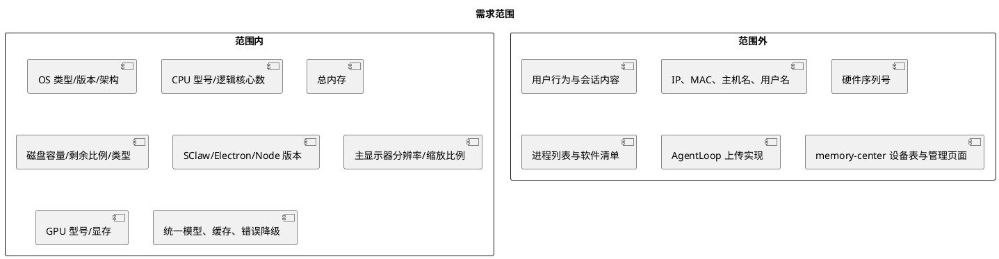

### 1.4 角色与业务场景

| 角色 | 场景 |
| --- | --- |
| SClaw 客户端 | 启动完成后生成设备画像；设置页刷新时重新采集 |
| 用户 | 查看设备概况；采集失败仍可继续使用 |
| AgentLoop（后续） | 接收画像摘要或画像关联标识 |
| 分析人员 | 按设备配置区间分析兼容性并制定最低/推荐配置 |

## 2. 目前系统现状

### 2.1 现有业务流程

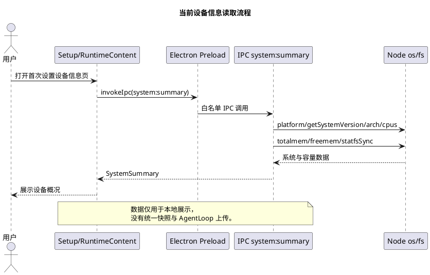

### 2.2 现有系统与模块

| 模块 | 位置 | 现状 |
| --- | --- | --- |
| 设备摘要 IPC | `electron/main/ipc-handlers.ts` | 直接组装 `system:summary` |
| Setup 展示模型 | `src/pages/Setup/index.tsx` | 页面内重复声明 `SystemSummary` |
| IPC 白名单 | `electron/preload/index.ts` | 已开放 `system:summary` |
| PostHog 遥测 | `electron/utils/telemetry.ts` | 条件上传版本、平台、架构、机器 ID；不包含完整设备画像 |
| AgentLoop 初始化 | `electron/main/agentloop-init.ts` | 未显式注入设备画像 |

### 2.3 现有接口与数据

| 分类 | 字段 | 现状 | 数据来源 |
| --- | --- | --- | --- |
| 系统 | OS 类型 | 已采集 | `os.platform()` |
| 系统 | OS 版本 | 已采集但与名称组合 | `process.getSystemVersion()` |
| 系统 | 架构 | 已采集 | `os.arch()` |
| CPU | 型号 | 已采集 | `os.cpus()[0].model` |
| CPU | 逻辑核心数 | 已采集 | `os.cpus().length` |
| 内存 | 总内存 | 已采集 | `os.totalmem()` |
| 磁盘 | 总容量 | 已采集 | `statfsSync(userData)` |
| 磁盘 | 剩余容量 | 已采集 | `statfsSync(userData)` |
| 磁盘 | 剩余比例 | 可计算，未作为字段输出 | `available / total` |
| 磁盘 | 类型 | 未采集 | 无 |
| 客户端 | SClaw 版本 | 可获取，未进入摘要 | `app.getVersion()` |
| 客户端 | Electron 版本 | 可获取，未进入摘要 | `process.versions.electron` |
| 客户端 | Node 版本 | 已采集 | `process.versions.node` |
| 显示 | 分辨率 | 未采集 | 无 |
| 显示 | 缩放比例 | 未采集 | 无 |
| GPU | 型号 | 未采集 | 无 |
| GPU | 显存 | 未采集 | 无 |

### 2.4 当前问题与约束

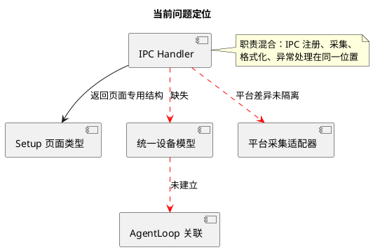

约束：

- `screen`、`app.getGPUInfo()` 需要 Electron Ready 后调用。
- 磁盘类型和显存不是 Node 标准 API，必须按平台尽力读取。
- SClaw 当前禁用 GPU 硬件加速；GPU 信息只用于配置分析，不改变渲染策略。
- 不得要求管理员权限，不得因外部命令缺失阻断启动。

## 3. 改动方案

### 3.1 方案概述

将采集能力从 IPC Handler 抽离为独立的设备画像领域模块，采用“唯一数据契约 + 唯一服务入口 + 独立采集器 + 上传适配器”的结构。

核心约束：

1. `DeviceProfileService` 是唯一采集入口。
2. `DeviceProfileV1` 是唯一数据契约。
3. 页面、IPC、AgentLoop Adapter 不得直接调用系统设备 API。
4. Collector 只读取原始信息，不包含页面或上传逻辑。
5. 上传字段必须经过独立 Adapter 和显式白名单转换。

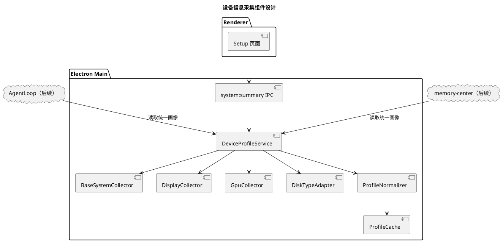

建议目录：

```text
shared/device-profile/
├── types.ts                  # DeviceProfileV1 唯一数据契约
├── schema.ts                 # schema 版本、枚举、校验和默认值
└── agentloop-fields.ts       # AgentLoop 属性名称与上传白名单

electron/services/device-profile/
├── device-profile-service.ts # 唯一对外采集入口
├── normalizer.ts             # 单位、枚举与空值归一化
├── cache.ts                  # 缓存、过期与强制刷新
└── collectors/
    ├── system.ts             # OS、CPU、内存
    ├── disk.ts               # 磁盘容量与剩余比例
    ├── disk-type.ts          # 跨平台磁盘类型
    ├── client.ts             # SClaw、Electron、Node 版本
    ├── display.ts            # 主显示器与缩放比例
    └── gpu.ts                # GPU 型号与显存

electron/integrations/device-profile/
├── setup-adapter.ts          # Setup 展示模型转换
├── agentloop-adapter.ts      # AgentLoop Resource/Event 转换
└── memory-center-adapter.ts  # 后续需要持久化时增加
```

### 3.2 改造后业务流程

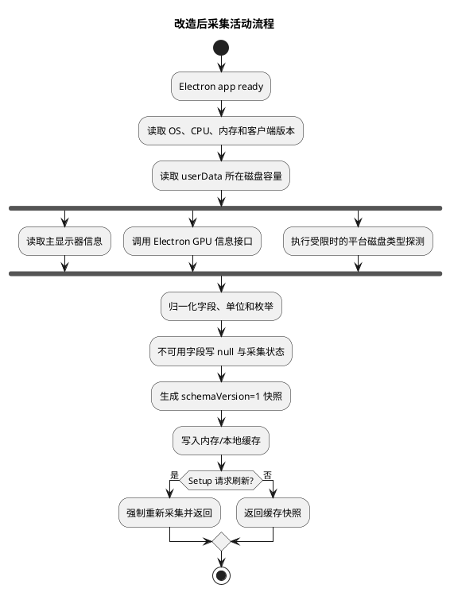

### 3.3 系统与模块改动

| 模块 | 类型 | 职责 |
| --- | --- | --- |
| `DeviceProfileService` | 新增 | 编排采集、并发、超时、缓存与统一返回 |
| `BaseSystemCollector` | 新增 | OS、CPU、内存、客户端版本、磁盘容量 |
| `DisplayCollector` | 新增 | 主显示器逻辑/物理分辨率与缩放比例 |
| `GpuCollector` | 新增 | Electron GPU 信息与平台补充信息 |
| `DiskTypeAdapter` | 新增 | Windows/macOS/Linux 磁盘类型探测 |
| `system:summary` | 修改 | 只调用服务并映射兼容响应 |
| Setup `SystemSummary` | 修改 | 改为复用共享类型 |
| AgentLoop Bootstrap | 预留 | 后续读取已归一化的稳定字段，不在本期上传 |

统一服务接口：

```typescript
interface DeviceProfileService {
  getProfile(options?: { forceRefresh?: boolean }): Promise<DeviceProfileV1>;
  getCachedProfile(): DeviceProfileV1 | null;
  invalidate(reason: string): void;
}
```

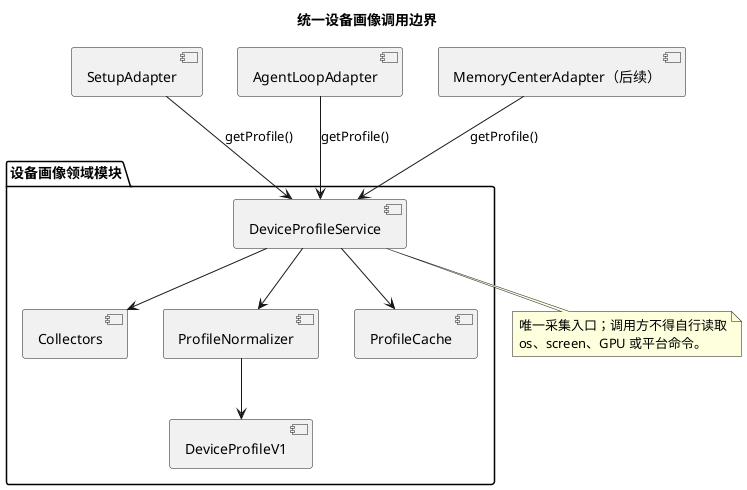

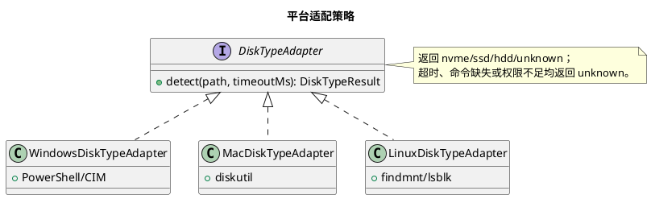

### 3.4 接口改动

#### 3.4.1 本地 IPC

保留现有接口，扩展返回值；新增字段必须可选，以兼容旧 Renderer。

```text
system:summary(forceRefresh?: boolean) -> DeviceProfileV1
```

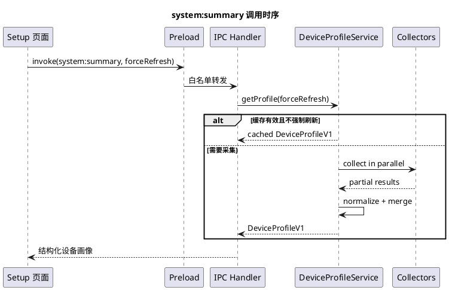

#### 3.4.2 memory-center 与 AgentLoop

本期不调用 memory-center。当前 memory-center 无专用设备画像接口；已有更新事件和 Agent 遥测接口不应复用为设备清单接口。

完整本地画像不得直接整体上传。AgentLoop Adapter 必须使用显式字段白名单，将本地精确值转换为适合分析的属性或分桶值。

```typescript
function toAgentLoopAttributes(
  profile: DeviceProfileV1,
): Record<string, string | number | boolean>;
```

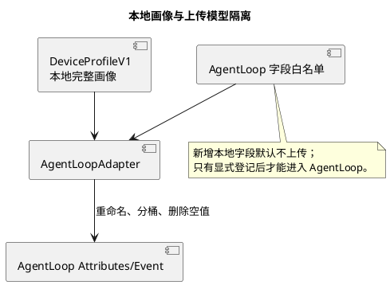

后续 AgentLoop 接入建议只传稳定、低基数字段或分桶值：

```text
client.os.type
client.os.version
client.arch
client.cpu.logical_cores
client.memory.total_bytes
client.disk.type
client.display.scale_factor
client.gpu.model
client.app.version
client.device_profile.schema_version
```

#### 3.4.3 AgentLoop 两阶段适配

AgentLoop 探针必须早于 Claude SDK 初始化，而显示器、GPU 等字段只能在 Electron Ready 后稳定读取，因此设备画像分两阶段采集。

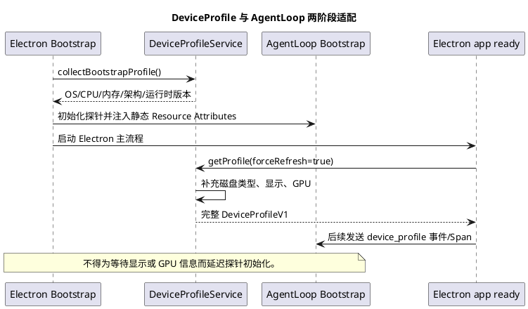

| 阶段 | 字段 | AgentLoop 方式 |
| --- | --- | --- |
| Bootstrap | OS、架构、CPU、总内存、Node/Electron 版本 | `OTEL_RESOURCE_ATTRIBUTES` 或 `ARMS_HOST_TAGS` |
| app ready | 磁盘类型、显示、GPU、完整画像状态 | 单次 `device_profile` 事件或自定义 Span |

> 待确认：当前 CMS SDK 自定义事件/Tracer 的最终调用方式；若 SDK 只支持 Resource Attributes，则完整画像需通过独立 Span 或后续 memory-center 接口承载。

### 3.5 数据模型与数据处理

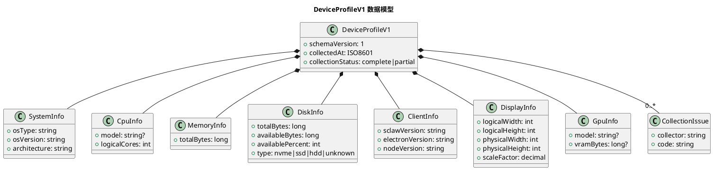

字段口径：

| 字段 | 口径 |
| --- | --- |
| `osType` | `windows`、`macos`、`linux`、`unknown` |
| `osVersion` | 原始系统版本号，不与系统名称拼接 |
| `architecture` | `x64`、`arm64` 或 Node 返回的其他值 |
| `memory.totalBytes` | 物理内存总字节数 |
| `disk.*` | `app.getPath('userData')` 所在文件系统/卷 |
| `availablePercent` | `round(availableBytes / totalBytes * 100)`，限定 0～100 |
| `display.logical*` | Electron DIP 尺寸 |
| `display.physical*` | `logical * scaleFactor` 四舍五入 |
| `gpu.model` | 优先活动 GPU；无法判断时取首个有效设备 |
| `gpu.vramBytes` | 仅在可靠来源可用时填写，否则 `null` |

新增字段扩展流程：

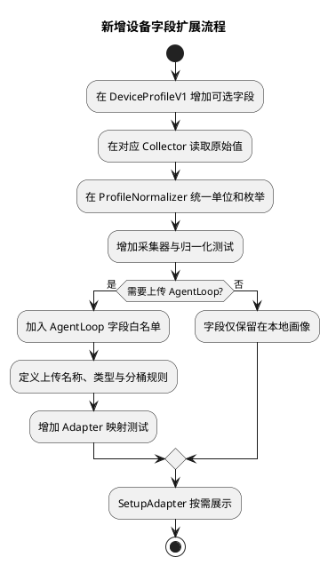

调用方不得因新增字段而复制或修改采集实现；上传端不得绕过白名单读取原始 Collector 结果。

### 3.6 异常、幂等与一致性

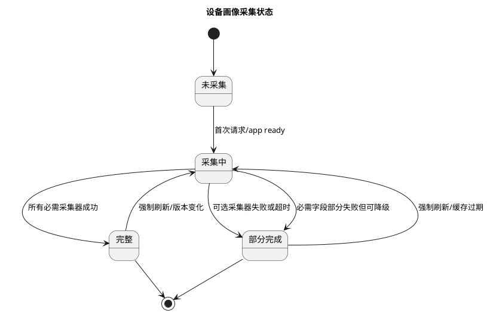

| 场景 | 处理 |
| --- | --- |
| 并发多次请求 | 复用同一个进行中的采集 Promise |
| 磁盘类型命令超时 | 终止子进程，返回 `unknown` |
| GPU 信息异常 | `gpu.model/vramBytes=null`，记录固定错误码 |
| 显示器暂不可用 | 返回 `display=null`，不阻断摘要 |
| 缓存损坏 | 丢弃缓存并重新采集 |
| 字段不支持 | 返回 `null/unknown`，不得猜测 |

建议超时：单个平台外部命令 2 秒；整体采集 5 秒。

### 3.7 权限、安全与审计

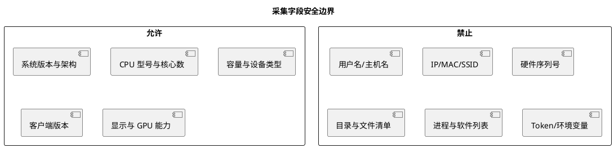

- 所有命令必须使用固定参数，不拼接用户输入。
- 不请求管理员权限。
- 日志仅记录采集器名称、耗时与固定错误码，不记录完整命令输出。
- 后续上传前必须增加显式开关、隐私说明和字段白名单。

### 3.8 兼容、迁移与回滚

| 项目 | 方案 |
| --- | --- |
| IPC 兼容 | 保留 `system:summary` 名称；新增字段可选 |
| 页面兼容 | 未知字段显示“暂不可用” |
| 平台兼容 | 每个平台独立适配，公共采集不依赖外部命令 |
| 缓存迁移 | 使用 `schemaVersion`；版本不匹配直接重采 |
| 回滚 | IPC 可退回旧摘要实现；新增字段不影响旧页面 |
| AgentLoop | 本期不启用上传，无远端回滚事项 |

### 3.9 影响范围

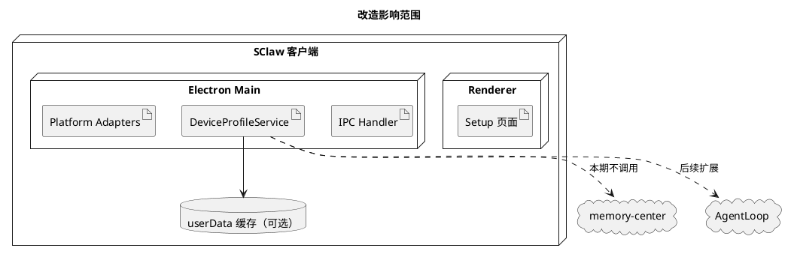

### 3.10 风险与待确认事项

| 风险/事项 | 处理建议 |
| --- | --- |
| GPU 显存跨平台获取不稳定 | 字段允许 `null`；不得用不可靠值填充 |
| 外部命令拖慢启动 | 延迟到 `app ready` 后并发执行，设置超时并缓存 |
| 磁盘卷到物理盘映射复杂 | 首期允许 `unknown`；只判断 userData 所在卷 |
| 多 GPU 选择口径 | 默认活动 GPU；无法识别时记录设备数组中的首个有效项 |
| 多显示器范围 | 首期只采集主显示器 |
| 快照有效期 | 建议客户端版本变化或 30 天后重采，最终口径待确认 |
| AgentLoop 属性原值还是分桶 | 建议本地保留原值、上传使用分桶；待后续上传方案确认 |
| Bootstrap 与完整画像字段不同步 | 使用相同 `schemaVersion` 和归一化函数；完整画像事件覆盖后续分析维度 |
| 多上传目标字段口径漂移 | 每个目标使用独立 Adapter；不得在 Collector 内写目标平台字段名 |

## 4. 验收口径

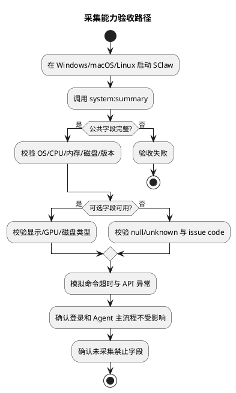

验收要求：

1. 三个平台均返回合法 `DeviceProfileV1`，必需字段格式一致。
2. 显示、GPU、磁盘类型任一失败时仍返回部分画像。
3. 相同时间窗口内并发请求只触发一次实际采集。
4. 输出不包含用户名、主机名、IP、MAC、序列号、路径和凭证。
5. 本期不产生 memory-center 或 AgentLoop 网络请求。
