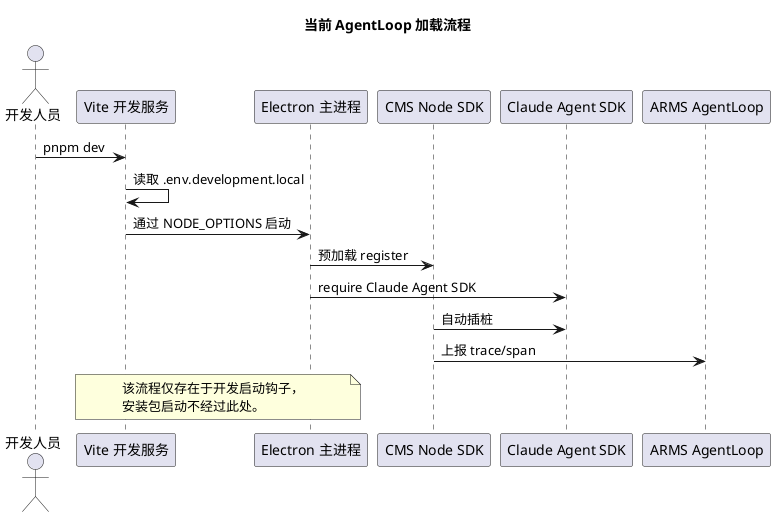
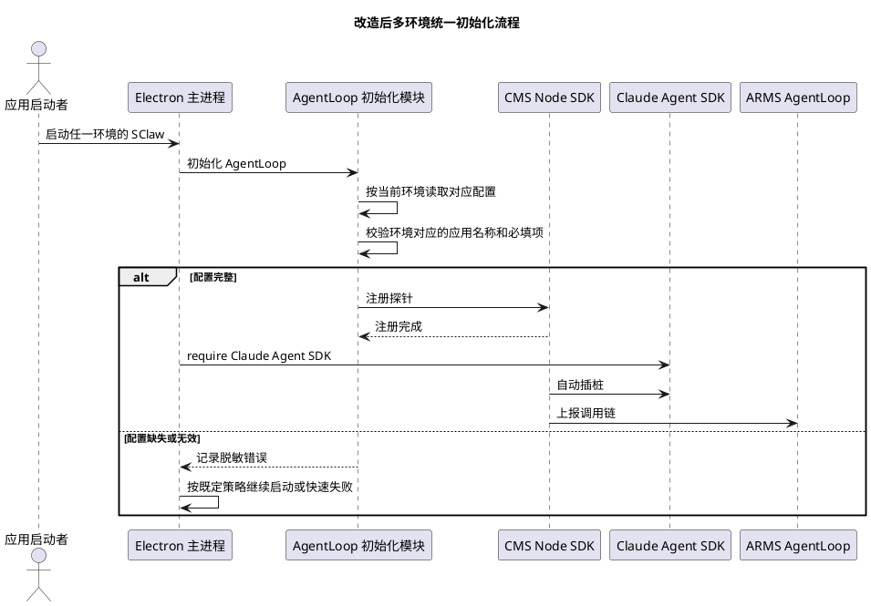

# AgentLoop 多环境统一接入系统分析文档

> 图示语法基线：PlantUML 2023.10。

## 1. 需求背景

### 1.1 背景与问题

SClaw 已接入 ARMS AgentLoop 探针，但当前配置仅放在本地 `.env.development.local`，并通过 Vite 开发启动钩子注入 Electron 主进程。因此本地开发可以加载探针，测试、预发和生产安装包没有等效的初始化链路。

### 1.2 建设目标

- development、test、staging、production 均加载同一套 AgentLoop 能力。
- 各环境使用不同的 AgentLoop 应用名称，名称与对应环境配置文件保持一致。
- 保证探针先于 Claude Agent SDK 注册，使 `claude_agent` 自动插桩持续有效。
- 本地调试配置与生产运行配置分离，避免生产输出调试日志。

### 1.3 范围与边界

本次范围为 Electron 主进程中的 AgentLoop 初始化和配置加载。继续复用现有 `@loongsuite/cms_node_sdk` 与 Claude Agent SDK `require()` 加载方式。

OpenClaw Gateway 为独立运行进程，不在本次统一范围内；如需采集 OpenClaw Agent 调用链，应另行分析其探针兼容性和进程注入方案。

### 1.4 角色与业务场景

- 开发人员：本地启动 SClaw，并在 AgentLoop 查看调试调用链。
- 测试和运维人员：按 development、test、staging、production 应用名称分别查看调用链。
- 安全与合规人员：确认 License 的交付方式以及会话内容上报策略。

## 2. 目前系统现状

### 2.1 现有业务流程

### 2.2 现有系统与模块

| 模块 | 当前职责 |
| --- | --- |
| `.env.development.local` | 保存本地 AgentLoop License、应用名、Region、Workspace 和调试开关 |
| `vite.config.ts` | 开发启动时合并环境变量，并向 Electron 主进程注入探针 |
| `claude-agent-sdk-loader.ts` | 通过 `require()` 加载 Claude Agent SDK，允许探针完成自动插桩 |
| `@loongsuite/cms_node_sdk` | 初始化采集器并向 ARMS AgentLoop 上报数据 |

### 2.3 现有接口与数据

本需求不新增业务接口或数据库。探针通过环境变量读取配置，并向 ARMS AgentLoop 上报 trace、span 及可选的会话事件。

### 2.4 当前问题与约束

- 探针初始化依赖 Vite 的 `onstart`，仅覆盖本地开发启动。
- `.env.test`、`.env.staging`、`.env.production` 当前没有 AgentLoop 配置，且这些文件不会作为运行时配置随安装包加载。
- 打包后的 Electron 不适合继续依赖 `NODE_OPTIONS --require`。
- 当前仅 development 本地配置了应用名称，其他环境尚未建立与配置文件对应的 AgentLoop 应用命名。
- 会话内容上报涉及用户输入和工具数据，不能直接沿用本地调试策略。

## 3. 改动方案

### 3.1 方案概述

新增统一的 AgentLoop 初始化入口，由 Electron 主进程在加载 Claude Agent SDK 前调用。该入口负责取得配置、校验必填项并注册 `@loongsuite/cms_node_sdk/register`，不再把核心初始化能力绑定在 Vite 开发启动钩子上。

各环境分别在对应配置中设置 `ARMS_APP_NAME`。建议以当前本地名称 `sto-claw` 为基础，按配置文件环境名追加后缀：

| 环境配置 | 建议 AgentLoop 应用名称 |
| --- | --- |
| `.env.development` | `sto-claw-development` |
| `.env.development.local` | 覆盖 development 配置，仍使用 `sto-claw-development` |
| `.env.test` | `sto-claw-test` |
| `.env.staging` | `sto-claw-staging` |
| `.env.production` | `sto-claw-production` |

`.env.development.local` 是 development 的本地覆盖文件，不作为独立环境。License、Region 和 Workspace 是否共用，可根据 AgentLoop 侧资源规划配置，不影响按环境区分应用名称。

### 3.2 改造后业务流程

### 3.3 系统与模块改动

| 类型 | 模块 | 改动说明 |
| --- | --- | --- |
| 新增 | AgentLoop 初始化模块 | 统一完成配置校验、探针注册、日志和重复初始化保护 |
| 修改 | Electron 主进程入口 | 在任何 Claude Agent SDK 加载前调用初始化模块 |
| 修改 | Vite 配置 | 仅负责向主进程提供构建期配置；不再作为唯一探针启动入口 |
| 保持 | Claude SDK Loader | 继续使用 `require()`，保证自动插桩兼容性 |

### 3.4 接口改动

不涉及外部业务接口。初始化模块内部应提供单一初始化方法，并保证重复调用不会重复注册探针。

### 3.5 数据模型与数据处理

不新增业务表和本地持久化数据。建议将配置分为两组：

- 环境接入配置：各环境独立的应用名称，以及对应的 License、Region、Workspace。
- 环境运行策略：Console exporter、日志级别、会话内容上报开关。

### 3.9 影响范围

主要影响 Electron 主进程启动、Vite 环境配置、构建流水线和安装包依赖。渲染进程、业务数据库、现有业务接口及 OpenClaw Gateway 不直接改动。

