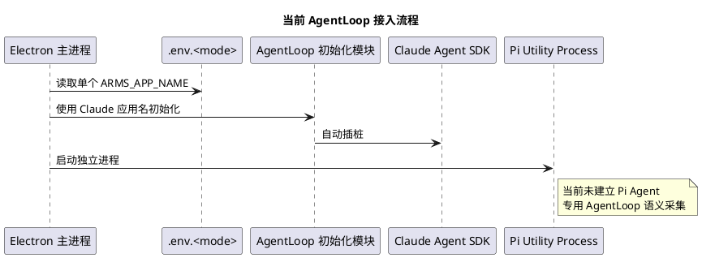
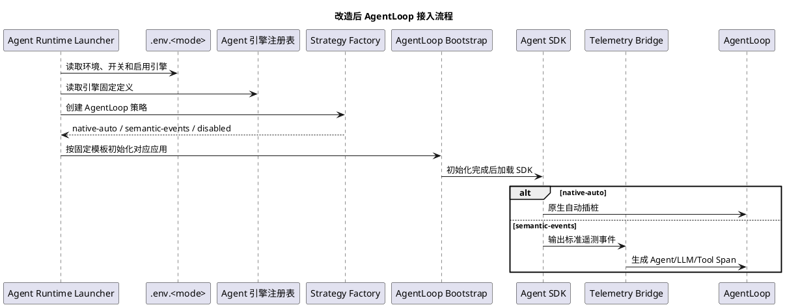

# AgentLoop 多 Agent 引擎接入系统分析文档

> 图示语法基线：PlantUML 2023.10。

## 1. 需求背景

### 1.1 背景与问题

SClaw 已完成 Claude Agent SDK 的 AgentLoop 接入，但配置和初始化仍与 Claude 强绑定；新增 Pi Agent 或其他 Agent 时需要重复开发接入逻辑。

### 1.2 建设目标

由 `.env.development`、`.env.test`、`.env.staging`、`.env.production` 控制环境、开关与灰度，通过 Agent 注册表统一生成应用名并选择插桩策略。

### 1.3 范围与边界

范围包含五个 `.env` 模板、Electron 主进程、Agent Utility Process、AgentLoop 配置和遥测事件；不包含渲染进程与 OpenClaw Gateway。

### 1.4 角色与业务场景

开发人员新增 Agent 引擎时，只需声明运行进程和 AgentLoop 策略，并完成该引擎原本所需的标准事件适配。

## 2. 目前系统现状

### 2.1 现有业务流程



### 2.2 现有系统与模块

Claude 在 Electron 主进程运行；Pi 在独立 Utility Process 运行，并通过 `NormalizedEngineEvent` 向主进程发送运行事件。

### 2.3 现有接口与数据

现有四个运行环境文件使用单个 `ARMS_APP_NAME`，`.env.example` 提供占位说明，License 构建后写入 `agentloop.config.json`；本需求不涉及数据库数据。

### 2.4 当前问题与约束

- AgentLoop 应用名存在 Claude 专用硬编码。
- `.env` 中 `Dev/Test/Online` 与代码固定的 `dev/test/online` 大小写不一致，当前配置不是唯一事实来源。
- 主进程探针不能自动覆盖 Pi 子进程。
- 当前 CMS SDK 没有 Pi Agent 原生插桩。
- AgentLoop 的服务名称属于进程级配置，不宜在同一进程内按 Agent 动态切换。

## 3. 改动方案

### 3.1 方案概述

采用“模板流程 + 策略 + 注册表/工厂 + 适配器”：`.env` 控制环境策略，注册表声明 Agent 固定能力，Bootstrap 统一初始化生命周期。

### 3.2 改造后业务流程



### 3.3 系统与模块改动

- `AgentLoopConfigResolver`：读取五个 `.env` 文件并校验配置。
- `AgentEngineRegistry`：保存引擎、运行进程、框架名和默认采集策略。
- `AgentLoopStrategyFactory`：创建自动插桩、标准事件或关闭策略。
- `AgentLoopBootstrap`：按模板执行配置、初始化、SDK 加载和关闭刷新。
- `AgentTelemetryBridge`：把标准 Agent 事件转换为 AgentLoop Span。
- Pi Worker：在加载 Pi SDK 前执行通用 Bootstrap。

环境配置建议如下：

```env
VITE_APP_ENV=development
AGENTLOOP_ENABLED=true
AGENTLOOP_ENABLED_ENGINES=claude,pi
AGENTLOOP_APP_NAME_TEMPLATE=SClaw-{framework}-{environment}
AGENTLOOP_CAPTURE_CONTENT=false
ARMS_LICENSE_KEY=***
ARMS_REGION_ID=cn-shanghai
ARMS_WORKSPACE=***
```

注册表提供 `Claude_Agent_SDK`、`Pi_Agent_SDK` 和默认策略；应用名统一生成为 `SClaw-{framework}-{dev|test|online}`。
`.env.example` 仅保留无效占位符，不保存真实 License。

### 3.4 接口改动

不新增外部接口；内部新增 `AgentLoopEngineConfig` 和 `AgentTelemetryEvent`，后者至少包含引擎、会话、模型、工具、Token 和异常信息。

### 3.5 数据模型与数据处理

不新增数据库表；配置随构建产物发布，遥测数据直接发送至 AgentLoop。

### 3.6 异常、幂等与一致性

配置非法时降级为 `disabled` 并记录脱敏告警；同一进程只初始化一次，退出前统一执行 flush 和 shutdown。

### 3.7 权限、安全与审计

License 继续按最小写入权限管理；Prompt、工具输入和输出默认不采集，启用内容采集时需显式配置。

### 3.8 兼容、迁移与回滚

先保留 Claude `native-auto`，再接入 Pi `semantic-events`；可通过 `AGENTLOOP_ENABLED_ENGINES` 灰度或回滚，不影响 Agent 主流程。

### 3.9 影响范围

影响五个 `.env` 文件、Agent 注册、Electron 主进程启动、Pi Worker、构建配置和 AgentLoop 测试；不影响业务数据库。

### 3.10 风险与待确认事项

- 避免同一调用同时产生自动 Span 和手工 Span。
- Pi 进程退出前必须完成遥测刷新。
- 新 Agent SDK 仍需完成一次事件语义适配。
- 运行进程和默认插桩策略属于结构能力，不允许由 `.env` 任意修改，只允许控制启用范围和安全策略。

> 待确认：AgentLoop 是否要求每种 Agent 框架使用独立应用；本文按独立应用设计。

> 待确认：各环境是否允许采集 Prompt、响应及工具内容。
